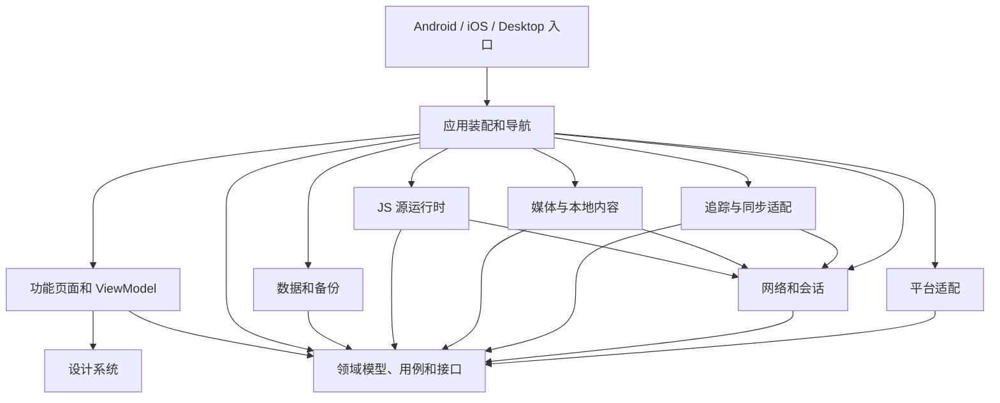

# 项目架构与目录

2026-11-15 · [技术栈选型](technology-stack.md)

这是独立的跨平台漫画阅读器项目，验收按[验收基线](verification.md)执行。当前优先梳理业务、视图与数据边界。小说应用接入安排在漫画主流程稳定之后。Komikku `290267d` 提供功能与交互参考。JS 源完整兼容 Venera-Next `c0c4597` 的协议与生命周期，已有脚本和源仓库应能原样导入。书架、账号、内部数据和备份格式从新项目开始，作品换源和批量迁移在新客户端内实现。 [Komikku 功能说明](https://github.com/komikku-app/komikku/blob/290267dd4c99f5b46812240fb0e4bc6b3ee8c562/README.md#features) · [Venera-Next 数据源文档](https://github.com/CyrilPeng/Venera-Next/blob/c0c45979d453c2a8740c45f08e95997c90717629/doc/api/comic_source.zh.md)

## 目录结构

以工作区根目录作为新项目根。`apps/` 放端入口，`shared/` 放 KMP 和 CMP 模块，`extension-sdk/` 放发布给源作者的契约与示例。参考仓库独立保存在 `reference/`，Gradle 构建只包含新项目的模块。

初始化已接通三个应用入口，以及 `shared/app`、`shared/design-system`、`shared/domain`、`shared/data`、`shared/network`、`shared/source-runtime`。`shared/features` 已接书架与漫画阅读器页面（`library/`、`reader/comic/`），其余页面后续实现。`shared/media` 独立构建、暂未接入 Gradle（见下文）。下方目录树包含后续开发的模块，标注为规划中。

```text
.
├── apps/
│   ├── android/                 # Android application、Activity、入口和分发配置
│   ├── ios/                     # Xcode 工程、iOS 入口和系统生命周期接线
│   └── desktop/                 # JVM 入口、窗口、桌面打包配置
├── shared/
│   │   ├── app/                     # 已接入：App()、导航、装配、启动与任务接线
│   │   ├── design-system/           # 已接入：Material 3 主题、组件、字体、图标和字符串
│   │   ├── features/                # 部分接入：共享页面、事件、预览与 UI 测试
│   │   │   └── src/commonMain/kotlin/…/   # library 与 reader/comic 已接入，其余页面后续再迁
│   │   │       ├── library/         # 已接入：书架屏、会话、仓储接口、列表/弹层组件
│   │   │       ├── updates/         # 规划：已更新、待更新、更新错误和任务状态
│   │   │       ├── history/         # 规划：阅读历史与继续阅读
│   │   │       ├── browse/          # 规划：源、扩展、Feed、全局搜索、保存搜索
│   │   │       ├── details/         # 规划：作品详情、目录、相关推荐、换源与合并入口
│   │   │       ├── reader/          # comic/ 已接入（Viewer、Chrome 菜单与设置、五种阅读模式）；novel/ 规划中
│   │   │       ├── downloads/       # 规划：下载队列、离线查看与失败恢复交互
│   │   │       └── settings/        # 规划：更多、追踪、备份、同步与偏好
│   │   ├── domain/                  # 已接入：作品、章节、源能力、用例和仓储/平台接口
│   │   ├── data/                    # 已接入：SQLDelight、设置、仓储、备份编解码
│   │   │   └── src/commonMain/sqldelight/…/  # schema 目录与包名逐段对应（见下文）
│   │   ├── network/                 # 已接入：Ktor、HTTP 策略、按源会话、限流
│   │   ├── source-runtime/          # 已接入：Venera 入口、JS 宿主桥接、源仓库、安装与更新
│   │   ├── media/                   # 独立构建：本地小说解析与阅读位置，暂未接入 settings
│   │   ├── integrations/            # 规划：追踪服务、WebDAV 等外部服务适配
│   │   └── platform/                # 规划：文件授权、密钥、调度、通知、网页登录适配
│   ├── extension-sdk/               # 规划：发布给源作者的契约与示例
├── gradle/libs.versions.toml
├── build.gradle.kts
├── settings.gradle.kts
├── docs/
│   ├── architecture.md
│   └── technology-stack.md
└── reference/                   # 本地参照资料
```

共享模块采用 `commonMain` / `commonTest`，用 `androidMain`、`iosMain`、`jvmMain` 接平台实现，桌面系统差异收在 `jvmMain` 的小型适配器里。只有需要平台 API 或原生依赖的模块增加对应源集。初期以功能包组织页面，随着编译或团队边界出现再拆 Gradle 模块。 [KMP 项目结构](https://kotlinlang.org/docs/multiplatform/multiplatform-discover-project.html) · [源集层级](https://kotlinlang.org/docs/multiplatform/multiplatform-hierarchy.html) · [应用平台入口](https://kotlinlang.org/docs/multiplatform/compose-multiplatform-entry-points.html)

## 包名与短目录约定

学 Animeko 的做法：包名写全反向域名，目录只保留功能后缀。

- Kotlin 源码从各 source set 的 `kotlin/` 根目录开始，按功能增加必要子目录，不再逐段重复包名前缀。例如 `shared/app` 的 `commonMain/kotlin/browse/` 对应包 `app.koyura.app.browse`，根目录的 `App.kt` 对应包 `app.koyura.app`。本项目当前基线是 `app.koyura`，与应用安装标识同源。
- 每个 source set 的 `kotlin/` 根目录放一个只声明基包的 `package.kt`（如 `package app.koyura.app`），锚定该源集的包前缀。
- **标识符与文件名按功能命名，不携带产品名**（Komikku、Koyura 等）；`app.koyura` 基包与安装标识是产品身份、不受此限；注释与文档引用来源名不受限。对齐参考实现的组件用功能名（`ListGroupHeader`、`BrowseRow`），不加来源前缀。
- **例外是 SQLDelight**：`.sq` / `.sqm` 文件必须放在与包名逐段对应的目录里，生成器按相对路径推导查询包。例如 `shared/data` 的 schema 在 `src/commonMain/sqldelight/app/koyura/data/extension/`，`packageName` 为 `app.koyura.data.extension`。
- **Compose Resources** 按模块各自维护：`src/commonMain/composeResources/values/`（默认）与 `values-b+zh+CN/`（中文），各模块的 `packageOfResClass` 指向自己的 resources 包（如 `app.koyura.app.resources`）。阅读器字符串随阅读器迁入 `:shared:features`，共用文案继续由其现有归属模块维护。
- **安装标识与模块包名是两回事**：Android `applicationId`、iOS `PRODUCT_BUNDLE_IDENTIFIER`、macOS `bundleID` 统一为 `app.koyura`；iOS framework（`ReaderShared`）的 bundleId 为 `app.koyura.app`，与应用标识区分。Kotlin 包名、Gradle `namespace` 与安装标识保持同源，但互不强制相等。

## 依赖和职责



- `domain` 定义跨平台的作品、章节、资源、任务与进度模型，以及应用用例和所需的仓储与能力接口。公开接口用 Kotlin 值类型、`suspend`、`Flow` 表达。
- `features` 依赖 `domain` 和 `design-system`。页面按不可变状态渲染。书架的状态由 ViewModel 持有，下载、更新和阅读器使用 MVIKotlin Store，其他页面逐步迁移。导航由 `app` 持有，包括 Tab 根栈、共享子页栈与独立阅读器栈。路由键使用可序列化的 ID 和必要参数。
- `data` 实现持久化接口。`source-runtime`、`media`、`integrations` 和 `platform` 分别实现对应领域接口。`network` 向适配器提供 Ktor 之上的请求与会话能力。具体实现由 `app` 装配，后台工作入口也调用同一组用例。
- 持久偏好进入设置仓储，页面进程恢复只保存导航和轻量界面状态。书架、章节、下载和进度以 SQLite 提交后的状态驱动 UI。HTTP DTO、数据库行和 JS 值在边界处转换。

## 漫画、小说与离线数据

本节是长期数据模型设计。当前应用工作聚焦漫画主流程。

`Work` 具有 `COMIC` 或 `NOVEL` 类型，两者共享元数据、目录、收藏、分类、历史、更新和下载任务。远程作品以 `(sourceId, kind, remoteWorkId)` 去重，章节以作品 ID 和源章节 ID 去重。JS 源以 Venera 的稳定 `key` 标识，仓库地址可变化。作品和章节在 SQLite 中使用本项目的内部 ID，发起源请求时使用源自己的定位值。

| 边界 | 漫画 | 小说 |
| --- | --- | --- |
| 源交付内容 | 有序图片描述符或需再次解析的资源键 | 结构化正文或待清洗的 HTML，以及可选图片引用 |
| 阅读器 | 横向左右翻页、双页、纵向与条漫模式，共享漫画工具栏和阅读设置 | Compose 文字排版，字体、字号、行距、主题、目录和翻页/滚动模式 |
| 持久进度 | 稳定页键，辅以页索引恢复 | 章节、内容版本、段落锚点和 Unicode 字符偏移，正文变化时按可定位的邻近段落恢复 |
| 本地内容 | 图像目录、漫画归档，以及图片型 EPUB | TXT 和无 DRM 的 EPUB，解析目录顺序与正文 |

章节读取优先使用可用的本地内容包，缺失时在联网状态下从源加载。下载与缓存分别管理，下载队列带持久任务 ID，暂停、重试和重启恢复复用同一记录。下载先写临时内容包，校验后在同一目录提交，再更新数据库状态，启动时核对中断的文件和记录。受登录保护的网络媒体按源和会话划分缓存。

SQLite 管理 `works`、`chapters`、`library_entries`、`categories`、`chapter_progress`、`reading_history`、`download_jobs`、`source_settings`、`extension_revisions` 和服务绑定等状态。图片、正文包和扩展脚本由应用数据目录管理。备份用自有版本化清单和数据容器，书架、分类、阅读进度、Feed、保存搜索和设置按选项导出，凭据继续由 `SecretStore` 管理。WebDAV 同步使用自有版本协议，利用条件请求检测远端并发修改，按书架条目和进度记录合并。 [WebDAV RFC 4918](https://www.rfc-editor.org/rfc/rfc4918.html)

## JS 源协议与执行边界

以 Venera-Next 的文档、`assets/init.js`、解析器及回归样例共同定义兼容行为。入口为 UTF-8 `.js` 中继承 `ComicSource` 的类。宿主按原规则读取 `name`、`key`、`version`、`minAppVersion`、`url` 与可选 `init()`，管理 `ComicSource.sources`，按同一个 `key` 唯一安装。`APP.version` 对外报告已通过兼容验证的 Venera 宿主版本，用于原有 `minAppVersion` 比较。项目 Release 版本单独管理。 [Venera 脚本格式](https://github.com/CyrilPeng/Venera-Next/blob/c0c45979d453c2a8740c45f08e95997c90717629/doc/api/comic_source.zh.md#1-脚本与最小示例) · [宿主 JS](https://github.com/CyrilPeng/Venera-Next/blob/c0c45979d453c2a8740c45f08e95997c90717629/assets/init.js) · [入口与最低版本检查](https://github.com/CyrilPeng/Venera-Next/blob/c0c45979d453c2a8740c45f08e95997c90717629/lib/features/comic_source/parser.dart#L230)

| 契约 | 设计 |
| --- | --- |
| 浏览 | 保留 `search`、`explore`、`category`、`categoryComics` 的回调、选项、跳转目标和分页形态。`search.load` 返回 `maxPage`，`search.loadNext` 返回 `next`。宿主再映射到 Komikku 风格的浏览、Feed 和保存搜索 |
| 漫画内容 | 保留 `Comic`、`ComicDetails`、分组目录、无章节作品、`comic.loadInfo` 与 `comic.loadEp`。按 Venera-Next 实现，`onThumbnailLoad` 和 `onImageLoad` 都可返回配置或 Promise。图片处理还需支持 `onResponse`、`modifyImage` 和失败重取。 [缩略图 Promise 回归用例](https://github.com/CyrilPeng/Venera-Next/blob/c0c45979d453c2a8740c45f08e95997c90717629/test/features/comic_source/source_image_config_test.dart#L133) |
| 配置与站点交互 | 保留 `settings`、翻译、源数据读写、`account`、在线收藏、评论、评分与归档能力。原有 `UI` 回调由 CMP 页面承接，保留同步与 Promise 的返回约定 |
| 宿主 API | 兼容 `Network` / `fetch`、Cookie、`HtmlDocument`、`APP`、`Convert`、日志、计时器、剪贴板、对话框和 `compute`。兼容检查包含同步/异步差异、异常及 `ArrayBuffer` 的传递 |
| 执行与所有权 | 沿用主引擎注册表和 `compute` / 图片处理独立引擎。按源实例绑定宿主回调和数据写入，避免卸载、替换或关闭后的旧回调继续写入新实例 |
| 小说能力 | 项目增加可选 `novel` 能力，复用源入口、仓库索引和生命周期，正文走现有小说内容模型。`ComicSource` 和漫画脚本字段保持 Venera 兼容 |

### 仓库、安装与更新

- 复用 Venera 的 UTF-8 JSON 数组索引。条目包含 `name`、`key`、`version` 和 `url` 或 `fileName`，`description` 可选。优先采用非空 `url`，相对路径以重定向后成功取得索引的 URL 为基准。仓库可预览，支持按条目安装，应用可从本地文件或原始 JS 链接导入源。 [仓库索引与路径规则](https://github.com/CyrilPeng/Venera-Next/blob/c0c45979d453c2a8740c45f08e95997c90717629/doc/api/comic_source.zh.md#7-发布脚本与源仓库)
- 以 Venera 的规则比较版本，包含点号、连字符后缀及 `hotfix` 行为。关联仓库决定检查和更新地址，未关联有效仓库的源可从脚本 `url` 手动更新。同 `key` 的仓库变体按 Venera 的选择流程处理。 [版本比较实现](https://github.com/CyrilPeng/Venera-Next/blob/c0c45979d453c2a8740c45f08e95997c90717629/lib/features/comic_source/parser.dart#L32) · [仓库更新实现](https://github.com/CyrilPeng/Venera-Next/blob/c0c45979d453c2a8740c45f08e95997c90717629/lib/features/comic_source/source_repositories.dart#L494)
- 安装、更新和编辑保存共用 Venera 的暂存、初始化和提交机制。事务校验下载脚本的 `key`，以旧源数据快照初始化替换源，成功后提交脚本、配置和注册表。初始化或落盘失败时恢复原脚本、设置与运行实例，进程中断后按事务记录恢复。安装、更新和卸载仍从 Komikku 风格的「浏览 → 扩展」进入。分发只需社区发布原始脚本和 JSON 索引。 [下载与提交](https://github.com/CyrilPeng/Venera-Next/blob/c0c45979d453c2a8740c45f08e95997c90717629/lib/features/comic_source/source_update_service.dart#L95) · [替换与回滚](https://github.com/CyrilPeng/Venera-Next/blob/c0c45979d453c2a8740c45f08e95997c90717629/lib/features/comic_source/comic_source_manager.dart#L824)

### 网页登录

`platform` 用 Android WebView、iOS / macOS WKWebView、Windows WebView2 或 Linux WebKitGTK 打开源的登录页。借鉴 Venera 的嵌入与原生窗口做法，Linux 可单独起原生 WebView 窗口。宿主按 `checkStatus(url, title)` 判定登录成功，采集当前登录站点的 Cookie 和 `localStorage`，写入该源会话并等待 `onLoginSuccess` 完成。保存失败时复用已采集的数据，来源变更或窗口关闭后停止回调。 [Venera 网页登录流程](https://github.com/CyrilPeng/Venera-Next/blob/c0c45979d453c2a8740c45f08e95997c90717629/lib/features/comic_source/comic_source_page.dart#L1314) · [Venera 桌面后端](https://github.com/CyrilPeng/Venera-Next/blob/c0c45979d453c2a8740c45f08e95997c90717629/packages/desktop_webview_window/README.md)

## 对齐与验收

| 验收域 | 需要覆盖的原版能力 |
| --- | --- |
| 应用外壳与视觉 | 书架、更新、历史、浏览、更多的标签顺序和返回规则，窄屏底栏、宽屏导航轨，浅色/深色、自定义主题和封面取色 |
| 书架与详情 | 网格、列表、分类和隐藏分类、筛选与搜索语义、批量收藏、详情与目录、长按操作、作品合并和跨源迁移 |
| 浏览与扩展 | 来源、全局搜索、Feed、保存搜索、相关推荐、源设置、仓库启停、安装、更新、卸载和错误状态 |
| 阅读与下载 | 在线、离线和本地阅读，漫画各种阅读模式、手势、翻页和续读，下载队列、暂停、重试和重启恢复 |
| 更新、追踪与数据管理 | 智能更新、待更新和错误列表、各追踪服务、双向进度、备份与恢复、WebDAV 同步、通知、平台小组件和应用更新机制 |

构建、测试与视觉核对按 [验收基线](verification.md) 执行，开发顺序经讨论确定。平台特有能力按可达操作和目标平台结果验收。
