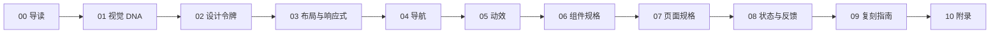

# 00 · 导读与方法

> 这份文档只做一件事：把 Komikku 的视觉决策变成 `project x` 能照着写的规格。**每个数值要么有代码行号，要么有像素测量过程，两者都没有的会被标成推断。**

| 项目 | 说明 |
| --- | --- |
| 章节 | 00 / 10 |
| 适用读者 | 要用 KMP + CMP 复刻 Komikku 视觉的实现者；做设计评审的人 |
| 前置阅读 | 无 |
| 证据类型 | Kotlin 源码逐文件阅读 + 73 张实机截图 + 编译产物反编译核对 |

---

## 0.1 为什么要有第二版

第一版是一份"看起来很像"的文档：它有正确的色值、结构清晰的目录，但**把不同组件的数值串成了同一条规则**，并且**从没在实机截图上量过尺寸**。举三个典型例子：

**例 1 · 平板截图分辨率**
第一版写"平板 1600×1000px"，但仓库里的文件实际是 960×600px。如果实现者按 1600px 去推算密度，所有间距会错 1.67 倍。用代码里的 720dp 断点加上导航轨 80dp 的最小宽度反推：导航轨在截图里量到 **60px**，`60px ÷ 80dp = 0.75 px/dp`，`960px ÷ 0.75 = 1280dp`。所以设备是 **1280×800dp**，截图是 0.75 倍密度导出的。

**例 2 · 设置项内边距**
第一版写"设置项内边距 16dp / 16dp"。真实情况有**三套**：
- `BasePreferenceWidget.kt:123-124`：`PrefsHorizontalPadding = 16.dp`、`PrefsVerticalPadding = 16.dp`（通用设置行）
- `SettingsItems.kt:65-68`：`SettingsItemsPaddings.Horizontal = 24.dp`、`Vertical = 10.dp`（另一套通用条目，用于旧式设置页）
- `SettingsMainScreen.kt:145-149`：平板双栏主列表的选中行 `padding(horizontal = 8.dp)` + `RoundedCornerShape(24.dp)`

一个"16/16"把三套抹成了一套。照着做，平板上设置列表的选中高亮会明显偏宽。

**例 3 · 未定义的角色数**
第一版说"完整为 36 个角色"。M3 1.5 的 `ColorScheme` 有 **48 个**颜色角色（新增 `primaryFixed` 等 12 个）。分母错了，缺口就被低估：Default 主题实际缺 15 个角色，不是 3 个。

### 第二版的核对方法

| 步骤 | 做法 | 产出 |
|---|---|---|
| 1. 读代码 | 用 `grep`/`Read` 逐文件读 `app/`、`presentation-core/`，抓 `dp`、`sp`、`Color(0x…)`、`tween(...)` 等字面量 | 每条数值带 `文件:行` |
| 2. 反编译核对 | `material3.aar` / `material-kolor.jar` 用 `javap -c` 解出 `ShapeTokens`、`TypeScaleTokens` 的常量 | 圆角、字阶的"默认值"不再是猜的 |
| 3. 解析主题 | 脚本正则提取 19 个 `*ColorScheme.kt` 的 `darkColorScheme(...)` / `lightColorScheme(...)` 调用 | 19×2×N 个色值，0 手工录入 |
| 4. 量截图 | `PIL` 采样像素，定位边界、量导航轨/卡片/内边距 | `📐实测` 数值 |
| 5. 交叉验证 | 代码值 vs 截图值不一致时，以**代码值**为准，并在文中标出差异原因（如密度、动画中间帧） | 修正叙述 |

### 可复现的验证脚本

`tools/` 下有四个脚本，用来验证本文的任何一条色值或尺寸主张。全部用 `-I` 运行、只读、不依赖 CWD：

```bash
# 1) 重新解析 19 套主题色值（需要 reference/komikku 源码）
python3 -I tools/parse_themes.py > /tmp/themes.json

# 2) 与本文 design-tokens.json 比对（应输出 0 差异）
python3 -I tools/compare_tokens.py /tmp/themes.json assets/design-tokens.json

# 3) 量截图（导航轨宽度、卡片边界、内边距）
python3 -I tools/measure_screenshot.py assets/tablet/10_library_grid.jpg
python3 -I tools/measure_screenshot.py assets/phone/10_library_grid.jpg --density 2.0

# 4) 重新生成附录 A 的 19 套色值表
python3 -I tools/gen_appendix.py > /tmp/appendixA.md
```

各脚本的期望输出：

| 脚本 | 期望 |
|---|---|
| `parse_themes.py` | stderr 打印 `19 scheme files parsed`，stdout 是 JSON |
| `compare_tokens.py` | `0 differences, 0 missing schemes` |
| `measure_screenshot.py` | 平板书架输出 `left rail: 60px = 80.0dp`；手机书架输出 `content bands … = 162.0dp`（卡宽）|
| `gen_appendix.py` | 输出 738 行 markdown 表格 |

> 脚本放在 `tools/`，用 `-I` 运行，只读路径、不依赖 CWD。它们存在的意义不是"跑一遍好看"，而是**让任何一个说法都能被推翻**。

---

## 0.2 证据分级

全文只用四种标记：

| 标记 | 定义 | 可信度 | 用法 |
|---|---|---|---|
| `📍代码` | 源码里的字面量、常量、调用 | 最高 | 可直接抄进实现 |
| `📐实测` | 从截图像素量取 + 换算 | 高（受密度/抗锯齿影响） | 必须连同设备 dp 一起引用 |
| `🎯推断` | 作者基于证据的分析 | 中 | 只用于解释"为什么"，不当规范 |
| `⚠️缺口` | 代码里不存在 | — | 复刻者需自行设计 |

**反面用法（本版已删除）**：
- ❌ "大概是 16dp" → 改成查代码或标 `⚠️缺口`
- ❌ "Material 默认看起来是这样" → 改成 `javap` 出真实常量
- ❌ "截图里是 9 列所以 1280dp 是 9 列" → 要给出 `Adaptive` 的列数公式和 contentPadding 的实际值

---

## 0.3 覆盖范围

### 覆盖

| 维度 | 内容 |
|---|---|
| 应用外壳 | 5 个一级 Tab、导航栏/轨、返回优先级、转场 |
| 主题 | 19 套静态 + Monet + 自定义种子 + 封面取色 + AMOLED |
| 主要页面 | 书架、更新、历史、浏览（源/Feed/扩展/迁移）、更多、详情、章节、阅读器、设置（12 个二级页） |
| 组件 | 封面卡、列表行、徽标、AppBar、弹层、底部动作栏、横幅、空/错/载 |
| 状态 | 多选、下载 4 态、空/错/载、全局横幅、手势 |

### 不覆盖

| 未覆盖 | 原因 |
|---|---|
| 桌面端 / 平板桌面窗口 | Komikku 只有 Android 实现，没有桌面版本可参照。`project x` 的 `jvmMain` 需要自行设计（标 `⚠️缺口`） |
| Web 版 | 同上 |
| 通知栏、Widget、快捷方式 | 不是应用内视觉 |
| 第三方源的网页内容样式 | WebView 内容不受应用控制 |
| 无障碍（TalkBack 朗读顺序） | 代码里有 `contentDescription`，但没有系统性设计 |
| 平板竖屏截图 | 截图集只有横屏 1280×800。竖屏行为由 `TwoPanelBox` 公式推导（[03](03-布局与响应式.md) §3.4） |

---

## 0.4 阅读路径



**只做 token**：00 → 02 → 09.2 → 10.A
**做双端骨架**：01 → 03 → 04 → 05
**做组件**：06 → 07
**验收**：10.B（截图索引）+ 10.D（验收清单）

---

## 0.5 与第一版的差异摘要

| 章节 | 改动 |
|---|---|
| README | 重写：新增 10 条勘误表、技术栈映射、证据分级 |
| 00 | 重写：新增核对方法论、验证脚本、覆盖/不覆盖清单 |
| 01 | 重写：8 条"不可动结构"全部改为可验证的代码事实 |
| 02 | 重写：角色数 36→48、补 AMOLED 真实规则、补 `getBestColor()` 算法、补阅读器 typography 覆写 |
| 03 | 重写：补网格实测、修正设置列表三套 padding、补 insets 与横幅层级 |
| 04 | 重写：补 5 Tab 的 `onReselect` 行为、返回优先级、顶栏三态 |
| 05 | 重写：动效从 4 档扩到 7 类，每类给触发条件 |
| 06 | 重写：18 类组件，每个给"结构 → 数值 → 状态 → 代码出处" |
| 07 | 重写：17 个页面，每个给入口、骨架、双端差异、截图对照 |
| 08 | 重写：状态机用表格而非散文 |
| 09 | 重写：面向 CMP，给出可编译的主题骨架与 6 个组件配方 |
| 10 | 重写：色值表按源码重生成、截图索引补验证要点、验收清单 40 条 |

---

## 0.6 使用本文的五个建议

1. **先读 01 再读 06**。组件数值是"果"，结构约束是"因"。先知道哪些不能动，再抄数值。
2. **不要把 `📐实测` 的 px 当 dp 用**。平板截图是 0.75 密度，手机是 2.0 密度。
3. **主题先做语义映射，再做色值**。19 套主题只是数据的排列组合，组件不该知道主题名。
4. **动效参数要连触发条件一起抄**。同样是 200ms，tab 切换是 fade-through，阅读器是 slide+fade 叠加，效果完全不同。
5. **遇到 `⚠️缺口` 就停下来设计**。桌面窗口、鼠标悬停、键盘导航在 Komikku 里不存在，照抄 Android 会得到错误的桌面体验。

---

## 延伸阅读

- [下一章：01 视觉 DNA 与设计原则](01-视觉DNA与设计原则.md)
- 技术栈对齐：[`docs/technology-stack.md`](../../docs/technology-stack.md)
- 架构与模块：[`docs/architecture.md`](../../docs/architecture.md)
