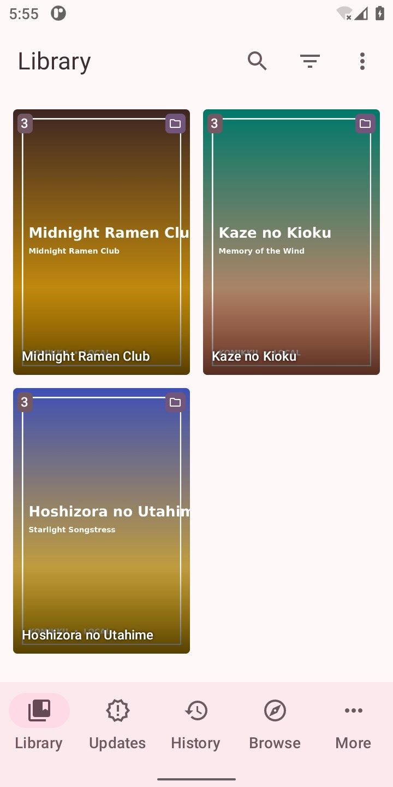
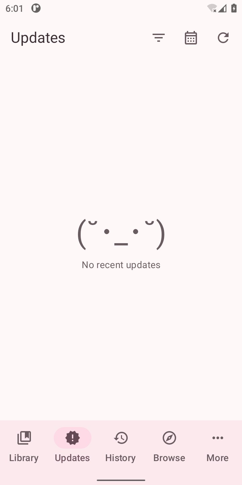

# 01 · 视觉 DNA 与设计原则

> Komikku 没有发明新的设计语言。它把 **Material 3 Expressive** 用到很彻底，然后用三种自绘元素（颜文字、动态 Tab 图标、封面取色）建立了辨识度。复刻时，**结构必须照抄，色相可以自由**。

| 项目 | 说明 |
| --- | --- |
| 章节 | 01 / 10 |
| 适用读者 | 决定"哪些能改、哪些不能改"的实现者与设计评审 |
| 前置阅读 | [00 导读](00-导读与方法.md) |
| 证据类型 | 源码 + 截图 + 编译产物 |

---

## 1.1 一句话定位

**一个内容密度极高的工具型阅读器，用 Material 3 的容器层级把"工具感"收拾干净，再用封面取色让每一部作品看起来是自己的。**

三个关键词，每个都能落到代码：

| 关键词 | 含义 | 代码证据 |
|---|---|---|
| **工具型** | 信息优先，不用大图、不用插画、不用装饰性留白 | 全书唯一的"大图"是用户封面；空状态用文字颜文字而不是插画 |
| **容器层级** | 所有浮层都是 `surfaceContainer*` 家族，靠明度分层，不靠阴影 | `AdaptiveSheet` 用 `surfaceContainerHigh`；底部动作栏用 `surfaceContainerHigh`；导航栏用 `surfaceContainer` |
| **内容着色** | 详情页/阅读器用封面主色生成局部主题 | `DynamicMaterialExpressiveTheme(seedColor=…)`（`TachiyomiTheme.kt:70`） |

---

## 1.2 八条不可动的结构

这八条是"一旦改了就不像 Komikku"的部分。每条都给了代码出处和验证方法。

### ① 主题是运行时数据，不是编译期常量

```kotlin
// app/src/main/java/eu/kanade/presentation/theme/TachiyomiTheme.kt:97
MaterialExpressiveTheme(
    colorScheme = getThemeColorScheme(context, appTheme, isDark, isAmoled),
    content = content,
)
```

组件只读 `MaterialTheme.colorScheme.xxx`，**从不判断主题名**。全仓 `MaterialTheme.colorScheme` 出现 200+ 次，没有一处 `if (appTheme == …)`。

> **复刻要求**：`project x` 的组件层不允许出现 `when (themeId)`。主题只产出 `ColorScheme`。

`🎯推断` 这条决定了新增主题的成本：加一套主题 = 加一个 `BaseColorScheme` 子类，0 处组件改动。

### ② 断点只有一个：720dp 最小宽度

```kotlin
// app/src/main/java/eu/kanade/tachiyomi/util/system/DisplayExtensions.kt:13,21-23
private const val TABLET_UI_REQUIRED_SCREEN_WIDTH_DP = 720
fun Configuration.isTabletUi(): Boolean =
    smallestScreenWidthDp >= TABLET_UI_REQUIRED_SCREEN_WIDTH_DP
```

它同时控制：底栏↔导航轨、单栏↔双栏、底部弹层↔居中卡片。**没有第二个断点。**

> **复刻要求**：CMP 没有 `Configuration.smallestScreenWidthDp`，需要自己算"最短边"。见 [03](03-布局与响应式.md) §3.2。

### ③ 双栏的分割线是 `min(width/2, 450dp)`

```kotlin
// presentation-core/.../components/TwoPanelBox.kt:31-32
val firstWidth = (width / 2).coerceAtMost(450.dp)
val secondWidth = width - firstWidth
```

`📐实测` 平板设置页（`assets/tablet/18_settings_main.jpg`）左栏量到 **338px ÷ 0.75 = 450.7dp**，与公式一致。

### ④ 详情页顶栏有两个独立 alpha 通道

```kotlin
// app/src/main/java/eu/kanade/presentation/manga/MangaScreen.kt:467-474
val titleAlpha by animateFloatAsState(if (!isFirstItemVisible) 1f else 0f)
val backgroundAlpha by animateFloatAsState(if (!isFirstItemVisible || isFirstItemScrolled) 1f else 0f)
```

背景 = `surfaceColorAtElevation(3.dp) × backgroundAlpha`（`MangaToolbar.kt:96`）。

> **复刻要求**：不要写成一个 `if (scrolled) Surface(...)`。否则标题和底色会同时跳变，失去 Komikku 那种"标题晚一步浮现"的质感。

### ⑤ 阅读器 chrome 是半透明 elevated surface

```kotlin
// app/src/main/java/eu/kanade/presentation/reader/appbars/ReaderAppBars.kt:92-94
val backgroundColor = MaterialTheme.colorScheme
    .surfaceColorAtElevation(3.dp)
    .copy(alpha = if (isSystemInDarkTheme()) 0.9f else 0.95f)
```

> **复刻要求**：这是**唯一**允许让页面内容透过工具栏的地方。其余场景的工具栏都是不透明的。

### ⑥ 状态即颜色

| 状态 | 颜色角色 | 代码 |
|---|---|---|
| 未读 | `secondary` | `UnreadBadge`（`LibraryBadges.kt:38-42`，`Badge` 默认色即 `secondary`） |
| 已下载 | `tertiary` | `DownloadsBadge`（`LibraryBadges.kt:27-35`） |
| 缺失源 | `errorContainer` + `error` 图标 | `SourceIconBadge`（`LibraryBadges.kt:83-90`） |
| 下载失败 | `error` | `ErrorIndicator`（`ChapterDownloadIndicator.kt:242-247`） |
| 有筛选 | `active`（亮 `#FFC107` / 暗 `#FFEB3B`） | `Color.kt:8-12` |
| 已选中 | `secondary` 22%/16% 叠加 | `selectedBackground`（`Modifier.kt:30-35`） |

`active` 是**唯一**的硬编码颜色，只用于"筛选已激活"的图标着色。它不在 `ColorScheme` 里。

### ⑦ 选中态用 M3 indicator，不用自定义药丸

`HomeScreen.kt:221-238` 直接调用 M3 `NavigationBarItem`，`HomeScreen.kt:254-271` 调用 `NavigationRailItem`。选中态的外观完全由 M3 决定：`secondaryContainer` 药丸 + `onSecondaryContainer` 图标与文字。

> **复刻要求**：不要手写药丸。CMP 的 `NavigationBarItem` 会给你同样的 indicator，前提是 `ColorScheme` 里 `secondaryContainer` / `onSecondaryContainer` 正确。
>
> **旧版错误**：第一版写"选中项 = 药丸 + **主色图标**"。实际图标是 `onSecondaryContainer`，在粉紫主题里它接近深紫，不是 `primary`。

### ⑧ 动效克制：没有装饰性动画

最长的是 sheet 的 350ms。没有循环动画、没有视差、没有弹簧过冲（唯一例外是 `animateContentSize(spring())` 的标签区，`MangaInfoHeader.kt:394`）。

---

## 1.3 视觉识别四要素

去掉这四个，剩下的就是"一个 Material 应用"。它们也是复刻时最容易被忽略的地方。

### 要素 1 · 封面是第一视觉主体



*图 1-1 紧凑网格：封面占满卡片，标题叠在底部 33% 的渐变上。左上/右上各一组 18dp 徽标。*

在书架网格里，封面占卡片面积的 **100%**（紧凑网格，标题叠在封面上）。在舒适网格里，封面 + 下方 2 行标题。列表模式封面是正方形。

```
紧凑网格（默认）      舒适网格              列表
┌──────────┐        ┌──────────┐        ┌────┬─────────────┐
│ [3] 📁   │        │ [3] 📁   │        │    │ Title       │
│          │        │          │        │ 1:1│             │
│  封面    │        │   封面   │        │    │ [3] 📁      │
│          │        │          │        └────┴─────────────┘
│Title  ▶  │        ├──────────┤          56dp 高
└──────────┘        │Title 2行 │
                    └──────────┘
```

`📍代码`：
- 紧凑网格封面比例 `MangaCover.Book = 2f/3f`（`MangaCover.kt:44`）
- 标题渐变遮罩 `fillMaxHeight(0.33f)` + `0f Transparent → 1f Color(0xAA000000)`（`CommonMangaItem.kt:161-170`）
- 标题 12sp/18sp，白色 + `Shadow(Black, blurRadius=4f)`（`CommonMangaItem.kt:178-190`, `:378-379`）
- 列表封面 `MangaCover.Square` + `fillMaxHeight()`，行高 56dp（`CommonMangaItem.kt:443-470`）

### 要素 2 · 徽标是 18dp 的语义色块

```kotlin
// presentation-core/.../components/Badges.kt:34-44
fun BadgeGroup(...) {
    Row(modifier = modifier.clip(shape).height(18.dp)) { content() }
}
```

徽标本身：`RectangleShape` + `bodySmall`（12sp）+ `FontWeight.Medium` + `padding(horizontal=3.dp, vertical=1.dp)`（`Badges.kt:55-67`）。

> ⚠️ **测量陷阱**：徽标叠在封面上，且形状是 `RectangleShape` 被 `BadgeGroup` 的 `clip(extraSmall)` 切角，所以它在截图里的上下边缘与封面**没有硬边界**。用像素扫描量"徽标高度"会得到不稳定结果（我试过，误差 ±4px）。
>
> **正确做法**：徽标高度只信代码的 `18.dp`，不要用截图反推。`crops/library-card.jpg` 是 480×530 的缩放裁剪，密度未知，更不能当基准。
>
> 复刻时的落地方式：`Modifier.height(18.dp)` 加在 `Row` 上，子项不要各自设高。

### 要素 3 · 空状态是文字颜文字



*图 1-2 空状态：`Σ(ಠ_ಠ)` + 一句说明。没有插画、没有装饰图形。*

```kotlin
// presentation-core/.../screens/EmptyScreen.kt:115-131
private val ErrorFaces = listOf(
    "(･o･;)", "Σ(ಠ_ಠ)", "ಥ_ಥ", "(˘･_･˘)", "(；￣Д￣)", "(･Д･。",
    "(╬ಠ益ಠ)", "(╥﹏╥)", "(⋟﹏⋞)", "Ò︵Ó", " ˙ᯅ˙)", "(¬_¬)",
)
private fun getRandomErrorFace(): String =
    ErrorFaces[Random.nextInt(ErrorFaces.size)]
```

`displayMedium`（45sp/52）、`onSurfaceVariant` 78% alpha、`LocalLayoutDirection` 强制 LTR（防止阿拉伯语镜像）。

`📐实测`（`assets/phone/16_updates.jpg`，720×1440px，2.0 px/dp，背景 `#FEF8F8`）：

| 测量项 | 像素 | 换算 | 说明 |
|---|---|---|---|
| 颜文字横向跨度 | 257px（x 232→488） | **128.5dp** | `displayMedium` 45sp 的颜文字 7 字符宽 |
| 颜文字纵向高度 | 94px（y 649→742） | **47dp** | 接近 52sp 行高的字面高度 |
| 颜文字 + 说明文字总高 | 131px（y 649→779） | 65.5dp | 含 `paddingFromBaseline(top=24dp)` 的一部分 |

与代码核对：`45sp` 字阶行高 52sp（[02](02-设计令牌.md) §2.7 的实测字阶表），颜文字字面高度 47dp 略小于行高，符合字形实际墨迹（括号 + 上标符号）的高度。✓

这是 Komikku 唯一的"人格化"元素。**不要换成插画。**

### 要素 4 · 封面取色（局部主题）

```kotlin
// app/src/main/java/eu/kanade/tachiyomi/ui/manga/MangaScreen.kt:208-214
val seedColor = successState.seedColor
TachiyomiTheme(
    seedColor = seedColor.takeIf { screenModel.themeCoverBased },
    ...
)
```

种子色的来源（`MangaScreenModel.kt:529-570`）：
1. 用 Coil 加载封面，`allowHardware(false)`
2. `Palette.from(bitmap).generate { }`
3. `it.getBestColor()`（启发式，见 [02](02-设计令牌.md) §2.6）
4. `DynamicMaterialExpressiveTheme(seedColor, style = themeCoverBasedStyle)`，默认 `Vibrant`，`animate = true`

`📐实测` `assets/tablet/11_manga_detail.jpg` 整页被染成青绿色（封面 `Kaze no Kioku` 顶部是青绿）；`assets/phone/34_manga_detail_dark.jpg` 暗色下被染成暗紫红。**同一部作品，亮暗两种取色结果方向一致但明度不同**，证明是同一 seed 生成两套 scheme。

---

## 1.4 密度与节奏

### 纵向节奏

| 区域 | 值 | 代码 |
|---|---|---|
| 书架列表行高 | 56dp | `CommonMangaItem.kt:451` |
| 历史行高 | 96dp | `HistoryItem.kt:49` |
| 章节行高 | 内容自适应（padding 12/12） | `MangaChapterListItem.kt:112` |
| 设置行最小高 | 56dp | `PreferenceItem.kt:35` (`LocalPreferenceMinHeight`) |
| 导航栏内容高 | 80dp | `NavigationBar.kt:43` |
| 导航轨最小宽 | 80dp | `NavigationRail.kt:47` |
| 徽标组高 | 18dp | `Badges.kt:42` |

### 横向节奏

| 区域 | 值 | 代码 |
|---|---|---|
| 书架网格内容边距 | 8dp（四边） | `LazyLibraryGrid.kt:24` |
| 书架网格间距 | 4dp（横竖） | `CommonMangaItem.kt:55-56` |
| 每个网格项内边距 | 4dp | `CommonMangaItem.kt:406` |
| 设置行内边距 | 16dp / 16dp | `BasePreferenceWidget.kt:123-124` |
| 通用条目内边距 | 24dp / 10dp | `SettingsItems.kt:65-68` |
| 章节行内边距 | start 16 / top 12 / end 8 / bottom 12 | `MangaChapterListItem.kt:112` |
| 历史行内边距 | 16 / 8 | `HistoryItem.kt:86-87` |

> **注意**：这三套内边距来自三个不同的组件族，不是"一套规则的三个应用"。照抄时要按**组件**选，不是按"设置页"选。

### 视觉重量排序

`🎯推断` 从截图观察，Komikku 的注意力权重是：

```
封面 > 标题 > 徽标 > 章节数/日期 > 图标
```

对应到字号：`titleSmall 14sp`（封面标题）> `bodyMedium 14sp`（列表标题）> `bodySmall 12sp`（副标题/徽标）> `labelSmall 11sp`（动作栏确认文字）。

没有使用 `headline*` 做列表标题——只有页面级标题（AppBar）用 `titleLarge 22sp`，引导页用 `headlineLarge 32sp`。

---

## 1.5 克制的边界：哪些地方"不设计"

| 位置 | Komikku 的做法 | 如果过度设计会怎样 |
|---|---|---|
| 空状态 | 文字颜文字 + 一句说明 + 可选按钮 | 加插画会让工具型应用显得幼稚 |
| 加载 | 居中 `CircularProgressIndicator` | 加骨架屏会与 Coil 的占位色冲突 |
| 错误 | Snackbar / 对话框，无插图 | 加错误插画会与封面争视觉 |
| 分隔 | `HorizontalDivider` 1px（`outlineVariant`） | 加阴影会让层级混乱 |
| 图标 | Material Icons Outlined 为主 | 自绘图标会破坏一致性 |
| 圆角 | 只有 4/8/12/16/28 五档 | 任意圆角会让卡片"软硬不一" |

---

## 1.6 与 Material 3 默认值的偏差清单

复刻时最常踩的坑：以为"跟 M3 一样"，实际改了。

| 项 | M3 默认 | Komikku | 代码 |
|---|---|---|---|
| NavigationBar 内容高 | 80dp（含 8dp 上下 padding） | **80dp 但去掉水平 spacer** | `NavigationBar.kt:20-46` |
| NavigationRail 对齐 | 顶部对齐 | **垂直居中** + `Arrangement.spacedBy(4dp)` | `NavigationRail.kt:49-55` |
| Scaffold | 无侧栏槽位 | **新增 `startBar` 槽位** | `Scaffold.kt:111` |
| Scaffold 内容内边距 | 只算 top/bottom | **同时算 FAB 高度与 startBar 宽度** | `Scaffold.kt:297-310` |
| TopAppBar 底色 | `surface` | **`surfaceColorAtElevation(3.dp)`（动作模式）或 0dp** | `AppBar.kt:174-177` |
| Chip 形状 | `small (8dp)` | 同，但项目自己 fork 了一份 `Chip.kt` 以支持长按 | `Chip.kt` |
| Sheet | `ModalBottomSheet` | **自写 `AnchoredDraggable`**，无 scrim 动画曲线 | `AdaptiveSheet.kt` |
| 字号 | M3 字阶 | 同，**但阅读器覆写 `bodyLarge → bodySmall`** | `ReaderActivity.kt:321-323` |
| 字体 | Roboto | Roboto（**无自定义字体**，`app/src/main/res/font/` 不存在） | — |

---

## 设计意图（`🎯推断`）

1. **为什么用 `smallestScreenWidthDp` 而不是当前宽度**：保证旋转时形态稳定。手机横屏不会突然变成平板布局。
2. **为什么左栏封顶 450dp**：1280dp 屏上一半是 640dp，对"封面 + 标题"来说太宽，会显得空荡。450dp 刚好容纳 2:3 封面（约 300dp 高）+ 标题 + 3 个动作按钮。
3. **为什么阅读器工具栏半透明**：阅读是沉浸行为，工具栏必须"可消失"；半透明让用户感知到内容还在下面，减轻"被遮挡"的焦虑。
4. **为什么空状态用颜文字**：漫画读者群体对日式颜文字的接受度高于西式插画；且零资源成本、天然支持所有语言。
5. **为什么封面取色只用在详情页和阅读器**：书架上有几十个封面，如果每张都染色，页面会变成调色盘。详情页只有一部作品，取色才成立。

---

## 复刻检查清单

- [ ] 组件层没有任何 `when (themeId)`，只有 `MaterialTheme.colorScheme.*`
- [ ] 断点只有一处，值 720dp，读"最短边"
- [ ] 双栏左栏用 `min(w/2, 450dp)`，不是百分比
- [ ] 详情页顶栏标题与背景是两个独立的 alpha 动画
- [ ] 阅读器工具栏用 `surfaceColorAtElevation(3.dp) × 0.9/0.95`
- [ ] 未读=`secondary`、已下载=`tertiary`、缺失源=`errorContainer`
- [ ] 导航选中态直接用 M3 `NavigationBarItem`/`NavigationRailItem`，不手写药丸
- [ ] 空状态是 12 个颜文字之一，`displayMedium`，不是插画
- [ ] 网格项内边距 4dp、间距 4dp、内容边距 8dp
- [ ] 设置行用 16/16，通用条目用 24/10，两者不混用

---

## 延伸阅读

- [上一章：00 导读与方法](00-导读与方法.md)
- [下一章：02 设计令牌](02-设计令牌.md)
- 布局细节：[03 布局与响应式](03-布局与响应式.md)
- 组件落地：[06 组件规格库](06-组件规格库.md)
