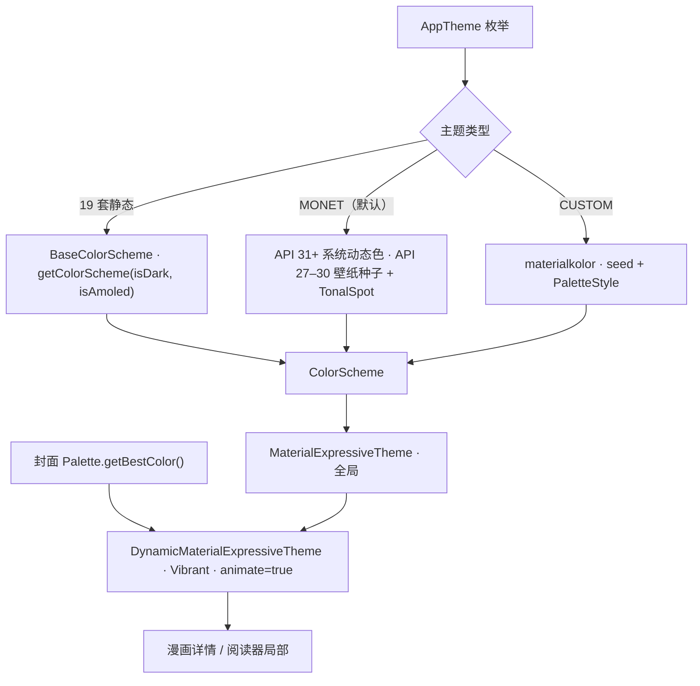

# 02 · 设计令牌

> Komikku 的视觉一致性不靠“记住颜色”，而靠“只允许使用语义角色”；令牌系统是复刻中唯一不能省略的一步。

| 项目 | 说明 |
| --- | --- |
| 章节 | 02 / 10 |
| 适用读者 | 要搭建主题系统、设计 token 或做多主题产品的工程师 |
| 前置阅读 | [01 设计定位与视觉 DNA](01-设计定位与视觉DNA.md) |
| 证据类型 | 颜色/字号/间距均来自代码，色值由脚本解析 |

## 本章导读

- 三层色彩机制：静态主题 → 动态主题 → 页面级封面取色。
- 默认调色板、19 套主题全集、AMOLED 的特殊规则。
- 字体、间距、圆角、高度、透明度与图标规格。
- 哪些主题的调色板不完整，以及为什么会在真实界面翻车。

---

Komikku 的视觉一致性不靠“记住颜色”，而靠“只允许使用语义角色”。理解它的令牌系统，是复刻的第一步，也是唯一不能省略的一步。

## 2.1 三层色彩机制

色彩不是一个主题，而是**三层叠加**：应用级静态主题 → 应用级动态主题（Monet / 自定义种子）→ 页面级封面取色。三层都产出同一个 `ColorScheme`，因此下游组件完全无感。



*图 2-1 三层色彩机制。静态主题与动态主题在应用根节点生效；封面取色以“局部主题”的形式包裹详情/阅读器，因此同一屏内可以出现与全局不同的色相。*

| 层       | 实现                                               | 作用域                    | 默认值                                        |
|----------|----------------------------------------------------|---------------------------|-----------------------------------------------|
| 静态主题 | BaseColorScheme → darkColorScheme/lightColorScheme | 应用根（TachiyomiTheme）  | AppTheme.DEFAULT（但默认选中 MONET）          |
| 动态主题 | MonetColorScheme / CustomColorScheme               | 应用根                    | themeMode=SYSTEM · appTheme=MONET             |
| 封面取色 | DynamicMaterialExpressiveTheme(seedColor)          | MangaScreen / Reader 局部 | themeCoverBased=true · Vibrant · animate=true |

### 静态主题的生成规则

```kotlin
// app/src/main/java/eu/kanade/presentation/theme/TachiyomiTheme.kt:97
MaterialExpressiveTheme(
    colorScheme = getThemeColorScheme(context, appTheme, isDark, isAmoled),
    content = content,
)

// AMOLED 不是简单地把所有面变黑
amoledScheme = darkScheme.copy(
    background = Color.Black, surface = Color.Black,
    surfaceContainer = 0xFF0C0C0C,      // 导航栏：不能纯黑，内容会从下面滚过
    surfaceContainerHigh = 0xFF131313,
    surfaceContainerHighest = 0xFF1B1B1B,
)
```

> **设计细节**
>
> AMOLED 下 `surfaceContainer` 被刻意保留为 `#0C0C0C` 而不是 `#000000`。代码注释写明原因：*“Cannot be pure black as there's content scrolling behind it”*，并引用了 M3 导航栏规范。这是“纯黑主题”最常见的翻车点。

## 2.2 默认调色板（Default / Tachiyomi）

这是唯一一套完整定义了导航栏、徽标、进度条语义的基准色板，也是复刻时最推荐的起点。它由 Material Theme Builder 从 `Primary #2979FF`、`Secondary #2979FF`、`Tertiary #47A84A` 生成。

| 角色                    | 暗色     | 亮色     | 代码中的用途                                  |
|-------------------------|----------|----------|-----------------------------------------------|
| primary                 | #B0C6FF | #0058CA | 主交互色：图标、选中态、进度环、筛选激活、FAB |
| onPrimary               | #002D6E | #FFFFFF | primary 容器上的文字/图标                     |
| primaryContainer        | #00429B | #D9E2FF | 章节滑动背景、Continue Reading 按钮           |
| onPrimaryContainer      | #D9E2FF | #001945 | primaryContainer 上的内容                     |
| secondary               | #B0C6FF | #0058CA | 未读徽标、选择描边、选中背景叠加              |
| onSecondary             | #002D6E | #FFFFFF | secondary 上的文字                            |
| secondaryContainer      | #00429B | #D9E2FF | 导航栏选中药丸、进度条剩余段                  |
| onSecondaryContainer    | #D9E2FF | #001945 | 导航药丸上的图标                              |
| tertiary                | #7ADC77 | #006E1B | 已下载徽标、本地来源、Downloaded only 横幅    |
| onTertiary              | #003909 | #FFFFFF | tertiary 上的文字                             |
| tertiaryContainer       | #005312 | #95F990 | 更新相关容器                                  |
| onTertiaryContainer     | #95F990 | #002203 | tertiaryContainer 上的文字                    |
| error                   | #FFB4AB | #BA1A1A | NSFW、失败、破坏性操作、恢复横幅              |
| onError                 | #690005 | #FFFFFF | error 上的文字                                |
| errorContainer          | #93000A | #FFDAD6 | 缺失来源徽标、错误卡片                        |
| onErrorContainer        | #FFDAD6 | #410002 | errorContainer 上的内容                       |
| background              | #1B1B1F | #FEFBFF | 页面基底、详情渐变终点                        |
| onBackground            | #E3E2E6 | #1B1B1F | 页面文字                                      |
| surface                 | #1B1B1F | #FEFBFF | AppBar 静息、卡片、Scaffold                   |
| onSurface               | #E3E2E6 | #1B1B1F | 正文与图标                                    |
| surfaceVariant          | #211F26 | #F3EDF7 | 平板选中行、引导容器、导航栏（旧）            |
| onSurfaceVariant        | #C5C6D0 | #44464F | 次级标题、对话框正文                          |
| outline                 | #8F9099 | #757780 | 输入框/对话框边框、引导分隔线                 |
| outlineVariant          | #44464F | #C5C6D0 | 列表分隔线                                    |
| scrim                   | M3 默认  | M3 默认  |                                               |
| inverseSurface          | #E3E2E6 | #303034 | Snackbar 背景                                 |
| inverseOnSurface        | #1B1B1F | #F2F0F4 | Snackbar 文字                                 |
| inversePrimary          | #0058CA | #B0C6FF | Snackbar 动作                                 |
| surfaceDim              | M3 默认  | M3 默认  |                                               |
| surfaceBright           | M3 默认  | M3 默认  |                                               |
| surfaceContainerLowest  | #1A181D | #F5F1F8 | 滑动操作未过阈值背景                          |
| surfaceContainerLow     | #1E1C22 | #F7F2FA | 低层容器                                      |
| surfaceContainer        | #211F26 | #F3EDF7 | 导航栏背景                                    |
| surfaceContainerHigh    | #292730 | #FCF7FF | 弹层、Pill、底部操作栏                        |
| surfaceContainerHighest | #302E38 | #FCF7FF | 最高层容器                                    |
| surfaceTint             | #B0C6FF | #0058CA | 搜索命中高亮 / 封面背景叠加                   |

*注：scrim / surfaceDim / surfaceBright 未显式定义，落到 M3 默认值；其余角色全部显式给出。表中“用途”列来自代码注释与实际使用点，而非猜测。*

## 2.3 主题全集

可选主题共 **19 套静态** + **Monet** + **Custom**。下表按主题枚举顺序，给出每个主题的暗/亮主色与背景，方便快速判断色相气质。

| 主题                                 | 暗 · 主色 | 暗 · 背景 | 亮 · 主色 | 亮 · 背景 | 定义角色 |
|--------------------------------------|-----------|-----------|-----------|-----------|----------|
| **Default** / Tachiyomi              | #B0C6FF  | #1B1B1F  | #0058CA  | #FEFBFF  | 33/36    |
| **Cotton Candy** / Cottoncandy       | #FFB3B4  | #1A1111  | #8F4A4C  | #FFF8F7  | 35/36    |
| **Mocha** / Mocha                    | #FFB77F  | #19120C  | #89511F  | #FFF8F5  | 35/36    |
| **Catppuccin** / Catppuccin          | #CBA6F7  | #181825  | #8839EF  | #E6E9EF  | 35/36    |
| **Green Apple** / GreenApple         | #7ADB8F  | #0F1510  | #005927  | #F6FBF2  | 35/36    |
| **Lavender** / Lavender              | #A177FF  | #111129  | #6D41C8  | #EDE2FF  | 35/36    |
| **Midnight Dusk** / MidnightDusk     | #F02475  | #16151D  | #BB0054  | #FFFBFF  | 28/36    |
| **Nord** / Nord                      | #88C0D0  | #2E3440  | #5E81AC  | #ECEFF4  | 32/36    |
| **Strawberry Daiquiri** / Strawberry | #FFB2B8  | #201A1A  | #A10833  | #FAFAFA  | 35/36    |
| **Tako** / Tako                      | #F3B375  | #21212E  | #66577E  | #F7F5FF  | 28/36    |
| **Teal & Turquoise** / TealTurqoise  | #40E0D0  | #202125  | #008080  | #FAFAFA  | 28/36    |
| **Tidal Wave** / TidalWave           | #5ED4FC  | #001C3B  | #006780  | #FDFBFF  | 28/36    |
| **Yin & Yang** / YinYang             | #FFFFFF  | #1E1E1E  | #000000  | #FDFDFD  | 28/36    |
| **Yotsuba** / Yotsuba                | #FFB59D  | #211A18  | #AE3200  | #FCFCFC  | 28/36    |
| **Monochrome** / Monochrome          | #FFFFFF  | #000000  | #000000  | #FFFFFF  | 35/36    |
| **Cloudflare** / Cloudflare          | #F38020  | #1B1B22  | #F38020  | #EFF2F5  | 22/36    |
| **Doom** / Doom                      | #FF0000  | #1B1B1B  | #FF0000  | #212121  | 22/36    |
| **Matrix** / Matrix                  | #00FF00  | #111111  | #00FF00  | #000000  | 22/36    |
| **Sapphire** / Sapphire              | #1E88E5  | #212121  | #1E88E5  | #FFFFFF  | 22/36    |

| 特殊主题 | 说明 | 定义方式 |
| --- | --- | --- |
| **Dynamic（Monet）** | 系统壁纸动态取色；API 31+ 用系统色，API 27–30 用壁纸种子 + TonalSpot / Spec 2025 | 系统生成 |
| **Custom Theme** | 任意 seed + PaletteStyle（默认 Fidelity）；内置 13 组预设色板 | seed 生成 |

*“定义角色”指该文件显式写出的 ColorScheme 字段数量（完整为 36）。未定义字段会落回 darkColorScheme()/lightColorScheme() 的 M3 基线值，通常是紫色系。*

> **复刻注意 · 部分调色板是不完整的**
>
> Cloudflare / Doom / Matrix / Sapphire 只定义了 22 个角色，缺少 `error*`、`surfaceContainer*`、`surfaceDim/Bright` 等；Nord 缺 4 个，Teal & Turquoise 缺 8 个。结果就是这些主题的错误色、弹层底色可能仍是 M3 基线紫红。**如果要做“主题商店”，请为每个主题补齐全部角色，或至少补齐 error 与 surfaceContainer 五档。**

### Custom Theme 的 13 组预设色板

自定义主题除了取色器，还内置了 13 组策划过的色板，用于一键生成协调的 seed：Sunset、Outrun、Raspberry、Cathode、Bubblegum、Springfield、Spectral、Night at the Beach、Casual、Patagonia、LCD、Pop、Pico。每组 4–14 个色值，可在 `ThemeColorPickerWidget.kt:199–298` 查看。

## 2.4 AMOLED

| 角色                     | 普通暗色（Default） | AMOLED   | 规则             |
|--------------------------|---------------------|----------|------------------|
| background / surface     | #1B1B1F            | #000000 | 纯黑             |
| onBackground / onSurface | #E3E2E6            | #FFFFFF | 纯白             |
| surfaceContainer         | #211F26            | #0C0C0C | 导航栏；保留层次 |
| surfaceContainerHigh     | #292730            | #131313 | 弹层/卡片        |
| surfaceContainerHighest  | #302E38            | #1B1B1B | 最高层容器       |

AMOLED 覆盖只对非 Monet 主题生效：`overrideDarkSurfaceContainers = appTheme != AppTheme.MONET`。

## 2.5 语义色映射

下表是复刻时最重要的“用色规则”。同一个 `primary` 在不同组件里承担不同语义，不能只按“主色”理解。

| 角色                     | 语义       | 实际用途                                                       | 证据                                               |
|--------------------------|------------|----------------------------------------------------------------|----------------------------------------------------|
| primary                  | 交互与选中 | 筛选激活图标、阅读器底栏图标、动作按钮激活态、返回箭头、进度环 | reader iconColor / filterTint / MangaActionButton  |
| secondary                | 社交/未读  | 未读徽标、网格选中描边、选中背景 16–22% 叠加                   | UnreadBadge / selectedOutline / selectedBackground |
| tertiary                 | 离线/正向  | 已下载数量、本地来源图标、Downloaded only 横幅、Updating 横幅  | DownloadsBadge / SourceIconBadge / Banners         |
| error                    | 危险/限制  | NSFW 标签、缺失来源、失败图标、恢复横幅、删除操作              | LanguageBadge(18+) / Banners / LibraryBadges       |
| surfaceContainerHigh     | 浮层       | 底部弹层、Pill 默认底、章节选择底栏、TabbedDialog Tab 行       | AdaptiveSheet / Pill / MangaBottomActionMenu       |
| surfaceContainerLowest   | 手势底层   | 章节滑动未过阈值时的背景                                       | MangaChapterListItem                               |
| surfaceVariant           | 选中/容器  | 平板设置选中行、引导内容容器、旧导航栏背景                     | SettingsMainScreen / InfoScreen                    |
| surfaceTint              | 强调叠加   | 设置项定位高亮 12%、封面背景 40%                               | BasePreferenceWidget / MangaInfoBox                |
| onSurfaceVariant         | 次级文字   | 分组标题 header、对话框正文、列表副标题                        | Typography.header / AlertDialogContent             |
| outline / outlineVariant | 边界       | 对话框/输入框边框、列表与引导分隔线                            | AlertDialog / HorizontalDivider                    |
| inverseSurface           | 反向提示   | Snackbar 背景/文字/动作                                        | M3 Snackbar 默认                                   |
| scrim                    | 遮罩       | 弹层背景遮罩（M3 默认）                                        | Dialog / Sheet                                     |

| 角色 | 次数 | 占比条 |
| --- | ---: | --- |
| `primary` | 93 | ████████████████████████ |
| `onSurface` | 62 | ████████████████ |
| `error` | 29 | ███████ |
| `surface` | 27 | ███████ |
| `background` | 24 | ██████ |
| `onSurfaceVariant` | 19 | █████ |
| `onBackground` | 19 | █████ |
| `tertiary` | 18 | █████ |
| `secondary` | 16 | ████ |
| `onTertiary` | 15 | ████ |
| `surfaceContainerHighest` | 12 | ███ |
| `surfaceContainerHigh` | 12 | ███ |
| `onPrimary` | 12 | ███ |

*图 2-2 · 语义角色在表现层代码中的出现次数（Top 13）*

## 2.6 字体系统

**没有自定义字体。**仓库中不存在 `res/font`，也没有自定义 `Typography`；全部使用 Material 3 默认字阶（Roboto，中文回落到系统 CJK 字体）。辨识度来自**字阶组合**与**字重**，而不是字族。

| 字阶          | 字号/行高 (sp) | 典型用途                                           |
|---------------|----------------|----------------------------------------------------|
| displayMedium | 45 / 52        | 空状态颜文字                                       |
| headlineLarge | 32 / 40        | 引导页大标题（Welcome!）                           |
| headlineSmall | 24 / 32        | 更新/新版本页标题                                  |
| titleLarge    | 22 / 28        | 统计数字（加粗）、设置项（重写为 16sp）            |
| titleMedium   | 16 / 24        | 搜索输入（重写为 18sp）、对话框标题                |
| titleSmall    | 14 / 20        | 分组卡片标题、引导页副标题                         |
| bodyLarge     | 16 / 24        | 少量说明文字                                       |
| bodyMedium    | 14 / 20        | **绝对主力**：列表标题、章节名、来源名、对话框正文 |
| bodySmall     | 12 / 16        | 次级信息、日期、版本号、徽标                       |
| labelLarge    | 14 / 20        | 按钮文字、导航标签                                 |
| labelMedium   | 12 / 16        | 状态横幅文字                                       |
| labelSmall    | 11 / 16        | 统计副标签                                         |

| 角色 | 次数 | 占比条 |
| --- | ---: | --- |
| `bodyMedium` | 67 | ████████████████████████ |
| `bodySmall` | 46 | ████████████████ |
| `titleLarge` | 18 | ██████ |
| `titleMedium` | 16 | ██████ |
| `titleSmall` | 13 | █████ |
| `bodyLarge` | 13 | █████ |
| `labelLarge` | 8 | ███ |
| `labelMedium` | 7 | ███ |
| `header（自定义）` | 7 | ███ |
| `labelSmall` | 5 | ██ |
| `headlineSmall` | 3 | █ |
| `headlineMedium` | 3 | █ |
| `displayMedium` | 1 | █ |
| `headlineLarge` | 1 | █ |

*图 2-3 · 排版样式在表现层代码中的出现次数（Top 14）*

### 唯一的自定义文字样式：header

```kotlin
// presentation-core/.../theme/Typography.kt
val Typography.header: TextStyle
    @Composable get() = bodyMedium.copy(
        color = MaterialTheme.colorScheme.onSurfaceVariant,
        fontWeight = FontWeight.SemiBold,
    )
```

用于设置分组标题、来源分组标题（如 “Other”）、统计分区标题。效果是“14sp 半粗 + 次级色”，比 M3 的 titleSmall 更轻、更像工具型应用的分组标签。

### 被显式改写的字号

- 书架标题 12sp / 18sp
- 搜索输入 18sp
- 设置项标题 16sp
- 详情动作标签 12sp
- Tab 计数 10sp
- 列表副标题 12sp
- 徽标 12sp / Medium
- 对话框正文 14sp

## 2.7 间距、圆角、高度

### 间距令牌

| 令牌       | 值   | 典型用途                     |
|------------|------|------------------------------|
| extraSmall | 4dp  | 徽标间距、图标与文字         |
| small      | 8dp  | 列表垂直内边距、卡片间距     |
| medium     | 16dp | 页面左右边距、列表项水平     |
| large      | 24dp | 对话框内边距、平板阅读器控件 |
| extraLarge | 32dp | 设置分组标题左右、空状态     |

### 圆角

| 令牌       | 值   | 典型用途                              |
|------------|------|---------------------------------------|
| extraSmall | 4dp  | 封面、BadgeGroup                      |
| small      | 8dp  | 书架卡片、Continue 按钮、主题预览内层 |
| medium     | 12dp | 少量容器                              |
| large      | 16dp | 底部操作栏（仅上圆角）                |
| extraLarge | 28dp | 设置卡片、弹层、统计卡片              |

| 高度 / 尺寸    | 值                     | 来源                                        |
|----------------|------------------------|---------------------------------------------|
| 底部导航栏     | 80dp                   | 自定义 NavigationBar（去掉默认水平 spacer） |
| 侧边导航栏     | min 80dp 宽，tonal 3dp | 自定义 NavigationRail（居中排列）           |
| 设置项最小高度 | 56dp                   | LocalPreferenceMinHeight                    |
| 设置项内边距   | 16dp / 16dp            | PrefsHorizontal/VerticalPadding             |
| 章节项内边距   | 16 / 12 / 8 / 12       | start/top/end/bottom                        |
| 历史项高度     | 96dp                   | HistoryItemHeight                           |
| 书架列表项高度 | 56dp                   | MangaListItem                               |
| 徽标组高度     | 18dp                   | BadgeGroup                                  |
| 快速滚动条     | 12dp 宽                | ThumbThickness                              |
| 最小触摸目标   | 48dp                   | minimumInteractiveComponentSize             |

### 透明度常量

| 场景                  | 值          | 备注                      |
|-----------------------|-------------|---------------------------|
| 禁用态                | 0.38        | DISABLED_ALPHA            |
| 次级文字              | 0.78        | SECONDARY_ALPHA           |
| 列表选中底色（亮/暗） | 0.22 / 0.16 | secondary 叠加            |
| 网格选中封面          | 0.76        | GRID_SELECTED_COVER_ALPHA |
| 计数 Pill（亮/暗）    | 0.08 / 0.12 | onBackground 叠加         |
| 阅读器栏（亮/暗）     | 0.95 / 0.90 | surface@3dp               |
| 详情页封面背景        | 0.20        | 再叠加 40% surfaceTint    |
| Continue Reading      | 0.90        | primaryContainer          |

## 2.8 图标与图形

> **Iconography · Material Symbols / Outlined**
>
> 界面图标以 `Icons.Outlined.*` 为主，少量 Filled 用于“已激活/已勾选”（Favorite、CheckCircle、PlayArrow）。阅读器部分使用自定义 24dp drawable（裁剪、翻页、书脊）。

> **Navigation · 导航图标是动画矢量**
>
> 五个 Tab 使用 `AnimatedImageVector`（`anim_library_enter` 等），选中时才播放一次进入动画，未选中保持首帧。这是“低成本高级感”的关键细节。

> **Badges · 语义小方块**
>
> 下载数=tertiary、未读=secondary、语言=国旗 emoji 或文字、来源=图标/文件夹、缺失来源=errorContainer + Warning。全部高 18dp、12sp Medium。

> **Imagery · 封面是唯一的“大图”**
>
> 没有插画体系；视觉冲击全部来自用户封面。占位色 `#1F888888`（12% 灰），加载失败用 `cover_error`。Coil 全局 300ms 交叉淡入。

---

## 设计意图

令牌系统的设计意图是“把主题变成运行时数据”。组件只声明自己需要一个语义角色（例如“弹层背景”），具体颜色由当前主题、是否 AMOLED、是否被封面取色覆盖共同决定。这样新增主题不需要改组件，封面取色也不需要为每个页面写特例。AMOLED 保留 `#0C0C0C` 的导航栏，则体现了另一层意图：纯黑只用于“没有内容从下面滚过”的表面，凡是叠在滚动内容上的容器都要保留可辨识的层次。

## 复刻检查清单

- [ ] 组件样式中没有任何硬编码 hex（主题定义文件除外）。
- [ ] 亮色、暗色、AMOLED 三种模式都定义了完整的 `surfaceContainer` 五档。
- [ ] 主题切换只改变 CSS 变量 / ColorScheme，不触发组件重写。
- [ ] 每个主题至少补齐 `error` 与 `surfaceContainer` 系列，避免回落到 M3 基线紫红。
- [ ] 字号使用 M3 字阶；覆写处能对应到具体组件（如设置项 16sp）。
- [ ] 透明度只用 0.38 / 0.78 / 0.76 / 0.90–0.95 这几档，不临时发明。
- [ ] 封面取色是局部主题，不污染全局 `ColorScheme`。

## 延伸阅读

- [上一章：01 设计定位与视觉 DNA](01-设计定位与视觉DNA.md)
- [下一章：03 布局与响应式系统](03-布局与响应式系统.md)
- 可直接使用的 `tokens.css`：[09 复刻指南](09-复刻指南.md)
- 全部主题完整色值：[10 附录 A](10-附录.md)
