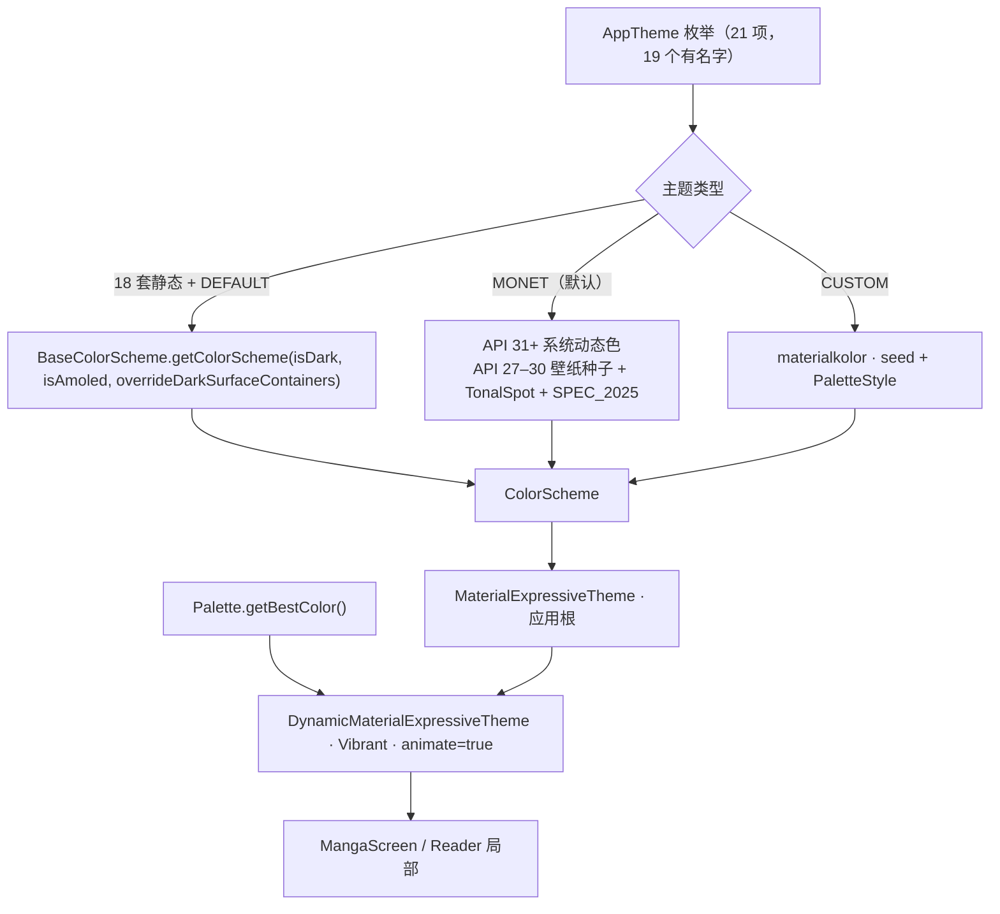
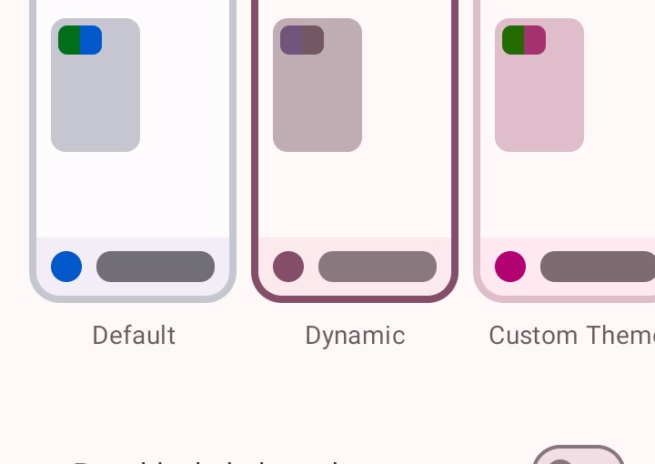

# 02 · 设计令牌

> Komikku 的视觉一致性不靠"记住颜色"，而靠"只允许使用语义角色"。令牌系统是复刻中**唯一不能省略**的一步。

| 项目 | 说明 |
| --- | --- |
| 章节 | 02 / 10 |
| 适用读者 | 搭主题系统、写 design token 的工程师 |
| 前置阅读 | [01 视觉 DNA](01-视觉DNA与设计原则.md) |
| 证据类型 | 源码 + 脚本解析 + 编译产物反编译 |

---

## 本章导读

- 三层色彩机制：静态主题 → 动态主题 → 页面级封面取色。
- **48 个** M3 角色，19 套主题各自漏了哪些。
- AMOLED 的真实规则（不是"全部变黑"）。
- 字体：无自定义字体，但**阅读器改了一个字阶**。
- 间距、圆角、透明度、动效的完整表。

---

## 2.1 三层色彩机制

色彩不是"一个主题"，而是**三层叠加**。三层都产出同一个 `ColorScheme`，下游组件完全无感。



*图 2-1 三层色彩机制。静态/动态主题在应用根生效；封面取色是**局部主题**，因此同一屏内可以出现与全局不同的色相。*

| 层 | 实现 | 作用域 | 默认值 | 代码 |
|---|---|---|---|---|
| 静态主题 | `BaseColorScheme` → `darkColorScheme`/`lightColorScheme` | 应用根 `TachiyomiTheme` | `AppTheme.DEFAULT` 的实例 | `TachiyomiTheme.kt:97` |
| 动态主题 | `MonetColorScheme` / `CustomColorScheme` | 应用根 | **`appTheme = MONET`**、`themeMode = SYSTEM` | `UiPreferences.kt:20-25` |
| 封面取色 | `DynamicMaterialExpressiveTheme(seedColor)` | `MangaScreen` / `ReaderActivity` | `themeCoverBased = true`、`PaletteStyle.Vibrant`、`animate = true` | `UiPreferences.kt:32-34`、`TachiyomiTheme.kt:70-77` |

> **注意默认值**：`AppTheme` 枚举的第一项是 `DEFAULT`，但**默认选中的是 `MONET`**（`UiPreferences.kt:20-23`）。所以"裸装"时看到的是壁纸色，不是蓝色。

### 静态主题的生成代码

```kotlin
// app/src/main/java/eu/kanade/presentation/theme/TachiyomiTheme.kt:95-97
val isDark = isSystemInDarkTheme()
MaterialExpressiveTheme(
    colorScheme = remember(appTheme, isDark, isAmoled) {
        getThemeColorScheme(context, appTheme, isDark, isAmoled)
    },
    content = content,
)

// TachiyomiTheme.kt:116-137
val colorScheme = when (appTheme) {
    AppTheme.MONET -> MonetColorScheme(context)
    AppTheme.CUSTOM -> CustomColorScheme(seed = Color(uiPreferences.colorTheme().get()), style = uiPreferences.customThemeStyle().get())
    else -> colorSchemes.getOrDefault(appTheme, TachiyomiColorScheme)
}
return colorScheme.getColorScheme(
    isDark = isDark,
    isAmoled = isAmoled,
    overrideDarkSurfaceContainers = appTheme != AppTheme.MONET,
)
```

### 封面取色是"局部主题"，不是全局

`TachiyomiTheme` 有两个重载（`TachiyomiTheme.kt:41-53` 与 `:58-79`）。带 `seedColor` 的那个会在 `seedColor != null` 时改用 `DynamicMaterialExpressiveTheme`，否则回落到全局主题：

```kotlin
// TachiyomiTheme.kt:65-78
if (seedColor == null) {
    TachiyomiTheme(appTheme, amoled, content)
} else {
    DynamicMaterialExpressiveTheme(
        seedColor = seedColor,
        isAmoled = isAmoled,
        style = uiPreferences.themeCoverBasedStyle().get(),  // 默认 Vibrant
        typography = typography,
        animate = true,
        content = content,
    )
}
```

---

## 2.2 M3 有 48 个颜色角色，不是 36

`androidx.compose.material3.ColorScheme`（M3 1.5）定义了 **48 个**颜色角色。第一版说"完整为 36"，把 12 个 `*Fixed` 角色漏掉了。

验证方式（无需源码）：

```bash
cd /tmp && mkdir m3 && cd m3
unzip -o -q ~/.gradle/caches/modules-2/files-2.1/androidx.compose.material3/material3-android/<ver>/<hash>/material3.aar classes.jar
unzip -o -q classes.jar 'androidx/compose/material3/ColorScheme*'
javap -p androidx/compose/material3/ColorScheme.class | grep "public final long get" | wc -l
# 48
```

| 分组 | 角色 | 数量 |
|---|---|---|
| 基础 | `primary` `onPrimary` `primaryContainer` `onPrimaryContainer` `inversePrimary` | 5 |
| 基础 | `secondary` `onSecondary` `secondaryContainer` `onSecondaryContainer` | 4 |
| 基础 | `tertiary` `onTertiary` `tertiaryContainer` `onTertiaryContainer` | 4 |
| 基础 | `background` `onBackground` `surface` `onSurface` `surfaceVariant` `onSurfaceVariant` `surfaceTint` | 7 |
| 基础 | `inverseSurface` `inverseOnSurface` `error` `onError` `errorContainer` `onErrorContainer` `outline` `outlineVariant` `scrim` | 9 |
| 表面 | `surfaceBright` `surfaceDim` `surfaceContainer` `surfaceContainerHigh` `surfaceContainerHighest` `surfaceContainerLow` `surfaceContainerLowest` | 7 |
| **Fixed（M3 1.5 新增）** | `primaryFixed` `primaryFixedDim` `onPrimaryFixed` `onPrimaryFixedVariant` | 4 |
| **Fixed** | `secondaryFixed` `secondaryFixedDim` `onSecondaryFixed` `onSecondaryFixedVariant` | 4 |
| **Fixed** | `tertiaryFixed` `tertiaryFixedDim` `onTertiaryFixed` `onTertiaryFixedVariant` | 4 |
| | **合计** | **48** |

> `*Fixed` 角色是"不随亮暗翻转的强调色"，M3 用于需要跨模式保持一致的品牌色。Komikku 没有显式定义任何一个，所以**全部 19 套主题都缺这 12 个**，落到 `darkColorScheme()`/`lightColorScheme()` 的基线值（紫系）。

---

## 2.3 19 套主题的完整度实测

用 `tools/parse_themes.py` 解析 `app/src/main/java/eu/kanade/presentation/theme/colorscheme/*.kt`，得到的显式定义数量：

| 主题（枚举项） | 文件 | dark 定义 | light 定义 | 缺失 |
|---|---|---:|---:|---|
| **Default**（`DEFAULT`） | `TachiyomiColorScheme.kt` | **33** | **33** | `scrim` `surfaceBright` `surfaceDim` + 12 Fixed = **15** |
| **Monochrome**（`MONOCHROME`） | `MonochromeColorScheme.kt` | 35 | 35 | 12 Fixed + `surfaceTint` = 13 |
| **Catppuccin**（`CATPPUCCIN`） | `CatppuccinColorScheme.kt` | 35 | 35 | 同上 13 |
| **Green Apple**（`GREEN_APPLE`） | `GreenAppleColorScheme.kt` | 35 | 35 | 同上 13 |
| **Lavender**（`LAVENDER`） | `LavenderColorScheme.kt` | 35 | 35 | 同上 13 |
| **Mocha**（`MOCHA`） | `MochaColorScheme.kt` | 35 | 35 | 同上 13 |
| **Strawberry Daiquiri**（`STRAWBERRY_DAIQUIRI`） | `StrawberryColorScheme.kt` | 35 | 35 | 同上 13 |
| **Cotton Candy**（`COTTONCANDY`） | `CottoncandyColorScheme.kt` | 35 | 35 | 同上 13 |
| **Midnight Dusk**（`MIDNIGHT_DUSK`） | `MidnightDuskColorScheme.kt` | 28 | 28 | 12 Fixed + `error` `onError` `errorContainer` `onErrorContainer` `outlineVariant` `scrim` `surfaceBright` `surfaceDim` = 20 |
| **Tako**（`TAKO`） | `TakoColorScheme.kt` | 28 | 28 | 同上 20 |
| **Teal & Turquoise**（`TEALTURQUOISE`） | `TealTurqoiseColorScheme.kt` | 28 | 28 | 同上 20 |
| **Tidal Wave**（`TIDAL_WAVE`） | `TidalWaveColorScheme.kt` | 28 | 28 | 同上 20 |
| **Yin & Yang**（`YINYANG`） | `YinYangColorScheme.kt` | 28 | 28 | 同上 20 |
| **Yotsuba**（`YOTSUBA`） | `YotsubaColorScheme.kt` | 28 | 28 | 同上 20 |
| **Nord**（`NORD`） | `NordColorScheme.kt` | **32** | **31** | 12 Fixed + `error` `scrim` `surfaceBright` `surfaceDim` = 16（light 多缺 1 个） |
| **Cloudflare**（`CLOUDFLARE`） | `CloudflareColorScheme.kt` | **22** | **22** | 12 Fixed + 14 个基础/表面角色 = 26 |
| **Doom**（`DOOM`） | `DoomColorScheme.kt` | 22 | 22 | 同上 26 |
| **Matrix**（`MATRIX`） | `MatrixColorScheme.kt` | 22 | 22 | 同上 26 |
| **Sapphire**（`SAPPHIRE`） | `SapphireColorScheme.kt` | 22 | 22 | 同上 26 |

### 三个必须知道的缺口后果

**① Default 缺 `scrim` / `surfaceBright` / `surfaceDim`**
`scrim` 会落到 M3 基线 `#000000`（碰巧正确）；`surfaceBright`/`surfaceDim` 落到紫灰基线，在 AMOLED 或深色背景下**局部会偏紫**。复刻时建议补：

```kotlin
// 按 darkColorScheme 的基线推算，与 Default 的中性灰调一致
surfaceBright = Color(0xFF39383D),     // dark
surfaceDim = Color(0xFF131316),        // dark
```

**② Midnight Dusk / Tako / Teal / Tidal / YinYang / Yotsuba 缺 `error` 全家**
这些主题下，删除确认、下载失败、NSFW 标签会**显示为 M3 基线红 `#FFB4AB`（暗）/ `#BA1A1A`（亮）**。视觉上不一定难看，但和主题色相无关。

`⚠️缺口` `project x` 如果要支持"主题商店"，必须补齐；否则用户会看到"红得莫名其妙"。

**③ Cloudflare / Doom / Matrix / Sapphire 只有 22 个角色**
这四套缺 `onSurfaceVariant` `error*` `outlineVariant` `scrim` `surfaceContainer*` 五档。后果：
- 设置页副标题、章节日期等**次级文字**用基线紫灰
- 所有弹层/底部栏的底色用基线紫灰，**与主色完全不搭**
- 平板双栏的选中行（`surfaceVariant`）可能仍可用，但 `surfaceContainerHigh`（sheet）会跑偏

> **复刻建议**：在 `project x` 里为这四套补齐 48 角色，或干脆不提供。**半残主题比没有主题更伤品牌。**

### 完整色值



*图 2-2 主题选择器特写：三段式模式切换 + 114dp × 9:16 主题预览卡。*

[10 附录 A](10-附录.md) 有 19×2×N 的完整表，由 `tools/parse_themes.py` 生成，可逐字段核对。`assets/design-tokens.json` 同样是脚本产物。

---

## 2.4 AMOLED 的真实规则

第一版说"AMOLED 把背景和 surface 变纯黑，容器保留层次"，方向对，但没写全。真实逻辑在 `BaseColorScheme.kt:17-41`：

```kotlin
fun getColorScheme(isDark: Boolean, isAmoled: Boolean, overrideDarkSurfaceContainers: Boolean): ColorScheme {
    if (!isDark) return lightScheme
    if (!isAmoled) return darkScheme

    val amoledScheme = darkScheme.copy(
        background = Color.Black,
        onBackground = Color.White,
        surface = Color.Black,
        onSurface = Color.White,
    )
    if (!overrideDarkSurfaceContainers) return amoledScheme

    return amoledScheme.copy(
        surfaceVariant = surfaceContainer,          // 0xFF0C0C0C
        surfaceContainerLowest = surfaceContainer,  // 0xFF0C0C0C
        surfaceContainerLow = surfaceContainer,     // 0xFF0C0C0C
        surfaceContainer = surfaceContainer,        // 0xFF0C0C0C
        surfaceContainerHigh = surfaceContainerHigh,      // 0xFF131313
        surfaceContainerHighest = surfaceContainerHighest, // 0xFF1B1B1B
    )
}
```

| 角色 | 普通暗色（Default） | AMOLED + override | AMOLED 不 override |
|---|---|---|---|
| `background` | `#1B1B1F` | **`#000000`** | `#000000` |
| `surface` | `#1B1B1F` | **`#000000`** | `#000000` |
| `onBackground` / `onSurface` | `#E3E2E6` | **`#FFFFFF`** | `#FFFFFF` |
| `surfaceVariant` | `#211F26` | **`#0C0C0C`** | 保持 `#211F26` |
| `surfaceContainerLowest` | `#1A181D` | **`#0C0C0C`** | 保持 `#1A181D` |
| `surfaceContainerLow` | `#1E1C22` | **`#0C0C0C`** | 保持 `#1E1C22` |
| `surfaceContainer` | `#211F26` | **`#0C0C0C`** | 保持 `#211F26` |
| `surfaceContainerHigh` | `#292730` | **`#131313`** | 保持 `#292730` |
| `surfaceContainerHighest` | `#302E38` | **`#1B1B1B`** | 保持 `#302E38` |

**`overrideDarkSurfaceContainers = appTheme != AppTheme.MONET`**（`TachiyomiTheme.kt:136`）。

含义：
- **非 Monet 主题**开 AMOLED → 五档容器全部被压成 `#0C0C0C / #131313 / #1B1B1B`，**丢掉主题自己的容器色相**
- **Monet** 开 AMOLED → 只变黑背景/surface，容器色保留系统动态色

> `🎯推断` 为什么 Monet 例外：Monet 的容器色来自壁纸，本来就该保留；静态主题的容器色是手调的，在纯黑背景下会显得"脏"，所以统一压平。

> 代码注释原话："Cannot be pure black as there's content scrolling behind it"，引用了 M3 导航栏规范。`surfaceContainer = #0C0C0C` 而不是 `#000000`，是为了让底部导航栏在滚动内容上仍有可辨识的边界。

### `project x` 的实现建议

AMOLED 不应硬编码在组件里，而应在 `ColorScheme` 生成阶段完成：

```kotlin
fun ColorScheme.applyAmoled(overrideContainers: Boolean): ColorScheme =
    copy(
        background = Color.Black,
        onBackground = Color.White,
        surface = Color.Black,
        onSurface = Color.White,
    ).let { base ->
        if (!overrideContainers) base
        else base.copy(
            surfaceVariant = Color(0xFF0C0C0C),
            surfaceContainerLowest = Color(0xFF0C0C0C),
            surfaceContainerLow = Color(0xFF0C0C0C),
            surfaceContainer = Color(0xFF0C0C0C),
            surfaceContainerHigh = Color(0xFF131313),
            surfaceContainerHighest = Color(0xFF1B1B1B),
        )
    }
```

---

## 2.5 语义角色 → 组件映射（复刻最重要的表）

同一角色在不同组件里承担不同语义。**按组件查表，不要按"主色"理解。**

| 角色 | 语义 | 实际用在 | 代码出处 |
|---|---|---|---|
| `primary` | 交互 / 选中 / 强调 | 筛选激活、阅读器底栏图标、章节未读圆点、收藏、详情动作按钮激活、FAB 容器（`MangaScreen.kt:1030`）、页码文字 | 多处 |
| `onPrimary` | primary 上的内容 | FAB 文字、动作栏确认文字 | — |
| `primaryContainer` | 主色容器 | "继续阅读"按钮底（`alpha=0.9`）、章节滑动背景（`primaryContainer`） | `CommonMangaItem.kt:516-518`、`MangaChapterListItem.kt:73` |
| `secondary` | 未读 / 选中描边 | 未读徽标底、网格选中描边、列表选中底色（22%/16%） | `LibraryBadges.kt:38-42`、`CommonMangaItem.kt:391-419`、`Modifier.kt:30-35` |
| `secondaryContainer` | 导航选中 | **NavigationBar/Rail indicator 药丸** | M3 内部 |
| `onSecondaryContainer` | 导航选中图标 | indicator 上的图标与文字 | M3 内部 |
| `tertiary` | 离线 / 正向 | 已下载徽标、语言徽标、`Downloaded only` 横幅、`Updating` 横幅、本地源图标 | `LibraryBadges.kt:27-35`、`Banners.kt:36-38` |
| `error` | 危险 / 限制 | 缺失源图标、下载失败、NSFW 标签、`Restoring` 横幅、缺失章节警告、错误对话框 | `LibraryBadges.kt:83-90`、`Banners.kt:32-34` |
| `errorContainer` | 错误容器 | 缺失源徽标底 | `LibraryBadges.kt:87` |
| `background` | 页面基底 | Scaffold 容器色、详情页渐变终点、空状态 scrim | `Scaffold.kt:125` |
| `onBackground` | 页面文字 | 章节标题、AppBar 标题、计数 pill（8%/12% alpha 底） | `LibraryToolbar.kt:105-112` |
| `surface` | 卡片 / 静息面 | 设置页容器、封面占位（选中时） | `SettingsMainScreen.kt:105` |
| `onSurface` | 正文 / 图标 | 列表标题、设置项标题、动作栏图标 | — |
| `surfaceVariant` | 选中容器 | **平板设置页选中行底**、引导内容区底 | `SettingsMainScreen.kt:145-149`、`OnboardingScreen.kt:69` |
| `onSurfaceVariant` | 次级文字 | 分组标题（`Typography.header`）、设置副标题、空状态文字 | `Typography.kt:9-14`、`BasePreferenceWidget.kt:67-77` |
| `surfaceTint` | 强调叠加 | 设置项定位高亮 12%、详情页封面背景 40% | `BasePreferenceWidget.kt:100`、`MangaInfoHeader.kt:179` |
| `outline` | 边界 | 对话框/输入框边框、引导页底栏分隔线 | `InfoScreen.kt:70-77` |
| `outlineVariant` | 细分隔 | `HorizontalDivider` 默认色 | M3 默认 |
| `scrim` | 遮罩 | Dialog/Sheet 背景遮罩 | M3 默认 |
| `inverseSurface` / `inverseOnSurface` | 反向提示 | Snackbar | M3 默认 |
| `surfaceContainer` | 导航栏 | **底部 NavigationBar 默认底** | `NavigationBarDefaults.containerColor` |
| `surfaceContainerHigh` | 浮层 | **AdaptiveSheet 底**、底部动作栏底、`Pill` 默认底 | `AdaptiveSheet.kt:98,183`、`MangaBottomActionMenu.kt:100`、`Pill.kt:23` |
| `surfaceContainerHighest` | 最高层 | 下拉菜单底 | M3 默认 |
| `surfaceContainerLowest` | 手势层 | 章节滑动未过阈值背景 | `MangaChapterListItem.kt:116` |
| `primaryContainer` (0.9) | 继续阅读 | 网格/列表的"继续阅读"按钮底 | `CommonMangaItem.kt:516-518` |
| `Color(45,45,45)` | 页码描边 | 阅读器页码 4px stroke | `ReaderPageIndicator.kt:38-42` |
| `Color(0x1F888888)` | 封面占位底 | 加载中/失败封面 | `MangaCover.kt:224` |
| `Color(0x8F888888)` | 封面占位前景 | 封面图标/进度环 | `MangaCover.kt:225` |
| `Color(0xAA000000)` | 封面标题遮罩 | 紧凑网格底部渐变 | `CommonMangaItem.kt:165` |
| 亮 `#FFC107` / 暗 `#FFEB3B` | 筛选激活 | 仅此一处 | `Color.kt:8-12` |

### 硬编码颜色的完整清单

除了主题文件，全仓只有 **7 个**硬编码颜色（`Color(0x…)` 或 `Color(r,g,b)`）：

| 值 | 用途 | 文件 |
|---|---|---|
| `Color(0x1F888888)` | 封面占位底（12% 灰） | `MangaCover.kt:224` |
| `Color(0x8F888888)` | 封面占位前景（56% 灰） | `MangaCover.kt:225` |
| `Color(0xAA000000)` | 紧凑网格标题渐变终点 | `CommonMangaItem.kt:165` |
| `Color(45, 45, 45)` | 阅读器页码描边 | `ReaderPageIndicator.kt:39` |
| `Color(255, 193, 7)` | 亮色筛选激活 | `Color.kt:11` |
| `Color(255, 235, 59)` | 暗色筛选激活 | `Color.kt:11` |
| `Color.Black` / `Color.White` | 文字阴影、AMOLED | `CommonMangaItem.kt:184`、`BaseColorScheme.kt:27-30` |

> **复刻检查点**：如果你的实现里硬编码颜色超过 8 个，说明有地方把语义角色写死了。

---

## 2.6 封面取色算法（`getBestColor`）

Komikku 不是简单取 `vibrantSwatch`。完整启发式在 `app/src/main/java/eu/kanade/tachiyomi/data/coil/Utils.kt:52-85`：

```kotlin
fun Palette.getBestColor(): Int? {
    val vibPopulation  = vibrantSwatch?.population ?: -1
    val domSat         = dominantSwatch?.hsl?.get(1) ?: 0f
    val domLum         = dominantSwatch?.hsl?.get(2) ?: -1f
    val mutedPopulation = mutedSwatch?.population ?: -1
    val mutedSat       = mutedSwatch?.hsl?.get(1) ?: 0f

    val mutedSatMinAcceptable = if (mutedPopulation > vibPopulation * 3f) 0.1f else 0.25f

    val dominantIsColorful        = domSat >= .25f
    val dominantBrightnessJustRight = domLum <= .8f && domLum > .2f
    val vibrantIsConsiderableBigEnough = vibPopulation >= mutedPopulation * 0.75f
    val mutedIsBig                = mutedPopulation > vibPopulation * 1.5f
    val mutedIsNotTooBoring       = mutedSat > mutedSatMinAcceptable

    return when {
        // 1. 主色够艳、亮度适中 → 用主色
        dominantIsColorful && dominantBrightnessJustRight -> dominantSwatch
        // 2. vibrant 面积不比 muted 小太多 → 用 vibrant
        vibrantIsConsiderableBigEnough -> vibrantSwatch
        // 3. muted 明显更大且不太灰 → 用 muted
        mutedIsBig && mutedIsNotTooBoring -> mutedSwatch
        // 4. 兜底：vibrant 三兄弟里面积最大（vibrant 权重 ×3）
        else -> listOfNotNull(vibrantSwatch, lightVibrantSwatch, darkVibrantSwatch)
            .maxByOrNull { if (it === vibrantSwatch) vibPopulation * 3 else it.population }
    }?.rgb
}
```

**规则摘要**：

| 条件 | 选中 |
|---|---|
| dominant 饱和度 ≥ 0.25 且亮度 ∈ (0.2, 0.8] | dominant |
| vibrant 面积 ≥ muted × 0.75 | vibrant |
| muted 面积 > vibrant × 1.5 且饱和度 > 0.25（或 muted 面积 > vibrant×3 时 > 0.1） | muted |
| 都不满足 | vibrant / lightVibrant / darkVibrant 中面积最大（vibrant ×3 加权） |

**为什么不是"直接取 vibrant"**：大量封面（尤其黑白漫画）的 vibrant 是极少量的装饰色，取它会得到与封面整体无关的刺眼色。这个启发式的核心是"面积优先 + 饱和度门槛"。

`⚠️缺口` **KMP 没有 `androidx.palette`**。`project x` 需要：
1. 自实现 Palette（median cut / octree 量化 + HSL 过滤），或
2. 换成 KMP 的量化库，或
3. 用 `materialkolor` 的 `materialColorUtilities` 里的量化器（同 JVM/Native 可用）

无论哪种，**要复刻的是上面这段决策逻辑，不是某个库**。建议把 `getBestColor` 定义成接口：

```kotlin
fun interface SeedColorSelector {
    fun select(palette: QuantizedPalette): Color?
}
```

这样三端可共用同一段启发式。

### 取色后的应用

```kotlin
// MangaScreenModel.kt:529-570（节选）
val generatePalette: (Image) -> Unit = { image ->
    val bitmap = image.asDrawable(context.resources).getBitmapOrNull()
    if (bitmap != null) {
        Palette.from(bitmap).generate {
            screenModelScope.launchIO {
                if (it == null) return@launchIO
                val mangaCover = ... // Manga 或 MangaCover
                if (mangaCover.isMangaFavorite) {
                    it.dominantSwatch?.let { swatch ->
                        mangaCover.dominantCoverColors = swatch.rgb to swatch.titleTextColor
                    }
                }
                val vibrantColor = it.getBestColor() ?: return@launchIO
                mangaCover.vibrantCoverColor = vibrantColor
                updateSuccessState { state -> state.copy(seedColor = Color(vibrantColor)) }
            }
        }
    }
}
```

两个派生值：
- `vibrantCoverColor` → `seedColor`（局部主题种子）
- `dominantCoverColors = (rgb, titleTextColor)` → 书架卡片占位色（`MangaCover.bgColor`）与文字色（`tint`）
- **只有收藏的作品**才算 `dominantCoverColors`（`isMangaFavorite` 分支），因为书架要预加载颜色

---

## 2.7 字体系统

### 结论：没有自定义字体

| 检查 | 结果 |
|---|---|
| `app/src/main/res/font/` | **不存在** |
| 任意 `*.ttf` / `*.otf` | **0 个** |
| 自定义 `Typography` | **无**（`MaterialExpressiveTheme` 不传 `typography`） |
| 唯一例外 | 阅读器传 `typography = MaterialTheme.typography.copy(bodyLarge = bodySmall)` |

字族是系统默认：Android 上是 Roboto，中文回落到系统 CJK（Noto Sans CJK / 厂商字体）。

### M3 字阶实测值（反编译 `TypeScaleTokens`）

| 字阶 | size / lineHeight (sp) | letterSpacing | 典型用途 |
|---|---|---|---|
| `displayLarge` | 57 / 64 | -0.25 | — |
| `displayMedium` | **45 / 52** | 0 | 空状态颜文字 |
| `displaySmall` | 36 / 44 | 0 | — |
| `headlineLarge` | **32 / 40** | 0 | 引导页 "Welcome!" |
| `headlineMedium` | 28 / 36 | 0 | — |
| `headlineSmall` | 24 / 32 | 0 | — |
| `titleLarge` | **22 / 28** | 0 | AppBar 标题、统计数字、设置项标题（覆写为 16sp） |
| `titleMedium` | **16 / 24** | 0.15 | 搜索输入（覆写为 18sp）、章节数标题、对话框标题 |
| `titleSmall` | **14 / 20** | 0.1 | 封面标题、作者行、卡片标题 |
| `bodyLarge` | 16 / 24 | 0.5 | （阅读器内被覆写为 12/16） |
| `bodyMedium` | **14 / 20** | 0.25 | **绝对主力**：列表标题、章节名、设置行、对话框正文 |
| `bodySmall` | **12 / 16** | 0.4 | 副标题、日期、徽标、版本号 |
| `labelLarge` | 14 / 20 | 0.1 | 按钮文字、导航标签 |
| `labelMedium` | 12 / 16 | 0.5 | 小标签 |
| `labelSmall` | **11 / 16** | 0.5 | 底部动作栏确认文字 |

> 这张表不是抄文档，是用 `javap -c` 解 `TypeScaleTokens.class` 得到的常量。验证方法见 [00](00-导读与方法.md) §0.1 步骤 2。

### 唯一的自定义文字样式：`header`

```kotlin
// presentation-core/src/main/java/tachiyomi/presentation/core/theme/Typography.kt:9-14
val Typography.header: TextStyle
    @Composable
    get() = bodyMedium.copy(
        color = MaterialTheme.colorScheme.onSurfaceVariant,
        fontWeight = FontWeight.SemiBold,
    )
```

= 14sp/20sp + `onSurfaceVariant` + SemiBold。用于设置分组标题、来源分组标题。

等价于 `ListGroupHeader` 的内联实现（`ListGroupHeader.kt:41-48`，`bodyMedium` + `onSurfaceVariant` + `SemiBold` + padding 16/8）。

### 所有显式改写的字号（完整清单）

| 位置 | 覆写 | 代码 |
|---|---|---|
| 网格标题 | `fontSize = 12.sp, lineHeight = 18.sp` | `CommonMangaItem.kt:378-379` |
| 搜索输入框 | `titleMedium.copy(fontSize = 18.sp, fontWeight = Normal)` | `AppBar.kt:301-305` |
| 搜索占位符 | `titleMedium.copy(fontSize = 18.sp, fontWeight = Normal)` | `AppBar.kt:322-326` |
| 设置项标题 | `titleLarge` + `fontSize = TitleFontSize (16.sp)` | `BasePreferenceWidget.kt:68-75` |
| 详情动作按钮标签 | `fontSize = 12.sp` | `MangaInfoHeader.kt:1037` |
| Tab 计数 Pill | `fontSize = 10.sp` | `Tabs.kt:29` |
| 书架标题计数 Pill | `fontSize = 14.sp` | `LibraryToolbar.kt:110` |
| 阅读器页码 | `bodySmall.fontSize` + `Bold` + `letterSpacing = 1.sp` | `ReaderPageIndicator.kt:32-36` |
| 阅读器全局 | `bodyLarge = bodySmall`（16/24 → 12/16） | `ReaderActivity.kt:321-323` |

> **阅读器那条最容易被忽略**：`ReaderActivity` 把 `bodyLarge` 覆写成 `bodySmall`，意味着阅读器内所有用 `bodyLarge` 的组件（章节过渡卡片、页码、工具栏副标题）都变成 12sp。复刻时如果照抄 `bodyLarge` 而不做这个覆写，阅读器排版会整体偏大 33%。

---

## 2.8 间距令牌

只有 **5 个**，定义在 `presentation-core/.../components/material/Constants.kt:12-24`：

```kotlin
class Padding {
    val extraLarge = 32.dp
    val large = 24.dp
    val medium = 16.dp
    val small = 8.dp
    val extraSmall = 4.dp
}
val MaterialTheme.padding: Padding get() = Padding()
```

用法是 `MaterialTheme.padding.medium`，**不是** `16.dp`。全仓 `MaterialTheme.padding.*` 出现数十次，说明这套令牌确实在执行。

| 令牌 | 值 | 典型用途 |
|---|---|---|
| `extraSmall` | 4dp | 徽标间距、标签间距、导航轨项间距 |
| `small` | 8dp | 列表垂直内边距、网格内容边距、按钮间距 |
| `medium` | 16dp | 页面左右边距、列表项水平、设置行 |
| `large` | 24dp | 对话框内边距、`SettingsItems` 水平、平板阅读器控件 |
| `extraLarge` | 32dp | `SectionCard` 标题左右、`EmptyScreen` 水平 |

### 不在令牌里的间距（按组件）

| 值 | 用途 | 代码 |
|---|---|---|
| 4dp | 网格项内边距、网格间距 | `CommonMangaItem.kt:55-56, 406` |
| 8dp | 网格内容边距（额外叠加） | `LazyLibraryGrid.kt:24` |
| 12dp | 章节行上下内边距 | `MangaChapterListItem.kt:112` |
| 16dp | 设置行内边距 | `BasePreferenceWidget.kt:123-124` |
| 24dp / 10dp | `SettingsItems` 条目内边距 | `SettingsItems.kt:65-68` |
| 56dp | 章节滑动阈值 | `MangaChapterListItem.kt:265` |
| 56dp | Sheet 下拉关闭阈值 | `AdaptiveSheet.kt:111` |

---

## 2.9 圆角

`MaterialTheme.shapes` **没有自定义**，用 M3 默认。实测值（`javap` 解 `ShapeTokens`）：

| 令牌 | 值 | 用途 |
|---|---|---|
| `extraSmall` | **4dp** | **封面**（默认 `MangaCover` shape）、徽标组、标题药丸 |
| `small` | **8dp** | 书架卡片（`GridItemSelectable` clip）、Continue 按钮、引导内容区 |
| `medium` | **12dp** | 少量容器 |
| `large` | **16dp** | **底部动作栏**（`copy(bottomEnd=Zero, bottomStart=Zero)` 只留上圆角）、阅读器页码胶囊 |
| `extraLarge` | **28dp** | **AdaptiveSheet**、`SectionCard`（统计卡片）、`Pill`、设置卡片 |

使用分布（`MaterialTheme.shapes.*` 出现次数）：

| 令牌 | 次数 |
|---|---:|
| `small` | 22 |
| `medium` | 5 |
| `extraSmall` | 5 |
| `large` | 4 |
| `extraLarge` | 1 |

### 不在 `shapes` 里的圆角

| 值 | 用途 | 代码 |
|---|---|---|
| `RoundedCornerShape(24.dp)` | **平板设置页选中行** | `SettingsMainScreen.kt:145-149` |
| `RoundedCornerShape(17.dp)` | 主题预览外框 | `AppThemePreferenceWidget.kt:139-140` |
| `RoundedCornerShape(13.dp)` | 主题预览内层 | `AppThemePreferenceWidget.kt:143` |
| `RoundedCornerShape(bottomStart=4.dp, bottomEnd=4.dp)` | 紧凑网格标题遮罩 | `CommonMangaItem.kt:161` |
| `RoundedCornerShape(24.dp)` | 阅读器页码胶囊 | `ChapterNavigator.kt:126` |
| `RoundedCornerShape(5.dp)` | 主题预览里的色块 | `AppThemePreferenceWidget.kt:196` |
| `RoundedCornerShape(ThumbThickness/2)` = 6dp | 快速滚动条 | `VerticalFastScroller.kt:465` |
| `CircleShape` | 主题预览的圆点 | `AppThemePreferenceWidget.kt:229` |

---

## 2.10 透明度常量

只有 **2 个**真正常量（`Constants.kt:9-10`）：

```kotlin
const val DISABLED_ALPHA = .38f    // M3 禁用态标准值
const val SECONDARY_ALPHA = .78f   // 次级文字
```

其余是就地写在调用处的字面量：

| 场景 | 值 | 代码 |
|---|---|---|
| 禁用态 | **0.38** | `Constants.kt:9` |
| 次级文字 | **0.78** | `Constants.kt:10` |
| 列表选中底（亮） | **0.22** | `Modifier.kt:32`（`secondary.copy(alpha)`） |
| 列表选中底（暗） | **0.16** | `Modifier.kt:32` |
| 网格选中封面 | **0.76** | `CommonMangaItem.kt:71` |
| 计数 Pill 底（亮） | **0.08** | `Tabs.kt:15`、`LibraryToolbar.kt:97` |
| 计数 Pill 底（暗） | **0.12** | 同上 |
| 阅读器栏（亮） | **0.95** | `ReaderAppBars.kt:106` |
| 阅读器栏（暗） | **0.90** | `ReaderAppBars.kt:106` |
| 详情页封面背景 | **0.20** | `MangaInfoHeader.kt:183` |
| 详情页 surfaceTint 叠加 | **0.40** | `MangaInfoHeader.kt:179` |
| Continue Reading 按钮 | **0.90** | `CommonMangaItem.kt:517` |
| 设置项定位高亮 | **0.12** | `BasePreferenceWidget.kt:100` |
| 主题预览里"已下载"条 | **0.6** | `AppThemePreferenceWidget.kt:244` |
| 浏览页已收藏封面 | **0.34** | `CommonMangaItem.kt:59` (`BrowseFavoriteCoverAlpha`) |
| 封面加载中 | 用 `alpha(1f)`（默认），成功后切到目标 alpha | `MangaCover.kt:78-83` |

> **`🎯推断` 为什么只有两档常量**：Komikku 的透明度是"一次性视觉决策"，不是设计系统里的一层。复刻时**可以**把它们收成 token，但值必须一致。

---

## 2.11 动效令牌（摘要）

完整分析在 [05 动效系统](05-动效系统.md)。这里只列数值：

| 场景 | 值 | 曲线 | 代码 |
|---|---|---|---|
| Tab 切换 fade-through | **200ms** | `materialFadeThrough`（`initialScale = 1f`） | `HomeScreen.kt:76,152-153` |
| 阅读器栏滑入/滑出 | **200ms** | `tween<IntOffset>` 默认曲线 | `ReaderAppBars.kt:38-39` |
| 阅读器栏淡入/淡出 | **150ms** | `tween<Float>` | `ReaderAppBars.kt:34` |
| AdaptiveSheet 拖动/淡入 | **350ms** | `tween<Float>` | `AdaptiveSheet.kt:259` |
| Sheet 内部导航 fade-in | **220ms + 90ms delay** | `tween` | `AdaptiveSheet.kt:47-49` |
| Sheet 内部导航 fade-out | **90ms** | `tween` | `AdaptiveSheet.kt:37` |
| 设置项定位高亮 | **200ms × 5 往返 + 600ms delay** | `RepeatMode.Reverse` | `BasePreferenceWidget.kt:104-122` |
| Coil 图片 crossfade | **300ms × 系统动画缩放** | 内置 | `App.kt:291` |
| M3 elevation（按下/离开） | **120ms / 150ms** | `FastOutSlowInEasing` / 自定义 bezier | `Elevation.kt` |
| 标签区高度变化 | `spring()` | 默认弹簧 | `MangaInfoHeader.kt:394` |
| 详情页顶栏标题/背景 alpha | 默认 `animateFloatAsState`（约 300ms 弹簧） | `animateFloatAsState` 默认 | `MangaScreen.kt:467-474` |

---

## 2.12 完整令牌清单（可复制）

```kotlin
// ===== 间距 =====
object KmPadding {
    val extraSmall = 4.dp
    val small = 8.dp
    val medium = 16.dp
    val large = 24.dp
    val extraLarge = 32.dp
}

// ===== 圆角（M3 默认，无需自定义） =====
// extraSmall=4, small=8, medium=12, large=16, extraLarge=28

// ===== 透明度 =====
object KmAlpha {
    const val disabled = 0.38f
    const val secondary = 0.78f
    const val selectedBgLight = 0.22f
    const val selectedBgDark = 0.16f
    const val gridSelectedCover = 0.76f
    const val pillCountLight = 0.08f
    const val pillCountDark = 0.12f
    const val readerBarLight = 0.95f
    const val readerBarDark = 0.90f
    const val backdrop = 0.20f
    const val backdropTint = 0.40f
    const val continueReading = 0.90f
    const val highlight = 0.12f
    const val browseFavoriteCover = 0.34f
}

// ===== 尺寸 =====
object KmSize {
    val navBarHeight = 80.dp
    val navRailMinWidth = 80.dp
    val listItemHeight = 56.dp
    val historyItemHeight = 96.dp
    val settingsMinHeight = 56.dp
    val badgeHeight = 18.dp
    val scrollerThumb = 12.dp
    val iconButtonStateLayer = 40.dp
    val chapterIndicator = 26.dp
    val swipeThreshold = 56.dp
    val sheetMaxWidth = 460.dp
    val twoPaneFirstMax = 450.dp
    val gridMinItem = 128.dp
    val dialogMinWidth = 280.dp
    val dialogMaxWidth = 560.dp
}
```

---

## 设计意图（`🎯推断`）

1. **为什么默认是 Monet 而不是品牌色**：漫画封面千差万别，固定品牌色会与封面冲突；壁纸取色让应用"属于这台设备"。
2. **为什么封面取色用 Vibrant 而不是 TonalSpot**：详情页只有一部作品，需要足够鲜明的色相才能被感知；TonalSpot 太灰。
3. **为什么 AMOLED 压平容器**：手调容器色在纯黑上会显出"色带"，统一压成中性灰避免了这个问题。
4. **为什么只有 5 个间距令牌**：更多令牌会让"间距是否正确"变成一个需要查表的问题；5 个覆盖 90% 场景，剩下的就地写。
5. **为什么 `header` 用 SemiBold 而不是 `titleSmall`**：`titleSmall` 是 14sp/20sp 但字重是 Medium，视觉上比 `bodyMedium` 重不了多少；SemiBold 才能拉开层次，同时保持和正文同样的字号。

---

## 复刻检查清单

- [ ] 组件里没有硬编码 hex（除 [2.5](#25-语义角色--组件映射复刻最重要的表) 列出的 7 个）
- [ ] `ColorScheme` 填充了 48 个角色（或至少补齐 `error*` + `surfaceContainer*` 五档 + `scrim`）
- [ ] 亮/暗/AMOLED 三种模式都能正确生成
- [ ] AMOLED 的 `overrideDarkSurfaceContainers` 行为与 Monet 例外一致
- [ ] 主题切换只替换 `ColorScheme`，不重组组件树
- [ ] 封面取色是**局部**主题，不影响全局
- [ ] 封面色选择用"面积优先 + 饱和度门槛"启发式，不是直接取 vibrant
- [ ] 字号用 M3 字阶；9 处覆写都能对应到具体组件
- [ ] 阅读器做了 `bodyLarge → bodySmall` 覆写
- [ ] 间距只用 4/8/16/24/32 五档 + 组件内 4/8/12/16
- [ ] 圆角只用 4/8/12/16/28 五档 + 组件内 5/13/17/24
- [ ] 透明度只出现在 [2.10](#210-透明度常量) 的表里
- [ ] 动效时长与 [05](05-动效系统.md) 的表一致

---

## 延伸阅读

- [上一章：01 视觉 DNA](01-视觉DNA与设计原则.md)
- [下一章：03 布局与响应式](03-布局与响应式.md)
- 完整色值：[10 附录 A](10-附录.md)
- CMP 主题骨架代码：[09 复刻指南](09-复刻指南.md) §9.2
