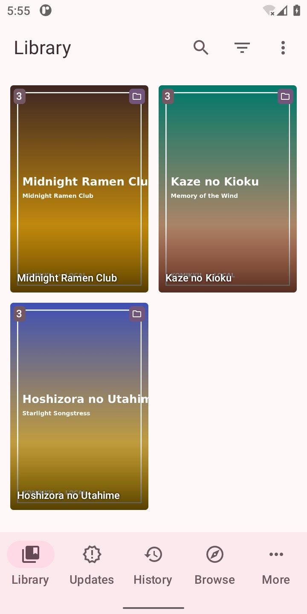
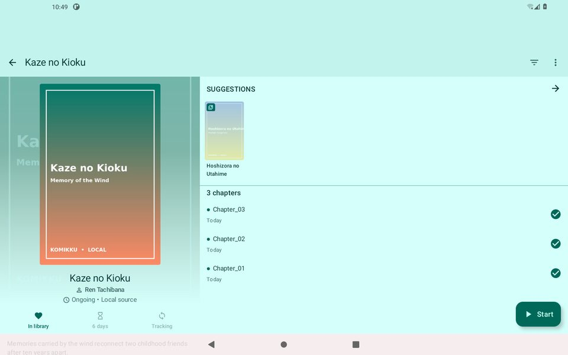
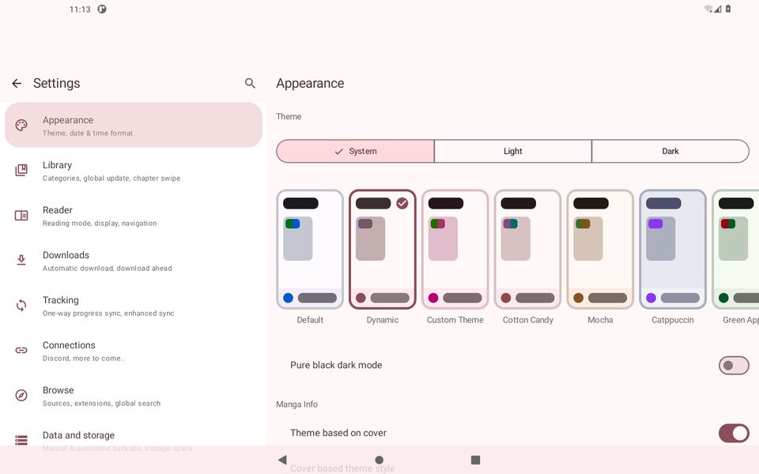
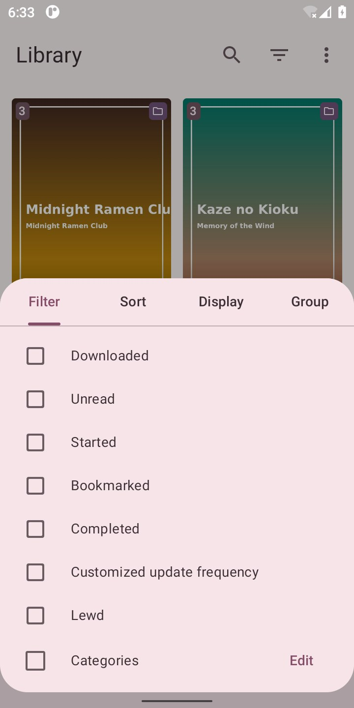
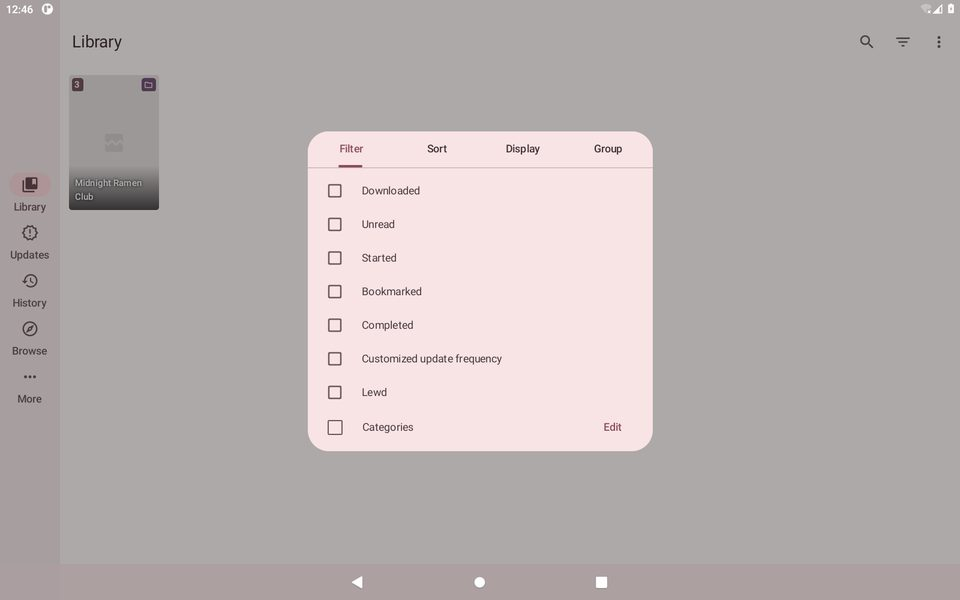

# 03 · 布局与响应式

> 响应式不是按宽度缩放，而是在 **720dp 最小宽度**处做一次形态跃迁：底栏→侧栏、单栏→双栏、底部弹层→居中卡片。**只有这一处断点。**

| 项目 | 说明 |
| --- | --- |
| 章节 | 03 / 10 |
| 适用读者 | 实现手机/平板双形态的客户端工程师 |
| 前置阅读 | [02 设计令牌](02-设计令牌.md) |
| 证据类型 | 源码 + 截图像素测量 |

---

## 本章导读

- 形态判定为什么用 `smallestScreenWidthDp`，以及四种强制模式。
- 双栏算法的精确公式与 5 个宽度的实测值。
- 网格列数的**正确**公式（第一版漏了导航轨与项内边距）。
- 弹层的自适应、insets、全局横幅层级。
- CMP 上如何在没有 `Configuration` 的地方算出同样的结果。

---

## 3.1 断点与形态判定

### 源码

```kotlin
// app/src/main/java/eu/kanade/tachiyomi/util/system/DisplayExtensions.kt:13-23
private const val TABLET_UI_REQUIRED_SCREEN_WIDTH_DP = 720

fun Configuration.isTabletUi(): Boolean {
    return smallestScreenWidthDp >= TABLET_UI_REQUIRED_SCREEN_WIDTH_DP
}
```

| 常量 | 值 | 用途 |
|---|---|---|
| `TABLET_UI_REQUIRED_SCREEN_WIDTH_DP` | **720** | 唯一的平板判定：`smallestScreenWidthDp >= 720` |
| `TABLET_UI_MIN_SCREEN_WIDTH_PORTRAIT_DP` | 700 | **仅用于自动模式**的阈值（照顾 1600px/2.25 ≈ 711dp 的设备） |
| `TABLET_UI_MIN_SCREEN_WIDTH_LANDSCAPE_DP` | 600 | **仅用于自动模式**的阈值（保证导航轨图标放得下） |

> ⚠️ **常见误读**：700 和 600 不是"布局断点"，它们只出现在 `prepareTabletUiContext()` 里，用于**决定是否强制改写 `smallestScreenWidthDp`**。真正的布局判定永远只读 720。

### 四种强制模式

```kotlin
// DisplayExtensions.kt:26-49
fun Context.prepareTabletUiContext(): Context {
    val expected = when (Injekt.get<UiPreferences>().tabletUiMode().get()) {
        TabletUiMode.AUTOMATIC ->
            configuration.smallestScreenWidthDp >= when (configuration.orientation) {
                Configuration.ORIENTATION_PORTRAIT -> 700
                else -> 600
            }
        TabletUiMode.ALWAYS -> true
        TabletUiMode.LANDSCAPE -> configuration.orientation == Configuration.ORIENTATION_LANDSCAPE
        TabletUiMode.NEVER -> false
    }
    if (configuration.isTabletUi() != expected) {
        val overrideConf = Configuration().apply { setTo(configuration) }
        overrideConf.smallestScreenWidthDp = if (expected) {
            overrideConf.smallestScreenWidthDp.coerceAtLeast(720)
        } else {
            overrideConf.smallestScreenWidthDp.coerceAtMost(719)
        }
        return createConfigurationContext(overrideConf)
    }
    return this
}
```

**实现要点**：不在每个页面判断形态，而是在 `Context` 层覆写 `smallestScreenWidthDp`（平板强制 ≥720，手机强制 ≤719），让所有下游 `isTabletUi()` 自动生效。

| 模式 | 行为 |
|---|---|
| `AUTOMATIC`（默认） | 竖屏 ≥700dp **或** 横屏 ≥600dp → 平板形态 |
| `ALWAYS` | 永远平板形态（即使手机横屏） |
| `LANDSCAPE` | 仅在横屏时平板形态 |
| `NEVER` | 永远手机形态（平板也用底栏） |

> `🎯推断` 为什么用 `smallestScreenWidthDp`：保证旋转时形态稳定。如果用当前宽度，手机旋转到横屏会突然变成平板布局，返回时又变回去。

### CMP 的实现路径（`project x`）

CMP 没有 `Configuration.smallestScreenWidthDp`。三种可行方式：

| 方式 | 做法 | 适用 |
|---|---|---|
| A. `WindowSizeClass` | `calculateWindowSizeClass()` 的 `windowWidthSizeClass` | 只能拿到 width，不是"最小边" |
| B. 自己的 `LocalSmallestWidth` | 组合 `BoxWithConstraints` + `LocalDensity`，`min(maxWidth, maxHeight)` | ✅ 推荐 |
| C. 平台 `expect/actual` | Android 读 `Configuration.smallestScreenWidthDp`；iOS 读 `UIScreen.bounds`；桌面读窗口尺寸 | 最精确，但要三份实现 |

推荐 B（再在 Android 上用 C 校准）：

```kotlin
// shared/design-system 里提供
val LocalSmallestWidth: ProvidableCompositionLocal<Dp> = staticCompositionLocalOf { 360.dp }

@Composable
fun ProvideSmallestWidth(content: @Composable () -> Unit) {
    BoxWithConstraints {
        val smallest = minOf(maxWidth, maxHeight)
        CompositionLocalProvider(
            LocalSmallestWidth provides smallest,
            content = content,
        )
    }
}

@Composable
fun isTabletUi(): Boolean = LocalSmallestWidth.current >= 720.dp
```

> ⚠️ `BoxWithConstraints` 会在测量阶段重组，不要把它放在高频滚动的内容里。放在应用根（`AppScaffold`）一次即可。
>
> ⚠️ 桌面窗口可以自由拉宽，`min(w,h)` 在超宽窗口下会给出很小的值 → 桌面永远"手机形态"。桌面需要单独策略（[3.9](#39-桌面与-ios-的-gap)）。

---

## 3.2 手机骨架

```text
┌──────────────────────────────────┐  ← edge-to-edge，状态栏透明
│ AppBar                            │  底色：surface @ 0dp（静息）
│  (title)              [🔍] [⚙] [⋮]│        动作模式：surface @ 3dp
├──────────────────────────────────┤
│                                   │
│  内容区                           │  LazyColumn / LazyGrid
│  contentPadding = Scaffold 内边距 │  + 组件自己的 8dp
│                                   │
│                                   │
├──────────────────────────────────┤
│  NavigationBar  (80dp 内容高)      │  surfaceContainer
│  Library  Updates  History  Browse  More
└──────────────────────────────────┘
        ↑ 可被阅读器/全屏隐藏
```



*图 3-1 手机端书架：360×720dp，2 列，顶栏与页面同色（`surfaceColorAtElevation(0.dp)` = `surface`），底栏 5 项，选中项是 `secondaryContainer` 药丸 + `onSecondaryContainer` 图标。*

`📐实测`（`assets/phone/10_library_grid.jpg`，720×1440px，2.0 px/dp）：

| 测量 | 像素 | dp |
|---|---|---|
| 卡片 1 横向 | x 24→348 | 24→174，宽 **162dp** |
| 卡片 2 起始 | x 372 | 186dp |
| 卡片间距 | 372−348 = 24px | **12dp**（= 2×4dp 项内边距 + 4dp 网格间距） |
| 首卡起始 | 24px | **12dp**（= 8dp 内容边距 + 4dp 项内边距） |
| 底栏总高（含手势条内边距） | y 1248→1440 | 96dp（80dp 内容 + 16dp 手势区） |

> 卡片"可见宽度"162dp 而不是 170dp，是因为每个网格项有 `padding(4dp)`（`CommonMangaItem.kt:406`）。**布局占位是 170dp，可见封面是 162dp。** 复刻时如果只按 170dp 做卡片，两张卡之间会贴死。

---

## 3.3 平板骨架

```text
┌──────┬───────────────────────────────────┐
│ Nav  │  AppBar（内容区自己的，跨内容区）     │
│ Rail ├───────────────────────────────────┤
│ 80dp │                                   │
│      │  内容区：单栏 / 双栏                │
│ 图标  │                                   │
│+文字  │                                   │
│      │                                   │
└──────┴───────────────────────────────────┘
   ↑ 垂直居中，tonalElevation 3dp，选中项药丸
   没有底部 NavigationBar
```



*图 3-2 1280×800dp 平板：左侧导航轨，右侧双栏详情（左栏 450dp）。整页被封面取色染成青绿。*

`📐实测`（`assets/tablet/10_library_grid.jpg`，960×600px，0.75 px/dp）：

| 测量 | 像素 | dp |
|---|---|---|
| 导航轨宽 | x 0→59 | **80dp** ✓ 与 `NavigationRail.kt:47` 一致 |
| 内容区起点 | x 60 | 80dp |
| 书架卡片起点 | x 69 | **92dp**（= 80 rail + 8 内容边距 + 4 项内边距） |
| 卡片宽度 | 90px | **120dp** |
| 卡片高度 | 135px | 180dp（120 × 3/2 = 180 ✓ 2:3 封面） |

> 这组数字可以反过来验证导航轨宽度：`92 − 8 − 4 = 80`。三处独立测量一致。
>
> ⚠️ **诚实标注**：该截图的书架只有 1 部作品，所以"9 列"是**由公式推算**（`cell=128dp → cover=120dp` 与实测 120dp 完全吻合，反证 9 列成立），不是数出来的。`📐实测` 只覆盖"卡宽 120dp / 起点 92dp / 轨宽 80dp"三项。

### 导航轨的构造

```kotlin
// presentation-core/.../components/material/NavigationRail.kt:37-58
androidx.compose.material3.Surface(
    color = containerColor,       // NavigationRailDefaults.ContainerColor
    contentColor = contentColor,
    modifier = modifier,
    tonalElevation = 3.dp,
) {
    Column(
        Modifier
            .fillMaxHeight()
            .windowInsetsPadding(windowInsets)
            .widthIn(min = 80.dp)
            .padding(vertical = MaterialTheme.padding.extraSmall)      // 4dp
            .selectableGroup(),
        horizontalAlignment = Alignment.CenterHorizontally,
        verticalArrangement = Arrangement.spacedBy(
            MaterialTheme.padding.extraSmall,                           // 4dp
            alignment = Alignment.CenterVertically,                     // 垂直居中
        ),
    ) { … }
}
```

与 M3 默认的差异：
- `widthIn(min = 80.dp)`（M3 默认也是 80dp，但这里显式声明，允许内容撑宽）
- **垂直居中**（M3 默认顶部对齐）
- 项间距 **4dp**，上下 padding **4dp**
- `tonalElevation = 3.dp`

---

## 3.4 双栏：`TwoPanelBox`

### 源码（全文 44 行，核心 4 行）

```kotlin
// presentation-core/src/main/java/tachiyomi/presentation/core/components/TwoPanelBox.kt:19-43
@Composable
fun TwoPanelBox(
    startContent: @Composable BoxScope.() -> Unit,
    endContent: @Composable BoxScope.() -> Unit,
    modifier: Modifier = Modifier,
    contentWindowInsets: WindowInsets = WindowInsets(0),
) {
    val direction = LocalLayoutDirection.current
    val padding = contentWindowInsets.asPaddingValues()
    val startPadding = padding.calculateStartPadding(direction)
    val endPadding = padding.calculateEndPadding(direction)
    BoxWithConstraints(modifier = modifier.fillMaxSize()) {
        val width = maxWidth - startPadding - endPadding
        val firstWidth = (width / 2).coerceAtMost(450.dp)   // ← 唯一规则
        val secondWidth = width - firstWidth
        Box(Modifier.align(Alignment.TopStart).width(firstWidth + startPadding), content = startContent)
        Box(Modifier.align(Alignment.TopEnd).width(secondWidth + endPadding), content = endContent)
    }
}
```

`width` 是**扣除 insets 后**的可用宽度；`firstWidth` 封顶 450dp；`secondWidth` 吃掉剩余。

### 5 个宽度的精确值

| 可用宽度 | 左栏 | 右栏 | 左栏占比 | 备注 |
|---|---|---|---|---|
| 720dp | 360dp | 360dp | 50% | 最小平板 |
| 800dp | 400dp | 400dp | 50% | 8 吋平板 |
| **900dp** | **450dp** | **450dp** | 50% | **封顶临界点** |
| 1024dp | 450dp | 574dp | 43.9% | iPad 类 |
| **1280dp** | **450dp** | **830dp** | 35.2% | 本白皮书平板 |

`📐实测` 平板设置页左栏 = **338px ÷ 0.75 = 450.7dp**（`assets/tablet/18_settings_main.jpg`），与公式的 450dp 一致（±1px 抗锯齿）。

### 哪些页面用双栏



*图 3-3 平板设置：左栏实测 450.7dp（338px ÷ 0.75），与 `min(w/2, 450dp)` 一致。*

| 页面 | 用双栏 | 代码 |
|---|---|---|
| 漫画详情 | ✅ | `MangaScreen.kt:1057` |
| 设置（主列表 + 子页） | ✅ | `SettingsScreen.kt:71` |
| 即将更新（Upcoming） | ✅ | `UpcomingScreenContent.kt:96` |
| 书架 | ❌ 单栏网格 | — |
| 历史 / 更新 | ❌ 单栏列表 | — |
| 浏览 / 更多 | ❌ 单栏 | — |

> **注意**：双栏只用于"列表 + 详情"的 master-detail 场景。书架、历史这些"内容网格/列表"页在平板上仍是单栏，只是列数变多。

### 平板设置页的额外规则

设置页的双栏不只是切两栏，还有视觉区分（`SettingsMainScreen.kt:96-171`）：

| 项 | 手机 | 平板双栏 |
|---|---|---|
| 容器色 | `MaterialTheme.colorScheme.surface` | **`getPalerSurface()`**：HSL 亮度 ±0.05/0.02 |
| 选中行 | 无选中概念 | `padding(horizontal=8dp)` + `clip(RoundedCornerShape(24dp))` + `background(surfaceVariant)` |
| 选中行文字色 | — | `onSurfaceVariant` |
| 导航 | `push` | **`replaceAll`**（右栏替换，不叠栈） |
| 滚动到当前项 | — | `animateScrollToItem` + 顶部栏折叠 |

```kotlin
// SettingsMainScreen.kt:70-84 —— 平板左栏的"更浅"底色
@Composable
private fun getPalerSurface(): Color {
    val surface = MaterialTheme.colorScheme.surface
    val dark = isSystemInDarkTheme()
    return remember(surface, dark) {
        val arr = FloatArray(3)
        ColorUtils.colorToHSL(surface.toArgb(), arr)
        arr[2] = if (dark) arr[2] - 0.05f else arr[2] + 0.02f   // 暗色更暗，亮色更亮？
            .coerceIn(0f, 1f)
        Color.hsl(arr[0], arr[1], arr[2])
    }
}
```

> ⚠️ **代码有个符号疑点**：暗色时 `arr[2] - 0.05f`（更暗），亮色时 `arr[2] + 0.02f`（更亮）。函数名叫 `getPalerSurface`，但暗色下实际是**更暗**。从截图看（`assets/tablet/18_settings_main.jpg`）左栏确实比右栏略暗一点。复刻时按代码行为做，不要按函数名做。

`⚠️缺口` CMP 没有 `ColorUtils.colorToHSL`（`androidx.core`）。需要自己写 RGB↔HSL 转换（约 30 行），或用 Compose 的 `Color.toArgb()` + 自实现。

---

## 3.5 网格列数（修正第一版的公式）

### 正确的计算链

```kotlin
// LazyLibraryGrid.kt:24-37
FastScrollLazyVerticalGrid(
    columns = if (columns == 0) GridCells.Adaptive(128.dp) else GridCells.Fixed(columns),
    contentPadding = contentPadding + PaddingValues(8.dp),        // ← 四边各 +8dp
    verticalArrangement = Arrangement.spacedBy(4.dp),             // GridVerticalSpacer
    horizontalArrangement = Arrangement.spacedBy(4.dp),           // GridHorizontalSpacer
    …
)
```

每个网格项自己还有 `padding(4.dp)`（`CommonMangaItem.kt:406`）。

因此：

```
可用宽 avail = 屏宽 − 导航栏/轨宽 − 2×8dp
列数 n      = floor((avail + 4) / (128 + 4))        // Adaptive(128dp) 的取整
单元格 cell = (avail − (n−1)×4) / n
可见封面    = cell − 2×4dp
```

### 实测验证

| 场景 | 屏宽 | 导航 | avail | 列数 | cell | **可见封面** | 实测 |
|---|---:|---:|---:|---:|---:|---:|---|
| 手机 | 360 | 0 | 344 | **2** | 170.0 | **162.0** | **162.0** ✓ |
| 平板书架 | 1280 | 80 | 1184 | **9**（推算） | 128.0 | **120.0** | **120.0** ✓ |
| 平板推入页（无轨） | 1280 | 0 | 1264 | 9 | 136.9 | 128.9 | — |
| 平板最小 | 720 | 80 | 624 | **4** | 153.0 | 145.0 | — |
| 1024dp | 1024 | 80 | 928 | 7 | 129.1 | 121.1 | — |

### 与第一版公式的差异

第一版公式：`floor((w + 4) / 132)`，**漏了导航轨和项内边距**。

| 屏宽 | 第一版 | 正确 | 差 |
|---:|---:|---:|---|
| 360 | 2 | 2 | — |
| 393 | 2 | 2 | — |
| **411** | **3** | **2** | ❌ |
| **600** | **4** | **3** | ❌ |
| **720**（平板） | **5** | **4** | ❌ |
| 800 | 5 | 5 | — |
| 1024 | 7 | 7 | — |
| **1200** | **9** | **8** | ❌ |
| 1280 | 9 | 9 | — |
| **1600** | **12** | **11** | ❌ |

> 第一版在 411dp（Pixel 常见宽度）上多算了一列，这是最容易被发现的错误：Pixel 上看书架的列数和文档不符。

### 固定列数（用户覆盖）

`portraitColumns()` / `landscapeColumns()` 默认都是 **0**（`LibraryPreferences.kt:33-35`），即"自动"。用户可在设置里指定固定值，此时走 `GridCells.Fixed(columns)`，跳过上面的公式。

### 其他用 `Adaptive(128.dp)` 的地方

| 位置 | 用途 | 代码 |
|---|---|---|
| 书架网格 | 封面卡 | `LazyLibraryGrid.kt:28` |
| 设置图标网格 | 大图标入口 | `SettingsItems.kt:361` |
| 来源/扩展网格 | 源图标卡 | `BrowseSourceComfortableGrid.kt` 等 |
| 关联漫画行 | **不是网格**，是 `LazyRow` + 固定 96dp 项宽 | `GlobalSearchCardRow.kt:86-88` |

> 关联漫画行的卡片宽是 **96dp**（`MangaItem` 的 `Modifier.width(96.dp)`），全景封面时 205dp。不要把这个当成网格。

---

## 3.6 三种显示密度

`LibraryDisplayMode`（`tachiyomi/domain/library/model/LibraryDisplayMode.kt`）有 **5 个值**（第一版说 4 个）：

| 模式 | 序列化名 | 封面比例 | 标题 | 布局 |
|---|---|---|---|---|
| **CompactGrid**（默认） | `COMPACT_GRID` | 2:3 | **叠在封面上**，1 行起，12sp/18sp | 封面占满卡片，底部 33% 渐变遮罩 |
| **ComfortableGrid** | `COMFORTABLE_GRID` | 2:3 | **封面下方**，2 行，12sp/18sp | 封面 + 4dp padding 的标题区 |
| **ComfortableGridPanorama**（KMK 新增） | `COMFORTABLE_GRID_PANORAMA` | 自动（宽图切 3:2） | 同上 | 封面高宽比 ≤0.75 时用 3:2 |
| **List** | `LIST` | 1:1 | 右侧，`bodyMedium` 2 行 | 56dp 行高 |
| **CoverOnlyGrid** | `COVER_ONLY_GRID` | 2:3 | **无标题** | 只有封面，右下角可能有继续阅读按钮 |

### 各模式的关键数值

**CompactGrid 标题层**（`CommonMangaItem.kt:155-196`）：
```kotlin
Box(
    Modifier
        .clip(RoundedCornerShape(bottomStart = 4.dp, bottomEnd = 4.dp))
        .background(Brush.verticalGradient(0f to Color.Transparent, 1f to Color(0xAA000000)))
        .fillMaxHeight(0.33f)   // 底部 1/3
        .fillMaxWidth()
        .align(Alignment.BottomCenter)
)
// 标题：titleSmall + White + Shadow(Black, blurRadius=4f) + padding(8dp)
// 字号：fontSize=12.sp, lineHeight=18.sp, minLines=1, maxLines=2
```

**ComfortableGrid 标题区**：
```kotlin
GridItemTitle(
    modifier = Modifier.padding(4.dp),
    title = title,
    style = MaterialTheme.typography.titleSmall,
    minLines = 2, maxLines = 2,   // 固定 2 行
)
// 字号仍是 12.sp / 18.sp（GridItemTitle 内部覆写）
```

**List**：
```kotlin
Row(
    Modifier
        .selectedBackground(isSelected)
        .height(56.dp)
        .padding(horizontal = 16.dp, vertical = 8.dp)
) {
    MangaCover.Square(Modifier.fillMaxHeight())   // 40×40dp
    Text(title, Modifier.padding(horizontal=16.dp).weight(1f), bodyMedium, maxLines=2)
    BadgeGroup(content = badge)
    // 可选：继续阅读按钮（28dp，图标 16dp）
}
```

### 全景封面的切换阈值

```kotlin
// MangaCover.kt:222
internal const val RatioSwitchToPanorama = 0.75f
```

封面加载后算 `height/width`，若 `≤ 0.75`（即宽高比 ≥ 4:3）且开启全景模式，则从 2:3 切成 3:2。

- `ComfortableGridPanorama` 模式下：`ContentScale.Fit`，比例 `3f/2f`
- 普通 `ComfortableGrid` + `usePanoramaCover=false`：永远 2:3 `Crop`

---

## 3.7 弹层的自适应

同一个 `AdaptiveSheet` 组件，在两种形态下完全不同的表现。

| 属性 | 手机 | 平板 |
|---|---|---|
| 位置 | 底部对齐 | **居中** |
| 最大宽 | `widthIn(max=460dp)` | `requiredWidthIn(max=460dp)` |
| 形状 | `shapes.extraLarge`（28dp） | `shapes.extraLarge`（28dp） |
| 底色 | `surfaceContainerHigh` | `surfaceContainerHigh` |
| 进出动画 | `AnchoredDraggable` + `tween(350)` | `alpha` `tween(350)` |
| 关闭方式 | 下滑（阈值 56dp）或点遮罩 | **仅点遮罩**（禁止滑动） |
| 内边距 | `navigationBarsPadding` + `statusBarsPadding` | `systemBarsPadding` + `padding(vertical=16dp)` |
| 遮罩 | **无** `scrim` 覆盖（Dialog 默认 `usePlatformDefaultWidth=false`） | 同 |

```kotlin
// AdaptiveSheet.kt（presentation-core）关键分支
if (isTabletUi) {
    // 居中卡片，alpha 淡入
    Box(Modifier.fillMaxSize().alpha(alpha), contentAlignment = Alignment.Center) {
        Surface(Modifier.requiredWidthIn(max = 460.dp).systemBarsPadding().padding(vertical = 16.dp),
                shape = MaterialTheme.shapes.extraLarge,
                color = MaterialTheme.colorScheme.surfaceContainerHigh)
    }
} else {
    // 底部抽屉，anchoredDraggable
    Surface(Modifier.widthIn(max = 460.dp).navigationBarsPadding().statusBarsPadding(),
            shape = MaterialTheme.shapes.extraLarge,
            color = MaterialTheme.colorScheme.surfaceContainerHigh)
}
```

`📐实测` 手机筛选弹层（`assets/phone/35_library_filter_sheet.jpg`）：弹层顶边 y≈568px ÷ 2 = **284dp**，屏高 720dp，所以弹层占 436dp。宽度是**全屏**（0→720px），因为手机宽度 360dp 本就小于 460dp 上限。

`📐实测` 平板筛选弹层（`assets/tablet/35_library_filter_sheet.jpg`，0.75 px/dp）：

| 测量 | 像素 | dp |
|---|---|---|
| 弹层横向 | x 308→651 | **458.7dp** ✓（= `requiredWidthIn(max=460dp)`） |
| 弹层纵向 | y 132→450 | 425.3dp |
| 左边距 | 308px | 410.7dp |
| 右边距 | 960−652 = 308px | 410.7dp（**完全对称**，证明居中） |

> 这条是 v2 自检时差点写错的：我一开始按"平板=全宽"推断，但实测左右边距完全相等且等于 `(1280 − 460)/2 = 410`，与 `460dp` 上限精确吻合。**同一条 `AdaptiveSheet` 在平板上确实是 460dp 居中卡片**，第一版这一点是对的。
>
> 教训：`📐实测` 必须真的量，不能靠"看起来像"。

---

## 3.8 Insets 与全局横幅

### 实测：手机 vs 平板同一弹层

**手机（底部抽屉，全宽）**



**平板（460dp 居中卡片）**



*图 3-4 同一个筛选面板的两种形态：手机全宽贴底；平板 458.7dp 居中，左右边距各 410.7dp。*

### Edge-to-edge

应用启用 `enableEdgeToEdge()`，状态栏/导航栏透明。内容延伸到系统栏下方，由各组件的 `windowInsets` 自行消费。

| 组件 | 消费的 insets | 代码 |
|---|---|---|
| Scaffold 内容 | 扣除 topBar/bottomBar/startBar 后的剩余 | `Scaffold.kt:287-305` |
| `NavigationBar` | `NavigationBarDefaults.windowInsets` | `NavigationBar.kt:30,40` |
| `NavigationRail` | `NavigationRailDefaults.windowInsets` | `NavigationRail.kt:35,45` |
| 阅读器底栏 | `WindowInsets.navigationBars` | `ReaderAppBars.kt:262` |
| 底部动作栏 | `WindowInsets.navigationBars.only(Bottom)` | `MangaBottomActionMenu.kt:118-121` |
| 引导页底栏 | `NavigationBarDefaults.windowInsets` | `InfoScreen.kt:78` |
| 平板双栏 | `WindowInsets.systemBars.only(Horizontal)` | `SettingsScreen.kt:66-70` |

### Scaffold 的非标准行为

Komikku fork 了 M3 的 `Scaffold`，加了 4 处改动（`Scaffold.kt:75-81` 注释）：

1. **`startBar` 槽位**（M3 没有）→ 导航轨
2. **content 的 `start` padding 取 `max(inset, startBarWidth)`** → 内容不被轨道遮挡
3. **bottom padding 同时考虑 FAB 高度** → FAB 不压内容
4. **处理已消费的 insets**（`onConsumedWindowInsetsChanged`）→ 避免重复留白

`project x` 若用 CMP 的 `Scaffold`，需要自己在 `Row { NavigationRail(); Scaffold(...) }` 里做等价布局，不要指望 CMP Scaffold 有 `startBar`。

### 全局横幅

`AppStateBanners`（`Banners.kt:87+`）在内容之上按条件堆叠：

```text
┌────────────────────────────┐
│ Indexing / Restoring /      │  ← tertiary / error / secondary
│ Syncing / Updating 横幅     │
├────────────────────────────┤
│ Downloaded only 横幅        │  ← tertiary
├────────────────────────────┤
│ Incognito mode 横幅         │  ← primary
├────────────────────────────┤
│ 页面内容                    │
└────────────────────────────┘
```

| 横幅 | 底色 | 文字色 | 代码 |
|---|---|---|---|
| Downloaded only | `tertiary` | `onTertiary` | `Banners.kt:36-37` |
| Incognito mode | `primary` | `onPrimary` | `Banners.kt:38-39` |
| Indexing | `secondary` | `onSecondary` | `Banners.kt:40-41` |
| Restoring backup | `error` | `onError` | `Banners.kt:43-44` |
| Syncing | `secondary` | `onSecondary` | `Banners.kt:45-46` |
| Updating library | `tertiary` | `onTertiary` | `Banners.kt:47-48` |
| 通用警告 | `error` | `onError` + `padding(16dp)` + 居中 | `Banners.kt:50-64` |

横幅用 `AnimatedVisibility(expandVertically/shrinkVertically)`，并自动叠加 `WindowInsets.statusBars`（`Banners.kt:104-112`）避免被状态栏遮挡。

> **顺序不是固定的**：`AppStateBanners` 里 indexing/restoring/syncing/updating 是**互斥**的单一横幅（用一个 `when` 选文案），不是四层叠加。第一版说的"按顺序堆叠 Indexing → Downloaded only → Incognito"只有 Downloaded/Incognito 是独立两层。

---

## 3.9 桌面与 iOS 的 `⚠️缺口`

Komikku 只有 Android。以下是 `project x` 必须自己决定的部分：

| 缺口 | 问题 | 建议 |
|---|---|---|
| 桌面形态判定 | `min(w,h)` 在 21:9 超宽窗口下仍判定为"手机" | 桌面用 `max(w,h)` 或 `w >= 840dp → 平板` |
| 桌面窗口最小宽 | 无 | 建议 360dp |
| 鼠标悬停 | M3 的 hover 态在 Compose Desktop 有，但 Komikku 没设计过 | 沿用 M3 默认 |
| 键盘导航 | 无 | 至少保证 Tab/方向键可达 |
| iOS 安全区 | 无对应 | `WindowInsets.safeDrawing` 已覆盖 |
| iOS 返回手势 | 无对应 | 需要 `predictiveBack` 的 iOS 等价 |
| 多窗口 | 无 | 需自行定义窗口尺寸记忆 |

---

## 设计意图（`🎯推断`）

1. **为什么只有 720 一个断点**：两个断点会产生"小平板"的中间态，需要第三套布局。一个断点 = 两套布局，维护成本减半。
2. **为什么平板书架仍是单栏**：书架是"浏览很多封面"的任务，给它分栏会减少可见封面数，得不偿失。
3. **为什么详情/设置用双栏**：这是"列表选一项 → 看详情"的任务，双栏避免返回操作。
4. **为什么左栏封顶 450dp**：450dp 刚好容纳 2:3 封面（300dp 高）+ 标题 + 3 个动作按钮。再宽就是浪费。
5. **为什么手机弹层全宽、平板限宽**：手机宽度本来就不够 460dp；平板如果全宽，一行文字会太长，阅读困难。

---

## 复刻检查清单

- [ ] 形态判定只读"最小边 ≥ 720dp"，没有第二个断点
- [ ] 700/600 只用于自动模式的阈值，不参与布局
- [ ] 双栏左栏 `min(avail/2, 450dp)`，右栏吃剩余
- [ ] 900dp 时左右各 450dp（封顶临界）
- [ ] 网格公式含导航轨宽与 `2×8dp` 内容边距、`2×4dp` 项内边距
- [ ] 360dp → 2 列 / 411dp → **2** 列 / 600dp → **3** 列 / 720dp → **4** 列 / 1280dp → 9 列
- [ ] 五种显示密度都实现（含 Panorama）
- [ ] 全景切换阈值 `height/width ≤ 0.75`
- [ ] 手机 sheet 底部 + 可下滑；平板 sheet 居中 + 只点遮罩关闭
- [ ] Scaffold 的 `startBar` 由自己实现（CMP 无此槽位）
- [ ] 平板设置左栏容器色按 HSL 微调，选中行 8dp padding + 24dp 圆角 + `surfaceVariant`
- [ ] 横幅的 7 种底色正确，且 indexing/restoring/syncing/updating 互斥

---

## 延伸阅读

- [上一章：02 设计令牌](02-设计令牌.md)
- [下一章：04 导航与信息架构](04-导航与信息架构.md)
- 组件落地：[06 组件规格库](06-组件规格库.md)
- 逐页对照：[07 页面规格](07-页面规格.md)
