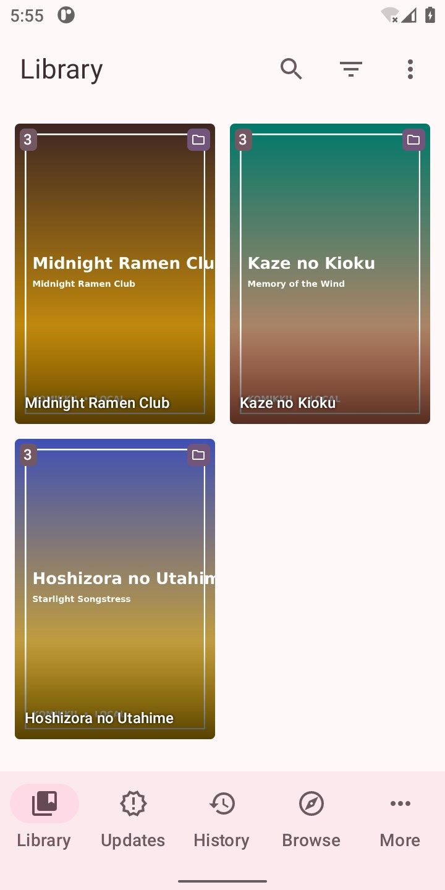
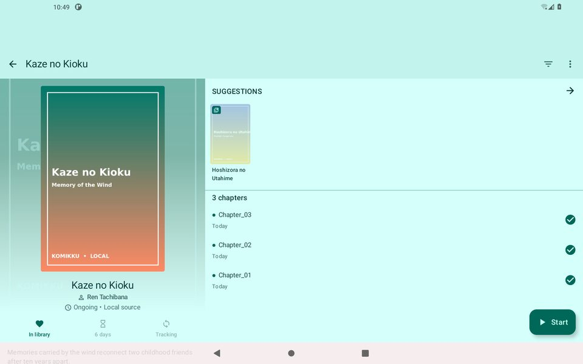
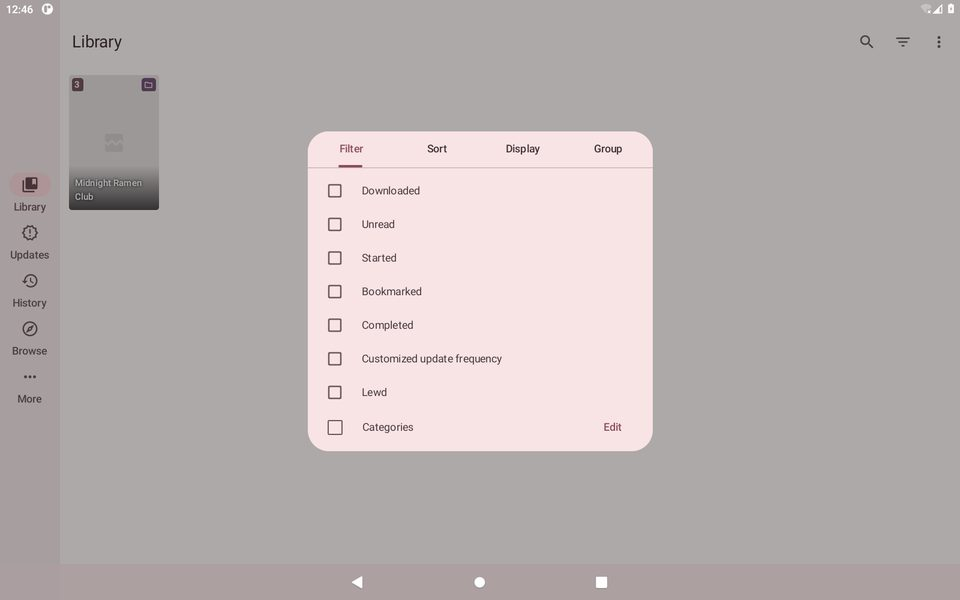

# 03 · 布局与响应式系统

> 响应式不是按屏幕宽度缩放，而是在 720dp 处做一次明确的形态跃迁：底栏→侧栏、单栏→双栏、底部弹层→居中卡片。

| 项目 | 说明 |
| --- | --- |
| 章节 | 03 / 10 |
| 适用读者 | 需要实现手机/平板双形态的客户端与 Web 工程师 |
| 前置阅读 | [02 设计令牌](02-设计令牌.md) |
| 证据类型 | 断点常量与布局代码 + 手机/平板截图对照 |

## 本章导读

- 形态判定为什么用 `smallestScreenWidthDp`，以及四种强制模式。
- 手机骨架、平板骨架，以及 `TwoPanelBox` 的 450dp 上限算法。
- 自适应网格列数公式与三种显示密度。
- 弹层、insets 与全局横幅的布局规则。

---

Komikku 的响应式不是“按屏幕宽度缩放”，而是**按设备形态切换结构**。手机与平板共用同一批页面，但在 720dp 处发生一次明确的形态跃迁：底栏→侧栏、单栏→双栏、底部弹层→居中卡片。

## 3.1 断点与形态判定

| 常量                                    | 值                  | 用途                                                                   |
|-----------------------------------------|---------------------|------------------------------------------------------------------------|
| TABLET_UI_REQUIRED_SCREEN_WIDTH_DP      | 720                 | 最小的“平板形态”判定：`smallestScreenWidthDp >= 720`                   |
| TABLET_UI_MIN_SCREEN_WIDTH_PORTRAIT_DP  | 700                 | 自动模式下，竖屏达到 700dp 即启用平板布局（照顾 1600px/2.25 这类设备） |
| TABLET_UI_MIN_SCREEN_WIDTH_LANDSCAPE_DP | 600                 | 自动模式下，横屏达到 600dp 即启用（保证侧栏图标放得下）                |
| GridCells.Adaptive                      | 128dp               | 书架/来源/设置图标网格的最小列宽                                       |
| TwoPanelBox 左栏                        | min(width/2, 450dp) | 详情页、设置页的双栏比例                                               |
| AdaptiveSheet 最大宽                    | 460dp               | 平板居中卡片宽度                                                       |
| AlertDialog 宽                          | 280–560dp           | 标准对话框                                                             |

用户还可以强制覆盖形态：`TabletUiMode` = **AUTOMATIC / ALWAYS / LANDSCAPE / NEVER**。实现方式不是在每个页面判断，而是通过 `prepareTabletUiContext()` 覆写 `Configuration.smallestScreenWidthDp`（平板强制抬到 720，手机强制压到 719），让所有下游 `isTabletUi()` 自动生效。

> **实现要点**
>
> “最小宽度”而不是“当前宽度”是关键。用 `smallestScreenWidthDp` 可以保证横竖屏切换时布局形态稳定，不会因为旋转瞬间从平板掉回手机布局。

## 3.2 手机骨架

```text
┌──────────────────────────────┐  ← edge-to-edge，状态栏透明
│  AppBar（滚动前透明，滚动后 surface@3dp）        │
├──────────────────────────────┤
│                              │
│  内容区：LazyColumn / LazyGrid                  │
│  contentPadding = Scaffold 内边距 + 8dp         │
│                              │
├──────────────────────────────┤
│  NavigationBar（80dp，5 项）                     │
│  Library  Updates  History  Browse  More         │
└──────────────────────────────┘
      ↑ 可被隐藏（阅读器/全屏）   ↑ insets 由组件自己消费
```



*图 3-1 手机端书架：360dp 宽，自适应网格得到 2 列；顶栏透明叠在背景上；底栏 5 项，选中项为药丸指示器 + 主色图标。*

## 3.3 平板骨架

```text
┌────────┬─────────────────────────────────────┐
│ Nav    │  AppBar（内容区自己的）                       │
│ Rail   ├─────────────────────────────────────┤
│ 80dp   │                                     │
│        │  内容区：单栏 / 双栏 / master-detail       │
│ 图标    │                                     │
│ +文字   │                                     │
│        │                                     │
└────────┴─────────────────────────────────────┘
  ↑ 居中排列，tonal elevation 3dp，选中项药丸
  没有底部 NavigationBar
```



*图 3-2 1280×800dp 平板：左侧 NavigationRail，右侧双栏详情。左栏 450dp（ min(1280/2, 450) ），右栏 830dp。整页被封面取色染成青绿色。*

## 3.4 TwoPanelBox：分栏的精确算法

```kotlin
// presentation-core/.../TwoPanelBox.kt
val width = maxWidth - startPadding - endPadding
val firstWidth  = (width / 2).coerceAtMost(450.dp)
val secondWidth = width - firstWidth
```

这行 `coerceAtMost(450.dp)` 是平板体验的核心：左栏永远不会因为屏幕变宽而无限变宽。在 1280dp 平板上左栏是 450dp（35%），右栏 830dp；在 800dp 平板上是 400dp / 400dp；在 720dp 上正好 360dp / 360dp。

| 可用宽度 | 左栏  | 右栏  | 左栏占比 |
|----------|-------|-------|----------|
| 720dp    | 360dp | 360dp | 50%      |
| 800dp    | 400dp | 400dp | 50%      |
| 900dp    | 450dp | 450dp | 50%      |
| 1024dp   | 450dp | 574dp | 44%      |
| 1280dp   | 450dp | 830dp | 35%      |

## 3.5 网格与列数

书架、来源列表、关联漫画、设置图标网格共用同一条规则：`columns == 0 → GridCells.Adaptive(128.dp)`，否则固定列数。内容边距 `8dp`，项目间距 `4dp`，每个条目自身再留 `4dp` 内边距。

| 屏幕宽度               | 可用宽度（减 16dp） | 自适应列数 | 单列宽约 |
|------------------------|---------------------|------------|----------|
| 360dp（常见手机）      | 344dp               | 2          | 170dp    |
| 411dp（Pixel 类）      | 395dp               | 3          | 129dp    |
| 600dp（折叠屏/小平板） | 584dp               | 4          | 143dp    |
| 720dp（最小平板）      | 704dp               | 5          | 139dp    |
| 800dp（8 吋平板）      | 784dp               | 5          | 155dp    |
| 1024dp（iPad 类）      | 1008dp              | 7          | 143dp    |
| 1280dp（本白皮书平板） | 1264dp              | 9          | 139dp    |

*公式： floor((可用宽度 + 4) / (128 + 4)) 。这也是为什么 1280dp 的平板截图里，单张卡片的宽度只有约 115dp（含内边距后视觉宽度）。*

## 3.6 三种显示密度

| 模式             | 封面比例         | 标题                   | 布局                                           |
|------------------|------------------|------------------------|------------------------------------------------|
| 舒适网格（默认） | 2:3              | 12sp / 18sp，最少 2 行 | 封面 + 下方标题；顶部两侧徽标                  |
| 紧凑网格         | 2:3              | 12sp，1 行             | 更小间距，适合大屏浏览                         |
| 列表             | 1:1（高度 40dp） | bodyMedium 2 行        | 56dp 行高；左封面、右徽标；Continue 按钮在末尾 |

封面统一使用 `MangaCover.Book = 2/3`，圆角 `extraSmall (4dp)`；当封面本身是横图（`height/width ≤ 0.75`）且开启全景封面时，切换为 `3:2` 的 `Panorama` 比例。

## 3.7 弹层的自适应

> **Phone · Bottom sheet**
>
> 底部滑出，顶部圆角 `extraLarge (28dp)`，背景 `surfaceContainerHigh`，可下拉关闭（阈值 56dp），进入/退出 350ms tween。

> **Tablet · Centered dialog**
>
> 同一个组件，自动变成居中的卡片：最大宽 460dp、上下 16dp 内边距、圆角 `extraLarge`、点击遮罩关闭、禁用滑动手势。



*图 3-3 同一个筛选面板：手机上是底部抽屉，平板上是 460dp 居中卡片；顶部 Tab 行与内容完全一致。*

## 3.8 Insets、系统栏与全局横幅

应用使用 `enableEdgeToEdge()`，状态栏/导航栏透明；状态栏图标明暗根据当前背景亮度动态选择（`statusBarBackgroundColor.luminance() > 0.5`）。底部导航栏在某些场景（如阅读器）会绘制一层 80% 透明度的 scrim，避免内容与手势条混淆。

全局状态横幅位于所有内容之上，按顺序堆叠：Indexing/Updating/Syncing/Restoring → Downloaded only → Incognito。每层都会动态计算剩余的状态栏 inset，避免重复留白。

---

## 设计意图

布局系统的核心意图是“结构随形态变，内容不随宽度漂”。用最小宽度判定可以避免旋转时布局抖动；给左栏 450dp 上限可以避免大屏上出现一条被拉长的空栏；让弹层在平板变成居中卡片，是为了缩短视线移动距离。所有这些都不是审美偏好，而是对“手、眼、内容距离”的工程化处理。

## 复刻检查清单

- [ ] 720dp 处底栏消失、Rail 出现，且没有中间态闪烁。
- [ ] 1280dp 下详情页左栏仍为 450dp，右栏吃掉剩余宽度。
- [ ] 360dp 书架 2 列、1280dp 书架 9 列，加载前后无跳动。
- [ ] 手机弹层从底部滑出；平板同一内容为 460dp 居中卡片。
- [ ] 系统栏透明，内容延伸到边到边，但文字不被状态栏遮挡。
- [ ] 旋转屏幕后布局形态不回到手机骨架（最小宽度判定）。
- [ ] 全局横幅按 Indexing → Downloaded only → Incognito 顺序堆叠。

## 延伸阅读

- [上一章：02 设计令牌](02-设计令牌.md)
- [下一章：04 导航与信息架构](04-导航与信息架构.md)
- 页面级平板对照：[07 页面规格](07-页面规格.md)
- Web 双栏配方：9.3 关键组件配方
