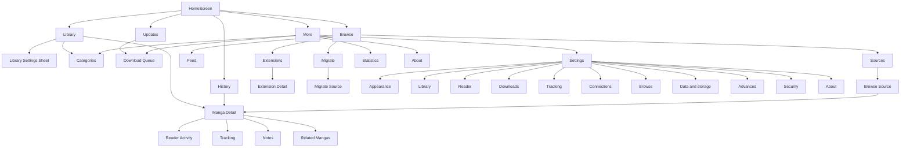

# 04 · 导航与信息架构

> 信息架构是 **5 个一级 Tab + 每个 Tab 独立返回栈 + 一个独立阅读器 Activity**。结构简单，但**每个返回行为、每次重复点击都有明确定义**——这才是复刻时容易漏的部分。

| 项目 | 说明 |
| --- | --- |
| 章节 | 04 / 10 |
| 适用读者 | 做路由、返回栈、页面转场的人 |
| 前置阅读 | [03 布局与响应式](03-布局与响应式.md) |
| 证据类型 | 源码（Voyager 路由结构） |

---

## 4.1 五个一级 Tab

```kotlin
// app/src/main/java/eu/kanade/tachiyomi/ui/home/HomeScreen.kt:81-87
private val TABS = listOf(
    LibraryTab,   // index 0
    UpdatesTab,   // index 1
    HistoryTab,   // index 2
    BrowseTab,    // index 3
    MoreTab,      // index 4
)
```

| # | Tab 类 | 标题（i18n key） | 图标（AnimatedVector） | 可隐藏 |
|---|---|---|---|---|
| 0 | `LibraryTab` | `label_library` | `anim_library_enter` | 否 |
| 1 | `UpdatesTab` | `label_recent_updates` | `anim_updates_enter` | ✅ `showNavUpdates` |
| 2 | `HistoryTab` | `label_recent_manga` | `anim_history_enter` | ✅ `showNavHistory` |
| 3 | `BrowseTab` | `browse` | `anim_browse_enter` | 否 |
| 4 | `MoreTab` | `label_more` | `anim_more_enter` | 否 |

> Tab 可以隐藏（`isEnabled()`），但**不重排 index**：Updates 永远是 1、History 永远是 2。隐藏后底栏只剩 3 或 4 项。`HomeScreen.kt:112,133` 用 `fastFilter { it.isEnabled() }` 过滤。

### 图标是动画矢量

每个 Tab 用 `AnimatedImageVector.animatedVectorResource(R.drawable.anim_*_enter)` + `rememberAnimatedVectorPainter(image, isSelected)`（`LibraryTab.kt:96-100`）。

- **选中**时播放进入动画
- **未选中**时停留在首帧

动画时长（`app/src/main/res/drawable/anim_*.xml`）：

| 图标 | 时长 | 结构 |
|---|---|---|
| `anim_library_enter` | **300ms** | 单条路径变形（书本+书签合体） |
| `anim_updates_enter` | **300ms** | 单条路径 |
| `anim_browse_enter` | **300ms** + 66/100/66/100ms 子动画 | 多路径（罗盘指针） |
| `anim_history_enter` | **500ms** | 单条路径（时钟指针回转） |
| `anim_more_enter` | 83/100/133/67/150/100ms | 多圆点依次 |

> CMP 的 `AnimatedImageVector` 在 1.13 已支持（`androidx.compose.animation.graphics`）。但 Android 的 `<animated-vector>` XML 格式需要转成 Compose 的 `AnimatedVectorPainter` 资源，或直接用 `rememberInfiniteTransition`/`animateFloatAsState` 驱动 path。**`project x` 需要重画这 5 个图标**（XML 不能直接复用）。

---

## 4.2 每个 Tab 独立返回栈

```kotlin
// HomeScreen.kt:100-103
TabNavigator(tab = LibraryTab, key = "HomeTabs") { tabNavigator ->
    CompositionLocalProvider(LocalNavigator provides navigator) {
        …
        AnimatedContent(targetState = tabNavigator.current, …) {
            tabNavigator.saveableState(key = "currentTab", it) { it.Content() }
        }
    }
}
```

结构：

```text
MainActivity
└── Navigator (全局栈)
    └── HomeScreen
        └── TabNavigator (5 个 Tab，各自独立栈)
            ├── LibraryTab  → [LibraryScreen, MangaScreen, ...]
            ├── UpdatesTab  → [UpdatesScreen, DownloadQueueScreen, ...]
            ├── HistoryTab  → [HistoryScreen, MangaScreen, ...]
            ├── BrowseTab   → [TabbedScreen(Sources/Feed/Extensions/Migrate), BrowseSourceScreen, ...]
            └── MoreTab     → [MoreScreen, SettingsScreen, ...]
```

**关键点**：`CompositionLocalProvider(LocalNavigator provides navigator)`（`:105`）把**全局 Navigator** 提供给 Tab 内容。这意味着 `navigator.push(MangaScreen(...))` 推的是**全局栈**，不是 Tab 栈。

所以：
- 从 Library 打开详情 → 详情在**全局栈**
- 切到 History 再切回 Library → 详情**仍在**（因为它不在 Tab 栈里）
- 从 History 打开详情 → 同一个全局栈，会叠在 Library 的详情上面

> `🎯推断` 这是 Voyager `TabNavigator` + 全局 `Navigator` 混用的结果，不是刻意设计。副作用是"跨 Tab 的详情会共享栈"。复刻时如果用 Navigation 3（`project x` 的选型），需要**显式决定**：是每个 Tab 一个 NavBackStack，还是共享一个。建议共享（与 Komikku 行为一致）。

---

## 4.3 重复点击当前 Tab（`onReselect`）

这是最容易被漏掉的行为。**点击已选中的 Tab 会触发一个特定动作，不是"滚动到顶"**。

| Tab | 重复点击行为 | 代码 |
|---|---|---|
| **Library** | 打开**书架设置 Sheet** | `LibraryTab.kt:104-106` → `requestOpenSettingsSheet()` |
| **Updates** | **推入下载队列** | `UpdatesTab.kt:61-63` → `navigator.push(DownloadQueueScreen)` |
| **History** | **续读上次章节** | `HistoryTab.kt:70-72` → `resumeLastChapterReadEvent.send(Unit)` |
| **Browse** | **推入全局搜索** | `BrowseTab.kt:60-62` → `navigator.push(GlobalSearchScreen())` |
| **More** | **推入设置** | `MoreTab.kt:64-66` → `navigator.push(SettingsScreen())` |

```kotlin
// HomeScreen.kt:210-230 —— 选中态判断与 reselect
val selected = tabNavigator.current::class == tab::class
NavigationBarItem(
    selected = selected,
    onClick = {
        if (!selected) {
            tabNavigator.current = tab
        } else {
            scope.launch { tab.onReselect(navigator) }
        }
    },
    …
)
```

> **不是"滚到顶"**。很多阅读器应用重复点击 Tab 是滚动到顶，Komikku 不是。复刻时如果做成滚到顶，会丢失 5 个快捷入口。

---

## 4.4 返回优先级

### 全局返回链

```kotlin
// HomeScreen.kt:166-168
val goToLibraryTab = { tabNavigator.current = LibraryTab }
BackHandler(enabled = tabNavigator.current != LibraryTab, onBack = goToLibraryTab)
```

| 当前状态 | 返回键行为 |
|---|---|
| 在非 Library 的 Tab | **回到 Library Tab**（不是退出） |
| 在 Library Tab，且有推入的页面 | 弹出页面 |
| 在 Library Tab 根，无推入页面 | 交给系统（退出应用 / 到桌面） |
| 有打开的 Sheet/Dialog | 先关 Sheet/Dialog |
| 有激活的多选模式 | 先退出多选 |
| 阅读器 | 先关工具栏，再退出阅读器 |

### 多选模式的返回

每个页面自己注册 `BackHandler`：

```kotlin
// 书架
BackHandler(enabled = state.selectionMode) { toggleSelectionMode() }
// 历史
BackHandler(enabled = state.selectionMode, onBack = toggleSelectionMode)
// 详情
BackHandler(enabled = isAnySelected) { onAllChapterSelected(false) }
```

### 阅读器的特殊返回

阅读器是**独立 Activity**（`ReaderActivity`），有自己的返回逻辑：

| 状态 | 返回键 |
|---|---|
| 工具栏可见 | 隐藏工具栏 |
| 工具栏隐藏 | 退出阅读器（回到来源页） |

### Sheet 内的返回

`NavigatorAdaptiveSheet`（`app/src/main/java/eu/kanade/presentation/components/AdaptiveSheet.kt:25-60`）给 sheet 内部建了独立 Navigator：

```kotlin
Navigator(screen = screen) { sheetNavigator ->
    AdaptiveSheet(onDismissRequest = …, enableSwipeDismiss = enableSwipeDismiss(sheetNavigator)) {
        ScreenTransition(navigator = sheetNavigator, transition = {
            fadeIn(tween(220, delayMillis = 90)) togetherWith fadeOut(tween(90))
        })
    }
}
```

返回键在 sheet 内导航时，先弹 sheet 的栈，再关 sheet。

---

## 4.5 页面转场

### 全局页面转场：Material Shared Axis X

```kotlin
// app/src/main/java/eu/kanade/presentation/util/Navigator.kt:63-79
@Composable
fun DefaultNavigatorScreenTransition(navigator: Navigator, modifier: Modifier = Modifier) {
    val slideDistance = rememberSlideDistance()
    ScreenTransition(
        navigator = navigator,
        transition = {
            materialSharedAxisX(
                forward = navigator.lastEvent != StackEvent.Pop,
                slideDistance = slideDistance,
            )
        },
        modifier = modifier,
    )
}
```

- **前进**：新页从右滑入，旧页向左滑出
- **返回**：反向
- 曲线：`materialSharedAxisX` 内置（M3 motion，约 300ms）

### Tab 切换：Material Fade Through

```kotlin
// HomeScreen.kt:149-157
AnimatedContent(
    targetState = tabNavigator.current,
    transitionSpec = {
        materialFadeThroughIn(initialScale = 1f, durationMillis = 200) togetherWith
            materialFadeThroughOut(durationMillis = 200)
    },
    contentKey = { it.key },
)
```

- **200ms**
- `initialScale = 1f`（**不做缩放**，只做透明度）
- 双向都是 fade，没有方向感（Tab 是平级切换）

> **注意 `initialScale = 1f`**：M3 的 `materialFadeThrough` 默认会有 0.92 → 1.0 的缩放。Komikku 显式关掉了它。这是"工具型"的体现——平级切换不该有缩放的"戏剧感"。

### Sheet 内部转场

```kotlin
// AdaptiveSheet.kt:47-50
fadeIn(animationSpec = tween(220, delayMillis = 90)) togetherWith
    fadeOut(animationSpec = tween(90))
```

- 进入：**220ms，延迟 90ms**
- 退出：**90ms**
- 只做透明度，无位移

### 转场总表

| 场景 | 类型 | 时长 | 曲线/缩放 | 代码 |
|---|---|---|---|---|
| 页面 push/pop | Shared Axis X | ~300ms | M3 默认 | `Navigator.kt:72-75` |
| Tab 切换 | Fade Through | **200ms** | `initialScale = 1f` | `HomeScreen.kt:152-153` |
| Sheet 内部 | Fade | 进入 220+90 / 退出 90 | — | `AdaptiveSheet.kt:36-37` |
| Sheet 进出 | 拖动 / alpha | **350ms** | tween | `AdaptiveSheet.kt:259` |
| 阅读器工具栏 | Slide + Fade | 200 / 150 | — | `ReaderAppBars.kt:38-39` |
| 引导页步骤 | Shared Axis X | M3 默认 | `rememberSlideDistance()` | `OnboardingScreen.kt:63-73` |
| 设置项进入 | Shared Axis X | M3 默认 | 同上 | `SettingsScreen.kt` |

---

## 4.6 顶栏的三种形态

Komikku 的顶栏不是"一种 AppBar 换标题"，而是三种不同结构。

### 形态 A · 静息

```text
←  Title                          [🔍] [⚙] [⋮]
```

- 底色：`surfaceColorAtElevation(0.dp)` = `surface`（与页面同色，视觉上"没有栏"）
- 标题：`titleLarge`（22sp），`maxLines = 1`, `Ellipsis`
- 可滚动折叠（`TopAppBarDefaults.pinnedScrollBehavior`）

### 形态 B · 搜索

```text
←  [搜索框________________]        [✕]
```

- 由 `SearchToolbar` 渲染，`searchQuery != null` 时切换
- 输入框：`titleMedium.copy(fontSize=18.sp, fontWeight=Normal)`
- 占位符：同样 18sp + `secondaryItemAlpha()`（78%）
- 右侧按钮从"搜索"变"清空"（`Icons.Outlined.Close`）
- 关闭搜索时：`onChangeSearchQuery(null)` → 回到形态 A

```kotlin
// AppBar.kt:268-352
if (searchQuery == null) return@AppBar titleContent()
BasicTextField(
    value = searchQuery,
    textStyle = MaterialTheme.typography.titleMedium.copy(
        color = MaterialTheme.colorScheme.onBackground,
        fontWeight = FontWeight.Normal,
        fontSize = 18.sp,
    ),
    keyboardOptions = KeyboardOptions(imeAction = ImeAction.Search),
    …
)
```

### 形态 C · 动作模式（多选）

```text
✕  3                    [全选] [反选] [⋮]
```

- 左侧：`Icons.Outlined.Close`，`contentDescription = action_cancel`
- 标题：选中数量（`actionModeCounter.toString()`）
- 底色：`surfaceColorAtElevation(3.dp)`（**抬起 3dp**，与页面区分）
- 右侧：动作按钮（全选/反选/更多）

```kotlin
// AppBar.kt:170-178
colors = TopAppBarDefaults.topAppBarColors(
    containerColor = backgroundColor ?: MaterialTheme.colorScheme.surfaceColorAtElevation(
        elevation = if (isActionMode) 3.dp else 0.dp,
    ),
)
```

### 第四种：详情页的双 alpha 顶栏

详情页不是上面三种之一，而是**底色透明 + 两个独立 alpha**：

```kotlin
// MangaScreen.kt:464-474
val isFirstItemScrolled by remember {
    derivedStateOf { chapterListState.firstVisibleItemScrollOffset > 0 }
}
val titleAlpha by animateFloatAsState(
    if (!isFirstItemVisible) 1f else 0f,
    label = "Top Bar Title",
)
val backgroundAlpha by animateFloatAsState(
    if (!isFirstItemVisible || isFirstItemScrolled) 1f else 0f,
    label = "Top Bar Background",
)
```

| 滚动状态 | 标题 alpha | 背景 alpha | 视觉效果 |
|---|---|---|---|
| 未滚动（首项完全可见） | 0 | 0 | 顶栏只有返回/动作图标，无标题无底色 |
| 首项开始滚出 | 0 | →1 | 底色渐显，标题仍隐藏 |
| 首项完全滚出 | →1 | 1 | 标题淡入 |

背景色 = `surfaceColorAtElevation(3.dp) × backgroundAlpha`（`MangaToolbar.kt:96`）。

> 这个"标题晚一步"的细节是 Komikku 详情页最精致的地方。复刻时如果用一个 `if (scrolled)` 同时切两个，会变成生硬跳变。

---

## 4.7 页面之间的主要路径



### 深层路径（3+ 级）

| 路径 | 说明 |
|---|---|
| Browse → Sources → Source → Manga Detail → Reader | 在线浏览主链路 |
| Browse → Extensions → Extension Detail → Source | 装扩展后进源 |
| Browse → Migrate → Migrate Source → Manga | 作品换源 |
| More → Settings → Appearance → Custom Theme | 自定义主题 |
| Library → Manga → Tracking → 登录 | 追踪登录 |
| Home → Deep Link → Manga | 外部链接 |

---

## 4.8 平板双栏的导航差异

| 行为 | 手机 | 平板 |
|---|---|---|
| 设置主列表 → 子页 | `push`（覆盖） | **`replaceAll`**（右栏替换） |
| 详情页返回 | 弹出详情 | 同（详情仍占满全屏？） |
| 导航轨位置 | — | 左侧固定 80dp |
| 底栏 | 有 | **无** |

设置页的差异最明确：

```kotlin
// SettingsMainScreen.kt:176-178
private fun Navigator.navigate(screen: VoyagerScreen, twoPane: Boolean) {
    if (twoPane) replaceAll(screen) else push(screen)
}
```

> **详情页在平板上仍是全屏推入**，不是右栏替换。只有设置页是真正的 master-detail。`🎯推断` 因为详情页有封面背景、FAB、章节列表，做成右栏太窄。

---

## 4.9 CMP 上的路由映射

`project x` 选型是 **Navigation 3**（`docs/technology-stack.md`）。对应关系：

| Komikku（Voyager） | `project x`（Navigation 3） |
|---|---|
| `Navigator`（栈） | `NavBackStack`（`rememberNavBackStack`） |
| `Screen`（`object` / `class`） | `NavKey`（`@Serializable data object/class`） |
| `navigator.push(screen)` | `backStack.add(key)` |
| `navigator.pop()` | `backStack.removeLastOrNull()` |
| `navigator.replaceAll(screen)` | `backStack.clear(); backStack.add(key)` |
| `TabNavigator` | **5 个独立 `NavBackStack`** 或 1 个共享栈 + Tab 状态 |
| `ScreenModel` + `rememberScreenModel` | `ViewModel`（`lifecycle-viewmodel-navigation3`） |
| `navigator.saveableState(key)` | `rememberSaveable` + `NavKey` 序列化 |

### 建议的 Tab 路由结构

```kotlin
// 每个 Tab 一个栈，与 Komikku 行为一致
@Serializable data object LibraryKey : NavKey
@Serializable data object UpdatesKey : NavKey
@Serializable data object HistoryKey : NavKey
@Serializable data object BrowseKey : NavKey
@Serializable data object MoreKey : NavKey

// 但详情页推入"共享栈"之上，才能复现"跨 Tab 共享详情"的行为
@Composable
fun AppScaffold() {
    val rootStack = rememberNavBackStack(LibraryKey)
    val tabStacks = remember {
        mapOf(
            LibraryKey to rememberNavBackStack(LibraryKey),
            UpdatesKey to rememberNavBackStack(UpdatesKey),
            // …
        )
    }
    // …
}
```

> ⚠️ Navigation 3 的 `NavBackStack` 是 `SnapshotStateList`，多个栈的 `remember` 要在 `CompositionLocal` 或 `ViewModel` 里持有，不能在 `remember` 里嵌套创建（会违反 Compose 规则）。

### 转场映射

Navigation 3 的转场通过 `NavDisplay` 的 `transitionSpec` / `popTransitionSpec`：

```kotlin
NavDisplay(
    backStack = backStack,
    transitionSpec = {
        // 对应 materialSharedAxisX
        slideInHorizontally(initialOffsetX = { it / 4 }) + fadeIn() togetherWith
            slideOutHorizontally(targetOffsetX = { -it / 4 }) + fadeOut()
    },
    popTransitionSpec = { /* 反向 */ },
    entryDecorators = listOf(
        rememberSaveableStateHolderNavEntryDecorator(),
        rememberViewModelStoreNavEntryDecorator(),
    ),
)
```

> ⚠️ `project x` 的技术栈文档写明：MVI + ViewModel 的切换在"第一轮阅读器对齐验收后"。在那之前，页面状态用 session/state holder。转场可以先做，路由 key 先定。

---

## 4.10 深链接

`DeepLinkActivity` / `DeepLinkScreen`（`app/src/main/java/eu/kanade/tachiyomi/ui/deeplink/`）处理外部 URI。

| 类型 | 行为 |
|---|---|
| 作品链接 | 打开详情页 |
| 章节链接 | 打开阅读器 |
| 源链接 | 打开源的浏览页 |
| 未知 | 尝试解析为源 + 作品 |

`⚠️缺口` `project x` 需要为每个平台定义 URI scheme：
- Android：`intent-filter` + `app.komikku://`
- iOS：`CFBundleURLTypes`
- 桌面：命令行参数 / 协议注册

---

## 设计意图（`🎯推断`）

1. **为什么每个 Tab 都有 reselect 动作**：Tab 是"常驻入口"，重复点击需要一个"更进一步"的行为。Komikku 选择的是"最常用的下一步"，不是"滚到顶"。
2. **为什么 Tab 切换不做方向感**：Tab 是平级，不是层级。Shared Axis 会暗示"前进/后退"，fade-through 才是平级切换的正确表达。
3. **为什么关掉 fade-through 的缩放**：`initialScale = 1f` 去掉 0.92 缩放，因为它会让每次切换都有"弹一下"的感觉。工具型应用要的是"内容换掉了"，不是"内容登场了"。
4. **为什么详情页推入全局栈而不是 Tab 栈**：详情是"跨 Tab 的共同目的地"（从书架、历史、浏览都能到）。放全局栈让"返回"回到来处，符合直觉。
5. **为什么平板设置用 replaceAll**：双栏右侧是"详情"，不是"叠层"。用 push 会让返回时看到一堆堆叠的右栏。

---

## 复刻检查清单

- [ ] 5 个 Tab 顺序与 index 固定（Library=0 … More=4）
- [ ] Tab 可隐藏但 index 不重排
- [ ] 5 个 `onReselect` 行为正确（书架→设置、更新→下载队列、历史→续读、浏览→全局搜索、更多→设置）
- [ ] Tab 切换用 fade-through，**200ms**，`initialScale = 1f`
- [ ] 页面 push/pop 用 Shared Axis X
- [ ] 非 Library Tab 按返回 → 回 Library
- [ ] 多选模式按返回 → 退出多选
- [ ] Sheet 内按返回 → 先弹 sheet 栈
- [ ] 顶栏三态（静息/搜索/动作模式）+ 详情页双 alpha
- [ ] 搜索输入 18sp Normal，占位符 78% alpha
- [ ] 动作模式顶栏 `surfaceColorAtElevation(3.dp)`
- [ ] 平板设置用 `replaceAll`，不是 `push`
- [ ] Tab 图标是动画矢量，选中播放一次
- [ ] 深链接三端 scheme 已定义

---

## 延伸阅读

- [上一章：03 布局与响应式](03-布局与响应式.md)
- [下一章：05 动效系统](05-动效系统.md)
- 顶栏组件细节：[06 组件规格库](06-组件规格库.md) §6.1
- 页面级对照：[07 页面规格](07-页面规格.md)
