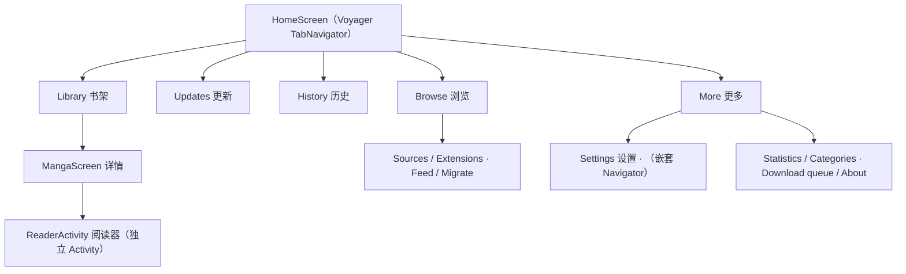

# 04 · 导航与信息架构

> 信息架构是“5 个一级 Tab + 一个无限深的页面栈 + 一个独立阅读器”；简单，但每个返回行为都有明确优先级。

| 项目 | 说明 |
| --- | --- |
| 章节 | 04 / 10 |
| 适用读者 | 负责导航、路由、返回栈与信息架构的工程师 |
| 前置阅读 | [03 布局与响应式系统](03-布局与响应式系统.md) |
| 证据类型 | 导航代码 + 截图 + 交互推断 |

## 本章导读

- 五个一级 Tab 的图标、徽标与重按行为。
- 返回键的优先级：Tab → 多选 → 子页 → 阅读器 → 弹层。
- 页面转场（shared axis X）与弹层内导航（fade）的区别。
- 顶栏的三种形态：常驻实色、滚动渐显、完全透明。

---

信息架构是“5 个一级 Tab + 一个无限深的页面栈 + 一个独立阅读器”。简单，但每个细节都有明确的行为定义。



*图 4-1 一级导航与主要二级入口。Settings 在平板下是 master-detail，在手机下是普通 push 栈；更深层的页面（Appearance、Reader、Downloads 等）挂在这个嵌套 Navigator 内。*

## 4.1 五个一级 Tab

| Tab          | 图标（动画矢量）   | 徽标                    | 重按行为（reselect）      |
|--------------|--------------------|-------------------------|---------------------------|
| Library 书架 | anim_library_enter | 无                      | 回到分类首页 / 滚动到顶部 |
| Updates 更新 | anim_updates_enter | 新章节数（secondary）   | 刷新更新列表              |
| History 历史 | anim_history_enter | 无                      | 回到顶部                  |
| Browse 浏览  | anim_browse_enter  | 扩展更新数（secondary） | 返回来源列表              |
| More 更多    | anim_more_enter    | 无                      | 回到顶部                  |

Tab 内容切换使用 **fadeThrough 200ms**（Material motion 的“淡出-淡入”，不是简单的交叉淡入）。每个 Tab 的滚动位置通过 `saveableState` 保留。

## 4.2 返回行为

| 场景             | 行为                                                         |
|------------------|--------------------------------------------------------------|
| 不在 Library Tab | 返回键先回到 Library（而不是退出应用）                       |
| 详情页有选中章节 | 先退出多选模式                                               |
| 设置子页         | pop 到设置主页；设置主页再 pop 到 More                       |
| 阅读器           | 系统返回 → 退出阅读器 Activity（可配置为翻页/关闭）          |
| 弹层打开         | 返回键优先关闭弹层（BackHandler 注册在内容之前，保证优先级） |

## 4.3 页面转场

所有普通页面 push/pop 使用 `materialSharedAxisX`：前进时新页面从右侧滑入、旧页面向左退出；返回时方向相反。转场距离由 `rememberSlideDistance()` 提供（约屏宽的 30%），保证大屏上不会“飞太远”。

```kotlin
ScreenTransition(
    transition = { materialSharedAxisX(forward = navigator.lastEvent != StackEvent.Pop) }
)
```

弹层内部的导航使用更轻的 **fade 220ms + 90ms 延迟**，避免在同一个 sheet 里叠加两个方向性转场。

## 4.4 顶栏的三种形态

| 形态     | 表现                                          | 使用页面               |
|----------|-----------------------------------------------|------------------------|
| 常驻实色 | `surfaceColorAtElevation(0dp)` = surface      | 设置、更多、历史、更新 |
| 滚动渐显 | 标题 alpha 0→1、背景 alpha 0→1（surface@3dp） | 漫画详情               |
| 完全透明 | 背景透明，只保留返回/收藏等操作               | 阅读器（叠加在页面上） |

---

## 设计意图

导航设计刻意保持“浅而稳定”：五个一级入口覆盖绝大多数任务，深层页面通过栈进入，阅读器作为独立 Activity 脱离主栈。这样做的意图是让用户在任何时刻都能回答三个问题——“我在哪”“返回会去哪”“阅读器会不会丢”。返回键优先关闭弹层、再退出多选、最后才回 Tab，是把“最轻的上下文”先弹出，避免一次返回就丢失整页状态。

## 复刻检查清单

- [ ] 不在 Library Tab 时，返回键先回 Library，而不是退出应用。
- [ ] 弹层打开时，返回键只关闭弹层；多选状态下先退出多选。
- [ ] 页面 push/pop 使用 shared axis X，前进/返回方向相反。
- [ ] Tab 切换使用 fadeThrough，不是交叉淡入。
- [ ] 每个 Tab 的滚动位置在切换后保留。
- [ ] 阅读器退出后回到进入前的详情页位置。
- [ ] 顶栏在详情页首屏透明，滚动后才出现 `surface@3dp`。

## 延伸阅读

- [上一章：03 布局与响应式系统](03-布局与响应式系统.md)
- [下一章：05 动效系统](05-动效系统.md)
- 组件级规格：[06 组件规格库](06-组件规格库.md)
