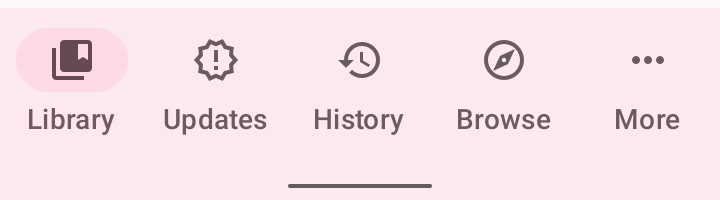
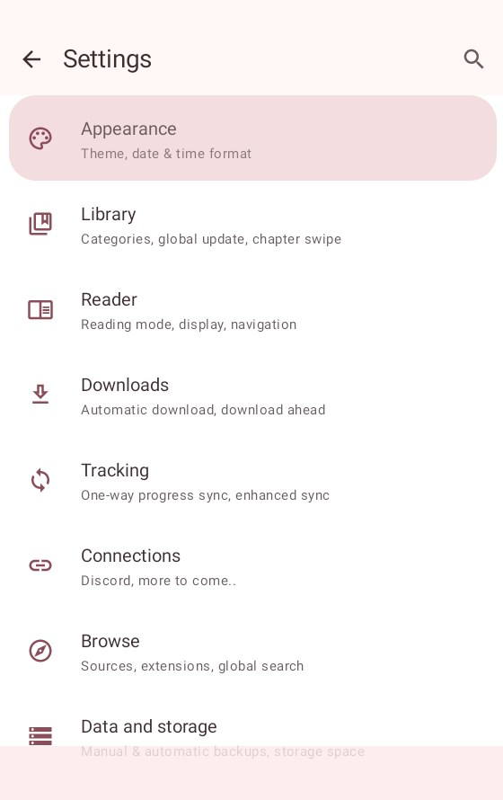
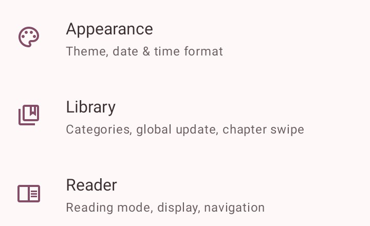
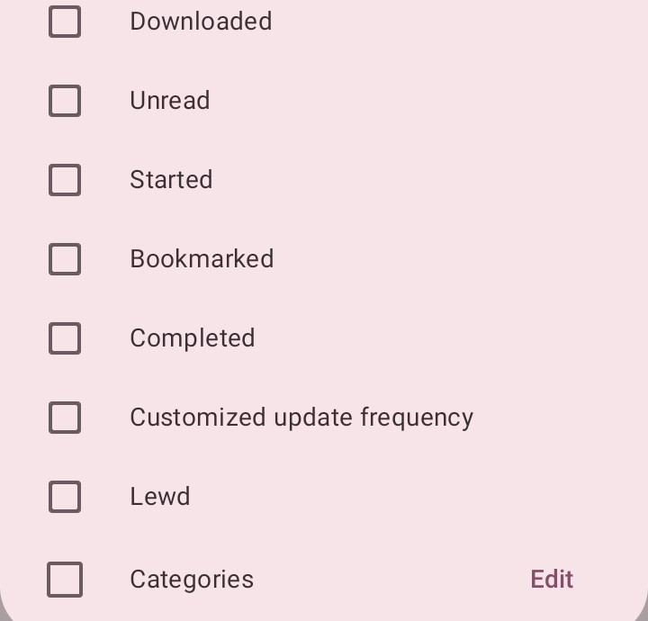
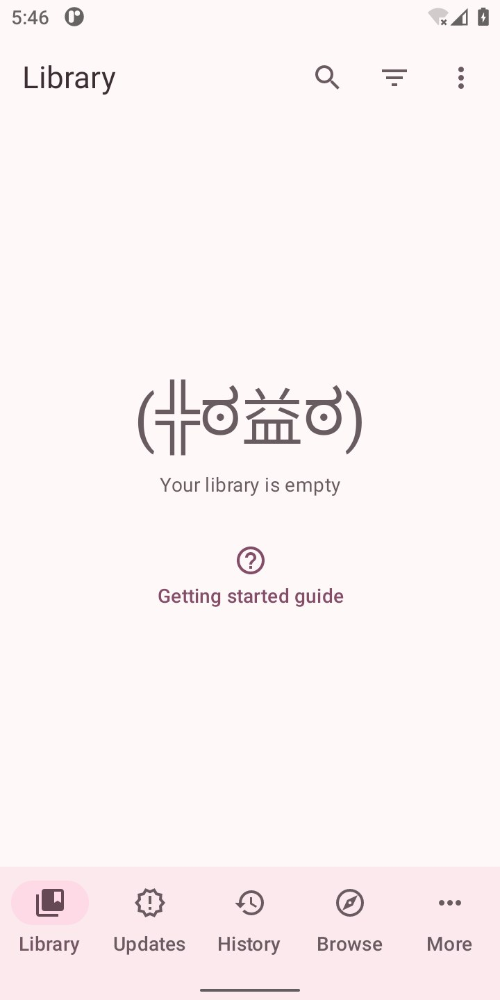
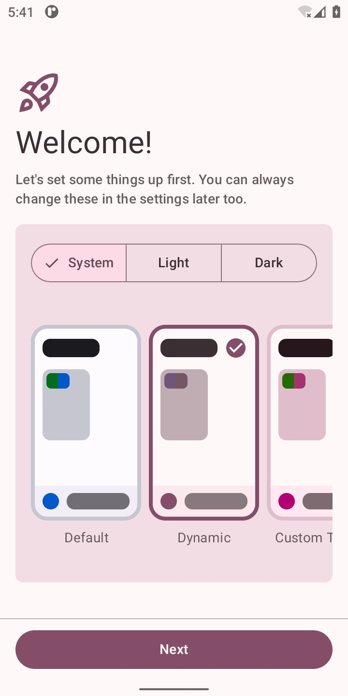
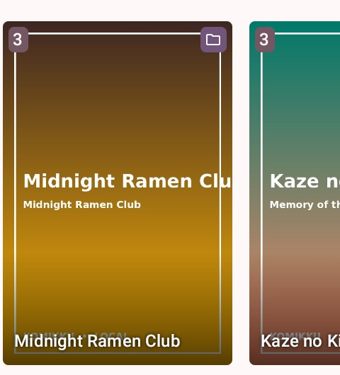
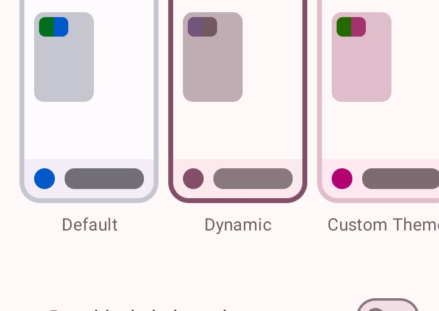

# 06 · 组件规格库

> 15 类核心组件的“解剖 → 数值 → 使用规则”，数值来自 Compose 代码，未显式写出的标注为 M3 默认。

| 项目 | 说明 |
| --- | --- |
| 章节 | 06 / 10 |
| 适用读者 | 需要逐个实现组件的 UI 工程师 |
| 前置阅读 | [02 设计令牌](02-设计令牌.md) · [03 布局与响应式系统](03-布局与响应式系统.md) |
| 证据类型 | 代码参数 + 组件特写截图 |

## 本章导读

- AppBar、NavigationBar/Rail、Tabs 的骨架与状态。
- Badge、Pill、SectionCard、设置项的尺寸与颜色。
- 按钮、FAB、弹层、空状态、封面卡片、章节行、历史行。
- 全局横幅、统计卡片、主题选择器、快速滚动条。

---

下面每个组件都按“解剖 → 数值 → 使用规则”三段式给出。数值来自 Compose 代码；若某值未显式写出，则标注为 M3 默认。

## 6.1 AppBar 与搜索栏

```text
┌────────────────────────────────────────────┐
│ [←]  标题（titleLarge 22sp）          [🔍][⋮] │  ← 64dp（M3 默认）
│      副标题（bodyMedium，走马灯）              │
└────────────────────────────────────────────┘
  背景：surfaceColorAtElevation(0dp)=surface
  动作模式：背景 elevation 3dp，左侧变 [×]，标题变计数
```

| 属性     | 值                                              | 说明                          |
|----------|-------------------------------------------------|-------------------------------|
| 容器色   | surfaceColorAtElevation(0dp) / 3dp              | 普通 / 多选模式               |
| 标题     | titleLarge 22sp，1 行省略                       | M3 默认                       |
| 副标题   | bodyMedium 14sp + basicMarquee(重复延迟 2000ms) | 长标题滚动                    |
| 动作按钮 | IconButton 48dp，长按显示 Tooltip（上方）       | AppBarActions                 |
| 搜索输入 | 18sp，无容器，占位符 0.78 alpha                 | IME 动作为 Search；防抖 250ms |

## 6.2 NavigationBar / NavigationRail



*图 6-1 手机底栏：80dp，5 项等宽；选中项为 secondaryContainer 药丸，图标/文字随之变色。*



*图 6-2 平板侧栏：min 80dp 宽，图标在上、文字在下，整体垂直居中。*

| 属性     | Bottom bar                          | Rail                      |
|----------|-------------------------------------|---------------------------|
| 尺寸     | 高 80dp，全宽                       | 宽 min 80dp，全高         |
| 容器     | surfaceContainer（AMOLED #0C0C0C） | surface + tonal 3dp       |
| 排列     | Row 均分，无水平 spacer             | Column 居中，垂直间距 4dp |
| 标签     | labelLarge，可配置是否常显          | labelLarge，常显          |
| 选中指示 | secondaryContainer 药丸             | 同上                      |

图标为动画矢量，选中时播放一次（约 300ms 的路径动画）；徽标由 M3 `Badge` 提供，默认 secondary 容器，数字超过 99 也不截断（按实际字符串显示）。

## 6.3 Tabs 与 TabbedDialog

```text
[ Library ① ] [ Updates ② ] [ History ] [ Browse ] [ More ]
  └ 选中：primary 文字 + primary 指示条（默认 3dp 高）
    未选中：onSurface（不是 0.78，保证可读）
    计数：Pill，onBackground 8%/12% 叠加，10sp
```

- 书架用 `PrimaryScrollableTabRow`，`edgePadding = 0.dp`，去掉默认 divider 后自己画一条 `HorizontalDivider`。
- 扩展/来源/迁移用 `PrimaryTabRow`（数量少，不滚动）。
- 弹层内的 `TabbedDialog`：Tab 行容器色 `surfaceContainerHigh`，内容用 `animateContentSize()` 平滑改变高度。

## 6.4 Badge 与 Pill

| 组件          | 规格                                           | 颜色                                        |
|---------------|------------------------------------------------|---------------------------------------------|
| BadgeGroup    | 高 18dp，clip extraSmall(4dp)                  | —                                           |
| Badge（文字） | bodySmall 12sp Medium；padding 3dp/1dp         | 默认 secondary / onSecondary                |
| 下载数        | 同 Badge                                       | tertiary / onTertiary                       |
| 未读数        | 同 Badge                                       | secondary / onSecondary                     |
| 语言徽标      | 25×18dp（图标模式）或文字                      | 图标透明底 / 文字 tertiary                  |
| 来源徽标      | 图标 18dp 高，scale 1.3                        | 本地/默认 = tertiary；缺失 = errorContainer |
| Pill          | extraLarge 圆角；padding 6dp/1dp；左外边距 4dp | surfaceContainerHigh / onSurface            |
| 计数 Pill     | 10sp；onBackground 8%(亮)/12%(暗)              | —                                           |

## 6.5 SectionCard 与设置项



*图 6-3 设置主页：无卡片、全宽行；图标 primary；标题 16sp；副标题 12sp/0.78。*

```text
SectionCard（统计、下载等）
┌─ 标题（titleSmall，左右 32dp） ───────────────┐
│ ┌────────────────────────────────────────┐ │
│ │ ElevatedCard  extraLarge(28dp)           │ │  ← 外 margin 16dp / 8dp
│ │ 内 padding 16dp                          │ │
│ └────────────────────────────────────────┘ │
└────────────────────────────────────────────┘

设置项（Preference）
┌────────────────────────────────────────────┐
│ [icon 24dp]  标题 16sp              [switch] │  ← minHeight 56dp
│              副标题 12sp · 78%                │     padding 16/16
└────────────────────────────────────────────┘
```

| 项              | 值                                              |
|-----------------|-------------------------------------------------|
| 设置项最小高度  | 56dp                                            |
| 水平/垂直内边距 | 16dp / 16dp                                     |
| 图标与文字间距  | start 16dp + end 8dp                            |
| 标题            | titleLarge 字阶，但 fontSize 强制 16sp          |
| 副标题          | bodySmall 12sp，alpha 0.78，最多 10 行          |
| 控件位置        | 行尾，右内边距 16dp                             |
| 点击高亮        | surfaceTint 12%，持续 3s 后消退                 |
| 平板选中项      | 左右 margin 8dp，圆角 24dp，背景 surfaceVariant |
| 平板左栏容器    | 比 surface 更浅/更深：亮色 L+0.02，暗色 L−0.05  |

## 6.6 按钮与 FAB

> **TextButton · 详情页动作行**
>
> 4 个等宽 `TextButton`（收藏/更新/追踪/网页）；图标 20dp、间距 4dp、标签 12sp；激活态 primary，未激活 `onSurface 38%`。

> **FAB · 继续阅读**
>
> `SmallExtendedFloatingActionButton`，primary 容器；只在存在未读章节且非多选时出现；可横向拖动切换左右吸附位置。

通用按钮使用 M3 默认：FilledButton 高 40dp、圆角全圆；TextButton 内容色 primary，禁用 `onSurface 38%`。网格里的 Continue 按钮是 32dp 方形（small 圆角），`primaryContainer 90%`。

## 6.7 弹层与对话框



*图 6-4 手机弹层：顶部四段 Tab、28dp 上圆角、surfaceContainerHigh；行高约 48dp。*

| 属性     | 手机 Sheet                     | 平板 Sheet           | AlertDialog          |
|----------|--------------------------------|----------------------|----------------------|
| 位置     | 底部                           | 居中                 | 居中                 |
| 宽度     | 全宽                           | max 460dp            | 280–560dp            |
| 圆角     | extraLarge 28dp（仅上）        | extraLarge           | M3 默认 28dp         |
| 背景     | surfaceContainerHigh           | surfaceContainerHigh | surfaceContainerHigh |
| 内边距   | 内容自定；垂直 16dp            | 垂直 16dp            | 24dp                 |
| 关闭     | 下拉/点击遮罩/返回             | 点击遮罩/返回        | 按钮/返回            |
| 筛选行高 | ≈44dp（24dp 控件 + 上下 10dp） | 同左                 | —                    |
| 动效     | 350ms tween + 拖拽             | 350ms                | M3 默认              |

## 6.8 空状态、加载与信息页



*图 6-5 空状态：displayMedium 颜文字（0.78）+ bodyMedium 文案 + 可选的帮助入口（primary）。*



*图 6-6 InfoScreen 骨架：48dp 图标、headlineLarge、titleSmall 副标题、底部整宽按钮。*

| 组件        | 规格                                                                                                                                         |
|-------------|----------------------------------------------------------------------------------------------------------------------------------------------|
| EmptyScreen | 12 个随机颜文字；displayMedium 45sp；水平 24dp；文案 0.78；动作行顶部 24dp                                                                   |
| InfoScreen  | 图标 48dp primary；标题 headlineLarge 32sp；副标题 titleSmall 14sp 0.78；顶部 48dp；底部整宽 Button + 可选 OutlinedButton；上方 1px hairline |
| Loading     | CircularProgressIndicator；确定进度时仍以 2s/圈匀速旋转，避免“卡住”错觉                                                                      |
| PullRefresh | M3 指示器；书架刷新 1s 后自动收起（假刷新）                                                                                                  |

## 6.9 封面、网格卡片与列表项



*图 6-7 舒适网格卡片：2:3 封面、4dp 圆角、左上下载数/右上来源徽标、下方 12sp 标题（最少 2 行）。*

```text
┌──────────────────┐  ← 外层 padding 4dp，clip small(8dp)
│ ③            📁  │  ← BadgeGroup，距边 4dp
│                  │
│      封面         │  ← 2:3，clip 4dp，占位 #1F888888
│                  │
└──────────────────┘
 标题 12sp/18sp，minLines=2，maxLines=2，padding 4dp
```

| 属性          | 值                                                                  |
|---------------|---------------------------------------------------------------------|
| 封面比例      | Book 2:3；Panorama 3:2（横图，阈值 h/w ≤ 0.75）                     |
| 封面圆角      | extraSmall 4dp                                                      |
| 占位/错误     | #1F888888 / cover_error                                            |
| 卡片圆角      | small 8dp                                                           |
| 选中态        | 封面 alpha 0.76 + 外圈 secondary 实色描边；文字变 onSecondary       |
| 标题          | 12sp / 18sp；titleSmall 字阶；最少 2 行                             |
| Continue 按钮 | 32dp 方形，small 圆角，primaryContainer 90%，图标 20dp，距边 6dp    |
| 列表项        | 高 56dp；封面 1:1 填满高度（40dp）；左右 16dp；标题 bodyMedium 2 行 |

## 6.10 章节列表项


*图 6-8 章节行：8dp 未读点、14sp 标题、12sp 日期；已读行整体降到 0.38；右侧为已读/下载状态。*

```text
┌────────────────────────────────────────────┐
│ ●  Chapter_03                        [✓]     │  ← 未读点 8dp primary
│    Today                                     │  ← bodySmall 0.78
└────────────────────────────────────────────┘
  内边距 16/12/8/12；行间用 6dp 垂直间距
  左右滑动 → primaryContainer 背景的操作层
```

| 属性       | 值                                                                        |
|------------|---------------------------------------------------------------------------|
| 未读标记   | 8dp 圆点，primary，右侧 4dp                                               |
| 标题       | bodyMedium；已读时 alpha 0.38                                             |
| 副标题     | bodySmall；未读 0.78，已读 0.38                                           |
| 元信息分隔 | “·” 小圆点，2dp 间距                                                      |
| 滑动背景   | primaryContainer；未过阈值前 surfaceContainerLowest                       |
| 分组头     | titleMedium onBackground；缺失章节警告 bodySmall error 0.78；padding 16/4 |

## 6.11 历史与更新条目

> **History · 96dp 行**
>
> 左侧 2:3 封面填满高度（约 80dp 高），右侧标题 + 章节 + 相对时间；水平 16dp、垂直 8dp；长按进入多选。

> **Updates · 分组 + 领导者**
>
> 每个漫画的第一行显示 48dp 封面（全景 108dp 宽），后续章节行缩进；未读点与日期样式与章节列表一致。

## 6.12 全局状态横幅

| 状态               | 背景      | 文字                     | 高度/内边距           |
|--------------------|-----------|--------------------------|-----------------------|
| Downloaded only    | tertiary  | onTertiary / labelMedium | 4dp                   |
| Incognito          | primary   | onPrimary                | 4dp                   |
| Indexing / Syncing | secondary | onSecondary              | 8dp + 120° 旋转指示器 |
| Updating           | tertiary  | onSecondary              | 8dp + 进度百分比      |
| Restoring          | error     | onSecondary              | 8dp + 进度百分比      |

指示器尺寸等于文字行高，描边为行高的 1/8，因此在不同字号/语言下都能保持比例。

## 6.13 统计卡片

```text
Overview                       ← header（14sp SemiBold, onSurfaceVariant）
┌──────────────────────────────┐
│   3        1m 23s      0      │  ← titleLarge 22sp Bold
│ In library  Read duration  …  │  ← bodyMedium 0.78
│   [icon]      [icon]   [icon] │  ← primary 24dp，底部对齐
└──────────────────────────────┘
```

数值区用 `IntrinsicSize.Min` 保证三列等高、图标底对齐；卡片间距 8dp。条目型统计（Entries/Chapters）数值用 bodyMedium Bold、标签 labelSmall。

## 6.14 主题选择器



*图 6-9 主题预览：114dp 宽、9:16；选中时 4dp primary 边框 + 右上角 CheckCircle；预览内部是一套缩微界面。*

| 属性            | 值                                                                             |
|-----------------|--------------------------------------------------------------------------------|
| 卡片宽度 / 比例 | 114dp / 9:16                                                                   |
| 外框            | 4dp 边框，圆角 17dp；未选中为 divider 色                                       |
| 内层            | 13dp 圆角，背景 = 该主题 background                                            |
| 缩微内容        | 40dp app bar（onSurface 条）+ 2:3 封面 + primary/tertiary 色块 + 底部圆点/横条 |
| 标签            | bodyMedium 0.78，居中，2 行                                                    |
| 选中标记        | 右上角 CheckCircle，primary                                                    |

## 6.15 快速滚动条

仅在滚动时出现，停止后立即淡出；颜色 primary，宽 12dp，全圆角，距内容区 8dp。支持拖动跳转并在拖动时显示气泡（M3 默认）。

---

## 设计意图

组件库的组织方式是“先解剖、再数值、后规则”。解剖图回答“这个组件由哪几层组成”，数值回答“每层多高多宽”，规则回答“什么时候用哪一种变体”。这三段式的好处是：复刻时可以先搭结构，再填数值，最后才处理状态；评审时也能明确指出问题发生在哪一层，而不是笼统地说“感觉不对”。

## 复刻检查清单

- [ ] AppBar 在普通态与多选态的容器色、标题与动作按钮符合规格。
- [ ] 底栏 80dp、5 项等宽；Rail 80dp、图标在上文字在下。
- [ ] Badge 高度 18dp，不撑高卡片；下载数与未读数颜色区分。
- [ ] 设置项最小高度 56dp，标题 16sp，副标题 12sp / 0.78。
- [ ] 封面卡片 2:3、4dp 圆角，选中态 0.76 + `secondary` 描边。
- [ ] 章节行未读点 8dp，已读态整体降到 0.38。
- [ ] 弹层手机底部 / 平板居中 460dp，圆角 28dp。
- [ ] 所有图标按钮 ≥ 48dp，并有可读标签。

## 延伸阅读

- [上一章：05 动效系统](05-动效系统.md)
- [下一章：07 页面规格](07-页面规格.md)
- 组件配方代码：9.3 关键组件配方
