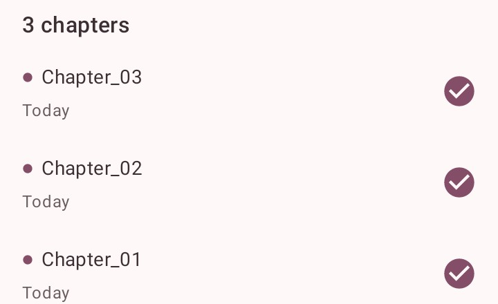

# 06 · 组件规格库

> 18 类核心组件的**结构 → 数值 → 状态 → 代码出处**。数值全部来自 Compose 源码；M3 内置的会标注"默认"。

| 项目 | 说明 |
| --- | --- |
| 章节 | 06 / 10 |
| 适用读者 | 逐个实现组件的工程师 |
| 前置阅读 | [02 令牌](02-设计令牌.md)、[03 布局](03-布局与响应式.md) |
| 证据类型 | 源码 + 截图 |

---

## 本章导读

第一版列了 15 类组件，但把"设置行"当成一类（实际有三套）、把"弹层"当成一个（实际手机/平板差异巨大）。本版拆成 18 类，**每一类都给出可复制的 Modifier 链**。

| # | 组件 | 一句话 |
|---|---|---|
| 6.1 | AppBar | 三态 + 一态双 alpha |
| 6.2 | NavigationBar / Rail | 80dp，M3 indicator |
| 6.3 | 封面卡（紧凑） | 2:3，标题叠在封面底部 1/3 |
| 6.4 | 封面卡（舒适） | 2:3，标题在封面下方 |
| 6.5 | 列表行 | 56dp，1:1 封面 40dp |
| 6.6 | 徽标组 | 18dp 高，语义色块 |
| 6.7 | 章节行 | 可滑动，26dp 下载指示器 |
| 6.8 | 历史行 | 96dp，封面填满高度 |
| 6.9 | 设置行（三套） | 16/16、24/10、8/24dp |
| 6.10 | 分组标题 | 14sp SemiBold onSurfaceVariant |
| 6.11 | Pill（计数） | 28dp 圆角，6×1dp padding |
| 6.12 | Chip（标签） | 8dp 圆角，1dp 边框 |
| 6.13 | 弹层（手机） | 底部抽屉，350ms，56dp 阈值 |
| 6.14 | 弹层（平板） | 460dp 居中卡片，alpha 350ms |
| 6.15 | 底部动作栏 | 16dp 上圆角，48dp 按钮 |
| 6.16 | 全局横幅 | 7 种语义色，expand/shrink |
| 6.17 | 空状态 | 颜文字 45sp + 说明 |
| 6.18 | 阅读器 chrome | 半透明 elevated，页码描边 |

---

## 6.1 AppBar

### 结构

```text
Column {
    TopAppBar(
        navigationIcon = { ✕ 或 ←（+可选 ⌂） },
        title = { Column { Text(title); Text(subtitle) } },
        actions = { 图标按钮… 或 溢出菜单 },
        colors = topAppBarColors(
            containerColor = backgroundColor
                ?: surfaceColorAtElevation(if (isActionMode) 3.dp else 0.dp)
        ),
        scrollBehavior = …,
    )
}
```

### 数值

| 属性 | 值 | 来源 |
|---|---|---|
| 容器色（静息） | `surfaceColorAtElevation(0.dp)` = `surface` | `AppBar.kt:174-177` |
| 容器色（动作模式） | `surfaceColorAtElevation(3.dp)` | 同上 |
| 标题 | `titleLarge` 22sp，`maxLines=1`，`Ellipsis` | `AppBar.kt:196-201` |
| 副标题 | `bodyMedium` 14sp，`basicMarquee(repeatDelayMillis = 2_000)` | `AppBar.kt:203-215` |
| 导航图标 | `Icons.AutoMirrored.Outlined.ArrowBack` 或 `Close` | `AppBar.kt:186-195` |
| 动作图标尺寸 | M3 `IconButton` 默认（24dp 图标 + 48dp 触摸区） | — |
| 溢出图标 | `Icons.Outlined.MoreVert` | `AppBar.kt:243-249` |
| Tooltip | `PlainTooltip`，`TooltipAnchorPosition.Above` | `AppBar.kt:218-240` |

### 三态切换

| 态 | 判定 | 左侧 | 标题 | 右侧 |
|---|---|---|---|---|
| 静息 | `searchQuery == null && !isActionMode` | ← | 页面标题 | 搜索/筛选/更多 |
| 搜索 | `searchQuery != null` | ←（点击清空） | `BasicTextField` 18sp | ✕ 或空 |
| 动作 | `actionModeCounter > 0` | ✕ | 选中数量 | 全选/反选/更多 |

### 副标题跑马灯

```kotlin
// AppBar.kt:203-215
subtitle?.let {
    Text(
        text = it,
        style = MaterialTheme.typography.bodyMedium,
        maxLines = 1,
        overflow = TextOverflow.Ellipsis,
        modifier = Modifier.basicMarquee(repeatDelayMillis = 2_000),
    )
}
```

> 副标题（如章节名）用跑马灯而非省略号，因为章节名往往"前面一样、后面不同"。`repeatDelayMillis = 2000` 让滚动有停顿。

### 搜索输入

```kotlin
// AppBar.kt:298-352
BasicTextField(
    value = searchQuery,
    textStyle = MaterialTheme.typography.titleMedium.copy(
        color = MaterialTheme.colorScheme.onBackground,
        fontWeight = FontWeight.Normal,
        fontSize = 18.sp,
    ),
    keyboardOptions = KeyboardOptions(imeAction = ImeAction.Search),
    singleLine = true,
    cursorBrush = SolidColor(MaterialTheme.colorScheme.onBackground),
    decorationBox = { inner ->
        TextFieldDefaults.DecorationBox(
            …
            placeholder = {
                Text(
                    modifier = Modifier.secondaryItemAlpha(),   // 78%
                    text = placeholderText ?: stringResource(MR.strings.action_search_hint),
                    style = MaterialTheme.typography.titleMedium.copy(
                        fontSize = 18.sp,
                        fontWeight = FontWeight.Normal,
                    ),
                )
            },
            container = {},   // ← 无背景、无边框
        )
    },
)
```

> `container = {}` 是关键：搜索框**没有**胶囊背景、没有下划线，纯文字浮在 AppBar 上。

### 详情页变体（双 alpha）

| 滚动状态 | 标题 alpha | 背景 alpha |
|---|---|---|
| 首项完全可见 | 0 | 0 |
| 首项开始滚出 | 0 | →1 |
| 首项完全滚出 | →1 | 1 |

见 [04](04-导航与信息架构.md) §4.6。

---

## 6.2 NavigationBar / NavigationRail


*图 6-1 底栏特写：5 项，选中项是 `secondaryContainer` 药丸 + `onSecondaryContainer` 图标。*

### 底部 NavigationBar

```kotlin
// presentation-core/.../material/NavigationBar.kt:25-48
Surface(color, contentColor, tonalElevation = NavigationBarDefaults.Elevation) {
    Row(
        Modifier
            .fillMaxWidth()
            .windowInsetsPadding(windowInsets)
            .height(80.dp)                  // ← 内容高度
            .selectableGroup()
    ) { content() }
}
```

| 属性 | 值 |
|---|---|
| 内容高度 | **80dp** |
| 容器色 | `NavigationBarDefaults.containerColor`（→ `surfaceContainer`） |
| 选中 indicator | M3 默认：`secondaryContainer` 药丸，32dp 高 × 64dp 宽 |
| 选中图标/文字 | `onSecondaryContainer` |
| 未选中图标/文字 | `onSurfaceVariant` |
| 标签 | `labelLarge` 14sp，`maxLines=1`，`Ellipsis` |
| 与 M3 差异 | **去掉水平 spacer**（M3 默认两端各 8dp） |

### 侧边 NavigationRail

```kotlin
// presentation-core/.../material/NavigationRail.kt:29-59
Surface(tonalElevation = 3.dp) {
    Column(
        Modifier
            .fillMaxHeight()
            .windowInsetsPadding(windowInsets)
            .widthIn(min = 80.dp)
            .padding(vertical = 4.dp)
            .selectableGroup(),
        horizontalAlignment = Alignment.CenterHorizontally,
        verticalArrangement = Arrangement.spacedBy(4.dp, Alignment.CenterVertically),
    ) { … }
}
```

| 属性 | 值 |
|---|---|
| 最小宽 | **80dp** |
| 垂直对齐 | **居中**（M3 默认顶部） |
| 项间距 | **4dp** |
| 上下 padding | **4dp** |
| tonalElevation | **3dp** |
| 选中 indicator | 同 NavigationBar |

`📐实测` 平板截图导航轨宽 **60px ÷ 0.75 = 80dp** ✓。

### 角标（Badge）

```kotlin
// HomeScreen.kt:306-345
BadgedBox(badge = {
    if (count > 0) {
        Badge {
            Text(count.toString(), Modifier.semantics { contentDescription = desc })
        }
    }
}) {
    Icon(painter = tab.options.icon!!, contentDescription = tab.options.title)
}
```

| 角标来源 | 触发 |
|---|---|
| Updates Tab | `showUpdatesCount && newUpdatesCount > 0` |
| Browse Tab | `extensionUpdatesCount > 0` |

---

## 6.3 封面卡（紧凑网格 / CompactGrid）

```text
┌─────────────────┐
│ [3]        [📁] │  ← 徽标组（左上 / 右上），4dp 内边距
│                 │
│      封面       │  ← 2:3，Crop
│                 │
│  渐变遮罩 33%   │  ← 0 → #AA000000
│ Title       ▶   │  ← 12sp/18sp 白字 + 阴影
└─────────────────┘
```

### Modifier 链（可直接抄）

```kotlin
// 外层：CommonMangaItem.kt:396-411
Box(
    Modifier
        .clip(MaterialTheme.shapes.small)          // 8dp
        .combinedClickable(onClick, onLongClick)
        .selectedOutline(isSelected, secondary)
        .padding(4.dp)                              // ← 项内边距
) {
    CompositionLocalProvider(
        LocalContentColor provides if (isSelected) onSecondary else LocalContentColor.current
    ) { content() }
}

// 封面：MangaCover.kt:78-83
modifier
    .aspectRatio(2f / 3f)
    .clip(MaterialTheme.shapes.extraSmall)          // 4dp
    .alpha(if (loaded) if (isSelected) 0.76f else 1f else 1f)
    .background(bgColor ?: CoverPlaceholderColor)   // #1F888888
```

### 数值表

| 属性 | 值 | 来源 |
|---|---|---|
| 卡片圆角 | `shapes.small` = **8dp** | `CommonMangaItem.kt:400` |
| 项内边距 | **4dp** | `CommonMangaItem.kt:406` |
| 封面圆角 | `shapes.extraSmall` = **4dp** | `MangaCover.kt:78-83` |
| 封面比例 | **2:3**（`MangaCover.Book = 2f/3f`） | `MangaCover.kt:44` |
| 选中描边 | `secondary`，**1px 矩形**（`drawRect`） | `CommonMangaItem.kt:414-415` |
| 选中封面 alpha | **0.76** | `CommonMangaItem.kt:71` |
| 徽标组内边距 | **4dp** | `CommonMangaItem.kt:350,359` |
| 标题遮罩高度 | **33%** | `CommonMangaItem.kt:168` |
| 标题遮罩渐变 | `Transparent → #AA000000` | `CommonMangaItem.kt:163-166` |
| 标题样式 | `titleSmall` + White + `Shadow(Black, blur=4f)` | `CommonMangaItem.kt:178-190` |
| 标题字号 | **12sp / 18sp** | `CommonMangaItem.kt:378-379` |
| 标题 padding | **8dp** | `CommonMangaItem.kt:178-190` |
| 继续阅读按钮 | 28dp（网格内）/ 32dp（无标题时），图标 16/20dp | `CommonMangaItem.kt:62-69` |
| 占位底色 | `#1F888888`（12% 灰） | `MangaCover.kt:224` |
| 占位前景 | `#8F888888`（56% 灰） | `MangaCover.kt:225` |
| 加载指示 | `CircularProgressIndicator` 32dp，`strokeWidth=3dp`（Normal） | `MangaCover.kt:100-120` |
| 失败图标 | `cover_error_vector` 32dp | `MangaCover.kt:122-142` |

### 状态

| 状态 | 表现 |
|---|---|
| 加载中 | 占位底色 + 居中 32dp 进度环 |
| 加载失败 | 占位底色 + 居中 32dp 错误图标 |
| 加载成功 | 封面 + Coil crossfade 300ms |
| 选中 | 封面 alpha 0.76 + `secondary` 矩形描边 + 内容色转 `onSecondary` |
| 长按 | 进入多选（触觉 `LongPress`） |
| 有未读 | 左上 `secondary` 徽标 |
| 有下载 | 左上 `tertiary` 徽标（在未读**左**侧） |
| 语言/源 | 右上语言图标徽标 + 源图标徽标 |

> **徽标顺序**：`coverBadgeStart = { DownloadsBadge(); UnreadBadge() }`（`LibraryCompactGrid.kt:48-52`），`coverBadgeEnd = { LanguageBadge(); SourceIconBadge() }`（`:53-64`）。即左上是"下载数、未读数"，右上是"语言、源"。

---

## 6.4 封面卡（舒适网格 / ComfortableGrid）

```text
┌─────────────────┐
│ [3]        [📁] │
│                 │
│      封面       │  ← 2:3 或全景 3:2
│                 │
│            ▶    │  ← 可选继续阅读，右下 6dp
├─────────────────┤
│ Title           │  ← 12sp/18sp，2 行，4dp padding
│ Second line     │
└─────────────────┘
```

与紧凑网格的差异：

| 属性 | 紧凑 | 舒适 |
|---|---|---|
| 标题位置 | **叠在封面底部 33%** | **封面下方** |
| 标题最小行数 | 1（`minLines=1`） | 2（`minLines=2`） |
| 标题最大行数 | 2 | 2（可配置 `titleMaxLines`） |
| 标题颜色 | 白色 + 阴影 | `LocalContentColor`（随主题） |
| 标题 padding | 8dp | **4dp** |
| 继续阅读按钮 | 行内（标题右侧） | 绝对定位右下 |
| 全景支持 | 否 | 是 |

`📍代码` 舒适网格标题区（`CommonMangaItem.kt:311-322`）：

```kotlin
GridItemTitle(
    modifier = Modifier.padding(4.dp),
    title = title,
    style = MaterialTheme.typography.titleSmall,
    minLines = 2,
    maxLines = titleMaxLines,
)
```

---

## 6.5 列表行（List 模式）

```text
┌──────────────────────────────────────────────┐
│ ┌────┐   Title（bodyMedium, 2 行）  [3] [📁] ▶ │  56dp
│ │1:1 │                                        │
│ └────┘                                        │
└──────────────────────────────────────────────┘
```

### Modifier 链

```kotlin
// CommonMangaItem.kt:443-480
Row(
    Modifier
        .selectedBackground(isSelected)                  // secondary 22%/16%
        .height(56.dp)
        .combinedClickable(onClick, onLongClick)
        .padding(horizontal = 16.dp, vertical = 8.dp),
    verticalAlignment = Alignment.CenterVertically,
) {
    MangaCover.Square(Modifier.fillMaxHeight())          // 40×40dp
    Text(
        title,
        Modifier.padding(horizontal = 16.dp).weight(1f),
        maxLines = 2, overflow = Ellipsis,
        style = MaterialTheme.typography.bodyMedium,
    )
    BadgeGroup(content = badge)
    // 可选 ContinueReadingButton(28dp, icon 16dp, padding start 8dp)
}
```

| 属性 | 值 |
|---|---|
| 行高 | **56dp** |
| 水平内边距 | **16dp**（`MaterialTheme.padding.medium`） |
| 垂直内边距 | **8dp** |
| 封面 | **1:1**，`fillMaxHeight()` → 40×40dp，圆角 4dp |
| 封面与文字间距 | **16dp** |
| 标题 | `bodyMedium` 14sp，2 行，`Ellipsis` |
| 选中底色 | `secondary` @ **22%（亮）/ 16%（暗）**，`drawRect` |
| 继续阅读按钮 | 28dp，图标 16dp，`start = 8dp` |

---

## 6.6 徽标组（BadgeGroup）

```text
┌───┬────┬────────┐
│ 3 │ 12 │ 🇯🇵 📁 │   18dp 高
└───┴────┴────────┘
```

### 代码

```kotlin
// presentation-core/.../components/Badges.kt:34-45
@Composable
fun BadgeGroup(modifier: Modifier = Modifier, shape: Shape = MaterialTheme.shapes.extraSmall, content: @Composable RowScope.() -> Unit) {
    Row(modifier = modifier.clip(shape).height(18.dp)) { content() }
}

// :50-67
@Composable
fun Badge(text: String, modifier: Modifier = Modifier,
          color: Color = MaterialTheme.colorScheme.secondary,
          textColor: Color = MaterialTheme.colorScheme.onSecondary,
          shape: Shape = RectangleShape) {
    Text(
        text,
        Modifier.clip(shape).background(color).padding(horizontal = 3.dp, vertical = 1.dp),
        color = textColor,
        fontWeight = FontWeight.Medium,
        maxLines = 1,
        style = MaterialTheme.typography.bodySmall,   // 12sp
    )
}
```

| 属性 | 值 |
|---|---|
| 组高 | **18dp** |
| 组圆角 | `shapes.extraSmall` = **4dp**（整个 Row 裁剪） |
| 单徽标形状 | **`RectangleShape`**（直角，靠父级裁剪出 4dp 圆角） |
| 单徽标 padding | **horizontal 3dp / vertical 1dp** |
| 文字 | `bodySmall` 12sp，`FontWeight.Medium`，1 行 |
| 默认色 | `secondary` / `onSecondary` |
| 下载数 | `tertiary` / `onTertiary` |
| 语言（无图标时） | `tertiary` / `onTertiary`，文字大写 |
| 语言（有图标时） | 透明底，`width(25.dp).height(18.dp)` |
| 缺失源 | `errorContainer` 底 + `error` 图标 |
| 本地源 | `tertiary` 底 + `Folder` 图标 |
| 普通源 | `tertiary` 底 + `LocalLibrary` 图标 |
| 源图标 | `imageBitmap` + `scale(1.3f).height(18.dp)` |

> **为什么单徽标是 `RectangleShape`**：如果每个徽标都圆角，紧挨着时会出现"两个圆角挨着"的裂缝。整组裁剪一次，视觉上是连体色块。

---

## 6.7 章节行（可滑动）



*图 6-2 章节行特写：未读圆点 8dp `primary`、标题 `bodyMedium`、副标题 `bodySmall`、右侧 26dp 下载指示器。*

```text
┌─────────────────────────────────────────────────┐
│ ● Chapter 42                      ⬇ / ⏳ / ✓    │  可左右滑
│ Today • 5 pages read • Scanlator                │
└─────────────────────────────────────────────────┘
     ↑ 未读圆点 8dp                            ↑ 26dp
```

### Modifier 链

```kotlin
// MangaChapterListItem.kt:100-142
SwipeableActionsBox(
    modifier = modifier.clipToBounds(),
    startActions = listOfNotNull(swipeStart),
    endActions = listOfNotNull(swipeEnd),
    swipeThreshold = 56.dp,                                   // swipeActionThreshold
    backgroundUntilSwipeThreshold = MaterialTheme.colorScheme.surfaceContainerLowest,
) {
    Row(
        Modifier
            .selectedBackground(selected)
            .combinedClickable(onClick, onLongClick)
            .padding(start = 16.dp, top = 12.dp, end = 8.dp, bottom = 12.dp)
    ) {
        Column(Modifier.weight(1f), verticalArrangement = spacedBy(6.dp)) {
            Row(spacedBy(2.dp)) {
                if (!read) Icon(Circle, Modifier.height(8.dp).padding(end = 4.dp), tint = primary)
                if (bookmark) Icon(Bookmark, …)
                Text(title, bodyMedium, maxLines=1, alpha = if (read) 0.38f else 1f)
            }
            Row { date • readProgress • scanlator }   // bodySmall, alpha 0.78/0.38
        }
        ChapterDownloadIndicator(Modifier.padding(start = 4.dp), …)
    }
}
```

| 属性 | 值 |
|---|---|
| 内边距 | start **16** / top **12** / end **8** / bottom **12** |
| 未读圆点 | `Icons.Filled.Circle`，**8dp 高**，`tint = primary`，`padding(end=4.dp)` |
| 书签图标 | `Icons.Filled.Bookmark`，`tint = primary`，高度随标题 `− 2dp` |
| 标题 | `bodyMedium`，1 行，已读时 alpha **0.38** |
| 副标题 | `bodySmall`，alpha **0.78**（未读）/ **0.38**（已读） |
| 副标题间距 | `spacedBy(6.dp)`（标题行与副标题行） |
| 分隔符 | `DotSeparatorText`（"·"） |
| 滑动阈值 | **56dp** |
| 滑动背景（未过阈值） | `surfaceContainerLowest` |
| 滑动背景（过阈值） | `primaryContainer` |
| 下载指示器 | **26dp**，状态层 **40dp** |

### 下载指示器的 4 个状态

| 状态 | 图标 | 颜色 |
|---|---|---|
| `NOT_DOWNLOADED` | `ic_download_chapter_24dp` | `primary`（KMK 改），alpha 78% |
| `QUEUE` / `DOWNLOADING` | 进度环 + `ArrowDownward` | `primary`；进度 >50% 时箭头转 `background` |
| `DOWNLOADED` | `Icons.Filled.CheckCircle` | `primary` |
| `ERROR` | `Icons.Outlined.ErrorOutline` | `error` |

`📍代码` 进度环（`ChapterDownloadIndicator.kt:128-166`）：

```kotlin
CircularProgressIndicator(
    progress = { animatedProgress },
    modifier = Modifier.size(26.dp).padding(2.dp),
    color = MaterialTheme.colorScheme.primary,
    strokeWidth = IndicatorSize / 2,   // 13dp ← 极粗，形成"扇形"效果
    trackColor = Color.Transparent,
    strokeCap = StrokeCap.Butt,
    gapSize = 0.dp,
)
```

> **13dp 描边 + 26dp 直径**：这是刻意的"扇形进度"，不是细环。复刻时如果按 M3 默认的 4dp 描边，视觉完全不同。

### 滑动动作（可配置）

`LibraryPreferences.ChapterSwipeAction` 三选：

| 动作 | 起始图标 | 完成图标 |
|---|---|---|
| `ToggleRead` | `Check`（未读→已读）/ `RemoveDone`（已读→未读） | 同 |
| `ToggleBookmark` | `BookmarkAdd` / `BookmarkRemove` | 同 |
| `Download` | `Download` / `FileDownloadOff` / `Delete` | 同 |
| `Disabled` | 无 | — |

---

## 6.8 历史行

```text
┌────────────────────────────────────────────────┐
│ ┌────┐  Title（SemiBold, 2 行）    [♡] [🗑]    │  96dp
│ │2:3 │  ● Ch. 2 · 6:01 PM · Page 5            │
│ └────┘                                          │
└────────────────────────────────────────────────┘
```

| 属性 | 值 | 来源 |
|---|---|---|
| 行高 | **96dp** | `HistoryItem.kt:49,86` |
| 内边距 | horizontal **16** / vertical **8** | `HistoryItem.kt:87` |
| 封面 | **2:3**，`fillMaxHeight()` → 约 55×83dp，圆角 4dp | `HistoryItem.kt:96-140` |
| 封面右间距 | **16dp** | `HistoryItem.kt:143-146` |
| 标题 | `bodyMedium` + **`FontWeight.SemiBold`**，2 行 | `HistoryItem.kt:150-163` |
| 副标题 | `bodySmall`，`padding(top=4.dp)` | `HistoryItem.kt:165-190` |
| 未读圆点 | 8dp，`primary` | `HistoryItem.kt:166-176` |
| 收藏按钮 | `IconButton` + `FavoriteBorder`（**仅未收藏时**显示） | `HistoryItem.kt:213-221` |
| 删除按钮 | `IconButton` + `Delete` | `HistoryItem.kt:223-231` |

> 历史行的封面比列表行（1:1 / 40dp）大得多：96dp 行高减去 16dp 垂直内边距 = 80dp 高，2:3 比例 → 约 53dp 宽。**这是全书架/历史中最大的列表封面。**

---

## 6.9 设置行（**三套**，别混用）

第一版把这三套合成一套，是最容易误导实现者的错误。

### 套 A · `BasePreferenceWidget`（通用设置行）

用于：外观、书架、阅读器、下载、追踪、连接、浏览、数据、安全、高级、关于——**所有 Settings 子页**。

```kotlin
// BasePreferenceWidget.kt:41-88
Row(
    Modifier
        .highlightBackground(highlighted)          // 定位高亮
        .sizeIn(minHeight = 56.dp)                 // LocalPreferenceMinHeight
        .clickable(enabled = onClick != null, onClick = { onClick?.invoke() })
        .fillMaxWidth(),
    verticalAlignment = Alignment.CenterVertically,
) {
    if (icon != null) Box(Modifier.padding(start = 16.dp, end = 8.dp)) { icon() }
    Column(Modifier.weight(1f).padding(vertical = 16.dp)) {
        Text(title, Modifier.padding(horizontal = 16.dp),
             style = titleLarge, fontSize = 16.sp, maxLines = 2, Ellipsis)
        subcomponent?.invoke(this)                 // 副标题
    }
    if (widget != null) Box(Modifier.padding(end = 16.dp)) { widget() }
}
```

| 属性 | 值 |
|---|---|
| 最小高 | **56dp** |
| 图标 | start **16dp** / end **8dp**，`tint = primary` |
| 标题 | `titleLarge` **覆写为 16sp**，2 行，`Ellipsis` |
| 标题水平 | **16dp** |
| 垂直内边距 | **16dp** |
| 副标题 | `bodySmall` 12sp，78% alpha，`maxLines=10`，16dp 水平 |
| 尾部控件 | end **16dp**（`TrailingWidgetBuffer`） |
| 高亮 | `surfaceTint` @ **12%**，200ms × 5 往返，600ms 延迟 |

### 套 B · `SettingsItems`（旧式通用条目）

用于：`HeadingItem`、`CheckboxItem`、`RadioItem`、`SliderItem`、`SelectItem`、`TriStateItem`、`TextItem`、`IconItem`。

```kotlin
// presentation-core/.../components/SettingsItems.kt:65-68
object SettingsItemsPaddings {
    val Horizontal = 24.dp
    val Vertical = 10.dp
}

// :380-400
Row(
    Modifier
        .clickable(onClick)
        .fillMaxWidth()
        .padding(horizontal = 24.dp, vertical = 10.dp),
    verticalAlignment = Alignment.CenterVertically,
    horizontalArrangement = Arrangement.spacedBy(24.dp),   // ← 图标与文字间距 24dp
) {
    widget(this)          // Checkbox / RadioButton / Icon
    Text(label, style = MaterialTheme.typography.bodyMedium)
}
```

| 属性 | 值 |
|---|---|
| 内边距 | **24dp / 10dp** |
| 控件与文字间距 | **24dp** |
| 文字 | `bodyMedium` 14sp |

### 套 C · 平板双栏主列表选中行

用于：平板 Settings 左栏（`twoPane = true`）。

```kotlin
// SettingsMainScreen.kt:152-166
if (twoPane) {
    modifier = Modifier
        .padding(horizontal = 8.dp)
        .clip(RoundedCornerShape(24.dp))
        .then(if (selected) Modifier.background(MaterialTheme.colorScheme.surfaceVariant) else Modifier)
    if (selected) contentColor = MaterialTheme.colorScheme.onSurfaceVariant
}
TextPreferenceWidget(modifier = modifier, …)
```

| 属性 | 值 |
|---|---|
| 水平外边距 | **8dp** |
| 选中圆角 | **24dp** |
| 选中底色 | `surfaceVariant` |
| 选中文字色 | `onSurfaceVariant` |
| 内部 padding | 仍用套 A 的 16/16 |

> `📐实测` 平板设置截图（`assets/tablet/18_settings_main.jpg`）：选中行左边缘 x=8px ÷ 0.75 = **10.7dp**（8dp padding + 抗锯齿），圆角明显大于 8dp，与 24dp 吻合。

### 三套的选择规则

| 你在写什么 | 用哪套 |
|---|---|
| 新的 Settings 子页 | **套 A** |
| 旧的列表式设置（`SettingsItems` 的条目） | **套 B** |
| 平板双栏左栏 | **套 A + 套 C 的外层修饰** |

---

## 6.10 分组标题

有两套实现，视觉等价：

```kotlin
// 套 1：Typography.header（presentation-core/.../theme/Typography.kt:9-14）
val Typography.header: TextStyle
    @Composable get() = bodyMedium.copy(
        color = MaterialTheme.colorScheme.onSurfaceVariant,
        fontWeight = FontWeight.SemiBold,
    )

// 套 2：ListGroupHeader（presentation-core/.../components/ListGroupHeader.kt:28-70）
Surface(Modifier.fillMaxWidth(), tonalElevation = 0.dp) {
    Row {
        Text(
            text,
            Modifier.padding(horizontal = MaterialTheme.padding.medium, vertical = MaterialTheme.padding.small),
            color = MaterialTheme.colorScheme.onSurfaceVariant,
            fontWeight = FontWeight.SemiBold,
            style = MaterialTheme.typography.bodyMedium,
        )
        if (count != null) Badge(containerColor = primary, contentColor = onPrimary) { Text("$count") }
    }
}
```

| 属性 | 值 |
|---|---|
| 字号 | `bodyMedium` **14sp / 20sp** |
| 字重 | **SemiBold** |
| 颜色 | `onSurfaceVariant` |
| 内边距（header） | horizontal **16** / vertical **8** |
| 内边距（ListGroupHeader） | horizontal **16** / vertical **8** |
| 可选计数徽标 | `primary` 底 / `onPrimary` 文字 |

### 第三套：`PreferenceGroupHeader`

```kotlin
// PreferenceGroupHeader.kt:16-32
Box(Modifier.fillMaxWidth().padding(bottom = 8.dp, top = 14.dp)) {
    Text(title, color = MaterialTheme.colorScheme.secondary,        // ← secondary 不是 onSurfaceVariant
         Modifier.padding(horizontal = 16.dp), style = bodyMedium)
}
```

| 差异 | 值 |
|---|---|
| 颜色 | **`secondary`**（不是 `onSurfaceVariant`） |
| 字重 | 默认 Normal（不是 SemiBold） |
| 上边距 | **14dp** |
| 下边距 | **8dp** |

> 三套都存在。Settings 子页用 `PreferenceGroupHeader`（secondary），列表用 `ListGroupHeader`（onSurfaceVariant + SemiBold）。**复刻时按页面选。**

---

## 6.11 Pill（计数胶囊）

```text
Title  ( 12 )
```

```kotlin
// presentation-core/.../components/Pill.kt:19-47
Surface(
    modifier = modifier.padding(start = 4.dp),
    shape = MaterialTheme.shapes.extraLarge,      // 28dp → 全圆
    color = color,
    contentColor = contentColor,
) {
    Box(Modifier.padding(6.dp, 1.dp), contentAlignment = Alignment.Center) {
        Text(text, maxLines = 1, style = style)
    }
}
```

| 属性 | 值 |
|---|---|
| 圆角 | `shapes.extraLarge` = **28dp**（效果上是全圆） |
| 内边距 | **horizontal 6dp / vertical 1dp** |
| 左间距 | **4dp** |
| 默认底色 | `surfaceContainerHigh` |
| 版本 2（计数） | 底色 `onBackground` @ **8%（亮）/ 12%（暗）** |
| 计数字号 | Tab 内 **10sp**；书架标题旁 **14sp** |

`📐实测` `assets/phone/06_browse_sources.jpg` 的 "Extensi..." Tab 没有计数；`assets/phone/10_library_grid.jpg` 的 "Library" 标题旁也没有。计数只在有值时出现（`badgeCount != null`）。

---

## 6.12 Chip（标签）

```text
( Romance )  ( Supernatural )
```

```kotlin
// presentation-core/.../components/... 或 app/.../components/Chip.kt
SuggestionChip(
    onClick = …, onLongClick = …,
    label = { Text("Romance") },
    shape = MaterialTheme.shapes.small,           // 8dp
    border = BorderStroke(1.dp, outline),
    containerColor = Color.Transparent,
    labelColor = onSurfaceVariant,
)
```

| 属性 | 值 |
|---|---|
| 形状 | `shapes.small` = **8dp** |
| 高度 | `SuggestionChipDefaults.Height`（32dp） |
| 边框 | **1dp `outline`** |
| 底色 | **透明** |
| 文字 | `labelLarge` 14sp，`onSurfaceVariant` |
| 元素间距 | **8dp** |
| 水平 padding | **8dp** |
| 拖拽时 elevation | 8dp |

> 视觉上看起来像"描边胶囊"，实际是 **8dp 圆角矩形 + 1dp 边框 + 透明底**。不是全圆。

---

## 6.13 弹层 · 手机（底部抽屉）

```text
              ┌──────────────────┐  ← 28dp 上圆角
              │  Tab  Tab  Tab   │
              ├──────────────────┤
              │  ☐ Downloaded    │
              │  ☐ Unread        │
              │  ☐ Started       │  可下滑关闭
              └──────────────────┘
                    (scrim)
```

```kotlin
// presentation-core/.../components/AdaptiveSheet.kt:105-190（手机分支）
Surface(
    Modifier
        .widthIn(max = 460.dp)
        .then(if (enableSwipeDismiss) Modifier.nestedScroll(anchoredDraggableState.preUpPostDownNestedScrollConnection { … }) else Modifier)
        .offset { IntOffset(0, anchoredDraggableState.offset.roundToInt()) }
        .anchoredDraggable(state, Orientation.Vertical, enabled = enableSwipeDismiss, flingBehavior)
        .navigationBarsPadding()
        .statusBarsPadding(),
    shape = MaterialTheme.shapes.extraLarge,
    color = MaterialTheme.colorScheme.surfaceContainerHigh,
)
```

| 属性 | 值 |
|---|---|
| 位置 | 底部对齐（`Alignment.BottomCenter`） |
| 最大宽 | **460dp**（手机屏宽 360dp 时为全宽） |
| 形状 | `extraLarge` **28dp** |
| 底色 | `surfaceContainerHigh` |
| 关闭阈值 | **56dp** |
| 动画 | `tween(350)` |
| 可下滑关闭 | ✅（`enableSwipeDismiss`） |
| padding | `navigationBarsPadding` + `statusBarsPadding` |

---

## 6.14 弹层 · 平板（居中卡片）

```text
        ┌────────────────────────────┐  ← 28dp 圆角
        │  Tab  Tab  Tab  Tab        │
        ├────────────────────────────┤
        │  ☐ Downloaded              │  ← 460dp 宽
        │  ☐ Unread                  │
        └────────────────────────────┘
              (scrim, 点击关闭)
```

```kotlin
// AdaptiveSheet.kt:74-103（平板分支）
Box(Modifier.clickable(onClick = internalOnDismissRequest).fillMaxSize().alpha(alpha),
    contentAlignment = Alignment.Center) {
    Surface(
        Modifier
            .requiredWidthIn(max = 460.dp)
            .clickable(onClick = {})
            .systemBarsPadding()
            .padding(vertical = 16.dp),
        shape = MaterialTheme.shapes.extraLarge,
        color = MaterialTheme.colorScheme.surfaceContainerHigh,
    ) { content() }
}
```

| 属性 | 值 |
|---|---|
| 位置 | **居中**（`Alignment.Center`） |
| 宽 | **460dp**（`requiredWidthIn`） |
| 圆角 | **28dp** |
| 底色 | `surfaceContainerHigh` |
| 动画 | `alpha` `tween(350)` |
| 可下滑关闭 | ❌（`anchoredDraggable` 不挂载） |
| 垂直 padding | **16dp** |
| 关闭 | 点击遮罩 / 返回键 |

`📐实测` 宽 **458.7dp**、左右边距各 **410.7dp**（完全对称）✓。

---

## 6.15 底部动作栏

```text
┌──────────────────────────────────────────────┐  ← 16dp 上圆角
│  ☆      ✓       ⬇       🗑       ⋮          │  ← 48dp 方形按钮
│ Bookmark Read   Download Delete  More        │     （长按 1s 显示标签）
└──────────────────────────────────────────────┘
```

```kotlin
// MangaBottomActionMenu.kt:96-125
Surface(
    modifier = modifier,
    shape = MaterialTheme.shapes.large.copy(bottomEnd = ZeroCornerSize, bottomStart = ZeroCornerSize),
    color = MaterialTheme.colorScheme.surfaceContainerHigh,
) {
    Row(
        Modifier
            .padding(WindowInsets.navigationBars.only(Bottom).asPaddingValues())
            .padding(horizontal = 8.dp, vertical = 12.dp)
    ) { Button(…) }
}

// :196-250
Box(
    Modifier
        .size(48.dp)
        .weight(animatedWeight)                    // 长按确认时 1f → 2f
        .combinedClickable(interactionSource = null, indication = ripple(bounded = false), onLongClick, onClick),
    contentAlignment = Alignment.Center,
) {
    Column {
        Icon(imageVector, contentDescription = title, tint = animatedColor)
        AnimatedVisibility(visible = toConfirm, enter = expandVertically(Top) + fadeIn(), …) {
            Text(title, style = labelSmall, color = animatedColor)
        }
    }
}
```

| 属性 | 值 |
|---|---|
| 形状 | `large` **16dp**，只留上圆角 |
| 底色 | `surfaceContainerHigh` |
| 按钮尺寸 | **48×48dp** |
| Row padding | horizontal **8dp** / vertical **12dp** |
| 图标颜色 | `onSurface`（禁用 38%） |
| 长按确认文字 | `labelSmall` **11sp**，从图标下方展开 |
| 长按确认宽度 | 权重 **1f → 2f**（`animateFloatAsState`） |
| 确认超时 | **1 秒**后自动收起 |
| 导航栏 inset | `WindowInsets.navigationBars.only(Bottom)` |

### 两套动作栏

| 用途 | 按钮 |
|---|---|
| **详情页章节多选** | 书签 / 取消书签 / 标记已读 / 标记未读 / 之前全读 / 下载 / 删除 |
| **书架多选** | 移动分类 / 标记已读 / 标记未读 / 下载 / 更新 / 迁移 / 更多 |

书架动作栏在手机上把"更新/迁移"收进"更多"菜单；平板上直接显示（`MangaBottomActionMenu.kt:296-330`）。

---

## 6.16 全局横幅

| 横幅 | 底色 | 文字色 | 文案 |
|---|---|---|---|
| Downloaded only | `tertiary` | `onTertiary` | `downloaded_only` |
| Incognito mode | `primary` | `onPrimary` | `incognito_mode` |
| Indexing | `secondary` | `onSecondary` | `indexing` |
| Restoring | `error` | `onError` | `restoring_backup`（+ 进度%） |
| Syncing | `secondary` | `onSecondary` | `syncing_library`（+ 进度%） |
| Updating | `tertiary` | `onTertiary` | `updating_library`（+ 进度%） |
| Warning | `error` | `onError` | 任意 |

```kotlin
// Banners.kt:50-64（WarningBanner）
Text(
    text = stringResource(textRes),
    modifier = modifier
        .fillMaxWidth()
        .background(MaterialTheme.colorScheme.error)
        .padding(16.dp),
    color = MaterialTheme.colorScheme.onError,
    style = MaterialTheme.typography.bodyMedium,
    textAlign = TextAlign.Center,
)
```

| 属性 | 值 |
|---|---|
| 内边距 | **16dp** |
| 文字 | `bodyMedium` 14sp，居中 |
| 动画 | `expandVertically() / shrinkVertically()` |
| 状态栏 inset | `windowInsetsPadding(WindowInsets.statusBars)` |
| 进度格式 | `NumberFormat.getPercentInstance()`，`RoundingMode.DOWN`，0 位小数 |

---

## 6.17 空状态

```text
              (╬ಠ益ಠ)

         Your library is empty

           ( ? )  Getting started guide
```

```kotlin
// presentation-core/.../screens/EmptyScreen.kt:63-100
Column(
    modifier
        .fillMaxSize()
        .verticalScroll(rememberScrollState())
        .padding(horizontal = 24.dp),
    horizontalAlignment = Alignment.CenterHorizontally,
    verticalArrangement = Arrangement.Center,
) {
    CompositionLocalProvider(LocalLayoutDirection provides LayoutDirection.Ltr) {
        Text(face, Modifier.secondaryItemAlpha(), style = MaterialTheme.typography.displayMedium)
    }
    Text(message, Modifier.paddingFromBaseline(top = 24.dp).secondaryItemAlpha(),
         style = MaterialTheme.typography.bodyMedium, textAlign = TextAlign.Center)
    help?.invoke()
    if (actions != null) {
        Row(Modifier.padding(top = 24.dp), horizontalArrangement = Arrangement.spacedBy(8.dp)) {
            actions.forEach { ActionButton(Modifier.weight(1f), it.title, it.icon, it.onClick) }
        }
    }
}
```

| 属性 | 值 |
|---|---|
| 水平 padding | **24dp** |
| 颜文字 | `displayMedium` **45sp/52**，78% alpha，**强制 LTR** |
| 说明文字 | `bodyMedium` 14sp，78% alpha，居中，`paddingFromBaseline(top=24.dp)` |
| 动作按钮 | `TextButton` + 图标在上、文字在下（`ActionButton.kt:17-40`），间距 4dp |
| 动作按钮布局 | `Row` + `weight(1f)` 等分，间距 **8dp**，上边距 **24dp** |

### 12 个颜文字

`(･o･;)` `Σ(ಠ_ಠ)` `ಥ_ಥ` `(˘･_･˘)` `(；￣Д￣)` `(･Д･。` `(╬ಠ益ಠ)` `(╥﹏╥)` `(⋟﹏⋞)` `Ò︵Ó` ` ˙ᯅ˙)` `(¬_¬)`

随机选一个（`Random.nextInt`），**每次组合新的就换**。

---

## 6.18 阅读器 chrome


*图 6-3 阅读器底栏：页码胶囊 24dp 圆角 + 4 个 `primary` 图标。*

### 顶栏

```text
←  Kaze no Kioku                    ★
   Chapter_02
```

- 结构复用 `AppBar`（`backgroundColor = Color.Transparent`）
- 背景由 `ReaderAppBars` 提供：`surfaceColorAtElevation(3.dp) × alpha(0.95 亮 / 0.90 暗)`
- 主标题 + 副标题（章节名）
- 右侧只有一个书签按钮 + 溢出菜单（WebView/浏览器/分享）

### 底部导航条

```text
  ◀◀   [ 6 ──●────── 1 ]   ▶▶
       └ 24dp 圆角胶囊 ┘
```

```kotlin
// ChapterNavigator.kt:140-190
Row(
    Modifier.weight(1f)
        .clip(RoundedCornerShape(24.dp))
        .background(backgroundColor)          // 同上，elevated surface × alpha
        .padding(horizontal = 16.dp)
) {
    Text(currentPageText, color = onSurface)
    Slider(Modifier.weight(1f).padding(horizontal = 8.dp), valueRange = 1..totalPages)
    Text(totalPages.toString(), color = onSurface)
}
```

| 属性 | 值 |
|---|---|
| 胶囊圆角 | **24dp** |
| 胶囊 padding | horizontal **16dp** |
| 滑块 padding | horizontal **8dp** |
| 左右按钮 | `FilledIconButton`，容器色 = 同一半透明背景，**图标 `primary`** |
| 页面水平 padding | 手机 **8dp** / 平板 **24dp** |

### 底部工具栏

```text
 📑   🚫   📖   ⚙
章节  裁边  阅读模式 设置
```

- `Row` + `Arrangement.SpaceEvenly`
- 图标 **`primary`**（KMK 改；上游是 `onSurfaceVariant`）
- 背景 = 同一半透明 elevated surface
- 可配置显示哪些按钮（`ReaderBottomButton`）

### 页码指示器（阅读时）

```text
            3 / 24
```

```kotlin
// ReaderPageIndicator.kt:24-54
val style = TextStyle(
    color = MaterialTheme.colorScheme.primary,
    fontSize = MaterialTheme.typography.bodySmall.fontSize,   // 12sp
    fontWeight = FontWeight.Bold,
    letterSpacing = 1.sp,
)
val strokeStyle = style.copy(color = Color(45, 45, 45), drawStyle = Stroke(width = 4f))

Box(contentAlignment = Alignment.Center) {
    Text(text, style = strokeStyle)   // 描边层
    Text(text, style = style)         // 填充层
}
```

| 属性 | 值 |
|---|---|
| 字号 | `bodySmall` **12sp** |
| 字重 | **Bold** |
| 字距 | **1sp** |
| 填充色 | `primary` |
| 描边色 | **`Color(45, 45, 45)`** |
| 描边宽 | **4f**（像素） |
| 位置 | `Alignment.BottomCenter` + `navigationBarsPadding` |
| 可见条件 | `!menuVisible && showPageNumber` |

> **描边文字**是 Komikku 阅读器的识别特征之一。实现方式是两个 `Text` 叠在一起：底层带 `Stroke` 的 `TextStyle`，上层正常填充。CMP 里 `drawStyle = Stroke(...)` 在 `TextStyle` 上同样可用。

---

## 设计意图（`🎯推断`）

1. **为什么封面圆角 4dp 而卡片 8dp**：封面是"图片"，圆角要小才显得"真实"；卡片是"容器"，圆角大才显得"可点"。两层圆角形成同心感。
2. **为什么徽标是直角但整组圆角**：见 6.6 的"裂缝"问题。
3. **为什么进度环 13dp 描边**：26dp 直径下，13dp 描边正好是"半圆"，进度看起来像"扇形填充"，比细环更容易在缩略图旁辨认。
4. **为什么章节行右内边距只有 8dp**：右侧是 40dp 的下载指示器，本身有内边距，如果再加 16dp 会显得太远。
5. **为什么设置行有三套**：不同时期加入的功能，没有统一重构。复刻时按页面选，不要强行统一（统一会改变已有页面的视觉）。
6. **为什么页码要描边**：阅读器背景是任意漫画页，浅色页上白字看不见、深色页上黑字看不见。描边让它在任何背景上都可读，且不需要背景板。

---

## 复刻检查清单

- [ ] AppBar 三态 + 详情页双 alpha
- [ ] 搜索框无背景、无边框、18sp Normal
- [ ] NavigationBar 内容高 80dp，去掉水平 spacer
- [ ] NavigationRail 最小宽 80dp、垂直居中、项距 4dp、elevation 3dp
- [ ] 导航选中态用 M3 indicator（`secondaryContainer` / `onSecondaryContainer`）
- [ ] 紧凑网格：2:3、8dp 卡圆角、4dp 封面圆角、4dp 项内边距、33% 渐变遮罩
- [ ] 舒适网格：标题在下方、`minLines=2`、4dp padding
- [ ] 列表行 56dp、1:1 封面 40dp、16dp 行 padding
- [ ] 徽标组 18dp、单徽标 `RectangleShape`、3×1dp padding
- [ ] 章节行 16/12/8/12，未读点 8dp `primary`
- [ ] 下载指示器 26dp、**13dp 描边**的扇形进度
- [ ] 历史行 96dp、封面 `fillMaxHeight`
- [ ] 设置行三套不混：16/16、24/10、8+24dp
- [ ] 分组标题三套（`header` / `ListGroupHeader` / `PreferenceGroupHeader`）
- [ ] Pill 28dp 圆角、6×1dp padding
- [ ] Chip 8dp 圆角 + 1dp `outline` 边框 + 透明底
- [ ] 手机 sheet 底部 + 56dp 阈值；平板 460dp 居中
- [ ] 底部动作栏 16dp 上圆角、48dp 按钮、长按 1s 确认
- [ ] 横幅 7 种语义色 + 16dp padding
- [ ] 空状态 45sp 颜文字 + 强制 LTR
- [ ] 阅读器 chrome 半透明 elevated；页码 12sp Bold 1sp 描边

---

## 延伸阅读

- [上一章：05 动效系统](05-动效系统.md)
- [下一章：07 页面规格](07-页面规格.md)
- 令牌来源：[02 设计令牌](02-设计令牌.md)
- 布局约束：[03 布局与响应式](03-布局与响应式.md)
