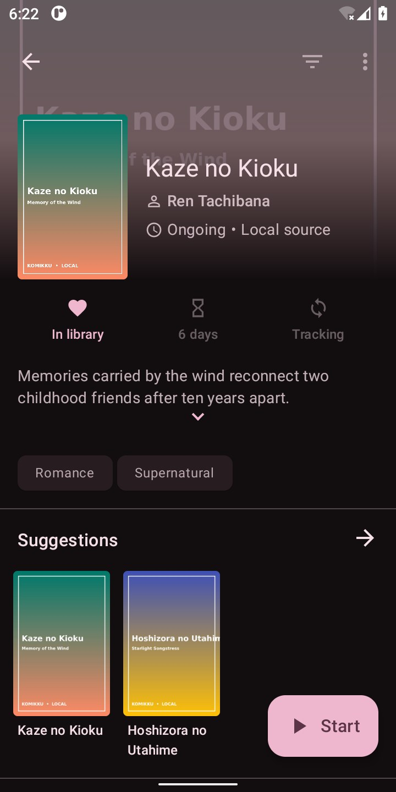

# 07 · 页面规格

> 17 个页面，按真实使用路径排列。每页给出：**入口 → 骨架 → 关键尺寸 → 双端差异 → 状态覆盖 → 截图对照**。

| 项目 | 说明 |
| --- | --- |
| 章节 | 07 / 10 |
| 适用读者 | 逐页实现的人 |
| 前置阅读 | [06 组件规格库](06-组件规格库.md) |
| 证据类型 | 源码 + 截图 |

---

## 页面清单

| # | 页面 | 层级 | 手机截图 | 平板截图 |
|---|---|---|---|---|
| 7.1 | 引导（4 步） | 根 | `01`–`04` | `01`–`04` |
| 7.2 | 书架 | Tab 0 | `05` 空、`10` 网格、`33` 暗 | `05`、`10`、`33` |
| 7.3 | 书架筛选/排序 Sheet | 弹层 | `35`、`35b` | `35`、`35b` |
| 7.4 | 更新 | Tab 1 | `16` | `15` |
| 7.5 | 历史 | Tab 2 | `15` | `14` |
| 7.6 | 浏览 · 来源 | Tab 3 | `06` | `06` |
| 7.7 | 源浏览（源内列表） | 推入 | `07` | `07` |
| 7.8 | 浏览 · Feed | Tab 3 | `29` | `29` |
| 7.9 | 浏览 · 扩展 | Tab 3 | `28` | `28` |
| 7.10 | 更多 | Tab 4 | `17`、`17b` | `16`、`16b` |
| 7.11 | 漫画详情 | 推入 | `11`、`34` 暗 | `11`、`34` |
| 7.12 | 章节列表（详情下半） | 推入 | `12` | `11` 右栏 |
| 7.13 | 阅读器 | 独立 Activity | `13`、`14` | `12`、`13` |
| 7.14 | 设置主页 | 推入 | `18`、`18b` | `18`、`18b` |
| 7.15 | 设置 · 外观 | 推入 | `19`、`19b` | `19` |
| 7.16 | 设置 · 书架/阅读器/下载/追踪/浏览/数据/高级/关于 | 推入 | `20`–`27` | `20`–`27` |
| 7.17 | 统计 / 分类 / 下载队列 | 推入 | `30`、`31`、`32` | `30`、`31`、`32` |

---

## 7.1 引导（Onboarding）

### 入口
首次启动（`isOnboardingComplete == false`）。

### 骨架

```text
        🚀                        ← 48dp 图标，primary
   Welcome!                     ← headlineLarge 32sp
   Let's set some things up…    ← titleSmall，78% alpha
┌──────────────────────────┐
│  [步骤内容区，surfaceVariant，8dp 圆角]  │
│                          │
└──────────────────────────┘
──────────────────────────────  ← outline 1px
        [ Next / Get started ]     ← 全宽 Button
```

### 4 个步骤

| 步 | 内容 | 完成条件 |
|---|---|---|
| 1 | 主题选择（System/Light/Dark 分段 + 19 套主题横向列表） | 总是可继续 |
| 2 | 存储位置（`Select a folder`） | **必须选目录** |
| 3 | 权限（安装应用 / 后台电量 / 媒体文件） | **必须给安装权限** |
| 4 | 指南（Getting started / Restore backup） | 总是可继续 |

### 关键尺寸

| 属性 | 值 | 来源 |
|---|---|---|
| 顶部 padding | **48dp**（内容区） | `InfoScreen.kt:101` |
| 图标 | **48dp**，`primary` | `InfoScreen.kt:105-112` |
| 标题 | `headlineLarge` **32sp** | `InfoScreen.kt:113-116` |
| 副标题 | `titleSmall` 14sp，78% alpha，垂直 8dp | `InfoScreen.kt:117-123` |
| 内容容器 | `surfaceVariant`，`shapes.small` **8dp** | `OnboardingScreen.kt:63-73` |
| 底栏分隔线 | `outline`，`Dp.Hairline` | `InfoScreen.kt:70-77` |
| 底栏 padding | horizontal **16** / vertical **8** | `InfoScreen.kt:59-67` |
| 主按钮 | `Button` 全宽 | `InfoScreen.kt:85-90` |
| 步骤转场 | `materialSharedAxisX` | `OnboardingScreen.kt:63-73` |

`📐实测` `assets/phone/01_onboarding_theme.jpg`：图标约 72×72px ÷ 2 = **36dp**（视觉墨迹，非 48dp 边界）；"Welcome!" 字高约 52px ÷ 2 = 26dp（对应 32sp 字阶的墨迹高度）✓。

### 双端差异

`⚠️缺口` 截图只有手机版。平板引导大概率是同一布局但内容区更宽。`InfoScreen` 没有双栏逻辑，所以平板也是单栏。

---

## 7.2 书架（Library）

### 入口
Tab 0（默认）。

### 骨架

```text
Library  (3)              [🔍] [▤] [⋮]
────────────────────────────────────
[ 分类 Tab 行：All | Reading | … ]      ← 仅当有多个分类
────────────────────────────────────
┌────────┐  ┌────────┐
│ 封面   │  │ 封面   │                  2 列（360dp）
└────────┘  └────────┘
┌────────┐
│ 封面   │
└────────┘
────────────────────────────────────
 Library  Updates  History  Browse  More
```

### 顶栏

| 元素 | 说明 |
|---|---|
| 标题 | `Library` + 计数 Pill（当前分类的作品数） |
| Pill alpha | 亮 **0.08** / 暗 **0.12**（`onBackground` 叠加） |
| 搜索 | 点击变搜索态（18sp 输入） |
| 筛选 | 活跃时图标变 `active`（亮 `#FFC107` / 暗 `#FFEB3B`） |
| 溢出 | 全局更新 / 随机作品 / 同步 / 清除缓存等 |

### 分类 Tab 行

```kotlin
// LibraryTabs.kt:30-55
PrimaryScrollableTabRow(
    selectedTabIndex = currentPageIndex,
    edgePadding = 0.dp,
    divider = {},                    // ← 去掉 M3 默认分隔线
) {
    categories.forEachIndexed { index, category ->
        Tab(selected, onClick, text = { TabText(category.visualName, count) },
            unselectedContentColor = MaterialTheme.colorScheme.onSurface)
    }
}
HorizontalDivider()                  // ← 自己加一条
```

| 属性 | 值 |
|---|---|
| `edgePadding` | **0dp** |
| 分隔线 | 默认 `divider = {}`，**自加** `HorizontalDivider()` |
| 未选中文字色 | `onSurface`（不是 `onSurfaceVariant`） |
| 计数 Pill | `onBackground` @ 8%/12%，**10sp** |
| 显示条件 | `categories.size > 1` 或首个分类不是系统分类 |

`📐实测` 截图里**看不到分类 Tab 行**，因为只有 "All" 一个系统分类 → `showPageTabs` 为 false。

### 网格

| 属性 | 值 |
|---|---|
| 列数 | `Adaptive(128.dp)`，360dp → **2 列**，1280dp（含轨）→ **9 列** |
| 内容边距 | **8dp**（四边） |
| 项间距 | **4dp** |
| 项内边距 | **4dp** |
| 封面 | 2:3，圆角 4dp |
| 卡片圆角 | 8dp |

### 空状态

```text
              (╬ಠ益ಠ)
         Your library is empty
           ( ? )  Getting started guide
```

`📐实测` `assets/phone/05_library_empty.jpg`：颜文字 `(╬ಠ益ಠ)` 居中偏上（y≈560-660px），说明文字在 y≈700px，帮助按钮在 y≈800px。

> 空状态在**没有分类 Tab 行**时出现；有分类但分类为空时显示 `information_no_manga_category`。

### 状态

| 状态 | 表现 |
|---|---|
| 加载中 | 无骨架屏，直接显示网格（数据来自 Flow，通常已就绪） |
| 空 | `EmptyScreen` + "Getting started guide" |
| 搜索无结果 | `EmptyScreen` + `no_results_found` + 全局搜索项 |
| 筛选无结果 | `EmptyScreen` + `error_no_match` |
| 多选 | 顶栏变动作模式，底栏变 `LibraryBottomActionMenu` |
| 下拉刷新 | `PullRefresh`，1 秒后自动收起（假状态） |

### 双端差异

| 项 | 手机 | 平板 |
|---|---|---|
| 导航 | 底栏 5 项 | 左侧轨 5 项 |
| 列数（360 vs 1280） | 2 | 9 |
| 分类 Tab 行 | 有（多分类时） | 同 |
| 双栏 | 无 | 无（书架永远单栏） |

---

## 7.3 书架筛选/排序/显示/分组 Sheet

### 入口
顶栏筛选图标，或长按底栏 Library（打开设置 Sheet）。

### 骨架

```text
┌─────────────────────────────────┐
│ Filter   Sort   Display   Group │  ← PrimaryTabRow
├─────────────────────────────────┤
│ ☐ Downloaded                    │
│ ☐ Unread                        │
│ ☐ Started                       │
│ ☐ Bookmarked                    │
│ ☐ Completed                     │
│ ☐ Customized update frequency   │
│ ☐ Lewd                          │
│ ☐ Categories              Edit  │
└─────────────────────────────────┘
```

### 4 个 Tab

| Tab | 内容 |
|---|---|
| **Filter** | 8 个复选筛选项（下载/未读/已开始/书签/已完成/自定义更新频率/Lewd/分类） |
| **Sort** | 9 个单选排序项（字母/章节数/最近阅读/最近更新检查/未读数/最新章节/章节获取时间/添加时间/随机）+ 升降序箭头 |
| **Display** | 显示密度（紧凑/舒适/全景/列表）+ 每行列数 |
| **Group** | 分组方式（无/分类/语言/源/标签…） |

### 关键尺寸

| 属性 | 值 | 来源 |
|---|---|---|
| 容器 | `AdaptiveSheet` → `surfaceContainerHigh`，28dp 圆角 | `TabbedDialog.kt:71-75` |
| Tab 行容器色 | **`surfaceContainerHigh`**（与 sheet 同色） | `TabbedDialog.kt:77` |
| Tab 行分隔线 | `divider = {}`，自加 `HorizontalDivider()` | `TabbedDialog.kt:80-93` |
| 内容水平 padding | **24dp**（`TabbedDialogPaddings.Horizontal`） | `TabbedDialog.kt:36-38` |
| 内容垂直 padding | **8dp** | `TabbedDialog.kt:37` |
| 复选项 | `Checkbox` + `bodyMedium`，行内边距同 24/8 | — |
| 排序项 | `SortItem` → `BaseSettingsItem`（图标 + 文字） | `SettingsItems.kt` |

### 排序项的箭头

```kotlin
// SettingsItems.kt:99-124
@Composable
fun SortItem(label: String, sortDescending: Boolean?, onClick: () -> Unit) {
    val arrowIcon = when (sortDescending) {
        true -> Icons.Default.ArrowDownward
        false -> Icons.Default.ArrowUpward
        null -> null
    }
    BaseSortItem(label = label, icon = arrowIcon, onClick = onClick)
}
```

只有**当前选中**的排序项显示箭头（`sortDescending` 非 null），其他项留 24dp 空白占位。

`📐实测` `assets/phone/35b_library_sort_sheet.jpg`：选中项 "Alphabetically" 左侧有向下箭头且颜色为 `primary`，其他项无箭头 ✓。

### 双端差异

| 项 | 手机 | 平板 |
|---|---|---|
| 容器 | 底部抽屉，全宽 | **460dp 居中卡片** |
| 关闭 | 下滑 56dp 或点遮罩 | 只点遮罩 |
| Tab 行 | 4 等分 | 同 |
| 内容 | 同 | 同 |

`📐实测` 平板宽 **458.7dp**、对称边距 **410.7dp** ✓。

---

## 7.4 更新（Updates）

### 骨架

```text
Updates                   [▤] [📅] [↻]
─────────────────────────────────────
Last updated 2 minutes ago           ← 斜体
─────────────────────────────────────
Today                                ← ListGroupHeader
┌─────┐  Title
│2:3  │  Chapter 42 · 3 new
└─────┘
```

### 关键尺寸

| 属性 | 值 | 来源 |
|---|---|---|
| "Last updated" | `bodyMedium` + `FontStyle.Italic`，padding 16/8 | `UpdatesUiItem.kt:98-110` |
| 分组标题 | `ListGroupHeader` | 见 [06](06-组件规格库.md) §6.10 |
| 更新项 | 结构同 `HistoryItem`（封面 `fillMaxHeight`、可滑动） | `UpdatesUiItem.kt` |
| 滑动动作 | 同章节（`ToggleRead`/`ToggleBookmark`/`Download`） | `UpdatesUiItem.kt:289` |
| 折叠 | 按作品分组可折叠（`expandedState`） | `UpdatesUiItem.kt:130-140` |

### 空状态

`📐实测` `assets/phone/16_updates.jpg`：颜文字 `Σ(ಠ_ಠ)` + "No recent updates"，居中。

### 顶栏动作

| 图标 | 功能 |
|---|---|
| `▤`（ViewModule/ViewList） | 切换显示模式 |
| `📅`（CalendarMonth） | 打开"即将更新"（Upcoming） |
| `↻`（Refresh） | 立即检查更新 |

### 双端差异

无结构差异（都是单栏列表）。

---

## 7.5 历史（History）

### 骨架

```text
History                   [🔍] [▤] [☑]
─────────────────────────────────────
Today                                ← ListGroupHeader
┌─────┐  Kaze no Kioku
│2:3  │  ● Ch. 2 · 6:01 PM
└─────┘                         [🗑]
```

### 关键尺寸

见 [06](06-组件规格库.md) §6.8（行高 96dp、封面 2:3 填满高度、标题 SemiBold）。

### 日期分组

| 分组 | 条件 |
|---|---|
| Today | `LocalDate.now()` |
| Yesterday | `now - 1 day` |
| 更早 | 按日期分段 |

### 空状态

`information_no_recent_manga` / `no_results_found`（有搜索时）。

### 双端差异

无结构差异。

---

## 7.6 浏览 · 来源（Browse / Sources）

### 骨架

```text
Browse              [🌐] [18] [▤]
─────────────────────────────────
Sources  Feed  Extensi…  Migrate    ← PrimaryTabRow
─────────────────────────────────
┌──────────────────────────────┐
│ 🔍  Search for sources       │     ← 胶囊搜索框
└──────────────────────────────┘
Other                               ← ListGroupHeader
📁 Local source
   🌐 Other                    [⚙]
```

### 顶栏动作

| 图标 | 功能 | 条件 |
|---|---|---|
| `🌐`（Public + Search 组合） | 全局搜索 | — |
| `[18]` | NSFW 内容开关 | — |
| `▤`（FilterList） | 源筛选 | — |

### Tab 行

| Tab | 内容 | 可隐藏 |
|---|---|---|
| **Sources** | 源列表（按语言分组） | 否 |
| **Feed** | 源 Feed（自定义顺序） | ✅ `hideFeedTab` |
| **Extensions** | 已安装扩展 | 否 |
| **Migrate** | 迁移入口 | 否 |

**Tab 顺序可变**：`feedTabInFront = true` 时 Feed 排第一（`BrowseTab.kt:95-120`）。

### 搜索框

`📐实测` `assets/phone/06_browse_sources.jpg`：搜索框高约 100px ÷ 2 = **50dp**，全宽（左右各 32px ÷ 2 = 16dp 边距），圆角完全（高度一半）。

```kotlin
// SourceSearchBox / 类似组件
OutlinedTextField(
    shape = CircleShape,               // 全圆
    colors = … containerColor = surfaceContainerHigh
)
```

### 源列表项

```text
[图标 40dp]  Local source
             🌐 Other              [⚙]
```

| 属性 | 值 | 来源 |
|---|---|---|
| 行内边距 | horizontal **16** / vertical **8** | `BaseBrowseItem.kt:28` |
| 图标 | 源图标或 `Folder`（本地），约 40dp | `SourceIcon` |
| 标题 | `bodyMedium` 14sp | `BaseSourceItem.kt:88-95` |
| 副标题 | `bodySmall` 12sp，78% alpha，`国旗 emoji + 语言名` | `BaseSourceItem.kt:80-90` |
| NSFW 标记 | `bodySmall` + `error` 色，大写 | `BaseSourceItem.kt:92-101` |
| 动作 | `⚙` 源设置 | — |

### 双端差异

无结构差异（TabbedScreen 在两端都是单栏 + Tab 行）。

---

## 7.7 源浏览（Browse Source）

### 骨架

```text
←  Local source      [🔍] [▤] [⋮]
─────────────────────────────────
Latest                        →
┌────┐ ┌────┐ ┌────┐              ← 横向 LazyRow
│2:3 │ │2:3 │ │2:3 │
└────┘ └────┘ └────┘
Midnight  Hoshizora  Kaze
Ramen     no Utahi   no Kioku
─────────────────────────────────
Browse                        →
┌────┐ ┌────┐ ┌────┐
…
                              [▤ Filter]   ← FAB
```

### 关键尺寸

| 属性 | 值 |
|---|---|
| 分区标题 | `titleMedium`? 实际是 `RelatedMangaTitle` 风格：**大写** + 箭头 |
| 分区标题内边距 | horizontal **16dp** |
| 横向卡片宽 | **96dp**（全景 205dp） | `GlobalSearchCardRow.kt:86-88` |
| 卡片标题 | `titleSmall`，**3 行**（`titleMaxLines = 3`） | `GlobalSearchCardRow.kt:91` |
| FAB | `ExtendedFloatingActionButton`，`primary` 容器 |

`📐实测` `assets/phone/07_local_source_list.jpg`：卡片宽约 **180px ÷ 2 = 90dp**（含项内边距），可见封面约 82dp；3 列正好铺满 360dp。

> 与实际代码的 96dp 有差异，因为截图里的源是"本地源"，用了 `BrowseSourceComfortableGrid` 而不是 `LazyRow`。横向行只在详情页的"Suggestions"区。

### 双端差异

| 项 | 手机 | 平板 |
|---|---|---|
| 列数 | 3 | 更多（`Adaptive(128dp)`） |
| FAB | 右下 | 同 |

---

## 7.8 浏览 · Feed

### 骨架

```text
Browse              [+] [↑↓] [☑]
─────────────────────────────────
Sources  Feed  Extensi…  Migrate
─────────────────────────────────
              Σ(ಠ_ಠ)
   You don't have any sources in your feed,
     navigate to the top right to add one
```

### 关键点

| 项 | 说明 |
|---|---|
| 空状态文案 | 明确指向右上角 `+` 按钮（好文案范例） |
| `+` | 添加源到 Feed |
| `↑↓` | 调整 Feed 顺序 |
| `☑` | 批量收藏模式 |

---

## 7.9 浏览 · 扩展

### 骨架

```text
Browse              [🔍] [18] [⋮]
─────────────────────────────────
Sources  Feed  Extensi…  Migrate
─────────────────────────────────
┌───────────────────────────────┐
│ Permissions are needed…       │   ← error 横幅，16dp padding
└───────────────────────────────┘
More extensions…   [ Add extension store ]
```

`📐实测` `assets/phone/28_extensions.jpg`：红色横幅是 `error` 底 + `onError` 文字，16dp padding，居中两行。

---

## 7.10 更多（More）

### 骨架

```text
              [Logo]                ← 64dp icon + 56dp 上下 padding
─────────────────────────────
☁ Downloaded only          [◯]      ← 开关
👓 Incognito mode          [◯]
─────────────────────────────
⬇ Download queue
🏷 Categories
📊 Statistics
⚠ Library update errors
💾 Data and storage
⚙ Settings
ℹ About
─────────────────────────────
  [GitHub]  [Discord]  [Reddit]
```

### 关键尺寸

| 属性 | 值 | 来源 |
|---|---|---|
| Logo | **64dp**，`tint = onSurface`，**垂直 padding 56dp**（总高 176dp） | `LogoHeader.kt:23-30` |
| 开关行 | 套 A（`BasePreferenceWidget`），56dp 最小高 | — |
| 图标 | `primary` 色 | `TextPreferenceWidget` 默认 `iconTint` |
| 分隔线 | `HorizontalDivider` | `MoreScreen.kt:135` |
| 底部社交图标 | 3 个，约 32dp，`primary` | `MoreScreen.kt` 末尾 |

### 双端差异

无结构差异。

---

## 7.11 漫画详情（Manga Detail）

### 骨架（手机）

```text
←                    [▤] [⋮]
   ┌────────────────────┐        ← 封面背景（模糊 7dp + 20% alpha + 40% surfaceTint）
   │  [封面 100dp 宽]   │  Title (titleLarge)
   │                    │  👤 Author
   └────────────────────┘  🕐 Ongoing · Local source
─────────────────────────────
  ♥        ⏳        ⟳
In library  6 days   Tracking     ← 动作行
─────────────────────────────
  Memories carried by the wind…    ← 描述（可展开）
                          ⌄
  ( Romance ) ( Supernatural )     ← 标签
─────────────────────────────
Suggestions                    →
┌────┐ ┌────┐
│2:3 │ │2:3 │                      ← 关联作品横向行
└────┘ └────┘
─────────────────────────────
       [ See Recommendations → ]
─────────────────────────────
3 chapters                    [▤]
● Chapter_03                  ✓
  Today
● Chapter_02                  ✓
  Today
● Chapter_01                  ✓
  Today
                    [▶ Start]      ← FAB
```

### 关键尺寸

| 属性 | 值 | 来源 |
|---|---|---|
| 封面宽 | **100dp**（`sizeIn(maxWidth = 100.dp)`） | `MangaInfoHeader.kt:622` |
| 封面背景 | `blur(7.dp)` + `alpha(0.2f)` + `surfaceTint @ 0.4f` | `MangaInfoHeader.kt:180-186` |
| 背景渐变 | `Transparent → background`，从 `height/2` 开始 | `MangaInfoHeader.kt:200-210` |
| 标题 | `titleLarge` **22sp** | `MangaInfoHeader.kt:715-729` |
| 作者行 | `titleSmall` 14sp + `PersonOutline` 16dp 图标，78% alpha | `MangaInfoHeader.kt:735-760` |
| 状态行 | `bodyMedium` 14sp + 16dp 图标 + · + 源名 | `MangaInfoHeader.kt:790-850` |
| 动作行 | 3–5 个按钮，`weight(1f)` 等分 | `MangaInfoHeader.kt:286-350` |
| 动作图标 | **20dp** | `MangaInfoHeader.kt:1028-1033` |
| 动作标签 | **12sp** | `MangaInfoHeader.kt:1034-1040` |
| 动作行 padding | start 16 / top 8 / end 16 | `MangaInfoHeader.kt:284` |
| 描述区 padding | top 8 / horizontal 16 | `MangaInfoHeader.kt:383-386` |
| 描述折叠高度 | 无笔记 3 行 / 有笔记 6 行 | `MangaInfoHeader.kt:876-880` |
| 描述渐变遮罩 | 24dp 高，`Transparent → background` | `MangaInfoHeader.kt:938-941` |
| 标签 Chip | `shapes.small` 8dp，`padding(vertical=4.dp)` | `MangaInfoHeader.kt:1007-1012` |
| 关联行卡片宽 | **96dp** | `GlobalSearchCardRow.kt:86-88` |
| FAB | `SmallExtendedFloatingActionButton`，`primary` 容器 | `MangaScreen.kt:530-545` |
| FAB 可左右拖动 | ✅ 拖到左半边则贴左 | `MangaScreen.kt:1012-1029` |

### 动作行的状态色

| 按钮 | 激活条件 | 颜色 |
|---|---|---|
| In library | `favorite == true` | `primary`，否则 `onSurface @ 0.38` |
| Tracking | `trackingCount > 0` | `primary`，否则 38% |
| 更新间隔 | `isUserIntervalMode \|\| nextUpdateDays <= 1` | `primary`，否则 38% |
| WebView | 总是 | **`primary`**（KMK 改） |
| Merge | 总是 | **`primary`**（KMK 改） |

### 双端差异（平板）

### 暗色下的封面取色



*图 7-1 暗色详情：同一封面在暗色下取色为紫红，说明 `seedColor` 是同一份、两套 scheme 分别生成。*

```text
← Kaze no Kioku              [▤] [⋮]
┌──────────────────┬──────────────────────┐
│ [封面 65% 宽]     │ Suggestions       →  │
│ Title (居中)      │ [96dp] [96dp]        │
│ 👤 Author         ├──────────────────────┤
│ 🕐 Ongoing · …    │ 3 chapters       [▤] │
│                   │ ● Chapter_03      ✓  │
│ ♥    ⏳    ⟳      │ ● Chapter_02      ✓  │
│In lib 6d Tracking │ ● Chapter_01      ✓  │
│                   │                      │
│ 描述…             │                      │
│ (tags)            │            [▶ Start] │
└──────────────────┴──────────────────────┘
```

| 项 | 手机 | 平板 |
|---|---|---|
| 布局 | 单栏纵向 | **TwoPanelBox**（左 450dp / 右 830dp） |
| 封面宽 | 100dp | **65% 栏宽**（约 292dp） |
| 封面居中 | 左对齐 | **水平居中** |
| 标题对齐 | 左 | **居中** |
| 章节列表 | 下方 | **右栏独立滚动 + 快速滚动条** |
| FAB | 右下 | 右下（右栏内） |

`📐实测` `assets/tablet/11_manga_detail.jpg`：左栏边界在 x≈338px ÷ 0.75 = **450dp** ✓；封面宽约 200px ÷ 0.75 = 267dp（≈ 450 × 0.65 = 292dp，含 padding）✓。

---

## 7.12 章节列表

### 骨架

见 [06](06-组件规格库.md) §6.7。

### 头部

```text
3 chapters                        [▤]      ← 22sp titleMedium
missing chapters warning (可选)            ← error @ 78%
```

| 属性 | 值 | 来源 |
|---|---|---|
| 章数标题 | `titleMedium` **16sp**，`onBackground` | `ChapterHeader.kt:51-58` |
| 缺失章节警告 | `bodySmall` 12sp，`error @ 78%` | `ChapterHeader.kt:66-74` |
| 头部 padding | horizontal 16 / vertical 4 | `ChapterHeader.kt:38-46` |
| 点击头部 | 打开章节筛选 Sheet | `ChapterHeader.kt:40-43` |

### 章节筛选 Sheet

见 `assets/tablet/37_chapter_filter_sheet.jpg`（仅平板截图）。结构同书架的 `TabbedDialog`。

---

## 7.13 阅读器（Reader）

### 骨架

```text
┌───────────────────────────────┐
│ ← Kaze no Kioku            ★  │  ← 顶栏（半透明，200ms slide + 150ms fade）
│    Chapter_02                 │
├───────────────────────────────┤
│                               │
│         [漫画页面]             │
│                               │
│                               │
├───────────────────────────────┤
│  ◀◀  [ 6 ─●─── 1 ]  ▶▶        │  ← 页码胶囊（24dp 圆角）
├───────────────────────────────┤
│  📑   🚫   📖   ⚙             │  ← 底栏图标（primary）
└───────────────────────────────┘
              3 / 24              ← 页码指示（12sp Bold 描边），菜单隐藏时显示
```

### chrome 的可见性

| 状态 | chrome | 页码指示 |
|---|---|---|
| 初始 | 隐藏 | 显示 |
| 点击中央 | 显示 | 隐藏 |
| 再点中央 | 隐藏 | 显示 |
| 返回键（chrome 显示） | 隐藏 | 显示 |

### 关键尺寸

| 属性 | 值 | 来源 |
|---|---|---|
| 顶/底栏底色 | `surfaceColorAtElevation(3.dp) × 0.95 亮 / 0.90 暗` | `ReaderAppBars.kt:104-106` |
| 页码胶囊圆角 | **24dp** | `ChapterNavigator.kt:126` |
| 页码胶囊 padding | horizontal **16dp** | `ChapterNavigator.kt:128` |
| 滑块 padding | horizontal **8dp** | `ChapterNavigator.kt:154` |
| 页面水平 padding | 手机 **8dp** / 平板 **24dp** | `ChapterNavigator.kt:82-83` |
| 页码指示 | 12sp Bold，1sp 字距，`primary` 填充 + `#2D2D2D` 4px 描边 | `ReaderPageIndicator.kt:32-46` |
| 底栏图标 | `primary` | `ReaderBottomBar.kt:60-62` |
| 底栏 padding | horizontal **8dp** + `navigationBars` inset | `ReaderAppBars.kt:255-258` |

### 阅读模式

| 模式 | 说明 |
|---|---|
| `LEFT_TO_RIGHT` | 从左到右翻页 |
| `RIGHT_TO_LEFT` | 从右到左（日漫） |
| `VERTICAL` | 纵向连续 |
| `WEBTOON` | 条漫（无手势缩放） |
| `CONTINUOUS_VERTICAL` | 纵向连续（可分段） |

### `bodyLarge` 覆写

```kotlin
// ReaderActivity.kt:321-323
TachiyomiTheme(
    seedColor = seedColorState().takeIf { themeCoverBased },
    typography = MaterialTheme.typography.copy(
        bodyLarge = MaterialTheme.typography.bodySmall,   // 16/24 → 12/16
    ),
)
```

> 阅读器内所有 `bodyLarge` 变成 12sp。**这是阅读器排版紧凑的关键**，复刻时不能漏。

### 双端差异

| 项 | 手机 | 平板 |
|---|---|---|
| 导航条 | 底部（`NavBarType.Bottom`） | 可配置为**左右侧边**（`VerticalLeft/Right`） |
| 页面水平 padding | 8dp | **24dp** |
| 双页 | 视设置 | 同 |
| `📐实测` 平板阅读 | — | 左右深色边（letterbox）+ 中间页面 |

---

## 7.14 设置主页

### 骨架

```text
←  Settings                 [🔍]
─────────────────────────────
🎨 Appearance
   Theme, date & time format
📚 Library
   Categories, global update, chapter swipe
📖 Reader
   Reading mode, display, navigation
⬇ Downloads
   Automatic download, download ahead
⟳ Tracking
   One-way progress sync, enhanced sync
🔗 Connections
   Discord, more to come..
🌐 Browse
   Sources, extensions, global search
💾 Data and storage
   Manual & automatic backups, storage space
🛡 Security and privacy
   App lock, secure screen
</> Advanced
   Dump crash logs, battery optimizations
ℹ About
   Komikku Debug 290267d
```

### 11 个入口

| 图标 | 标题 | 副标题 |
|---|---|---|
| `Palette` | Appearance | Theme, date & time format |
| `CollectionsBookmark` | Library | Categories, global update, chapter swipe |
| `ChromeReaderMode` | Reader | Reading mode, display, navigation |
| `GetApp` | Downloads | Automatic download, download ahead |
| `Sync` | Tracking | One-way progress sync, enhanced sync |
| `Link` | Connections | Discord, more to come.. |
| `Explore` | Browse | Sources, extensions, global search |
| `Storage` | Data and storage | Manual & automatic backups, storage space |
| `Security` | Security and privacy | App lock, secure screen |
| `Code` | Advanced | Dump crash logs, battery optimizations |
| `Info` | About | `Komikku {version}` |

### 关键尺寸

| 属性 | 值 |
|---|---|
| 图标 | 24dp，`primary` |
| 图标 start padding | **16dp**，end **8dp** |
| 标题 | `titleLarge` 覆写为 **16sp**，2 行 |
| 副标题 | `bodySmall` 12sp，78% alpha，`maxLines=10` |
| 行最小高 | **56dp** |
| 垂直 padding | **16dp** |

`📐实测` `assets/phone/18_settings_main.jpg`：图标中心 x≈56px ÷ 2 = 28dp（= 16dp padding + 12dp 半宽）✓；标题基线间距与 16sp 字阶吻合 ✓。

### 双端差异（平板）

| 项 | 手机 | 平板 |
|---|---|---|
| 布局 | 单栏列表 | **双栏**（左 450dp 主列表 + 右子页） |
| 容器色 | `surface` | 左栏 `getPalerSurface()` |
| 选中行 | 无 | 8dp padding + 24dp 圆角 + `surfaceVariant` |
| 标题 | Settings | 同 |
| 子页进入 | `push` | **`replaceAll`** |

---

## 7.15 设置 · 外观（Appearance）

### 骨架

```text
←  Appearance
─────────────────────────────
Theme                                ← PreferenceGroupHeader（secondary）
┌─────────────────────────────┐
│ ✓ System │ Light │ Dark     │     ← MultiChoiceSegmentedButtonRow
└─────────────────────────────┘
┌──────┐┌──────┐┌──────┐┌──────┐
│ 预览 ││ 预览 ││ 预览 ││ 预览 │     ← 114dp 宽，9:16
│      ││  ✓   ││      ││      │
└──────┘└──────┘└──────┘└──────┘
 Default Dynamic Custom  Cotton…

Pure black dark mode        [◯]

Manga Info                          ← 分组标题
Theme based on cover        [●]
Cover based theme style     Vibrant  →
```

### 主题预览卡

```kotlin
// AppThemePreferenceWidget.kt:108-155
Column(Modifier.width(114.dp).padding(top = 8.dp)) {
    TachiyomiTheme(appTheme, amoled) {
        AppThemePreviewItem(selected, onClick)
    }
    Spacer(Modifier.height(8.dp))
    Text(stringResource(appTheme.titleRes!!), Modifier.fillMaxWidth().secondaryItemAlpha(),
         textAlign = Center, maxLines = 2, minLines = 2, style = bodyMedium)
}
```

| 属性 | 值 | 来源 |
|---|---|---|
| 卡片宽 | **114dp** | `AppThemePreferenceWidget.kt:95` |
| 卡片比例 | **9:16** | `AppThemePreferenceWidget.kt:136` |
| 外框边框 | **4dp**，选中 `primary` / 未选 `DividerDefaults.color` | `AppThemePreferenceWidget.kt:138-146` |
| 外框圆角 | **17dp** | `AppThemePreferenceWidget.kt:144` |
| 内层圆角 | **13dp** | `AppThemePreferenceWidget.kt:145-147` |
| 内层 padding | **4dp** | `AppThemePreferenceWidget.kt:145-147` |
| 列表间距 | **8dp** | `AppThemePreferenceWidget.kt:87` |
| 列表水平 padding | **16dp** | `AppThemePreferenceWidget.kt:86` |
| 标签 | `bodyMedium` 14sp，78% alpha，**固定 2 行** | `AppThemePreferenceWidget.kt:113-119` |
| 选中标记 | `Icons.Filled.CheckCircle`，`primary` | `AppThemePreferenceWidget.kt:174-179` |

`📐实测` `assets/phone/19_settings_appearance.jpg`：卡片宽 **228px ÷ 2 = 114dp** ✓，间距 **16px ÷ 2 = 8dp** ✓。

### 预览卡的内部构造

```text
┌─────────────────┐  ← 4dp 边框 + 17dp 圆角
│ ███████         │  ← AppBar：40dp 高，onSurface 色块（0.7 权重）
│                 │
│ ┌────┐          │  ← 封面：50% 宽，2:3，DividerDefaults 色
│ │▌▌  │          │     里面有 24×16dp 双色块（tertiary + secondary）
│ └────┘          │
│                 │
│ ┌─────────────┐ │  ← 底栏：surfaceContainer，32dp 高
│ │●  ▬▬▬▬▬▬▬  │ │     primary 圆点 17dp + onSurface 条（0.6 alpha）
│ └─────────────┘ │
└─────────────────┘
```

| 元素 | 尺寸 | 来源 |
|---|---|---|
| AppBar 区高 | **40dp** | `AppThemePreferenceWidget.kt:151-157` |
| AppBar 色块 | 0.7 权重，`onSurface`，`shapes.small` | `AppThemePreferenceWidget.kt:159-169` |
| 封面 | 50% 宽，2:3，`DividerDefaults.color` | `AppThemePreferenceWidget.kt:185-190` |
| 封面双色块 | **24×16dp**，圆角 **5dp** | `AppThemePreferenceWidget.kt:195-201` |
| 底栏高 | **32dp**，`surfaceContainer` | `AppThemePreferenceWidget.kt:225-231` |
| 圆点 | **17dp**，`primary`，`CircleShape` | `AppThemePreferenceWidget.kt:233-237` |
| 条 | 17dp 高，`onSurface @ 0.6`，`shapes.small` | `AppThemePreferenceWidget.kt:240-248` |

### 主题模式分段按钮

```kotlin
// AppThemeModePreferenceWidget.kt:29-45
MultiChoiceSegmentedButtonRow(Modifier.fillMaxWidth().padding(horizontal = 16.dp)) {
    options.onEachIndexed { index, (mode, labelRes) ->
        SegmentedButton(
            checked = mode == value,
            onCheckedChange = { onItemClick(mode) },
            shape = SegmentedButtonDefaults.itemShape(index, options.size),
        ) { Text(stringResource(labelRes)) }
    }
}
```

- 3 段：System / Light / Dark
- 选中段有 `✓` 前导图标（M3 `SegmentedButton` 默认行为）
- 水平 padding **16dp**，全宽

> `📐实测` 截图里的 `✓` 是 M3 SegmentedButton 自动加的（`SegmentedButtonDefaults.Icon(active = checked)`），不是自定义。

### 关于截图里的下划线

`assets/phone/19_settings_appearance.jpg` 底部 "Cover based theme style" 下方有紫色下划线，`assets/phone/20_settings_library.jpg` 的 "Automatically refresh metadata" 也有。**这不是设计元素**，是无障碍焦点指示器（模拟器里 TalkBack/键盘焦点）。复刻时**不要**加。

---

## 7.16 设置子页（Library / Reader / Downloads / Tracking / Browse / Data / Advanced / About）

### 通用骨架

```text
←  {标题}
──────────────────────────────
{分组标题}                         ← PreferenceGroupHeader，secondary
{条目}
  {标题}
  {副标题}                    {控件}
──────────────────────────────
{分组标题}
…
```

### 各页分组

| 页 | 主要分组 |
|---|---|
| **Library** | Categories / Global update / Library update restrictions / Chapter swipe / … |
| **Reader** | Reading / Display / Navigation / … |
| **Downloads** | Automatic download / Download ahead / … |
| **Tracking** | Trackers（MAL / AniList / Kitsu / MangaUpdates / Bangumi / Shikimori）/ Enhanced sync |
| **Browse** | Sources / Extensions / Global search / Feed |
| **Data and storage** | Backup / Restore / Storage / Cache |
| **Advanced** | Debug / Battery / Network |
| **About** | Version / What's new / Licenses / Privacy / 社交链接 |

### 设置行的三种控件

| 控件 | 组件 | 说明 |
|---|---|---|
| 开关 | `SwitchPreferenceWidget` → `Switch`，`padding(start=16.dp)` | 点击整行切换 |
| 下拉 | `ListPreferenceWidget` | 点击弹 `AlertDialog` 单选 |
| 滑杆 | `BaseSliderItem` | 标题 + 值 Pill + Slider |
| 文本 | `TextPreferenceWidget` | 只有标题/副标题 |
| 输入 | `EditTextPreferenceWidget` | 点击弹输入对话框 |

### About 页的特殊布局

```text
←  About
─────────────────────────
       [Logo 大图]
─────────────────────────     ← outline 分隔线
Version
Debug 290267d (11/18/26 2:18 AM)
What's new
What's coming (soon)
Help translate
Open source licenses
Privacy policy
─────────────────────────
  [GitHub]  [Discord]  [Reddit]
```

| 元素 | 说明 |
|---|---|
| Logo 区 | icon **64dp** + 上下 **56dp** padding，居中；下方 `HorizontalDivider` |
| 分隔线 | `outline` 1px 全宽 |
| 版本行 | 标题 + 副标题（版本号 + 构建时间） |
| 社交图标 | 3 个，`primary`，约 32dp |

---

## 7.17 统计 / 分类 / 下载队列

### 统计（Statistics）

```text
←  Statistics                    [⋮]
─────────────────────────
Overview                       ← titleSmall
┌───────────────────────────┐
│  3        4m 13s      0   │  ← titleLarge 数字
│ In library  Read dur. Completed
│  📚         🕐         📖  │  ← primary 图标
└───────────────────────────┘
Entries
┌───────────────────────────┐
│  0        0        3      │
│ In global  Started  Local  │
└───────────────────────────┘
Chapters
┌───────────────────────────┐
│  9        0        0      │
│ Total     Read    Downloaded
└───────────────────────────┘
Trackers
┌───────────────────────────┐
│  0       N/A       0      │
│ Tracked  Mean score  Used  │
└───────────────────────────┘
```

| 属性 | 值 | 来源 |
|---|---|---|
| 卡片 | `ElevatedCard`，`shapes.extraLarge` **28dp** | `SectionCard.kt:30-42` |
| 卡片水平边距 | **16dp** | `SectionCard.kt:33-36` |
| 卡片垂直边距 | **8dp** | `SectionCard.kt:35` |
| 卡片内 padding | **16dp** | `SectionCard.kt:39` |
| 分组标题 | `titleSmall` 14sp，`padding(horizontal=32.dp)` | `SectionCard.kt:23-27` |
| 概览数字 | `titleLarge` **22sp** + `FontWeight.Bold`，居中，1 行 | `StatsItem.kt:29,59-64` |
| 概览标签 | `bodyMedium` 14sp，78% alpha，居中 | `StatsItem.kt:31,66-73` |
| 其他数字 | `bodyMedium` **14sp** + Bold，居中，1 行 | `StatsItem.kt:37-47` |
| 其他标签 | `labelSmall` **11sp**，78% alpha，居中 | `StatsItem.kt:45` |
| 图标 | `primary`，M3 默认 24dp，底部对齐（`Spacer(weight(1f))`） | `StatsItem.kt:70-77` |

`📐实测` `assets/phone/30_statistics.jpg`：卡片左右边距 32px ÷ 2 = **16dp** ✓；圆角明显约 28dp ✓；数字字高约 44px ÷ 2 = 22dp（22sp 字阶墨迹）✓。

### 分类（Edit categories）


*图 7-2 统计页：4 张 `ElevatedCard`，28dp 圆角，概览数字 `titleLarge` Bold。*

```text
←  Edit categories
              (•O•;)
   You have no categories. Tap the plus button to
   create one for organizing your library.
                            [+ Add]    ← FAB
```

| 元素 | 说明 |
|---|---|
| 空状态 | 标准 `EmptyScreen` + 说明文案 |
| FAB | `ExtendedFloatingActionButton`，`primaryContainer`，`+ Add` |
| 分类项 | 标题 + 计数，可拖动排序，右滑删除 |

### 下载队列（Download queue）

```text
←  Download queue
              (︶︿︶)
           No downloads
```

| 元素 | 说明 |
|---|---|
| 空状态 | 标准 `EmptyScreen` |
| 队列项 | 封面 + 作品名 + 章节 + 进度条 + 暂停/取消 |
| 顶栏动作 | 全部暂停 / 全部取消 / 清除已完成 |

---

## 设计意图（`🎯推断`）

1. **为什么书架不显示分类 Tab 行当只有"All"**：单一分类的 Tab 行是纯装饰，浪费 48dp 高度。
2. **为什么详情页动作行是"图标 + 12sp 标签"**：5 个动作要在一行放下，图标 20dp + 文字 12sp 是能容纳的最小组合。
3. **为什么主题预览卡是 114dp × 9:16**：9:16 是手机屏幕比例，预览卡"看起来像一台手机"；114dp 让 3 张卡在 360dp 屏上几乎铺满（3×114 + 2×8 + 32 = 390，略超，所以第 3 张被裁——这是刻意的"可滑动"暗示）。
4. **为什么统计卡片用 28dp 圆角**：统计页是"阅读型"页面，不承载操作；大圆角让它看起来"柔和、非工具"，与书架/列表的 8dp 形成对比。
5. **为什么 About 页有分隔线而其他设置页没有**：About 页的 logo 区是一个"头部"，需要与条目区分隔。

---

## 复刻检查清单

- [ ] 引导 4 步，第 2/3 步有完成条件
- [ ] 书架 360dp→2 列、1280dp→9 列，内容边距 8dp
- [ ] 书架分类 Tab 行仅在多分类时显示
- [ ] 筛选 Sheet 有 4 个 Tab，24/8dp 内边距
- [ ] 更新页有 "Last updated" 斜体行
- [ ] 历史页按日期分组（Today/Yesterday/…）
- [ ] 浏览 4 Tab，Feed 可前置、可隐藏
- [ ] 源列表项显示国旗 + 语言名
- [ ] 详情页封面 100dp（手机）/ 65% 栏宽（平板）
- [ ] 详情页动作行图标 20dp、文字 12sp
- [ ] 章节列表头部 16sp + 缺失警告
- [ ] 阅读器 `bodyLarge → bodySmall` 覆写
- [ ] 阅读器页码胶囊 24dp 圆角
- [ ] 设置主页 11 个入口，图标 `primary`
- [ ] 主题预览卡 114dp / 9:16 / 17dp 外圆角 / 13dp 内圆角
- [ ] 统计卡片 28dp 圆角、`ElevatedCard`
- [ ] **不要**加截图里的紫色下划线（那是焦点指示器）

---

## 延伸阅读

- [上一章：06 组件规格库](06-组件规格库.md)
- [下一章：08 状态与反馈](08-状态与反馈.md)
- 截图索引：[10 附录 B](10-附录.md)
