# 07 · 页面规格

> 按真实使用路径逐页拆解 15 个页面：入口、骨架、关键尺寸、手机/平板差异与状态覆盖。

| 项目 | 说明 |
| --- | --- |
| 章节 | 07 / 10 |
| 适用读者 | 需要按页实现或做页面级设计评审的人 |
| 前置阅读 | [06 组件规格库](06-组件规格库.md) |
| 证据类型 | 页面代码 + 37 张手机截图 + 37 张平板截图 |

## 本章导读

- 引导、书架、浏览、详情、阅读器、历史、更新、更多、设置。
- 统计、分类、下载队列、更新错误、关于与工具页。
- 每页的手机/平板差异，以及哪些页面不进入本次截图集。
- 页面之间的共享组件与状态复用关系。

---

本章按真实使用路径逐页拆解。每页给出：入口、骨架、关键尺寸、手机/平板差异、状态覆盖。所有截图均来自同一台设备的实机运行；手机为 720×1440（360dp，18:9），平板为 1600×1000（1280×800dp）。

## 7.1 引导（Onboarding）

四步线性流程：**主题 → 存储 → 权限 → 指南**。外壳是 `InfoScreen`：48dp 火箭图标、headlineLarge 标题、titleSmall 副标题、底部整宽主按钮（最后一步变为“完成”）。中间内容区是一个 `surfaceVariant` 圆角容器，步骤之间用 shared axis X 横向切换。

| 步骤       | 内容                                                               | 交互                          |
|------------|--------------------------------------------------------------------|-------------------------------|
| Theme      | System / Light / Dark 分段控件 + 横向主题预览列表（114dp 宽 9:16） | 选择后立即应用并重建 Activity |
| Storage    | 当前存储位置说明 + “选择文件夹”按钮 + 帮助按钮                     | SAF 目录选择                  |
| Permission | 权限清单卡片（标题 + 说明 + 授权按钮）                             | 逐项授权；可滚动              |
| Guides     | 新手指南/恢复备份入口                                              | 完成或恢复                    |

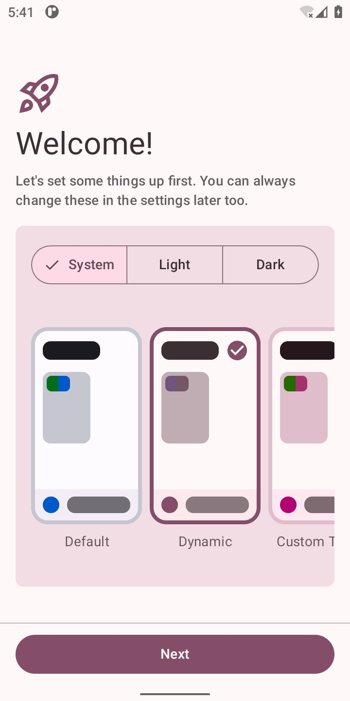

*01 · 引导 · 主题选择*

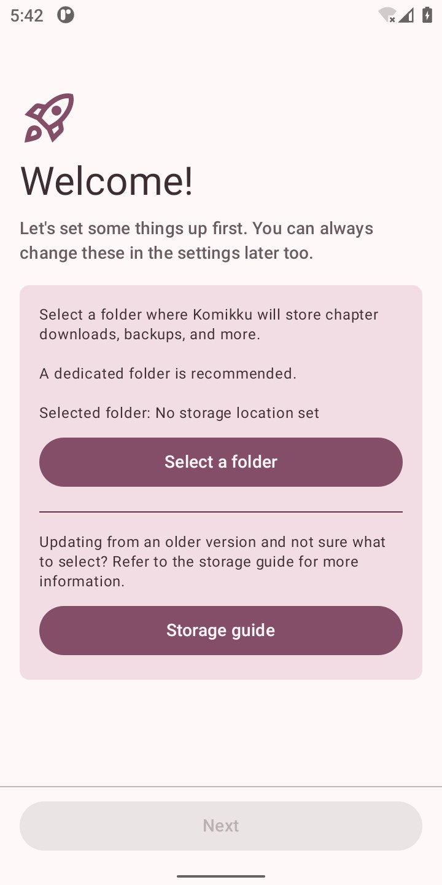

*02 · 引导 · 存储位置*

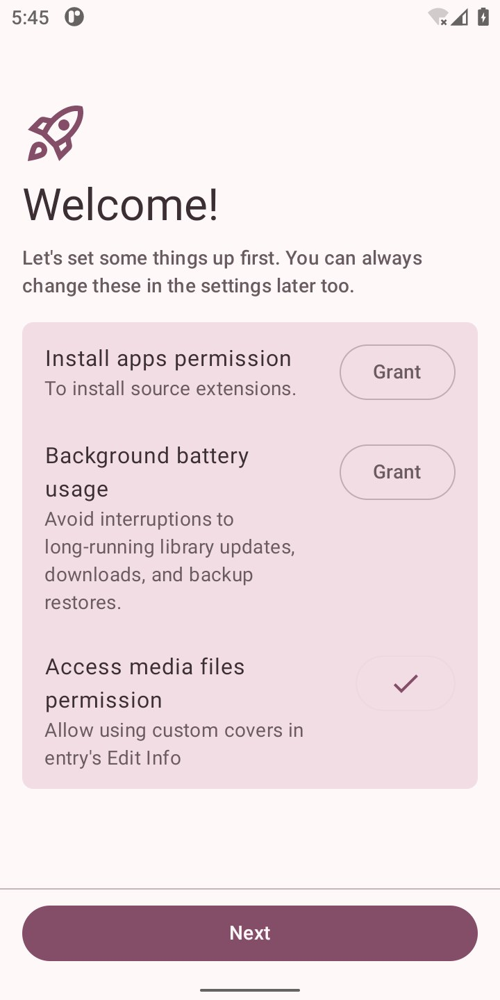

*03 · 引导 · 权限*

**平板差异：**四步内容一屏可容纳，无需滚动；外壳与手机完全一致（见附录 B 平板 01–04）。

## 7.2 书架（Library）

书架是默认首页，也是信息密度最高的页面。顶部为分类 Tab（多于一个分类时显示）+ 工具栏，主体为自适应网格或列表，底部 5 项导航。

```text
AppBar：分类名 + 数量 Pill        [搜索] [筛选] [⋮]
Tabs：Library ① / Reading / …（可滚动）
────────────────────────────────────────
Grid：Adaptive(128dp)，padding 8dp，gap 4dp
  卡片 = 2:3 封面 + 12sp 标题
  徽标：左上 下载数/未读数；右上 语言/来源
────────────────────────────────────────
NavigationBar：Library · Updates · History · Browse · More
```

| 状态     | 表现                                                              |
|----------|-------------------------------------------------------------------|
| 空书架   | 随机颜文字 + “Your library is empty” + 帮助入口；无底部操作按钮   |
| 有内容   | 网格卡片；Continue Reading 按钮出现在有未读章节的卡片右下         |
| 多选     | 顶栏变计数 + 全选/反选 + 关闭；选中卡片封面 0.76 + secondary 描边 |
| 筛选激活 | 筛选图标变 primary                                                |
| 分类 Tab | 文字 + 计数 Pill；选中 primary 指示条                             |


*10 · 书架 · 网格（360dp → 2 列）*

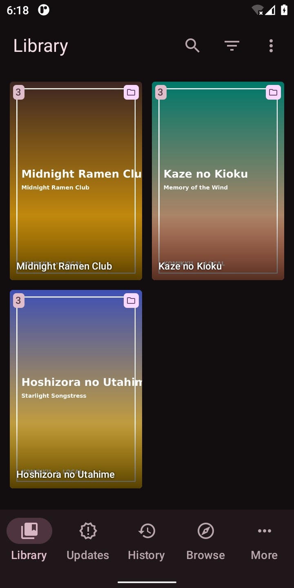

*33 · 书架 · 深色*

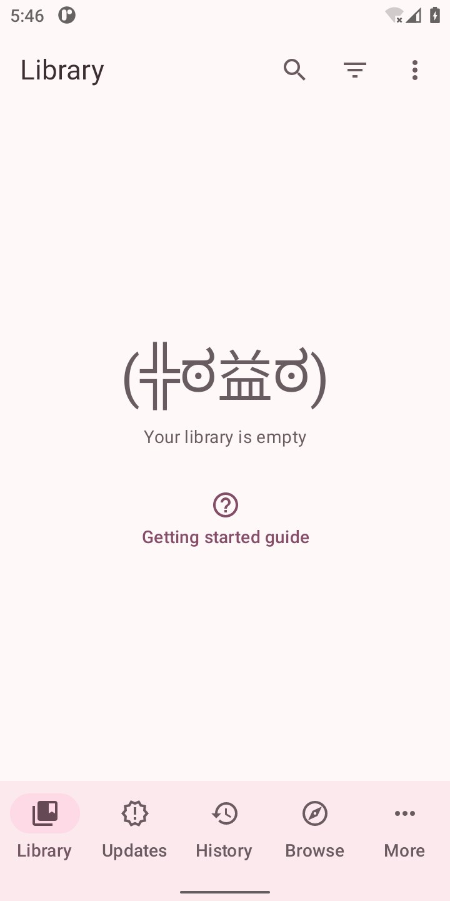

*05 · 书架 · 空状态*

**平板：**底栏换成左侧 Rail，网格列数从 2 变成 9（1280dp）；工具栏与内容区相对位置不变。筛选/排序面板变成居中卡片。

## 7.3 浏览（Browse）

Browse 是一个“多来源入口聚合器”，四个 Tab 分别是 Sources、Feed、Extensions、Migrate。顶栏右侧三个动作：全库搜索、18+ 内容开关、筛选。

| 模块       | 布局                                                                           | 关键样式                                              |
|------------|--------------------------------------------------------------------------------|-------------------------------------------------------|
| Sources    | 按语言分组（如 Other），每行 40dp 图标 + 名称 + 国旗/语言 + NSFW + 置顶        | 标题 bodyMedium，副标题 bodySmall 0.78；NSFW 用 error |
| 本地来源   | Latest / Browse 两个区域，网格展示本地漫画                                     | 与书架同一套卡片                                      |
| Extensions | 分组列表：待更新 / 已安装 / 可用；行内是 40dp 图标 + 名称/版本/仓库 + 操作按钮 | “Update all”为 FilledButton；安装/更新为 TextButton   |
| Feed       | 来源动态条目列表                                                               | 空状态复用 EmptyScreen                                |
| Migrate    | 来源列表 → 搜索 → 选择目标                                                     | 空状态 + 说明                                         |

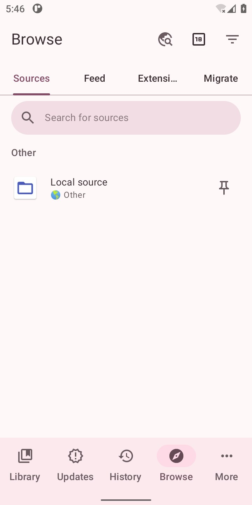

*06 · 浏览 · 来源*

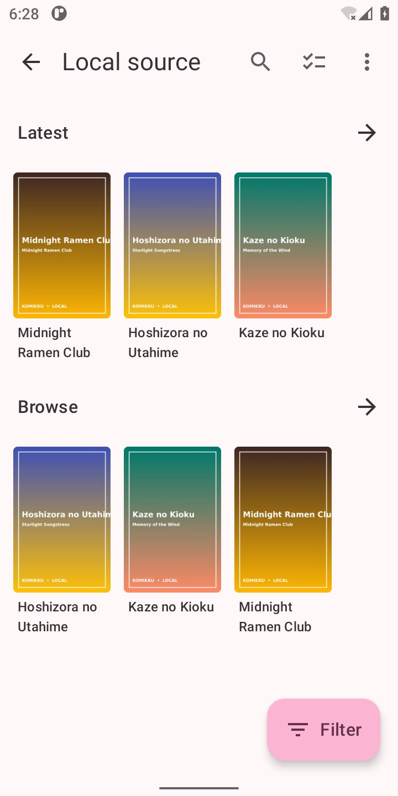

*07 · 浏览 · 本地来源*

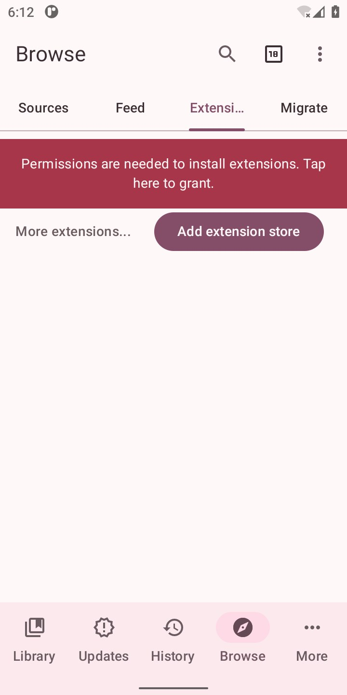

*28 · 浏览 · 扩展*

**平板：**来源/扩展仍为单列列表，但内容区更宽；来源分组头与行内边距不变，形成“窄内容、宽留白”的工具感（见附录 B 平板 06/07/28）。

## 7.4 漫画详情（Manga detail）

这是整套设计里视觉最重的页面：封面既是内容也是背景色源。整页包在 `DynamicMaterialExpressiveTheme(seedColor = 封面主色)` 中，因此页面背景、按钮、FAB 都会随封面变化。

```text
背景层：封面图（fill，blur 7dp，alpha 0.2）+ surfaceTint 40%
         + 垂直渐变 transparent → background（从 50% 高度开始）
────────────────────────────────────────
顶栏：透明 → 滚动后 surface@3dp；标题 alpha 0→1
封面区：手机 左封面(max 100dp 宽，实机 83×125dp) + 右侧标题/作者/状态
        平板 居中封面(fillMaxWidth 0.65) + 居中标题
动作行：4 个等宽 TextButton（图标 20 + 12sp 标签）
简介：bodyMedium，可展开；标签 Chip
章节：标题 titleMedium + 缺失警告；列表 16/12 内边距
底部：FAB “Start / Resume”（可左右吸附）
```

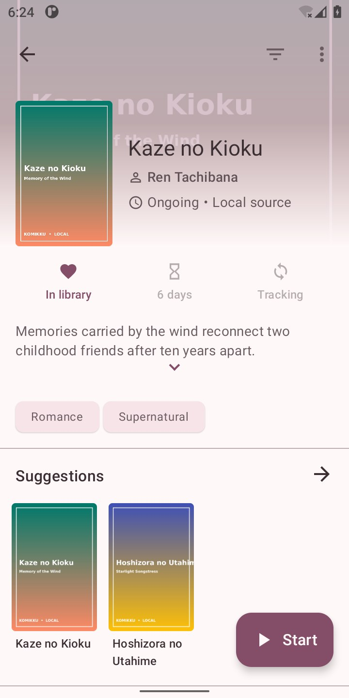

*11 · 详情 · 封面取色（青绿）*

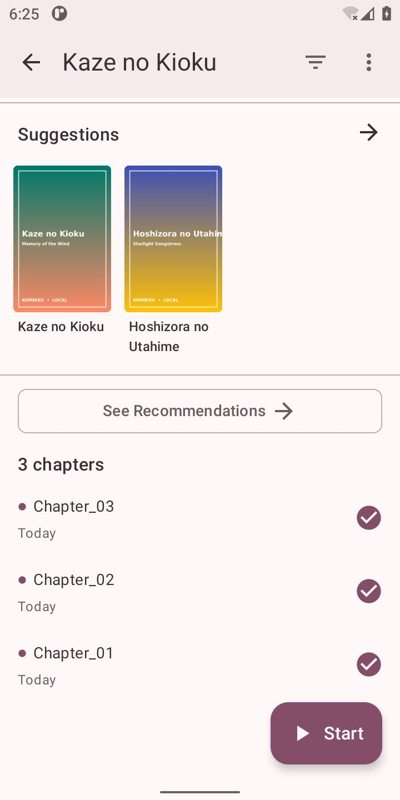

*12 · 详情 · 章节列表*


*34 · 详情 · 深色*


*图 7-1 平板双栏：左栏 450dp 固定上限，右栏放章节。注意左栏封面下的动作行只有 3 项，因为本地来源没有“网页”动作。*

**关键差异：**手机封面在左、信息在右；平板封面居中、信息居中。手机章节列表与简介在同一滚动容器；平板左栏独立滚动，右栏章节独立滚动，互不影响。

## 7.5 阅读器（Reader）

阅读器是独立 Activity，默认纯黑背景、沉浸式、隐藏系统栏（上滑临时显示）。它不复用主页面的 Scaffold，而是自己绘制页面 + 悬浮控制条。

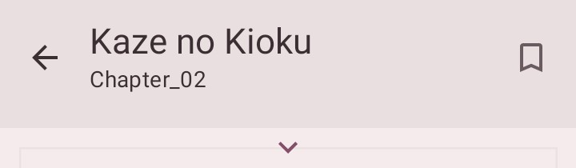

*图 7-2 顶栏：返回、漫画名/章节名、书签；背景 surface@3dp 95% 不透明，叠在页面上。*

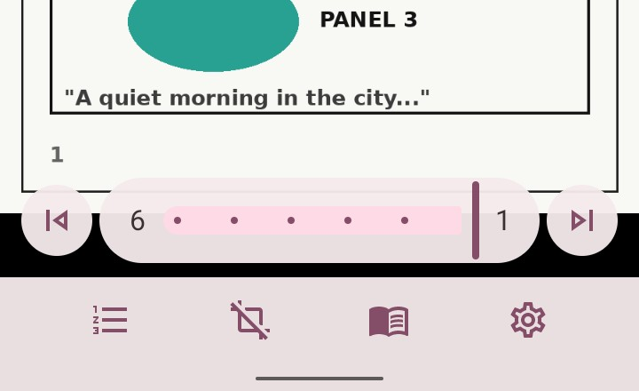

*图 7-3 底栏：上一章/页码滑块/下一章；下方 4 个主色图标（章节、裁剪、阅读模式、设置）。*

| 元素     | 规格                                                                 |
|----------|----------------------------------------------------------------------|
| 背景     | Black / Gray / Automatic / White（默认 Black）                       |
| 顶/底栏  | surface@3dp，alpha 0.90（暗）/0.95（亮）                             |
| 栏动画   | 滑入 200ms + 淡入 150ms；消失反向                                    |
| 页码滑块 | 中间药丸 24dp 圆角，左右 16dp；水平 padding 8dp（手机）/24dp（平板） |
| 翻页控件 | FilledIconButton，容器色 = 栏背景，图标 primary                      |
| 底部图标 | IconButton 48dp，tint primary，SpaceEvenly                           |
| 页码拖动 | 每次变化触发 TextHandleMove 触觉                                     |

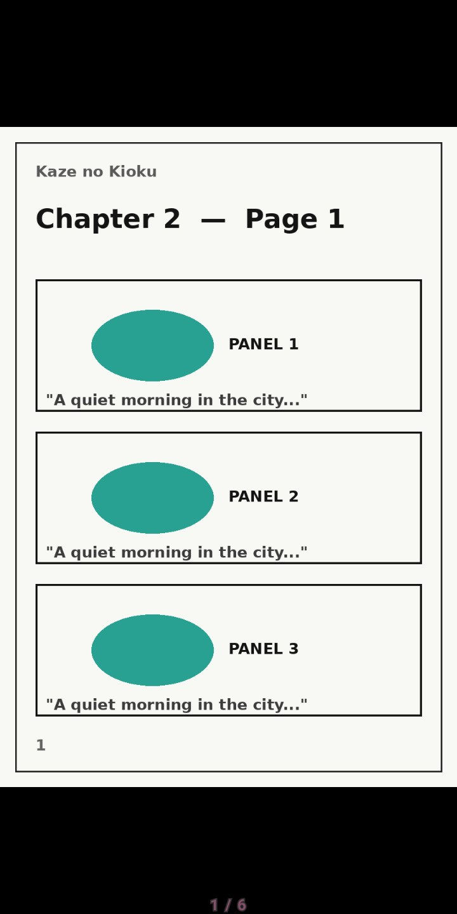

*13 · 阅读器 · 无控件*

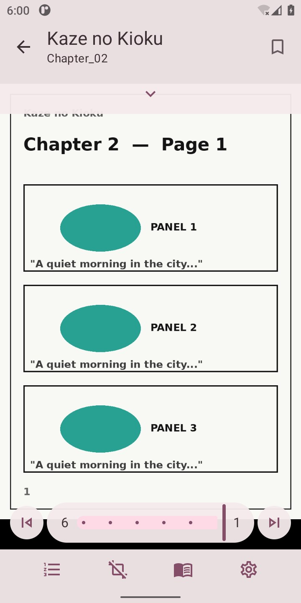

*14 · 阅读器 · 控制菜单*

**平板：**栏高度不变，但页码滑块横向拉满，左右按钮贴边（24dp padding）；底部图标均匀分布在整个宽度上（见附录 B 平板 13）。

## 7.6 历史（History）

按日期分组的浏览记录。每个分组用 `ListGroupHeader`（14sp SemiBold、onSurfaceVariant、16/8 内边距、可选计数徽标），条目高 96dp，左侧封面填满高度。

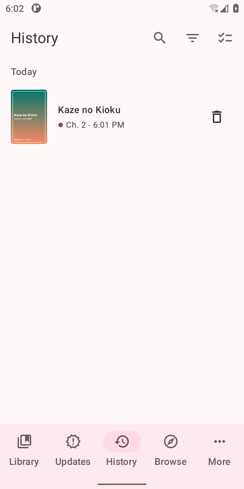

*15 · 历史 · 日期分组*

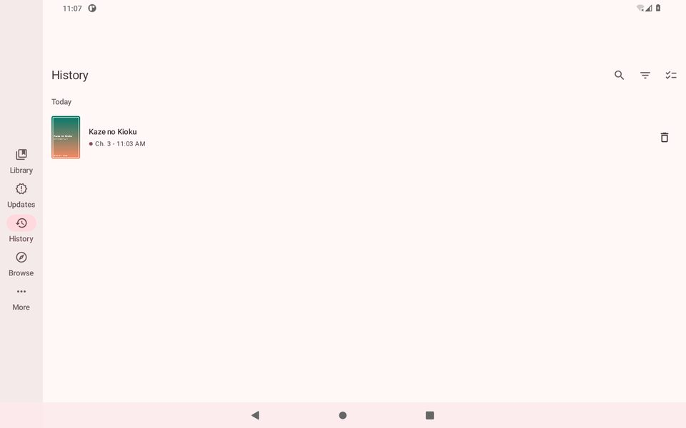

*图 7-4 平板历史：内容仍按单列排布，但可视区域更宽，封面与标题的留白更充裕。*

长按条目进入多选；滑动可删除单条记录。分组头在滚动时吸顶，吸顶背景带 1dp tonal elevation，与内容区分。

## 7.7 更新（Updates）

按漫画聚合的新章节列表。每个漫画的第一行是“领导者”：48dp 封面（全景封面 108dp 宽）、标题、未读数；后续章节行缩进对齐标题。空状态复用 EmptyScreen。

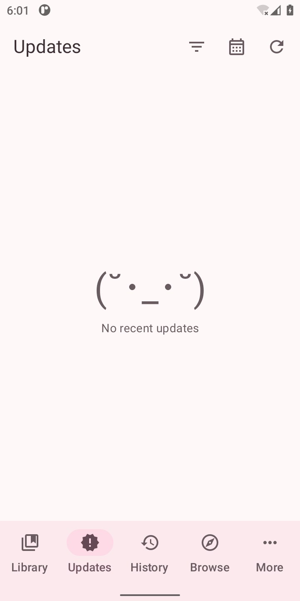

*16 · 更新 · 空状态*

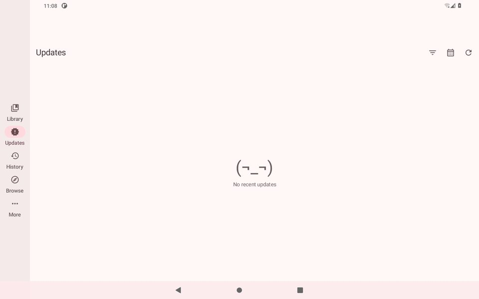

*图 7-5 平板更新：空状态垂直居中于整个内容区，底部无导航栏。*

## 7.8 更多（More）

More 是“设置 + 工具”的入口页。顶部是 64dp 品牌 Logo（上下 56dp 留白）+ 分隔线，下面是全宽设置行：Downloaded only、Incognito（护目镜动画图标）、下载队列、分类、统计、更新错误、数据与存储、批量添加，然后分隔线，再是设置、关于、帮助。

| 元素     | 规格                                                    |
|----------|---------------------------------------------------------|
| Logo 区  | 64dp 图标，onSurface tint，vertical 56dp，底部分隔线    |
| 普通行   | 56dp 最小高度，16dp 水平内边距；图标 primary；标题 16sp |
| 开关行   | 同上，右侧 M3 Switch；副标题 12sp 0.78                  |
| 赞助按钮 | 2dp primary 边框，small 圆角，居中                      |

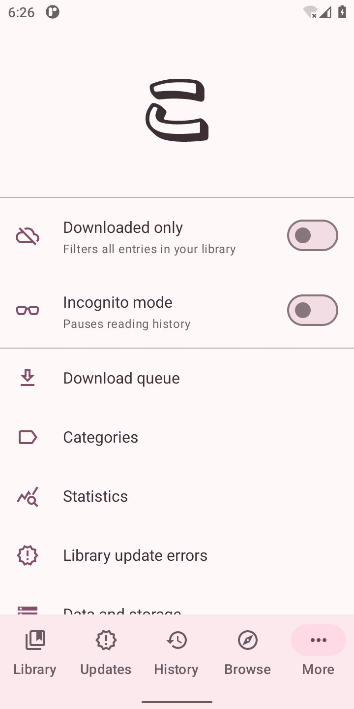

*17 · 更多 · 列表*

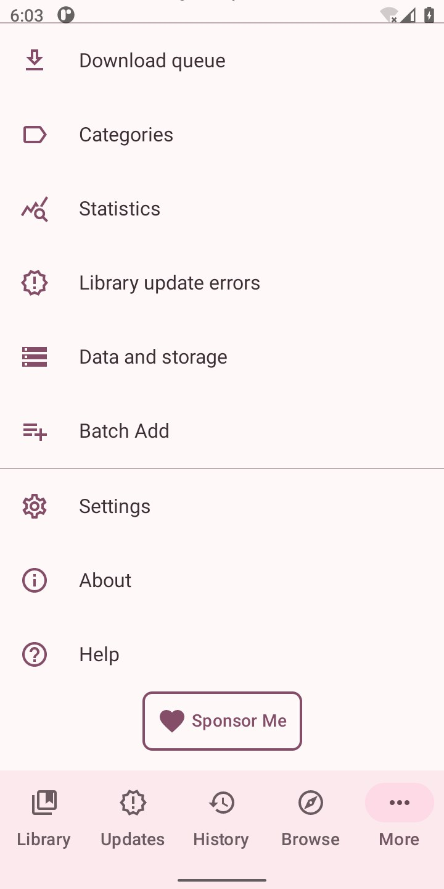

*17b · 更多 · 底部*

**平板：**Logo 区保留，列表撑满宽度；视觉上更像“关于页”而非手机上的长列表。

## 7.9 设置（Settings）

设置是最能体现响应式差异的页面。手机是“列表 → push 子页”，平板是“左列表 + 右详情”的 master-detail。


*图 7-6 平板设置：左栏比 surface 略浅（亮色 HSL +0.02），选中项为 24dp 圆角的 surfaceVariant 背景；右栏直接显示选中项内容。*

| 页面           | 内容结构                                                                                                        | 特殊控件                     |
|----------------|-----------------------------------------------------------------------------------------------------------------|------------------------------|
| 主页           | Appearance / Library / Reader / Downloads / Tracking / Connections / Browse / Data & storage / Advanced / About | 每行图标 + 标题 + 副标题     |
| Appearance     | 主题模式分段、19 套主题横向卡片、纯黑暗色、封面取色开关/风格、相对时间、日期格式、语言                          | 分段控件、主题预览卡、Switch |
| Library        | 分类、全局更新、更新限制、排序、显示模式、列数、分组                                                            | Slider、列表选择、分类多选   |
| Reader         | 阅读模式、方向、裁剪、页面布局、背景色、亮度、自动滚动                                                          | 带预览的选项、Slider         |
| Downloads      | 下载目录、并行数、仅 Wi-Fi、自动下载                                                                            | Switch、Slider、目录选择     |
| Tracking       | 追踪服务登录状态                                                                                                | 账号行 + 登录按钮            |
| Data & storage | 备份/恢复、存储用量、缓存                                                                                       | 进度条、危险操作红字         |
| Advanced       | 调试、日志、更新渠道、代理                                                                                      | 可折叠分组                   |

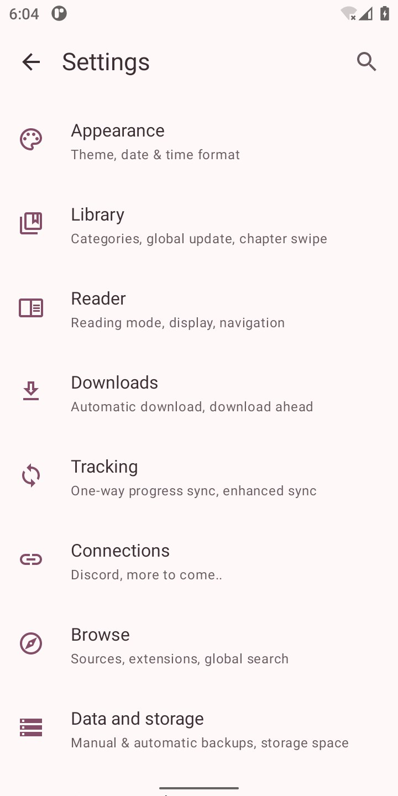

*18 · 设置 · 总览*

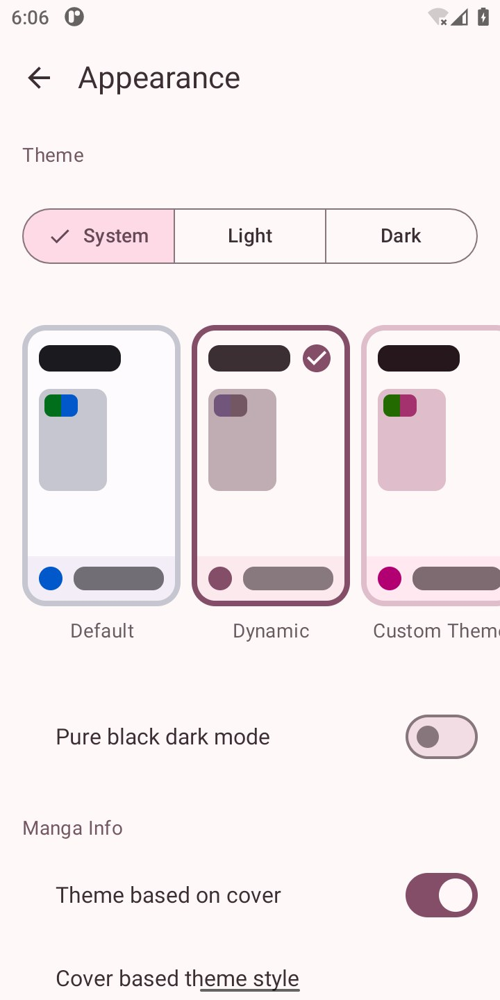

*19 · 设置 · 外观*

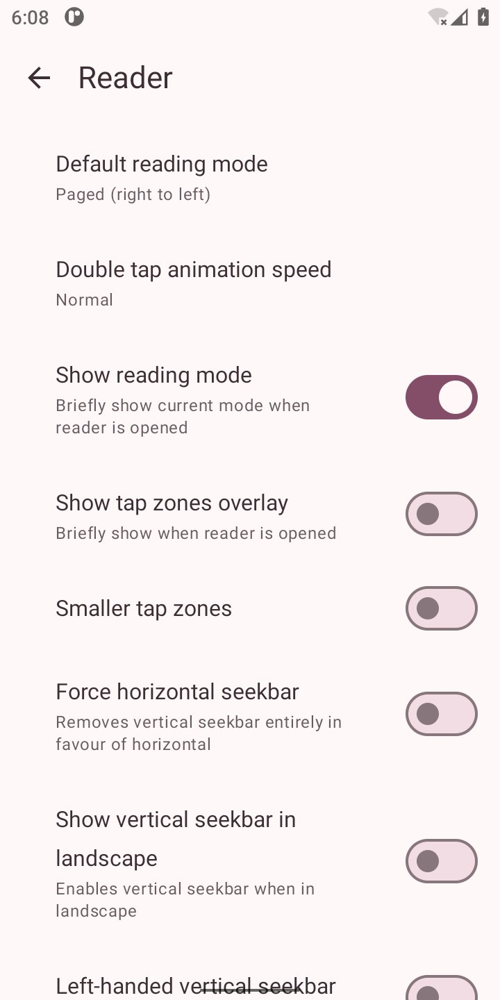

*21 · 设置 · 阅读器*

*子页分组标题用 HeadingItem （14sp SemiBold、onSurfaceVariant、24/10 内边距）；普通行用 BasePreferenceWidget （16/16、最小 56dp），内嵌的复选项/滑块用 BaseSettingsItem （24/10）。设置主页则统一是 16/16 行距。*

## 7.10 统计（Statistics）

四张 SectionCard：Overview、Entries、Chapters、Trackers。卡片间距 8dp，标题在卡片外。数值用 titleLarge Bold，说明用 bodyMedium 0.78，图标 primary 放在卡片底部。

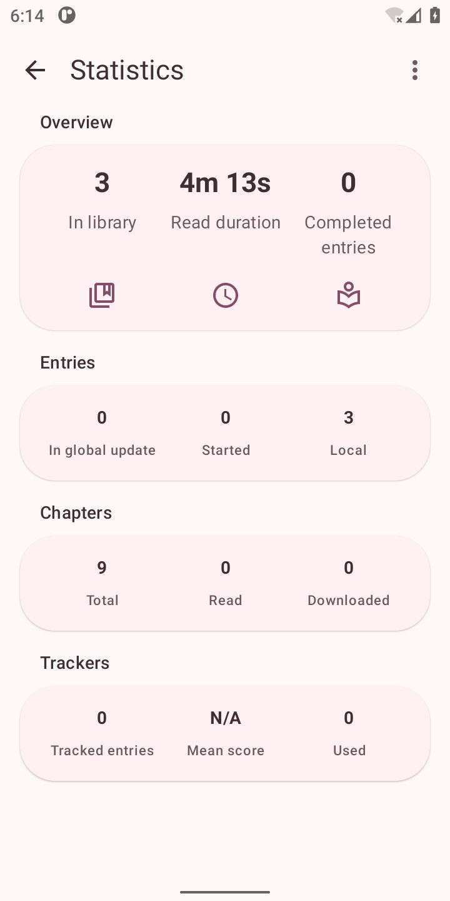

*30 · 统计 · 手机*

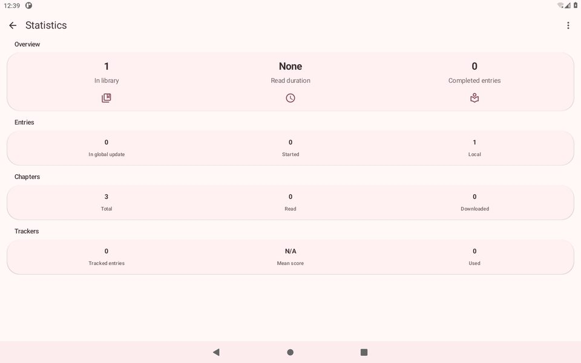

*图 7-7 平板统计：SectionCard 撑满内容宽度，三列数值的间距随之拉开。*

## 7.11 分类管理（Categories）

分类列表支持新增、重命名、删除、拖动排序。条目为 56dp 标准行，拖动手柄在左侧，名称为 bodyMedium；删除确认对话框使用标准 AlertDialog 宽度（280–560dp）。

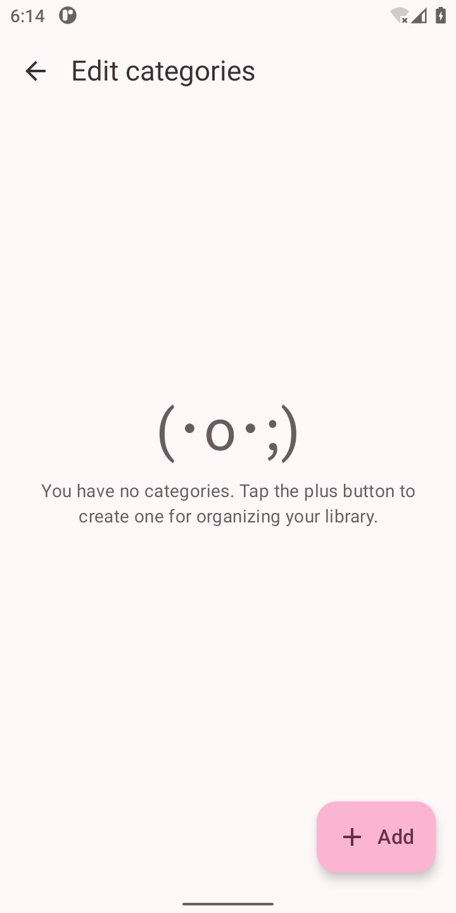

*31 · 分类 · 空列表*

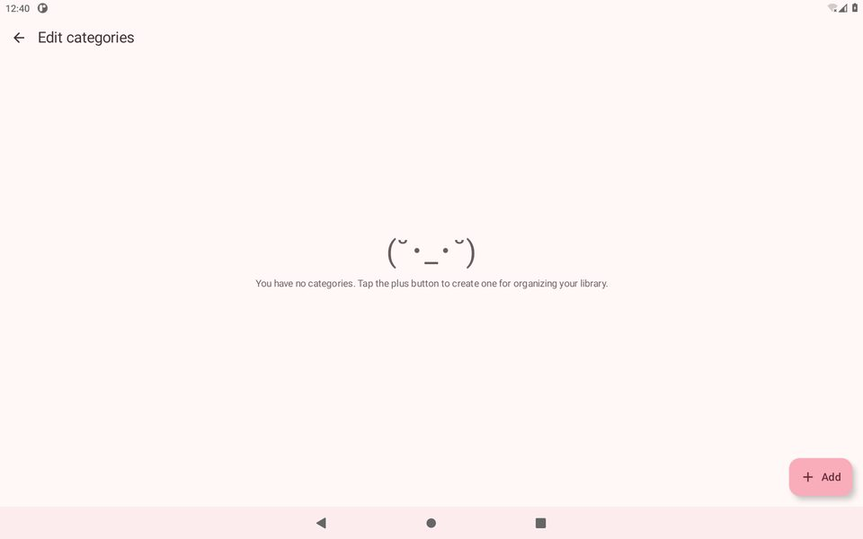

*图 7-8 平板分类：列表与空状态都保持在内容区的左上，不会为了填满宽度而拉伸行高。*

## 7.12 下载队列（Download queue）

这一页保留了大量旧版 XML 布局：每条为 MaterialCardView（透明、0 高度）+ 拖动手柄（16dp padding）+ 漫画名 bodyMedium + 章节名 12sp + 线性进度条（上方 8dp）+ 右侧菜单。整体密度高于 Compose 页面，是“历史遗留层”的典型样本。

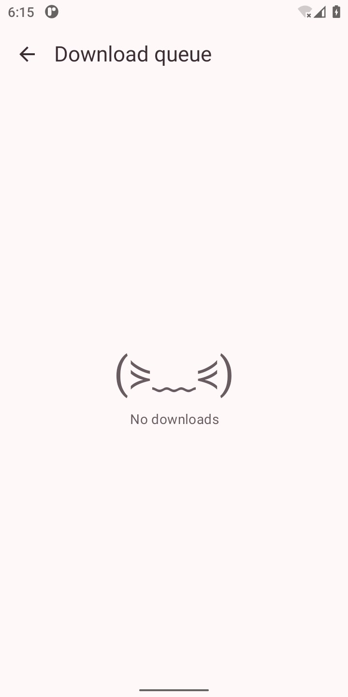

*32 · 下载队列 · 空*

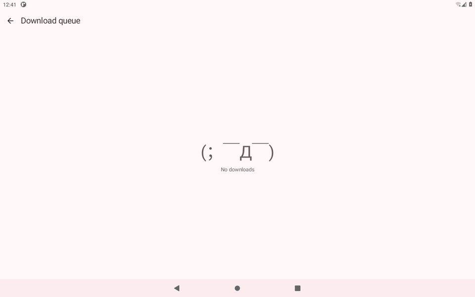

*图 7-9 平板下载队列：XML 列表同样只是拉宽，不改变行高与信息密度。*

## 7.13 书架更新错误（Library update errors，KMK 新增）

按错误信息分组（sticky header + 数量徽标），每条包含封面、漫画名、来源、错误详情；支持多选与滑动删除（SwipeToDismissBox，删除背景 error）。这一页没有进入本次截图集，但代码结构完整（`LibraryUpdateErrorUiItem.kt`）。

## 7.14 关于、更新与“新功能”

About 复用 More 的 LogoHeader（64dp + 56dp 留白），下面是版本号、检查更新、新功能、即将到来、源码/帮助链接、赞助者列表。检查更新时在行尾显示 28dp/3dp 的圆形进度。新版本页（NewUpdateScreen）与“新功能”页（WhatsNewScreen）使用 long-form 文本 + headline 层级，属于低频信息页。

## 7.15 次级与工具页面

这些页面没有进入本次截图集，但共享同一套组件与间距；复刻时可当作“同构页面”处理，而不是另起设计。

| 页面                | 视觉结构                                | 复用组件                                  |
|---------------------|-----------------------------------------|-------------------------------------------|
| 全局搜索            | 顶栏搜索输入 + 来源分组结果网格         | SearchToolbar、MangaCard、ListGroupHeader |
| 迁移（Migrate）     | 来源列表 → 搜索 → 选择目标；空状态      | BaseBrowseItem、EmptyScreen               |
| 扩展详情 / 来源设置 | 设置项列表 + 图标头部                   | BasePreferenceWidget、HeadingItem         |
| 追踪（Tracking）    | 服务列表 + 登录状态 + 搜索              | TextPreferenceWidget、SearchToolbar       |
| 调色板（Palette）   | 按角色成对展示色块（seed/onPrimary 等） | 色板行、ScrollbarLazyColumn               |
| 笔记（Notes）       | 全屏文本编辑 + 保存动作                 | TopAppBar、TextField                      |
| 网页（WebView）     | 全屏 WebView + 返回/刷新                | AppBar                                    |
| 关联漫画 / 推荐     | 横向卡片行或网格                        | MangaCover、卡片                          |

*设置内的搜索（SettingsSearch）会在结果中高亮命中的偏好项：跳转后目标行以 surfaceTint 12% 闪烁 3 秒。这是整套界面里唯一“主动引导视线”的动效。*

---

## 设计意图

页面规格按“用户真正会走的路径”排序，而不是按代码目录排序。这样复刻时可以先把主链路（引导 → 书架 → 详情 → 阅读器）跑通，再补设置与工具页。每页都强调手机/平板差异，是因为这套设计的价值有一半在“同一内容的结构切换”；如果只做手机版，会误以为它是一套普通的 M3 应用。

## 复刻检查清单

- [ ] 主链路五页（引导、书架、详情、章节、阅读器）全部可用。
- [ ] 书架空态/有内容/多选/筛选激活四种状态都有定义。
- [ ] 详情页封面背景、动作行、章节列表、FAB 位置正确。
- [ ] 阅读器隐藏系统栏，控件点击后才出现。
- [ ] 设置页手机为 push 栈，平板为 master-detail。
- [ ] 平板所有列表不被强行拉宽到失去阅读舒适度。
- [ ] 未进入截图集的页面（更新错误、迁移等）标注为“同构页面”，不臆造视觉。

## 延伸阅读

- [上一章：06 组件规格库](06-组件规格库.md)
- [下一章：08 状态与反馈](08-状态与反馈.md)
- 截图索引：[10 附录 B](10-附录.md)
