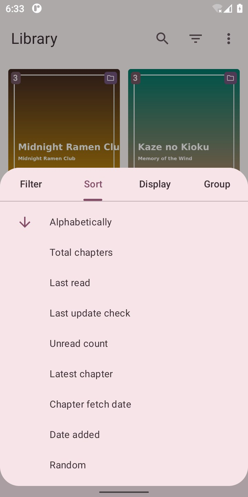
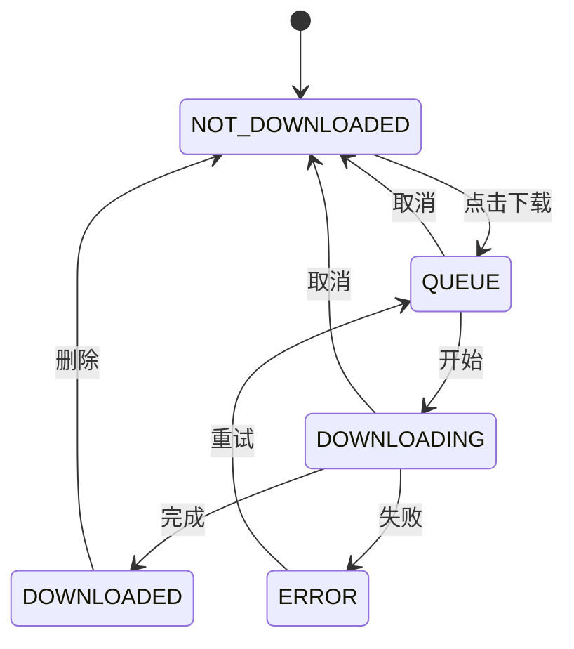
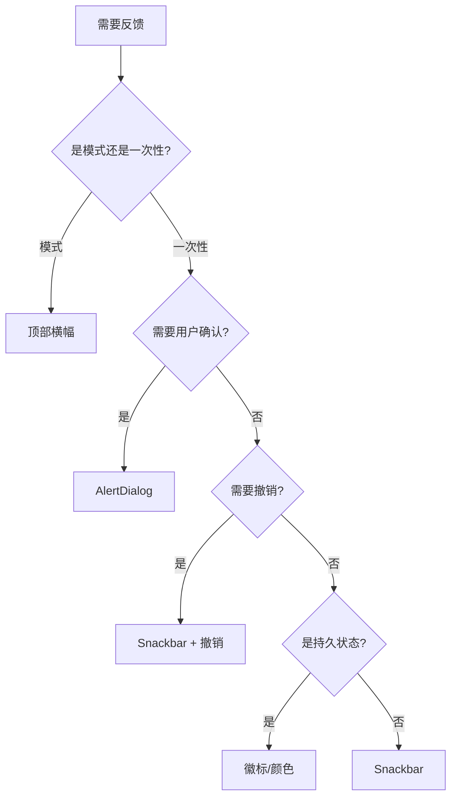

# 08 · 状态与反馈

> 状态设计的主线：**模式用色块**（横幅），**进度用圆环**，**结果用文字**（Snackbar），**危险用红色**。四类反馈各司其职，不混用。

| 项目 | 说明 |
| --- | --- |
| 章节 | 08 / 10 |
| 适用读者 | 做状态机、空/错/载、多选、下载态的人 |
| 前置阅读 | [06 组件规格库](06-组件规格库.md) |
| 证据类型 | 源码 |

---

## 8.1 全局模式（三种，互斥或叠加）

| 模式 | 触发 | 视觉 | 作用范围 |
|---|---|---|---|
| **Downloaded only** | 更多页开关 | `tertiary` 横幅 | 书架/浏览/搜索只显示已下载 |
| **Incognito mode** | 更多页开关 | `primary` 横幅 | 暂停阅读历史与追踪同步 |
| **Library updating** | 全局更新/定时更新 | `tertiary` 横幅 + 进度% | 整个应用 |

### 三种的可见性

```kotlin
// Banners.kt:69-92
AppStateBanners(
    downloadedOnlyMode = downloadedOnlyMode,
    incognitoMode = incognitoMode,
    indexing = indexing,          // ← 重建索引时
    restoring = restoring,        // ← 恢复备份中
    syncing = syncing,            // ← 同步中
    updating = updating,          // ← 更新书库中
    progress = progress,          // ← 0..1
)
```

| 横幅 | 来源 flag | 底色 | 叠加状态栏 inset |
|---|---|---|---|
| Downloaded only | `downloadedOnlyMode` | `tertiary` | ✅ |
| Incognito | `incognitoMode` | `primary` | ✅ |
| 索引/恢复/同步/更新 | 4 个 flag 各自 | `secondary` / `error` / `secondary` / `tertiary` | ✅ |

> **索引/恢复/同步/更新是互斥的**：`Banners.kt:120-145` 用一个 `when` 从 4 个 flag 里选**一个**文案，不是四层叠加。

---

## 8.2 多选模式

### 进入与退出

| 页面 | 进入方式 | 退出方式 | 代码 |
|---|---|---|---|
| 书架 | 长按封面 | ✕ / 返回键 | `LibraryTab.kt:332` |
| 详情（章节） | 长按章节 | ✕ / 返回键 | `MangaScreen.kt:281` |
| 历史 | 顶栏 `☑` | ✕ / 返回 | `HistoryScreen.kt` |
| 更新 | 顶栏 `☑` | ✕ / 返回 | `UpdatesScreen.kt` |
| 源浏览 | 长按作品 | ✕ / 返回 | `BrowseSourceScreen.kt:377` |
| 批量收藏 | 顶栏 `☑` | ✕ / 返回 | `TabbedScreen.kt:72-96` |

### 多选的视觉状态

| 位置 | 静息 | 多选 |
|---|---|---|
| 顶栏 | 标题 + 搜索/筛选/更多 | **✕ + 选中数 + 全选/反选/更多** |
| 顶栏底色 | `surfaceColorAtElevation(0.dp)` | `surfaceColorAtElevation(3.dp)` |
| 列表项 | 无底色 | `secondary` @ 22%/16% |
| 网格项 | 正常封面 | 封面 alpha **0.76** + `secondary` 矩形描边 |
| 底栏 | 导航栏（书架）或无 | **底部动作栏** |
| 下拉刷新 | 可用 | **禁用** |

### 网格选中态



*图 8-1 弹层与选中态并存：背景书架卡片被 `scrim` 压暗，弹层为 28dp 圆角 `surfaceContainerHigh`。*

```kotlin
// CommonMangaItem.kt:396-416
Box(
    Modifier
        .clip(MaterialTheme.shapes.small)
        .combinedClickable(onClick, onLongClick)
        .selectedOutline(isSelected, color = MaterialTheme.colorScheme.secondary)
        .padding(4.dp)
) {
    CompositionLocalProvider(
        LocalContentColor provides if (isSelected) MaterialTheme.colorScheme.onSecondary
                                    else LocalContentColor.current
    ) { content() }
}

private fun Modifier.selectedOutline(isSelected: Boolean, color: Color) =
    drawBehind { if (isSelected) drawRect(color = color) }
```

| 属性 | 值 |
|---|---|
| 描边 | `secondary`，**1px 矩形**（`drawRect` 整块填充，不是 stroke） |
| 封面 alpha | **0.76** |
| 内容色 | `onSecondary` |

> **注意**：`selectedOutline` 实际是 `drawRect(color)`——填充整个绘制区域，但因为卡片已被 `clip(shapes.small)`，最终呈现为一个比内边距稍大的色块，看起来像描边。复刻时不要用 `border()`，会得到圆角描边，与原始不同。

### 列表选中态

```kotlin
// Modifier.kt:30-35
fun Modifier.selectedBackground(isSelected: Boolean): Modifier {
    if (!isSelected) return this
    val alpha = if (isSystemInDarkTheme()) 0.16f else 0.22f
    val color = MaterialTheme.colorScheme.secondary.copy(alpha = alpha)
    return this.drawBehind { drawRect(color) }
}
```

| 属性 | 值 |
|---|---|
| 亮色 alpha | **0.22** |
| 暗色 alpha | **0.16** |
| 颜色 | `secondary` |

### 范围选择（长按拖动）

书架支持"长按 + 拖动"范围选择（`onToggleRangeSelection`）。行为：从锚点项到当前项全部选中/取消。

---

## 8.3 下载的 4 个状态



| 状态 | 指示器 | 颜色 | 点击 | 长按 |
|---|---|---|---|---|
| `NOT_DOWNLOADED` | `ic_download_chapter_24dp` | `primary`，78% alpha | 加入队列 | 立即下载 |
| `QUEUE` | 无进度环 + `ArrowDownward` | `primary` | 打开菜单 | 取消 |
| `DOWNLOADING` | **扇形进度环** + `ArrowDownward` | `primary`；>50% 时箭头 `background` | 打开菜单 | 取消 |
| `DOWNLOADED` | `Icons.Filled.CheckCircle` | `primary` | 打开删除菜单 | 打开删除菜单 |
| `ERROR` | `Icons.Outlined.ErrorOutline` | **`error`** | 重试 | 重试 |

### 扇形进度的实现

```kotlin
// ChapterDownloadIndicator.kt:148-166
CircularProgressIndicator(
    progress = { animatedProgress },
    modifier = Modifier.size(26.dp).padding(2.dp),
    color = MaterialTheme.colorScheme.primary,
    strokeWidth = IndicatorSize / 2,     // 13dp ← 半圆
    trackColor = Color.Transparent,
    strokeCap = StrokeCap.Butt,
    gapSize = 0.dp,
)
Icon(Icons.Outlined.ArrowDownward, modifier = Modifier.size(19.dp), tint = arrowColor)
```

| 属性 | 值 |
|---|---|
| 尺寸 | **26dp** |
| 内 padding | **2dp** |
| 描边宽 | **13dp**（= 尺寸 / 2） |
| `strokeCap` | **`Butt`**（平头，不是圆头） |
| `gapSize` | **0dp** |
| 箭头尺寸 | **19dp**（= 26 − 7） |
| 箭头颜色切换阈值 | 进度 **50%** |

> 26dp 直径 + 13dp 描边 + 平头 = 恰好是"半个圆环"，视觉上像扇形填充。换成 4dp 描边 + 圆头就是完全不同的组件。

### 书架/详情顶部的批量下载

| 菜单项 | 说明 |
|---|---|
| `NEXT_1_CHAPTER` | 下 1 章 |
| `NEXT_5_CHAPTERS` | 下 5 章 |
| `NEXT_10_CHAPTERS` | 下 10 章 |
| `NEXT_25_CHAPTERS` | 下 25 章 |
| `UNREAD_CHAPTERS` | 所有未读 |
| `BOOKMARKED_CHAPTERS` | 所有书签 |

---

## 8.4 空 / 错 / 载

### 三态对照

| 状态 | 组件 | 视觉 | 何时出现 |
|---|---|---|---|
| **空** | `EmptyScreen` | 颜文字 + 文案 + 可选动作 | 数据加载完成但为空 |
| **错** | `Snackbar` 或 `Dialog` | 文字 + 可选重试 | 操作失败 |
| **载** | `LoadingScreen` | **居中 `CircularProgressIndicator`** | 首次加载 |

### 空状态的 5 种文案

| 场景 | 文案 key |
|---|---|
| 书架空 | `information_no_manga_category` |
| 搜索无结果 | `no_results_found` |
| 筛选无匹配 | `error_no_match` |
| 无更新 | `information_no_recent_updates` |
| 无历史 | `information_no_recent_manga` |

### 加载状态

```kotlin
// presentation-core/.../screens/LoadingScreen.kt
@Composable
fun LoadingScreen(modifier: Modifier = Modifier) {
    Box(modifier.fillMaxSize(), contentAlignment = Alignment.Center) {
        CircularProgressIndicator()
    }
}
```

**没有骨架屏**。这是刻意的：骨架屏只在"内容有固定形状"时才有意义，而 Komikku 的列表项形状多变（封面比例、行数）。

### 错误反馈的三种层级

| 层级 | 组件 | 使用场景 |
|---|---|---|
| 轻 | `Snackbar` | 操作成功/失败（加入书架、删除、复制） |
| 中 | `AlertDialog` | 需要确认（删除、退出登录、覆盖） |
| 重 | 全屏 `EmptyScreen` | 整页加载失败（源不可用） |

### Snackbar 的两种结果

```kotlin
// LibraryTab.kt:典型用法
scope.launch {
    val result = snackbarHostState.showSnackbar(
        message = …,
        actionLabel = stringResource(MR.strings.action_undo),
        duration = SnackbarDuration.Short,
    )
    if (result == SnackbarResult.ActionPerformed) { /* 撤销 */ }
}
```

| 场景 | 有撤销 |
|---|---|
| 删除书架作品 | ✅ |
| 标记已读/未读 | ✅ |
| 删除历史 | ✅ |
| 清除缓存 | ❌ |
| 加入书架 | ❌（可再点一次取消） |

---

## 8.5 手势

| 手势 | 页面 | 行为 |
|---|---|---|
| **下拉** | 书架、详情、更新、历史 | 刷新 |
| **左/右滑** | 章节行、更新行 | 可配置动作（已读/书签/下载） |
| **长按** | 封面、章节 | 进入多选 |
| **长按 + 拖动** | 书架 | 范围选择 |
| **点击中央** | 阅读器 | 切换 chrome |
| **点击左/右 1/3** | 阅读器 | 翻页（可配置） |
| **双指缩放** | 阅读器（非 Webtoon） | 缩放 |
| **双击** | 阅读器 | 缩放切换 |
| **水平拖动 FAB** | 详情页 | 移动 FAB 到左/右 |

### 章节滑动

```kotlin
// MangaChapterListItem.kt:100-118
SwipeableActionsBox(
    startActions = listOfNotNull(swipeStart),
    endActions = listOfNotNull(swipeEnd),
    swipeThreshold = 56.dp,
    backgroundUntilSwipeThreshold = MaterialTheme.colorScheme.surfaceContainerLowest,
)
```

| 属性 | 值 |
|---|---|
| 阈值 | **56dp** |
| 未过阈值背景 | `surfaceContainerLowest` |
| 过阈值背景 | `primaryContainer` |
| 图标 | 24dp（`IndicatorSize`），`contentColorFor(background)` |
| 图标水平 padding | **16dp** |

### FAB 左右拖动（KMK 新增）

```kotlin
// MangaScreen.kt:1012-1029
detectHorizontalDragGestures(
    onDragEnd = {
        if (positionOnScreen.x + fabSize.width / 2 >= layoutSize.width / 2) {
            readButtonPosition.set(FabPosition.End.toString())
        } else {
            readButtonPosition.set(FabPosition.Start.toString())
        }
        offsetX = 0f
    },
) { change, dragAmount ->
    val newOffsetX = offsetX + dragAmount
    if (!newOffsetX.isNaN()) offsetX = newOffsetX
}
```

拖动结束后，按钮吸附到左/右边缘，位置持久化到 `readButtonPosition`。

---

## 8.6 反馈层级总表

| 需要一个… | 用什么 | 位置 | 时长 |
|---|---|---|---|
| 告知操作成功 | `Snackbar`（无动作） | 底部 | Short（4s） |
| 提供撤销 | `Snackbar` + `actionLabel` | 底部 | Short |
| 确认危险操作 | `AlertDialog` | 中央 | 直到选择 |
| 展示选项 | `DropdownMenu` / `AdaptiveSheet` | 锚点 / 底部 | 直到选择 |
| 引导注意力 | 设置项高亮闪烁 | 行背景 | 3s |
| 阻止操作 | 按钮 `enabled = false` + 38% alpha | 原位 | — |
| 表示加载 | `CircularProgressIndicator` | 居中 / 按钮内 | — |
| 表示模式 | 顶部横幅 | 顶部 | 直到关闭 |
| 表示未读/已下载 | 徽标 | 封面角 | — |

### 什么情况下用哪个（决策树）



---

## 8.7 状态的颜色映射（完整表）

| 状态 | 颜色角色 | 出现位置 |
|---|---|---|
| 未读 | `secondary`（徽标底）/ `primary`（圆点） | 书架徽标 / 章节圆点 |
| 已下载 | `tertiary` | 书架徽标 |
| 下载中 | `primary` | 进度环 |
| 下载失败 | `error` | 错误图标 |
| 缺失源 | `errorContainer` + `error` | 源徽标 |
| 已选中 | `secondary` @ 22%/16% | 列表底色 |
| 网格已选 | `secondary` 矩形 + 0.76 alpha | 封面 |
| 筛选激活 | `#FFC107` / `#FFEB3B` | 顶栏筛选图标 |
| 已收藏 | `primary` | 详情页动作 |
| 未收藏 | `onSurface @ 0.38` | 详情页动作 |
| Downloaded only 模式 | `tertiary` 横幅 | 全局 |
| Incognito 模式 | `primary` 横幅 | 全局 |
| 更新中 | `tertiary` 横幅 | 全局 |
| 恢复中 | `error` 横幅 | 全局 |
| 同步中 | `secondary` 横幅 | 全局 |

---

## 8.8 状态持久化

| 状态 | 存储 | 恢复时机 |
|---|---|---|
| Downloaded only | `PreferenceStore` | 启动 |
| Incognito | `PreferenceStore` | 启动 |
| 阅读模式/方向 | 每作品 + 全局默认 | 打开阅读器 |
| 书架显示模式 | `LibraryPreferences.displayMode()` | 启动 |
| 每行列数 | `portraitColumns` / `landscapeColumns`（默认 0） | 旋转时 |
| 排序/筛选 | 每分类 | 切分类 |
| FAB 位置 | `readButtonPosition` | 打开详情 |
| 阅读位置 | `chapter_progress` 表 | 打开阅读器 |
| 分类 Tab 索引 | `LibraryContent.activeCategoryIndex` | 页面重建 |
| 章节排序/筛选 | `Manga` 表字段 | 打开详情 |
| 多选状态 | **不持久化**（离开页面即清空） | — |
| 搜索查询 | **不持久化**（除保存搜索） | — |

---

## 设计意图（`🎯推断`）

1. **为什么"模式"用横幅、不用开关的视觉反馈**：开关在"更多"页里，用户切到书架后看不到开关状态。横幅把"当前处于什么模式"带到任何页面。
2. **为什么进度用扇形而不是细环**：26dp 太小，细环在缩略图旁无法辨认。扇形填充面积大，一眼能看出百分比。
3. **为什么加载不用骨架屏**：列表项形状多变（2:3/1:1/全景、有/无标题），骨架屏无法匹配所有形状，反而会造成"布局跳动"。
4. **为什么"撤销"只给删除类操作**：删除是"不可逆且容易误触"的操作。加入书架可再点一次取消，不需要撤销。
5. **为什么多选状态不持久化**：多选是"临时意图"，用户离开页面通常意味着放弃选择。持久化会导致下次进入时"莫名其妙选中了一堆"。

---

## 复刻检查清单

- [ ] 三种全局模式都有横幅，颜色正确（tertiary / primary / tertiary）
- [ ] 索引/恢复/同步/更新是**互斥**的单一横幅
- [ ] 多选：顶栏变动作模式（elevation 3dp）、底栏变动作栏
- [ ] 网格选中 = `secondary` 矩形 + 封面 0.76
- [ ] 列表选中 = `secondary` @ 22% 亮 / 16% 暗
- [ ] 下载 4 态，进度环 26dp + **13dp** 描边 + `Butt`
- [ ] 空状态用 `EmptyScreen`（颜文字），不用插画
- [ ] 加载用居中 `CircularProgressIndicator`，**不用骨架屏**
- [ ] 错误分三级：Snackbar / Dialog / EmptyScreen
- [ ] 删除类操作提供"撤销" Snackbar
- [ ] 章节滑动阈值 56dp，未过阈值 `surfaceContainerLowest`
- [ ] 多选状态不持久化
- [ ] 所有状态颜色按 §8.7 表，不自行发明

---

## 延伸阅读

- [上一章：07 页面规格](07-页面规格.md)
- [下一章：09 复刻指南](09-复刻指南.md)
- 组件细节：[06 组件规格库](06-组件规格库.md)
