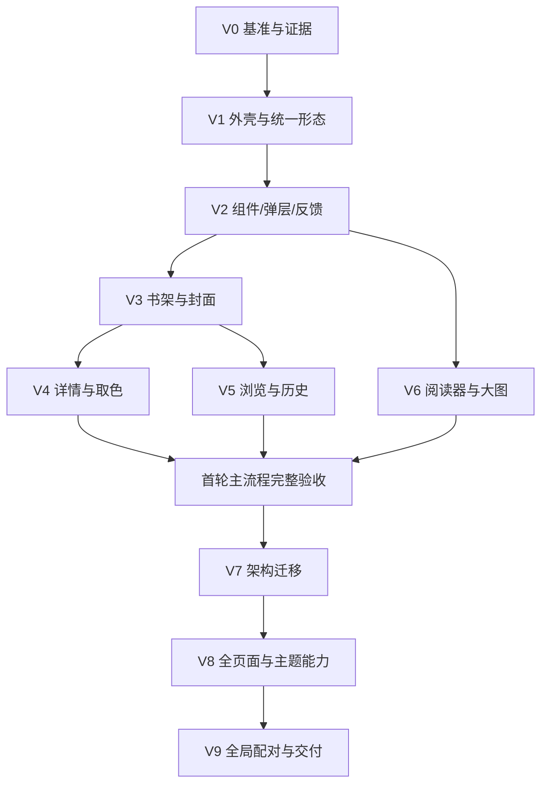

# 前端视觉对齐实施路线图

2026-11-18 · 基于当前工作区的规划，包含尚未提交的实现。项目 HEAD：`4f82b71`。本文件记录实施建议与待验收项，不将阅读源码、历史测试或截图存在视为对齐完成。

**当前优先目标：用现代 KMP/CMP 技术栈复现 Komikku 的视觉、布局、交互反馈和页面信息架构。先收敛已经存在的主流程，再扩展全部页面；架构升级沿仓库既定窗口实施。**

阅读依据：[白皮书](../reference/komikku-design-whitepaper-md/README.md)、[总对齐计划](komikku-alignment.md)、[已有视觉任务书](visual-parity-plan.md)、[架构](architecture.md)、[技术栈](technology-stack.md)。本路线图补充当前差距、完整页面排期、依赖与证据口径；不覆盖技术栈选型，也不改写旧验收记录。

## 1. 目标与范围

### 1.1 要复现的内容

- 视觉系统：语义颜色、浅/深/AMOLED、静态主题、动态种子与封面局部主题、字阶、图标、形状、层级。
- 布局结构：主页五 Tab、页面外壳、单/双栏、设置 master-detail、弹层形态、边到边与安全区、网格密度。
- 用户可见交互：搜索、多选、排序筛选、滚动顶栏、控件显隐、返回与重选、手势阈值、进度和结果反馈。
- 页面状态：空、加载、失败、内容、多选、筛选激活、权限受限、长文本、图片失败与任务进度。
- 阅读体验：五种阅读模式、双页、长图、缩放、裁边、菜单与设置；行为变化不能破坏当前页和续读位置。

“现代化”落在共享实现、明确依赖、状态归属和可验证性上。原版的 Android View、独立 Activity、Voyager、XML 下载队列并非本项目必须继承的实现要求。

### 1.2 本轮与后续的边界

| 工作 | 当前处理原则 |
| --- | --- |
| 已有页面视觉修复 | 最高优先，保留真实服务链路，按同数据配对验收 |
| 尚无服务的页面 | 可先建立可交互的夹具页面及状态规格，生产接入单独登记 |
| 下载、同步、追踪、网页登录等系统 | 为页面列出能力依赖，不为了截图提前重写后台系统 |
| Venera 扩展 | 保持 JS 协议方向；扩展界面参考原版，安装包格式、账号能力按 Venera 契约实现 |
| 小说、浏览器版、差异化功能 | 漫画对齐完成后另排 |
| 应用身份 | 维持 `app.koyura` 与本项目身份；原版标识、赞助与源码链接不直接作为本项目操作 |

开发用夹具进入测试/预览宿主，不混进正常用户数据。仅通过夹具验收的页面登记为“视觉通过、生产待接入”，不能对外标为功能完成。

## 2. 基准裁决与白皮书校正

### 2.1 证据优先级

1. 项目指引、技术栈与已明确的跨平台约束。
2. 本地 Komikku `290267dd4c99f5b46812240fb0e4bc6b3ee8c562` 的实际源码和对应版本运行结果。
3. 白皮书的数值提取、组件说明和截图；存在冲突时回到第 2 层。
4. 为跨平台提出的实现方案与推断，必须标记为方案或待验证。

2026-11-18 基准同步：本地参考仓库 HEAD 已核实为 `290267dd4c99f5b46812240fb0e4bc6b3ee8c562`，与白皮书 README 的 `290267d` 一致，版本差异已消除。白皮书截图可直接作为同版视觉参考；仍需核对数据、主题、字体和画布条件，并采集项目侧配对结果。原版缺失的目标状态按同版代码补采，不必因旧版本差异重新采集全部图片。

原规划的源码分析基于旧参考 `383ffaa`。本次比较了两版的 `presentation`、`ui/home`、`ui/main`、形态判定及 `presentation-core`：此前核对的导航、布局、卡片、详情背景、弹层与页码关键文件无变化；该比较范围中变化集中在扩展更新的仓库来源标记、书架/详情自定义更新间隔入口，以及仓库刷新警告链路。相关页面任务改以新版本核对这些变化，历史验收记录保留原版本。

### 2.2 已核实、需要修正规划口径的事项

| 事项 | 源码核对结果 | 实施规则 |
| --- | --- | --- |
| 平板阈值 | `DisplayExtensions.kt` 先按 AUTOMATIC 的竖 700/横 600 与 `smallestScreenWidthDp` 得出形态，再将下游判定规范到 720 | 不能把所有页面都改为“当前宽度 ≥720”；外壳、详情、弹层共用一次形态判定 |
| 旋转稳定性 | 自动模式横竖阈值本来不同 | “旋转永不变形态”不是普遍断言；以原版规则和用户覆盖为准，防止瞬时重建丢状态 |
| 一级导航显示范围 | `MainActivity` 的根 Navigator 从 `HomeScreen` push 详情；底栏/Rail 属于 `HomeScreen` | 保留项目五 Tab 独立栈，但由路由决定导航栏可见性；详情等非主页目的地按原版隐藏主页导航 |
| 双栏 | `TwoPanelBox.kt` 对扣除起止 inset 后的可用宽计算 `min(width / 2, 450dp)` | 不能用 42%/58% 或无上限的 1:1 代替；先明确页面是否包含 Rail |
| 网格 | `LazyLibraryGrid.kt` 使用 `Adaptive(128dp)` 或固定列数，额外 padding 8dp、gap 4dp | 列数按实际内容宽计算，不能对任何 1280dp 场景硬断言 9 列 |
| 紧凑网格 | `CommonMangaItem.kt` 为封面底部渐变上的标题叠层；舒适网格才在封面下显示标题 | 纠正白皮书“紧凑只是较小间距/单行外置标题”的简述 |
| 未读颜色 | 章节未读点是 `primary`，书架未读数量徽标是 `secondary` | 分组件记录角色，不把全站未读统一成一种颜色 |
| 阅读器 LTR/RTL | `ChapterNavigator.kt` 外层强制 LTR，但内部按 `isRtl` 处理滑块和前后章语义 | 应用语言 RTL 与漫画阅读 RTL 分开；“所有控件恒 LTR”不足以定义行为 |
| 页码拖动 | 原版 `onValueChange` 实时调用页面变化；项目当前为预览、松手提交 | 属于用户可感知差异，需要专项对齐或明确记录差异，不能仅以松手一次的现有测试作为原版通过证明 |
| Tab 动画 | 原版给 `materialFadeThroughIn/Out` 传入 200ms；项目当前出场 200ms，入场再延迟 200ms | 现有组合名义总时长 400ms；下一任务核对 motion 库具体曲线与时间分段，不仅检查常量名 |
| Sheet 宽度 | 原版窄屏底部弹层也有 460dp 上限 | 手机是底部定位且受最大宽限制；强制手机形态的宽窗也要验收 |
| 主题默认值 | 原版应用默认 Monet；本项目当前是三套 Default 静态色板 | 静态色板一致仅代表基础完成，仍需动态主题与页面局部主题 |
| 背景模糊 | 详情背景的图像模糊 7dp，与封面放大时的 Haze 10dp 属于不同效果 | 不将背景图 blur 和 backdrop blur 混为一个 API 或一个验收项 |

示例：假定主页总宽 1280dp、Rail 实占 80dp、无额外横向 inset，网格内容 padding 为 16dp，则网格可用宽为 1184dp，`floor((1184+4)/(128+4))=9`。**列数为 9 不意味着每格仍有白皮书简表中的约 139dp**；该场景每格约 128dp，封面还需扣条目内部 padding。窗口宽、页面宽、网格宽、图片宽分别记录。

白皮书附录明确未实测全部主题、600–719dp 临界带、RTL、200% 字体及部分任务进度。本项目必须补这些场景，不能由白皮书的检查清单反推出它们已经通过。

## 3. 当前项目状况

### 3.1 已有基础

| 区域 | 当前源码事实 | 规划处理 |
| --- | --- | --- |
| 工程 | Android/iOS/Desktop 入口、KMP 模块和共享装配存在；版本目录使用 Kotlin 2.4.21、CMP/M3 1.13.0-beta02、Navigation 3 1.2.0 | 使用现有 Wrapper/JDK 21，不在视觉轮次升级工具链 |
| 设计系统 | `DesignTokens.kt`、`ReaderTheme.kt`、图标、导航、封面、列表、搜索组件已存在 | 消费和校准现有令牌，不重新造一套；全局动态主题仍待做 |
| 外壳 | 五 Tab、独立栈、saveable/movable content、四种平板模式判断存在 | 重开的是差异复核与证据补齐，不从零写导航 |
| 浏览 | 来源、扩展、仓库、单源搜索、详情已有生产链路 | 保留安装/更新/失败重试等已有动作，逐页校准密度与状态 |
| 书架 | `features/library` 已有页面、会话、显示模式、分类、多选；`ProductionLibraryRepository` 接真实存储 | 视觉任务基于现有生产实现，不能再当作占位页 |
| 阅读器 | `ReaderScreen` 实际组合 `ReaderSession`、Viewer、Chrome、设置；五模式与单/双页逻辑存在 | 保留进度和模式契约，修复显示与能力缺口 |
| 历史 | 生产历史服务、日期分组、搜索/过滤、续读等存在 | 逐项验证多选、删除反馈、封面与滚动头部 |
| 更新/更多 | `AppScaffold` 对其根页仍走 `TabRootScreen` | 是后续需要建立的真实页面，不应登记为已有复刻 |
| 图片 | 封面仍是自管字节加载/缓存/平台解码；正文同样全图解码路径 | Coil 3 与 ZoomImage 按既定阅读器窗口接入，当前不能写成已接入 |

### 3.2 高影响差距，按源码确定

| 编号 | 差距 | 当前落点 | 影响 |
| --- | --- | --- | --- |
| G01 | 详情仍保留主页导航；与原版页面画布不同 | `AppScaffold.kt` 只对阅读器/书架多选隐藏导航 | 所有详情尺寸和截图的前置条件错误 |
| G02 | 外壳自动阈值与页面自己的 720dp 判断各自存在 | `navigation/TabletUiMode.kt`、`SourceScreens.kt`、`chrome/ReaderChrome.kt` | 700dp 竖/600dp 横可能出现 Rail 与手机详情/底部弹层并存 |
| G03 | Tab 动画出入两段各 200ms；生产 `AppShell` 默认重选回调为空 | `AppScaffold.kt`、`App.kt` | 节奏偏慢；回根后的刷新/回顶等还需逐 Tab 接入验证 |
| G04 | 自适应列数未实现：`columnsPref.coerceIn(1,6)`、`GridCells.Fixed` | `LibraryListing.kt`、`LibraryScreen.kt` | 宽屏密度与原版差距明显，0=自动语义丢失 |
| G05 | 书架 padding/gap 均 12dp；紧凑标题外置；舒适用 bodyLarge 加粗并额外显示来源 | `LibraryScreen.kt` | 卡片结构与字阶不一致，单纯换颜色无法解决 |
| G06 | 书架空态为左上文案和按钮组；筛选等使用 16dp 圆角普通 Dialog | `LibraryEmptyState`、`LibrarySheetHost` | 空态和弹层均缺原版辨识度 |
| G07 | 详情 42%/58% 分栏、固定顶栏、开始/继续为普通按钮 | `SourceScreens.kt` | 双栏、滚动渐显和浮动入口未对齐 |
| G08 | 详情背景 alpha 0.28、未 blur；无页面封面主题 | `Covers.kt: DetailBackdrop`、`ReaderTheme.kt` | 缺少封面驱动的主要视觉效果 |
| G09 | Chrome 栏使用 surface@0.92，而非 surface@3dp 加浅/深分支 | `chrome/ReaderChrome.kt` | 层次与对比不一致；虽有动画，不等于 chrome 已完成 |
| G10 | `ReaderScreen` 菜单初始状态为 true；系统沉浸与首屏显隐需按原版偏好复核 | `ReaderScreen.kt`、各端入口 | 首屏观感和系统栏处理可能与默认体验不同 |
| G11 | 模式弹层有形态雏形，但没有完整统一拖拽/焦点/insets 组件；书架另写一套 | `ModeDialog.kt`、`LibrarySheetHost` | 修一个弹层无法带动其他页面 |
| G12 | 三套静态色板不包含完整主题设置、Monet、自定义种子和局部取色机制 | `ReaderTheme.kt`、`App.kt` | 固定主题相似不能代表主题系统复刻 |
| G13 | 部分现有截图是历史 JVM 离屏渲染，Viewer 的原版侧还包含源码推导示意 | `docs/alignment/a-shell`、`b-viewer`、`c-chrome` | 缺少版本一致、同数据的原版运行配对证据 |

这张表是规划输入，不是完整 bug 审计。旧功能审阅中的“标记已读无操作”等结论不能直接沿用：当前未提交代码已加入目录同步、章节计数与标记路径，相关 KDoc 又仍保留旧描述。后续应对当前调用链和测试核实，不重复安排已经修复的功能。

### 3.3 验证记录

本次仅新增规划文档，未修改业务实现。为确认规划依据，执行现有 `design-system/features/app` JVM 回归，结果见本文末尾验证记录。三端最新构建、真实设备操作、原版配对截图以及性能测量不在本次已完成范围。

## 4. 实现结构与技术边界

### 4.1 沿用依赖方向

```text
apps/android · apps/ios · apps/desktop
                    ↓
shared/app：装配、路由、平台会话、现存 browse/history 页面
       ↓                       ↓
shared/features           data / source-runtime / network
       ↓                       ↓
design-system                 domain
       ↓
CMP / 官方 Material 3
```

`features` 同时依赖 `domain`；设计系统不能反向依赖功能页或具体服务。现存 `browse/history` 暂留 `app`，视觉校准期间只做必要拆分；在架构窗口再逐页迁入 `features`，避免同时改目录、状态框架和页面外观。

推荐页面结构为路由入口 → session/state holder → 不可变 `UiState` → 无状态 Content；动作向外传递，服务装配位于 `app`。这是目标组织形式，不宣称当前每一页都已完成该整理。

```kotlin
@Composable
fun DetailsContent(
    state: DetailsUiState,
    onAction: (DetailsAction) -> Unit,
    modifier: Modifier = Modifier,
)
```

先让 Content 可由固定状态复现，再校准视觉。同一 Content 同时服务生产、预览与截图；不为每个状态复制一套页面。

### 4.2 共享能力的最小集合

| 能力 | 建议归属 | 约束 |
| --- | --- | --- |
| 统一形态上下文 | `design-system/layout` 的只读布局值；`app` 计算并提供 | 不向 `features` 引入 `app.navigation` 依赖；形态和可用窗口尺寸分开 |
| 双栏容器 | `design-system/layout` | 明确 inset 所有者、450dp 上限与独立滚动 |
| 自适应弹层 | `design-system` | 状态外提、共享内容、紧凑底部/宽屏居中、键盘/焦点/返回一致 |
| 顶栏、搜索栏、多选栏 | `design-system` | 普通、滚动、选择三态；槽位承接动作，不耦合章节实体 |
| 封面/徽标/卡片基础 | `design-system`；业务组合留功能包 | 普通封面和占位同尺寸同圆角；状态标记使用语义模型 |
| 空/错/载、全局横幅、任务进度 | `design-system`；`app` 汇聚全局状态 | 可注入固定颜文字/时钟/进度供截图；运行时保留原版反馈逻辑 |
| 主题与封面种子 | `design-system` 负责生成/应用，图片管线负责输入 | 封面局部主题只覆盖详情/阅读器，不污染主页 |
| 系统栏、触觉、分享、目录权限 | 领域接口与现有平台源集 | 有真实平台需求再扩展；不提前创建空模块 |

### 4.3 依赖接入顺序

- **当前可用**：现有 CMP/M3、Navigation 3、Coroutines、SQLDelight、Ktor、QuickJS、Compose Resources，手动构造器注入与 `CompositionLocal`。
- **阅读器轮次接入**：Coil 3 负责封面与列表；ZoomImage 负责阅读器缩放/长图分块。Coil 不能绕过 Venera 的 `onThumbnailLoad`、源请求配置与图片处理，ZoomImage 的 `ImageSource` 必须接自管字节/文件管线。
- **首轮阅读器完整验收之后**：Koin、MVIKotlin、androidx ViewModel、`lifecycle-viewmodel-navigation3`、Multiplatform Settings、Kermit、Turbine，单独作为保持行为的迁移里程碑。
- **后续能力轮次**：Ketch 只在下载任务 POC，FileKit/AppDirs 在目录和本地导入任务，备份加密按既定路线。

封面取色的公共种子算法/实现依赖尚需 POC，先核对锁定版本的实际能力、平台行为和官方来源，再记录技术决定。不得因为原版使用某库就默认为本项目已经选型。不得提前引入 Voyager、Decompose、Room、Retrofit、Paging 3 或 mvikotlin `keepers`。

## 5. 分阶段任务

任务 ID 使用 V0–V9，避免与已有 P0–P7 的历史完成记录混淆。每个阶段允许拆为多个可独立验证的提交。

### V0 · 固定视觉基准与当前实现快照

**优先级：立即；前置：无。**

交付：页面/状态索引、基准 manifest、当前构建与测试记录、差异清单。

1. 为原版 `290267d` 建立可复现构建/安装路径，记录 APK SHA、设备、API、density、字体比例、语言、主题、系统栏方式；复用白皮书同版且条件匹配的截图，补采缺失状态。
2. 统一主比较画布：手机 360×720dp（对应白皮书手机逻辑画布），平板 1280×800dp；420dp 保留为已有回归扩展，不冒充 360dp 配对。
3. 固定相同封面、章节标题、计数、日期与阅读图片；使用本地资源和受控网络响应。原版若需另一个来源适配器，两个适配器输出相同可见数据，不依赖相同插件格式。
4. 为每页列出实际入口、是否显示主页导航、状态集合及宽窄布局。确认旧文档中的“占位”“未接线”是否过时。
5. 将已提交实现、未提交工作和历史截图分开标注；记录参考目录是否有修改。

**出口：**至少完成书架、浏览、详情、历史、阅读器这五类主页面的可重现基线；缺原版运行证据的项明确待补，不据此宣布通过。

### V1 · 外壳、统一形态、主题基础与导航

**前置：V0；修改范围：`design-system`、`app/App*`、`app/navigation` 与相关测试。**

1. 统一 `LayoutMode` 计算与传播，外壳、详情和所有 Sheet 消费同一结果。Android 读取实际 Configuration 所需信息，iOS/桌面使用明确的窗口适配规则；`min(width,height)` 仅是当前近似，不能直接当成 Android Configuration 在分屏/折叠场景的等价物。
2. 将“是否为宽形态”和“主页导航是否可见”分开：详情、设置等根栈目的地按原版隐藏主页导航；返回后恢复原 Tab 栈与滚动。
3. 校准导航栏高度、Rail 宽与标签、徽标、tonal elevation；保持已有动态图标缺失为可追踪微动效差异，静态首帧先匹配。
4. 核对 fadeThrough 时间轴及普通页面 shared-axis 前进/返回。使用手动动画时钟采样开头、中间、结束，避免只断言 200 常量。
5. 接入各已实现 Tab 的重选行为；尚未落地的更新刷新等只登记依赖。
6. 复核 MaterialTheme 与原版 MaterialExpressiveTheme 的默认差异：显式字阶、形状与动效，不能只因为组件同名就认定外观相同。
7. 统一系统安全区消费：主页、非主页、阅读器分别定义所有者，横幅插入后不重复增加顶端空白。

**验收：**599/600、699/700、719/720dp 临界输入、横竖与强制四模式；Tab→详情→阅读器→返回；弹层→选择→子页→Tab 根的返回消费；窗口变化不丢位置；截图窄/宽×浅/深。

**与旧任务关系：**承接 P0/P1，保留其已有测试与截图，补上述发现；不把整个 P1 标为全部重做。

### V2 · 通用组件、弹层与状态反馈

**前置：V1 的布局契约；修改范围：`design-system` 与各表现层调用点。**

1. 先实现共享 AdaptiveSheet，再迁移模式选择、书架筛选/排序/显示/分组、章节筛选。移除“普通 Dialog 看起来像 Sheet”的独立实现。
2. 窄形态底部定位、最大宽 460dp、上圆角 28dp、surfaceContainerHigh；宽形态居中，最大宽 460dp、上下安全留白、禁拖拽。手机拖拽阈值 56dp、350ms settle 按源码复核。
3. 处理内部可滚动内容与拖拽竞争、遮罩点按、返回、Esc、键盘遮挡、焦点进入和关闭后恢复。强制手机形态的宽窗口与短窗口必须可操作。
4. 建立共用 EmptyScreen、错误和加载组件；固定颜文字用于快照，实际页面按原版规则选择。重试失败保留上下文。
5. 统一 Badge/Pill/章节状态和下载六态外观；下载暂缺服务时只在夹具宿主展示六态。
6. 全局横幅支持任务态→Downloaded only→Incognito 的顺序与 inset；真实模式尚未实现时不在生产假显示任务。
7. 图标有描述，装饰图无重复播报；图标按钮保持至少 48dp 交互目标。小视觉控件的触摸扩展需验证重叠，不机械改大全部图形。

**验收：**同一状态在两种 Sheet 中内容一致；一个返回只关闭最上层；取消不提交、确认按原版语义提交；进度/空/错/载窄宽浅深组件矩阵通过。

### V3 · 书架与封面列表管线

**前置：V1、V2；修改范围：`features/library`、`app/library` 的表现层装配、封面组件；图片接入可单独提交。**

1. 恢复 `columns=0` 的自动语义，网格用 `Adaptive(128dp)`，显式列数用 Fixed。显式列数范围按原版偏好定义，移除无依据的 1..6 限制；旧偏好兼容只在必要时调整仓储边界。
2. 按原版恢复 8dp 网格 padding、4dp gap、条目自身 padding；分组头跨满实际列数，稳定 key/contentType。
3. 紧凑网格：标题在封面底部渐变叠层；舒适网格：封面下 12sp/18sp、至少两行；只封面、列表和全景模式分别参照源码，复用 Cover 而不复制取图。
4. 封面 2:3、4dp 圆角，徽标 18dp；选择 alpha 0.76 和 secondary 描边即时切换；Continue 的视觉尺寸与独立点击目标分别验证。
5. 分类 Tab、计数 Pill、搜索模式、筛选激活、底部批量动作、空态/筛空态按原版逐项校准。删除和分类操作沿用已存在的真实写入路径。
6. 将 Coil 3 通过现有封面服务/自定义 Fetcher 等边界接入，保留 Venera 回调、取消与按源缓存隔离；核对缓存键是否还需要会话/版本维度。切账号或源替换不能复用失效的受保护图片。
7. 保持封面占位尺寸，图片完成后仅内容淡入；按实际目标尺寸解码，限制并发与内存。目录/计数是否准确由既有生产回归确认，不在视觉提交中改写章节模型。

**验收状态：**空、有内容、搜索无结果、筛选激活、分类、多选、加载/错误、封面失败；至少舒适/紧凑/列表三种密度各做窄宽浅深，其余模式做组件快照与关键整页截图。

**出口：**同一宽度下格数、卡片几何、标题位置、徽标、选择态匹配；真实收藏/取消/分类/续读回归通过；不得为了新截图更新所有旧断言而丢掉生产行为保障。

### V4 · 作品详情与章节目录

**前置：V1、V2、V3 的封面管线；修改范围：现存 `app/browse/SourceScreens.kt` 与共享视觉组件。**

1. 用可复现状态拆出详情头、信息动作、简介标签、章节目录和浮动阅读入口，保持路由/服务契约。
2. 手机为封面左、文字右；平板左栏 `min(可用宽/2,450dp)`、右栏剩余，两边独立滚动。按原版处理全景封面和长标题。
3. 恢复顶栏透明→surface@3dp 的滚动背景和标题 alpha；单栏与双栏分别定义滚动驱动，不把整个页面每像素滚动写入高层状态。
4. 封面背景按原版 Modifier 次序验证：图像填充、7dp blur、0.2 alpha、surfaceTint 叠层、从半高开始的背景渐变。实际合成效果由配对截图裁决，不把各 alpha 简单相乘后猜结果。
5. 封面种子只影响页面局部 ColorScheme；相同封面跨平台产出可比较结果。取色失败/透明图/纯色封面回到应用主题，不闪白也不染到返回后的主页。
6. 动作行按来源能力显示等宽项，本地无网页时不强占四项；用户动作仍落既有生产实现。未支持的能力按真实可用性呈现。
7. 章节标题 bodyMedium、未读点 primary、已读 0.38、次级信息 0.78、内边距 16/12/8/12；多选及批量标记依赖当前持久化状态。
8. Start/Resume 为原版浮动阅读入口，支持非多选/存在可读内容时显隐；左右吸附和保存位置按原版偏好实现。已有普通按钮不能作为完成形态。

**验收：**有/无封面、封面主题开/关、浅深、单/双栏、长简介、章节多选、无分章、目录错误与重试；返回原书架/历史的位置，阅读后已读与续读状态同步。

**POC 决策：**blur 和种子方案分别记录三端实测；临时 surfaceTint+渐变回退可保证可用性，但仍登记视觉偏差，不以“有回退”作为完整复刻通过。

### V5 · 浏览、搜索、扩展与历史

**前置：V1–V3；可与 V4 独立实施。**

- 浏览根页：按原版 Sources/Feed/Extensions/Migrate 信息架构规划；已存在来源/扩展先精修，未有能力的 Tab 在夹具宿主完成各状态，不在生产伪造数据。
- 来源与扩展：40dp 图标槽、分组标题、语言/NSFW/置顶、安装和更新状态、按钮类型、空错载、搜索模式；仓库管理是 Venera 所需入口，沿原版组件语言组织。
- 单源搜索：结果网格/列表、加载更多、空结果、失败保留已有结果、搜索工具栏、输入焦点与键盘；查询不能因转场重复发起。
- 扩展详情/源设置：视觉骨架与操作状态先复用设置组件；脚本设置与账号能力另列依赖，不将 UI 生成等同于宿主支持。
- 历史：96dp 行、封面、日期分组吸顶与轻微 elevation、标题/章节/相对时间、删除/清空确认、长按多选及选择计数。历史隐藏与续读位置的现有语义保留。
- 全局搜索、Feed、保存搜索、迁移的完整页面排在 V8；所需组件可从本阶段复用。

**出口：**真实路径“来源→搜索→详情→阅读→历史续读→返回”不中断，四形态页面状态配对；历史使用固定日期而非系统当前时间生成基线。

### V6 · 阅读器表现与大图能力收敛

**前置：V1、V2；封面局部主题依赖 V4，ZoomImage POC 可提前。**

| 工作包 | 内容 | 验收重点 |
| --- | --- | --- |
| V6a Chrome | surface@3dp、浅 0.95/深 0.90、200ms 位移+150ms alpha、药丸滑块、48dp 工具、长标题 | 菜单显隐及弹层不会抢走 Viewer 手势或留下不可见点击层 |
| V6b 默认行为 | 根据原版偏好确认菜单初始显隐、系统栏、Black/Gray/Automatic/White、屏幕方向 | 首次进入与重进都能复现；iOS/桌面按平台方式呈现沉浸 |
| V6c 页码与方向 | 原版实时拖动、页码触觉、双页范围标签、RTL 章按钮/滑块、语言 RTL | 预览、页面定位、持久化三个时机明确；过期章事件不能写回 |
| V6d 图片 | ZoomImage 自定义 ImageSource、长图 tile、单双页缩放/平移、裁边、预读与淘汰 | 1x 溢出长图可达、缩放与翻页竞争、损坏页重试、三端内存 |
| V6e 连续模式 | WEBTOON 与 CONTINUOUS_VERTICAL 间距/跨章边界、页内位置恢复 | 不以“边界重新打开下一章”冒充连续拼接；设置变化保持稳定页键 |
| V6f 设置 | 模式、布局、适配、作品覆盖、全局默认；其余亮度/滤镜/点击区逐项补充 | 全局→作品覆盖→清字段继承的现有语义不退化 |

ZoomImage 的接入与 Chrome 校准分提交，避免一轮同时改图片管线、页键和工具栏。允许沿用 `ReaderSession` 外部契约；需要增加页内锚点或内存策略时先写清兼容规则、再改实现和回归。

**首轮阅读器出口：**五模式、单双页、跨页图、长图、坏图、两章、跳页、切模式、窗口变化、重启续读全部通过；真实原版配对截图/操作录屏，以及 Android/Desktop/iOS 构建运行记录齐全。仅 V6a 截图通过不能触发架构迁移。

### V7 · 首轮验收后的架构迁移

**前置：总对齐计划的第一轮完成，包含 V1–V6 主流程相关项与阅读器出口。不是自动进入的并行任务。**

1. 固定迁移前截图、状态序列与持久化样例。
2. 手动装配平移至 Koin，保留类构造器和领域接口；生命周期边界仍以应用/源会话/路由为准。
3. 按每个 NavKey 管理官方 ViewModel；MVIKotlin 承接意图与状态，禁止 `keepers`。先迁一个代表页面验证，逐页推进。
4. 在同一窗口接 Multiplatform Settings、Kermit、Turbine。阅读器现有 JSON 偏好与书架 SQLite 偏好是否迁移要单独设计版本/读写兼容，不因采用新库就全量搬库。
5. 逐页迁移 browse/history 到 `features`；生产适配与注入仍留 `app` 或对应适配模块。只有编译/职责边界确实需要时才拆 Gradle 模块。

**出口：**迁移前后同夹具外观和用户路径一致、返回与取消正确、重建/重启恢复正确；三端验证通过。不得在该阶段夹带新视觉设计。

### V8 · 补齐其余页面与主题能力

**前置：复用前述组件；完整生产状态与设置持久化按 V7 后的接口接入。**

| 顺序 | 页面组 | 视觉交付 | 生产依赖/特殊验收 |
| --- | --- | --- | --- |
| 1 | 更多、设置主页、外观、关于 | Logo 区、56dp 设置行、分组、手机 push/平板 master-detail、选中行圆角 24dp | 本项目图标与正确链接；主题切换和返回不闪白 |
| 2 | 主题全量 | 19 套静态、Monet/Custom、AMOLED、主题预览 114dp/9:16、封面取色选项 | 未覆盖平台的系统动态色采用明确的种子回退；原版不完整角色按锁定 M3 默认展开记录，不擅自美化 |
| 3 | 应用书架/阅读设置 | 复用已有设置能力，列表选择、Slider、开关和说明 | 同阅读器内设置共用真值，不能维护两份设置 |
| 4 | 更新与更新错误 | 作品领导行+缩进章节、空态、进度、筛选、多选、按错误分组 | 章节差异检测、调度与错误仓储；内容态补真实截图，不能仅靠白皮书空态 |
| 5 | 下载队列、离线与本地 | 高密度队列、暂停/失败/恢复、拖动排序、目录选择 | Ketch POC、持久任务、本地资源加载；原版 XML 外观用 Compose 重建 |
| 6 | 分类管理、统计 | 拖动分类、增删改、SectionCard、数值层级 | 复用已有分类 CRUD，统计来自实际持久数据 |
| 7 | 全局搜索、Feed、保存搜索、关联推荐 | 来源分组结果、卡片行、编辑/排序面板、空错载 | 对应 Venera 能力与分页契约；避免要求 APK 插件兼容 |
| 8 | 迁移/合并 | 候选搜索、选择、范围、进度与冲突反馈 | 跨源映射、可回退的数据操作与进度；没有截图的内容补锁定原版运行采集 |
| 9 | 追踪、账号、连接、数据与存储 | 服务行、登录、绑定搜索、备份恢复/同步进度、确认 | 真实授权、SecretStore、备份/同步；视觉夹具与生产接入分别登记 |
| 10 | 引导、权限、网页、笔记及信息页 | InfoScreen 四步、平台权限、WebView 外壳、编辑与版本信息 | FileKit/平台授权、网页会话；Android 权限项按平台能力映射到 iOS/桌面 |

每组先验证组件与夹具状态，再接实际服务。权限、下载或追踪服务缺失不阻塞相互独立的页面视觉工作，但会阻塞该页“功能完成”。未在白皮书截图出现的页面先找原版 Content 和真实运行画面，不自行另创风格。

### V9 · 全局复核与交付

1. 按白皮书 9.5 的 30 条逐项建立“通过/未通过/有记录的平台差异”结果，应用本路线图第 2 节的校正解释。
2. 对所有生产页面补完整窄宽×浅深，AMOLED 核心页面，19 主题组件抽样与 Default/Monochrome/Matrix 整体检查。
3. 完成 Android 同版配对；iOS/桌面保持共享组件几何并补平台输入/安全区实测，系统字体差异单独记录。
4. 复核性能、可达性、键盘鼠标、窗口变化、应用暂停/恢复与进程重启。
5. 总对齐计划登记实际合并 SHA、截图和录屏路径、测试命令、平台结果及未解决差异。Windows/Linux 安装包属于目标系统发布验收，不以 macOS JVM 测试替代。

## 6. 依赖、排序与工作量



V8 可提前做状态清单和复用组件的测试预览，但生产接入与框架迁移按上述窗口推进。V3/V4/V5/V6 只有在共享 API 稳定、修改文件不重叠时才适合分工；这是一项排程建议，不要求同时启动多代理。

以下为规划估算，单位是熟悉仓库的单人有效工作日，包含实现、回归与截图整理，不是已测工期或交付承诺：

| 范围 | 粗估 | 主要不确定性 |
| --- | --- | --- |
| V0 | 1–3 | 原版构建、同夹具输入和设备条件 |
| V1–V2 | 4–7 | 导航画布、跨平台弹层与系统栏 |
| V3 | 3–5 | 生产偏好兼容、Coil 自定义取图与缓存 |
| V4 | 4–7 | 种子算法、模糊三端效果、滚动组合 |
| V5 | 3–5 | 现有页面复用程度与历史交互 |
| V6 Chrome 校准 | 2–4 | 页码实时响应、RTL、焦点与系统栏 |
| V6 Viewer/长图/连续 | 单独 POC 后估算 | tile、内存、跨章和页内锚点，不能作为少量 UI 调整估计 |
| V7 | 3–6 | 生命周期、旧偏好兼容、页面数量 |
| V8 视觉层 | 12–22 | 页面状态和原版截图补采；不含后台系统实现 |
| V9 | 3–5 | 三端设备、操作录屏与性能返修 |

已知视觉与迁移工作约 35–64 人日；**不包含**尚待估算的 Viewer 大图/连续模式和下载、同步、追踪等服务。V0 完成后用实际页面清单重估；Coil、取色/blur、ZoomImage 各完成一个 POC 后再次收敛，不用总页数乘固定天数替代评估。

## 7. 验收与测试方案

### 7.1 三种完成状态独立记录

| 状态 | 必需证据 |
| --- | --- |
| 视觉通过 | 锁定原版版本、同数据配对、窄宽×浅深、组件几何与状态清单、差异审阅 |
| 交互通过 | 自动化动作/状态断言，动效或手势的真实操作录屏，返回与焦点验证 |
| 生产通过 | 真实仓储/源链路、失败与取消、重启恢复、三端运行与构建 |

实现存在、生产接线、JVM 通过、平台通过、原版配对通过分别设列，不压缩成一个“已完成”勾选。第一轮总出口和最终交付要求关联列全部通过。

### 7.2 截图矩阵与目录

```text
docs/alignment/<task-id>/
  manifest.json
  original/     # 锁定原版运行结果
  current/      # 当前应用结果
  compare/      # 并排、局部放大与差异图
  recordings/   # 真实操作录屏
  verification.md
```

manifest 至少记录：两侧 commit/未提交状态摘要、构建标识、数据夹具哈希、页面入口、状态 ID、画布 dp/px、density、字体比例/字体来源、语言、主题/种子、设备/系统、系统栏/insets、动画采样时间。

每个主要内容态基线是窄/宽×浅/深四张成对图，不等于每页只需四张；空、失败、多选、面板等分别拥有状态 ID。白皮书 assets 和已有 a/b/c/p1 目录保留不覆盖。源码推导示意、拼接测试帧标注其性质，不能改名充当原版截图或操作录屏。

对比顺序：画布和导航显示范围→分栏和信息密度→组件几何→字阶换行→颜色角色和合成→图标→动效。先纠正骨架再打磨色值。

### 7.3 判定指标

- 明确 dp/sp 值使用布局/语义边界断言；建议同一渲染环境几何误差不超过 1dp，作为项目验收目标，不是上游承诺。
- 固定种子/色板后比较色值；动态色不受控时先固定输入，不能拿不同壁纸的截图判色差。
- 图像差异图辅助定位，不设一个全屏相似度百分比作为唯一通过条件。字体抗锯齿、状态栏和测试图时间等只能有明确掩膜，不能掩盖布局差异。
- 100% 字体做原版配对，200% 验证内容与动作可达；正文不因固定行高被切，允许合理省略并有全文入口。不把“200% 所有长标题仍两行完整”当成可实现的普遍要求。
- 白皮书的“所有组件 4.5:1”需按内容角色解释：普通正文目标 4.5:1，其他文本/控件按适用标准检查；原版禁用 0.38 等特殊态单独记录。若严格复刻与可读性冲突，明确列为待决差异，不默默改色。
- 动效使用动画时钟断言进退方向、alpha、总时间，真实设备录屏核对节奏；减少动态效果设置生效后保留可理解的状态变化。

### 7.4 性能与跨平台

长列表至少用 200 项覆盖滚动、图片加载与选择；阅读器用高分辨率跨页图、长图、多页章和坏图。记录设备、数据量、图像尺寸、峰值内存、帧时间、操作时延及冷热缓存条件。60Hz 设备可将约 16.7ms 帧预算作为分析目标，实际门槛在 V0 测量基线后确定，不能在没有实测时宣称“无掉帧”。

Android 验证边到边、返回、触觉、系统栏及 Configuration；iOS 验证安全区、键盘、前后台、取消与内存；桌面验证鼠标、滚轮、键盘焦点/Esc、窗口缩放和短窗口。Windows/Linux 的字体、原生依赖和安装包另记系统证据。

### 7.5 验收命令

所有命令使用仓库 Wrapper、`JAVA_HOME="$HOME/devtools/jdk-21"`。按修改范围运行模块回归，例如：

```bash
JAVA_HOME="$HOME/devtools/jdk-21" ./gradlew \
  :shared:design-system:jvmTest :shared:features:jvmTest :shared:app:jvmTest \
  -PveneraReferenceDir="$PWD/reference/Venera-Next" --console=plain
```

修改阅读偏好/书架持久化时增加 `:shared:domain:jvmTest :shared:data:jvmTest`；改变网络会话、源宿主回调或图片脚本路径时运行原版脚本 SHA-256 与全回调链，不以静态图片测试代替。

里程碑集成至少运行总计划命令并补受影响模块：

```bash
JAVA_HOME="$HOME/devtools/jdk-21" ./gradlew \
  :shared:domain:jvmTest :shared:design-system:jvmTest :shared:features:jvmTest \
  :shared:app:jvmTest :shared:data:jvmTest :shared:source-runtime:jvmTest \
  :apps:android:assembleDebug :apps:desktop:classes \
  :shared:app:linkDebugFrameworkIosSimulatorArm64 \
  -PveneraReferenceDir="$PWD/reference/Venera-Next" --console=plain
```

framework 链接和编译通过不代替实际 iOS 应用运行。阶段交付同时按 README 执行 Xcode 应用构建及模拟器操作；桌面按需生成 distributable 并启动。

## 8. 第一批可直接拆出的任务

| 顺序 | 任务 | 输入/落点 | 必需结果 |
| --- | --- | --- | --- |
| 1 | V0-01 统一页面状态与证据 manifest | 本路线图、白皮书、现有截图测试 | 手机/平板五主页面基线，版本/画布/夹具可复现 |
| 2 | V1-01 统一形态及导航栏可见性 | `AppScaffold`、`TabletUiMode`、详情/Chrome | 解决 G01/G02；详情画布匹配，返回保位 |
| 3 | V1-02 校准转场与重选 | `AppScaffold`、`App`、各 Tab 入口 | 时间轴证据，已实现 Tab 重选动作接通 |
| 4 | V2-01 共享弹层和空态 | `ModeDialog`、`LibrarySheetHost`、设计系统 | 两形态、拖拽/返回/焦点/键盘验证，空态匹配 |
| 5 | V3-01 自适应网格与卡片 | `LibraryListing`、`LibraryScreen` | 0=自动，正确紧凑叠层、舒适字阶与徽标 |
| 6 | V3-02 Coil 管线 POC 与接入 | `CoverImageLoaders`、Cover、生产源回调 | 封面加载/缓存/取消/失败、原脚本回归不退化 |
| 7 | V4-01 详情双栏/滚动/FAB | `SourceScreens`、共享布局 | 450dp 上限、无主页导航、滚动渐显、入口正确 |
| 8 | V4-02 封面主题/blur POC | `ReaderTheme`、`DetailBackdrop`、平台渲染 | 三端效果和失败回退记录，局部取色不污染全局 |
| 9 | V6-01 Chrome 校准 | `reader/comic/chrome` | 栏色/透明度、页码、RTL、菜单显隐配对 |
| 10 | V6-02 ZoomImage POC | Viewer、PlatformImage、页资源管线 | tile/手势/内存三端实测后给出完整接入估算 |

每张任务卡固定包含：原版 commit/入口/参考文件、当前落点、允许修改范围、前置接口、目标状态、验收动作、测试命令、截图与录屏位置、已知平台差异。视觉任务若发现服务缺口，创建关联能力任务，先完成独立可验证的视觉工作。

## 9. 原版源码定位索引

以下原版表现层前缀为 `reference/komikku/app/src/main/java/eu/kanade/`，core 前缀为 `reference/komikku/presentation-core/src/main/java/tachiyomi/presentation/core/`。

| 主题 | 原版路径 | 本项目主要落点 |
| --- | --- | --- |
| 根导航/主页 | `tachiyomi/ui/main/MainActivity.kt`、`tachiyomi/ui/home/HomeScreen.kt` | `shared/app/.../AppScaffold.kt`、`navigation/` |
| 形态 | `tachiyomi/util/system/DisplayExtensions.kt`、`presentation/util/WindowSize.kt` | `navigation/TabletUiMode.kt`；待统一布局上下文 |
| 主题 | `presentation/theme/TachiyomiTheme.kt`、`colorscheme/*` | `shared/design-system/.../ReaderTheme.kt` |
| 双栏 | core `components/TwoPanelBox.kt` | 详情/未来设置的共享布局 |
| 弹层 | core `components/AdaptiveSheet.kt`、`presentation/components/AdaptiveSheet.kt` | `ModeDialog.kt`、`LibrarySheetHost`；待抽共享组件 |
| 书架 | `presentation/library/components/LazyLibraryGrid.kt`、`CommonMangaItem.kt`、`LibraryTabs.kt`、`LibraryBadges.kt` | `shared/features/.../library/` |
| 详情 | `presentation/manga/MangaScreen.kt`、`components/MangaInfoHeader.kt`、`MangaChapterListItem.kt` | `app/.../browse/SourceScreens.kt`、`design-system/.../Covers.kt` |
| 浏览/历史 | `presentation/browse/*`、`presentation/history/HistoryScreen.kt`、`components/HistoryItem.kt` | `app/.../browse/`、`history/` |
| 阅读器 | `presentation/reader/appbars/*`、`components/ChapterNavigator.kt`、`settings/*`、`tachiyomi/ui/reader/viewer/*` | `features/.../reader/comic/` |
| 更多/设置 | `presentation/more/MoreScreen.kt`、`LogoHeader.kt`、`settings/*` | 待建 `features/settings` 等功能包 |
| 更新 | `presentation/updates/*`、原版更新错误页面 | 待建 `features/updates` |
| 其他 | `presentation/more/onboarding/*`、`more/stats/*`、原版下载/分类/追踪页面 | 按 V8 状态清单逐项定位 |

## 10. 本次规划验证记录

- 已阅读白皮书主章 00–09、README、附录代码/截图索引和已知局限，查阅令牌资料；对照本地锁定版本核对导航、形态、网格、详情背景、弹层、主题与阅读器页码行为。
- 抽看白皮书手机书架、平板详情及项目已有详情截图；这属于分析抽样，未声称逐张审核 74 张图片。
- 已核查当前生产装配、书架、详情、阅读器和历史相关源码，以及既有对齐/审阅记录。旧记录按其当时版本理解。
- 本次 JVM 命令：第 7.5 节的 `design-system/features/app` 三模块命令，含 `-PveneraReferenceDir`。结果 `BUILD SUCCESSFUL in 1m 59s`，63 个任务中 14 个执行、49 个最新。
- `app:jvmTest` 本次实际执行，XML 合计 261 项，失败/错误/跳过均为 0；`features:jvmTest` 为 `UP-TO-DATE`，现存 XML 合计 69 项且失败/错误/跳过均为 0，不能表述为本次强制重跑 69 项；`design-system:jvmTest` 为 `NO-SOURCE`，没有独立测试用例。
- 构建日志：`/tmp/visual-roadmap-jvm-20261118.log`（本机临时文件）；测试报告：`shared/app/build/reports/tests/jvmTest/index.html`、`shared/features/build/reports/tests/jvmTest/index.html`。文档本地链接、空白和代码围栏检查通过。
- 本次没有修改业务实现、更新依赖、生成新的原版配对材料或运行三端 UI 验收。
